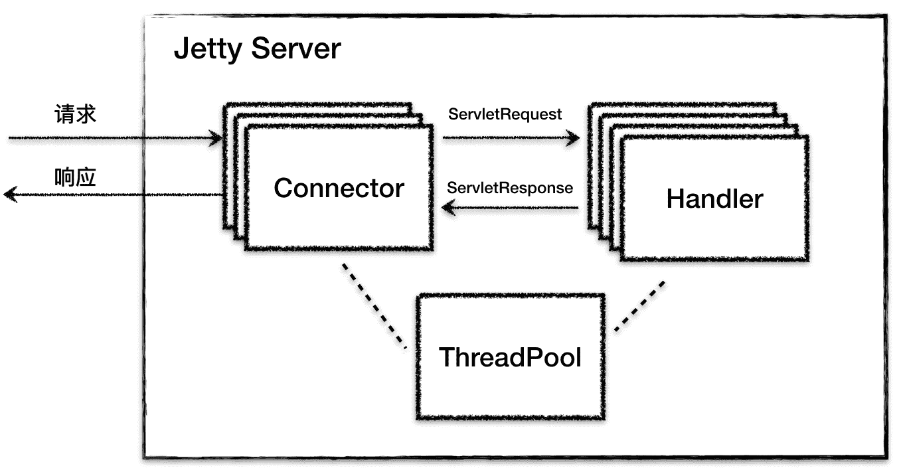
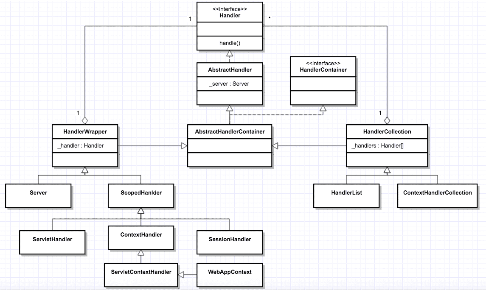
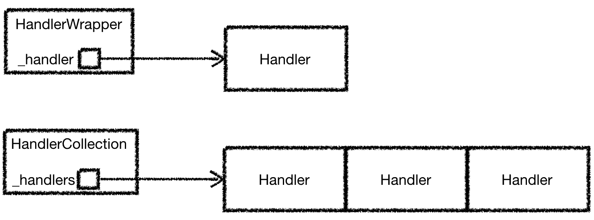
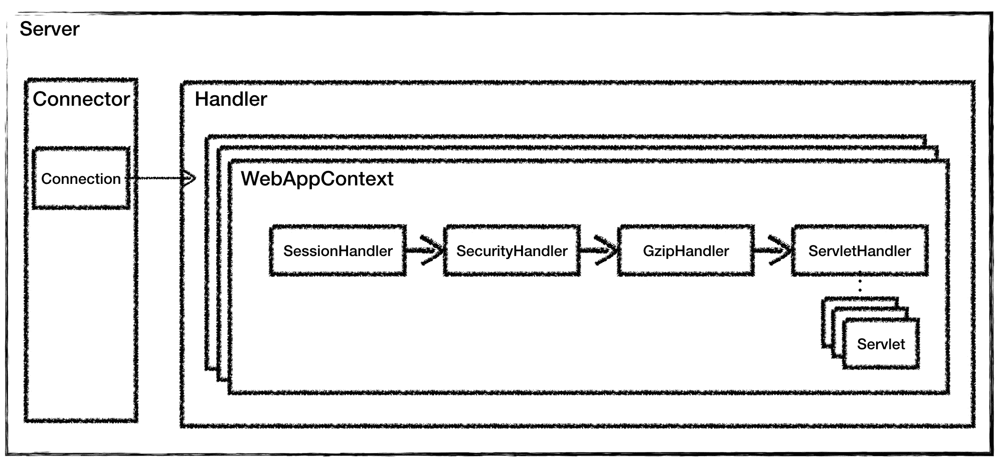
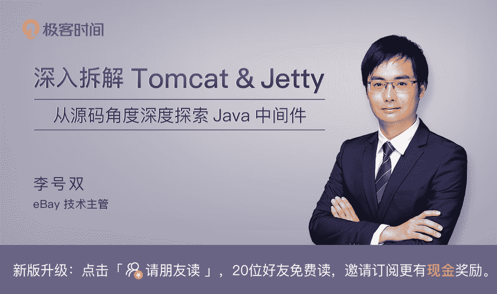

# 10 | 比较：Jetty架构特点之Handler组件

 

在专栏上一期，我们学习了 Jetty 的整体架构。先来回顾一下，Jetty 就是由多个 Connector（连接器）、多个 Handler（处理器），以及一个线程池组成，整体结构图如下。



上一期我们分析了 Jetty Connector 组件的设计，Connector 会将 Servlet 请求交给 Handler 去处理，那 Handler 又是如何处理请求的呢？

Jetty 的 Handler 在设计上非常有意思，可以说是 Jetty 的灵魂，Jetty 通过 Handler 实现了高度可定制化，那具体是如何实现的呢？我们能从中学到怎样的设计方法呢？接下来，我就来聊聊这些问题。

## Handler 是什么

**Handler 就是一个接口，它有一堆实现类**，Jetty 的 Connector 组件调用这些接口来处理 Servlet 请求，我们先来看看这个接口定义成什么样子。

```
public interface Handler extends LifeCycle, Destroyable{    // 处理请求的方法    public void handle(String target, Request baseRequest, HttpServletRequest request, HttpServletResponse response)        throws IOException, ServletException;        // 每个 Handler 都关联一个 Server 组件，被 Server 管理    public void setServer(Server server);    public Server getServer();     // 销毁方法相关的资源    public void destroy();}
```

你会看到 Handler 接口的定义非常简洁，主要就是用 handle 方法用来处理请求，跟 Tomcat 容器组件的 service 方法一样，它有 ServletRequest 和 ServeletResponse 两个参数。除此之外，这个接口中还有 setServer 和 getServer 方法，因为任何一个 Handler 都需要关联一个 Server 组件，也就是说 Handler 需要被 Server 组件来管理。一般来说 Handler 会加载一些资源到内存，因此通过设置 destroy 方法来销毁。

**Handler 继承关系**

Handler 只是一个接口，完成具体功能的还是它的子类。那么 Handler 有哪些子类呢？它们的继承关系又是怎样的？这些子类是如何实现 Servlet 容器功能的呢？

Jetty 中定义了一些默认 Handler 类，并且这些 Handler 类之间的继承关系比较复杂，我们先通过一个全景图来了解一下。为了避免让你感到不适，我对类图进行了简化。



从图上你可以看到，Handler 的种类和层次关系还是比较复杂的：

Handler 接口之下有抽象类 AbstractHandler，这一点并不意外，因为有接口一般就有抽象实现类。

在 AbstractHandler 之下有 AbstractHandlerContainer，为什么需要这个类呢？这其实是个过渡，为了实现链式调用，一个 Handler 内部必然要有其他 Handler 的引用，所以这个类的名字里才有 Container，意思就是这样的 Handler 里包含了其他 Handler 的引用。

理解了上面的 AbstractHandlerContainer，我们就能理解它的两个子类了：HandlerWrapper 和 HandlerCollection。简单来说就是，HandlerWrapper 和 HandlerCollection 都是 Handler，但是这些 Handler 里还包括其他 Handler 的引用。不同的是，HandlerWrapper 只包含一个其他 Handler 的引用，而 HandlerCollection 中有一个 Handler 数组的引用。



接着来看左边的 HandlerWrapper，它有两个子类：Server 和 ScopedHandler。Server 比较好理解，它本身是 Handler 模块的入口，必然要将请求传递给其他 Handler 来处理，为了触发其他 Handler 的调用，所以它是一个 HandlerWrapper。

再看 ScopedHandler，它也是一个比较重要的 Handler，实现了“具有上下文信息”的责任链调用。为什么我要强调“具有上下文信息”呢？那是因为 Servlet 规范规定 Servlet 在执行过程中是有上下文的。那么这些 Handler 在执行过程中如何访问这个上下文呢？这个上下文又存在什么地方呢？答案就是通过 ScopedHandler 来实现的。

而 ScopedHandler 有一堆的子类，这些子类就是用来实现 Servlet 规范的，比如 ServletHandler、ContextHandler、SessionHandler、ServletContextHandler 和 WebAppContext。接下来我会详细介绍它们，但我们先把总体类图看完。

请看类图的右边，跟 HandlerWapper 对等的还有 HandlerCollection，HandlerCollection 其实维护了一个 Handler 数组。你可能会问，为什么要发明一个这样的 Handler？这是因为 Jetty 可能需要同时支持多个 Web 应用，如果每个 Web 应用有一个 Handler 入口，那么多个 Web 应用的 Handler 就成了一个数组，比如 Server 中就有一个 HandlerCollection，Server 会根据用户请求的 URL 从数组中选取相应的 Handler 来处理，就是选择特定的 Web 应用来处理请求。

**Handler 的类型**

虽然从类图上看 Handler 有很多，但是本质上这些 Handler 分成三种类型：

 
- 第一种是**协调 Handler**，这种 Handler 负责将请求路由到一组 Handler 中去，比如上图中的 HandlerCollection，它内部持有一个 Handler 数组，当请求到来时，它负责将请求转发到数组中的某一个 Handler。 
- 第二种是**过滤器 Handler**，这种 Handler 自己会处理请求，处理完了后再把请求转发到下一个 Handler，比如图上的 HandlerWrapper，它内部持有下一个 Handler 的引用。需要注意的是，所有继承了 HandlerWrapper 的 Handler 都具有了过滤器 Handler 的特征，比如 ContextHandler、SessionHandler 和 WebAppContext 等。 
- 第三种是**内容 Handler**，说白了就是这些 Handler 会真正调用 Servlet 来处理请求，生成响应的内容，比如 ServletHandler。如果浏览器请求的是一个静态资源，也有相应的 ResourceHandler 来处理这个请求，返回静态页面。 

## 如何实现 Servlet 规范

上文提到，ServletHandler、ContextHandler 以及 WebAppContext 等，它们实现了 Servlet 规范，那具体是怎么实现的呢？为了帮助你理解，在这之前，我们还是来看看如何使用 Jetty 来启动一个 Web 应用。

```
// 新建一个 WebAppContext，WebAppContext 是一个 HandlerWebAppContext webapp = new WebAppContext();webapp.setContextPath("/mywebapp");webapp.setWar("mywebapp.war"); // 将 Handler 添加到 Server 中去server.setHandler(webapp); // 启动 Serverserver.start();server.join();
```

上面的过程主要分为两步：

第一步创建一个 WebAppContext，接着设置一些参数到这个 Handler 中，就是告诉 WebAppContext 你的 WAR 包放在哪，Web 应用的访问路径是什么。

第二步就是把新创建的 WebAppContext 添加到 Server 中，然后启动 Server。

WebAppContext 对应一个 Web 应用。我们回忆一下 Servlet 规范中有 Context、Servlet、Filter、Listener 和 Session 等，Jetty 要支持 Servlet 规范，就需要有相应的 Handler 来分别实现这些功能。因此，Jetty 设计了 3 个组件：ContextHandler、ServletHandler 和 SessionHandler 来实现 Servle 规范中规定的功能，而**WebAppContext 本身就是一个 ContextHandler**，另外它还负责管理 ServletHandler 和 SessionHandler。

我们再来看一下什么是 ContextHandler。ContextHandler 会创建并初始化 Servlet 规范里的 ServletContext 对象，同时 ContextHandler 还包含了一组能够让你的 Web 应用运行起来的 Handler，可以这样理解，Context 本身也是一种 Handler，它里面包含了其他的 Handler，这些 Handler 能处理某个特定 URL 下的请求。比如，ContextHandler 包含了一个或者多个 ServletHandler。

再来看 ServletHandler，它实现了 Servlet 规范中的 Servlet、Filter 和 Listener 的功能。ServletHandler 依赖 FilterHolder、ServletHolder、ServletMapping、FilterMapping 这四大组件。FilterHolder 和 ServletHolder 分别是 Filter 和 Servlet 的包装类，每一个 Servlet 与路径的映射会被封装成 ServletMapping，而 Filter 与拦截 URL 的映射会被封装成 FilterMapping。

SessionHandler 从名字就知道它的功能，用来管理 Session。除此之外 WebAppContext 还有一些通用功能的 Handler，比如 SecurityHandler 和 GzipHandler，同样从名字可以知道这些 Handler 的功能分别是安全控制和压缩 / 解压缩。

WebAppContext 会将这些 Handler 构建成一个执行链，通过这个链会最终调用到我们的业务 Servlet。我们通过一张图来理解一下。



通过对比 Tomcat 的架构图，你可以看到，Jetty 的 Handler 组件和 Tomcat 中的容器组件是大致是对等的概念，Jetty 中的 WebAppContext 相当于 Tomcat 的 Context 组件，都是对应一个 Web 应用；而 Jetty 中的 ServletHandler 对应 Tomcat 中的 Wrapper 组件，它负责初始化和调用 Servlet，并实现了 Filter 的功能。

对于一些通用组件，比如安全和解压缩，在 Jetty 中都被做成了 Handler，这是 Jetty Handler 架构的特点。

因此对于 Jetty 来说，请求处理模块就被抽象成 Handler，不管是实现了 Servlet 规范的 Handler，还是实现通用功能的 Handler，比如安全、解压缩等，我们可以任意添加或者裁剪这些“功能模块”，从而实现高度的可定制化。

## 本期精华

Jetty Server 就是由多个 Connector、多个 Handler，以及一个线程池组成。

Jetty 的 Handler 设计是它的一大特色，Jetty 本质就是一个 Handler 管理器，Jetty 本身就提供了一些默认 Handler 来实现 Servlet 容器的功能，你也可以定义自己的 Handler 来添加到 Jetty 中，这体现了“**微内核 + 插件**”的设计思想。

## 课后思考

通过今天的学习，我们知道各种 Handler 都会对请求做一些处理，再将请求传给下一个 Handler，而 Servlet 也是用来处理请求的，那 Handler 跟 Servlet 有什么区别呢？

不知道今天的内容你消化得如何？如果还有疑问，请大胆的在留言区提问，也欢迎你把你的课后思考和心得记录下来，与我和其他同学一起讨论。如果你觉得今天有所收获，欢迎你把它分享给你的朋友。


