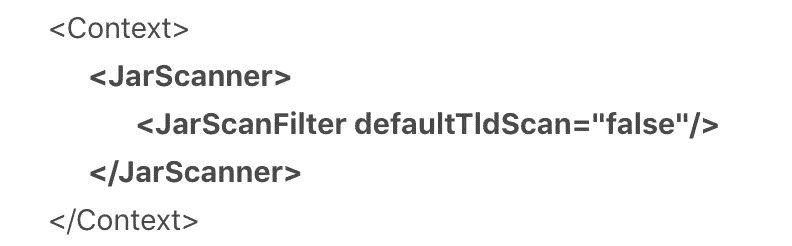
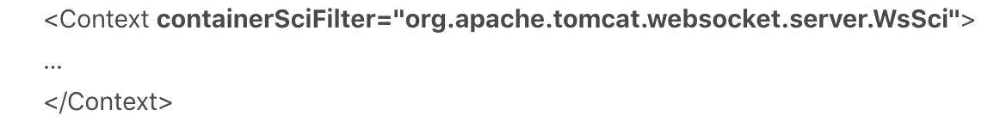
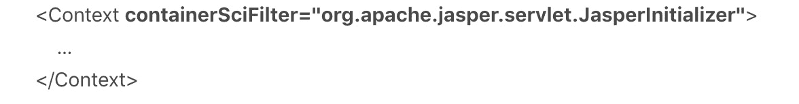
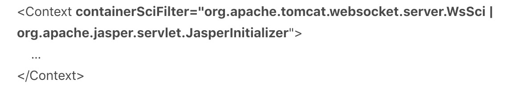
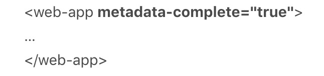
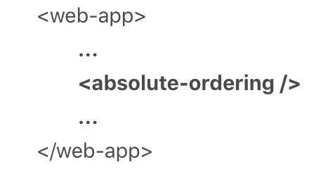
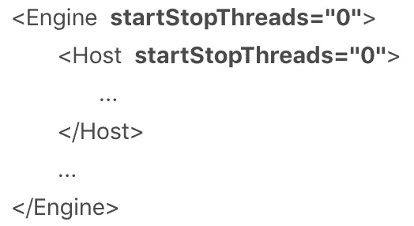

# 12 | 实战：优化并提高Tomcat启动速度

 

到目前为止，我们学习了 Tomcat 和 Jetty 的整体架构，还知道了 Tomcat 是如何启动起来的，今天我们来聊一个比较轻松的话题：如何优化并提高 Tomcat 的启动速度。

我们在使用 Tomcat 时可能会碰到启动比较慢的问题，比如我们的系统发布新版本上线时，可能需要重启服务，这个时候我们希望 Tomcat 能快速启动起来提供服务。其实关于如何让 Tomcat 启动变快，官方网站有专门的[文章](https://wiki.apache.org/tomcat/HowTo/FasterStartUp)来介绍这个话题。下面我也针对 Tomcat 8.5 和 9.0 版本，给出几条非常明确的建议，可以现学现用。

## 清理你的 Tomcat

**1. 清理不必要的 Web 应用**

首先我们要做的是删除掉 webapps 文件夹下不需要的工程，一般是 host-manager、example、doc 等这些默认的工程，可能还有以前添加的但现在用不着的工程，最好把这些全都删除掉。如果你看过 Tomcat 的启动日志，可以发现每次启动 Tomcat，都会重新布署这些工程。

**2. 清理 XML 配置文件**

我们知道 Tomcat 在启动的时候会解析所有的 XML 配置文件，但 XML 解析的代价可不小，因此我们要尽量保持配置文件的简洁，需要解析的东西越少，速度自然就会越快。

**3. 清理 JAR 文件**

我们还可以删除所有不需要的 JAR 文件。JVM 的类加载器在加载类时，需要查找每一个 JAR 文件，去找到所需要的类。如果删除了不需要的 JAR 文件，查找的速度就会快一些。这里请注意：**Web 应用中的 lib 目录下不应该出现 Servlet API 或者 Tomcat 自身的 JAR**，这些 JAR 由 Tomcat 负责提供。如果你是使用 Maven 来构建你的应用，对 Servlet API 的依赖应该指定为`<scope>provided</scope>`。

**4. 清理其他文件**

及时清理日志，删除 logs 文件夹下不需要的日志文件。同样还有 work 文件夹下的 catalina 文件夹，它其实是 Tomcat 把 JSP 转换为 Class 文件的工作目录。有时候我们也许会遇到修改了代码，重启了 Tomcat，但是仍没效果，这时候便可以删除掉这个文件夹，Tomcat 下次启动的时候会重新生成。

## 禁止 Tomcat TLD 扫描

Tomcat 为了支持 JSP，在应用启动的时候会扫描 JAR 包里面的 TLD 文件，加载里面定义的标签库，所以在 Tomcat 的启动日志里，你可能会碰到这种提示：

>  
> At least one JAR was scanned for TLDs yet contained no TLDs. Enable debug logging for this logger for a complete list of JARs that were scanned but no TLDs were found in them. Skipping unneeded JARs during scanning can improve startup time and JSP compilation time.
 

Tomcat 的意思是，我扫描了你 Web 应用下的 JAR 包，发现 JAR 包里没有 TLD 文件。我建议配置一下 Tomcat 不要去扫描这些 JAR 包，这样可以提高 Tomcat 的启动速度，并节省 JSP 编译时间。

那如何配置不去扫描这些 JAR 包呢，这里分两种情况：

 
- 如果你的项目没有使用 JSP 作为 Web 页面模板，而是使用 Velocity 之类的模板引擎，你完全可以把 TLD 扫描禁止掉。方法是，找到 Tomcat 的`conf/`目录下的`context.xml`文件，在这个文件里 Context 标签下，加上**JarScanner**和**JarScanFilter**子标签，像下面这样。 



 
- 如果你的项目使用了 JSP 作为 Web 页面模块，意味着 TLD 扫描无法避免，但是我们可以通过配置来告诉 Tomcat，只扫描那些包含 TLD 文件的 JAR 包。方法是，找到 Tomcat 的`conf/`目录下的`catalina.properties`文件，在这个文件里的 jarsToSkip 配置项中，加上你的 JAR 包。 

```
tomcat.util.scan.StandardJarScanFilter.jarsToSkip=xxx.jar
```

## 关闭 WebSocket 支持

Tomcat 会扫描 WebSocket 注解的 API 实现，比如`@ServerEndpoint`注解的类。我们知道，注解扫描一般是比较慢的，如果不需要使用 WebSockets 就可以关闭它。具体方法是，找到 Tomcat 的`conf/`目录下的`context.xml`文件，给 Context 标签加一个**containerSciFilter**的属性，像下面这样。



更进一步，如果你不需要 WebSockets 这个功能，你可以把 Tomcat lib 目录下的`websocket-api.jar`和`tomcat-websocket.jar`这两个 JAR 文件删除掉，进一步提高性能。

## 关闭 JSP 支持

跟关闭 WebSocket 一样，如果你不需要使用 JSP，可以通过类似方法关闭 JSP 功能，像下面这样。



我们发现关闭 JSP 用的也是**containerSciFilter**属性，如果你想把 WebSocket 和 JSP 都关闭，那就这样配置：



## 禁止 Servlet 注解扫描

Servlet 3.0 引入了注解 Servlet，Tomcat 为了支持这个特性，会在 Web 应用启动时扫描你的类文件，因此如果你没有使用 Servlet 注解这个功能，可以告诉 Tomcat 不要去扫描 Servlet 注解。具体配置方法是，在你的 Web 应用的`web.xml`文件中，设置`<web-app>`元素的属性`metadata-complete="true"`，像下面这样。



`metadata-complete`的意思是，`web.xml`里配置的 Servlet 是完整的，不需要再去库类中找 Servlet 的定义。

## 配置 Web-Fragment 扫描

Servlet 3.0 还引入了“Web 模块部署描述符片段”的`web-fragment.xml`，这是一个部署描述文件，可以完成`web.xml`的配置功能。而这个`web-fragment.xml`文件必须存放在 JAR 文件的`META-INF`目录下，而 JAR 包通常放在`WEB-INF/lib`目录下，因此 Tomcat 需要对 JAR 文件进行扫描才能支持这个功能。

你可以通过配置`web.xml`里面的`<absolute-ordering>`元素直接指定了哪些 JAR 包需要扫描`web fragment`，如果`<absolute-ordering/>`元素是空的， 则表示不需要扫描，像下面这样。



## 随机数熵源优化

这是一个比较有名的问题。Tomcat 7 以上的版本依赖 Java 的 SecureRandom 类来生成随机数，比如 Session ID。而 JVM 默认使用阻塞式熵源（`/dev/random`）， 在某些情况下就会导致 Tomcat 启动变慢。当阻塞时间较长时， 你会看到这样一条警告日志：

>  
> `<DATE>` org.apache.catalina.util.SessionIdGenerator createSecureRandom  
 INFO: Creation of SecureRandom instance for session ID generation using [SHA1PRNG] took [8152] milliseconds.
 

这其中的原理我就不展开了，你可以阅读[资料](https://stackoverflow.com/questions/28201794/slow-startup-on-tomcat-7-0-57-because-of-securerandom)获得更多信息。解决方案是通过设置，让 JVM 使用非阻塞式的熵源。

我们可以设置 JVM 的参数：

```
 -Djava.security.egd=file:/dev/./urandom
```

或者是设置`java.security`文件，位于`$JAVA_HOME/jre/lib/security`目录之下： `securerandom.source=file:/dev/./urandom`

这里请你注意，`/dev/./urandom`中间有个`./`的原因是 Oracle JRE 中的 Bug，Java 8 里面的 SecureRandom 类已经修正这个 Bug。 阻塞式的熵源（`/dev/random`）安全性较高， 非阻塞式的熵源（`/dev/./urandom`）安全性会低一些，因为如果你对随机数的要求比较高， 可以考虑使用硬件方式生成熵源。

## 并行启动多个 Web 应用

Tomcat 启动的时候，默认情况下 Web 应用都是一个一个启动的，等所有 Web 应用全部启动完成，Tomcat 才算启动完毕。如果在一个 Tomcat 下你有多个 Web 应用，为了优化启动速度，你可以配置多个应用程序并行启动，可以通过修改`server.xml`中 Host 元素的 startStopThreads 属性来完成。startStopThreads 的值表示你想用多少个线程来启动你的 Web 应用，如果设成 0 表示你要并行启动 Web 应用，像下面这样的配置。



这里需要注意的是，Engine 元素里也配置了这个参数，这意味着如果你的 Tomcat 配置了多个 Host（虚拟主机），Tomcat 会以并行的方式启动多个 Host。

## 本期精华

今天我讲了不少提高优化 Tomcat 启动速度的小贴士，现在你就可以把它们用在项目中了。不管是在开发环境还是生产环境，你都可以打开 Tomcat 的启动日志，看看目前你们的应用启动需要多长时间，然后尝试去调优，再看看 Tomcat 的启动速度快了多少。

如果你是用嵌入式的方式运行 Tomcat，比如 Spring Boot，你也可以通过 Spring Boot 的方式去修改 Tomcat 的参数，调优的原理都是一样的。

## 课后思考

在 Tomcat 启动速度优化上，你都遇到了哪些问题，或者你还有自己的“独门秘籍”，欢迎把它们分享给我和其他同学。

不知道今天的内容你消化得如何？如果还有疑问，请大胆的在留言区提问，也欢迎你把你的课后思考和心得记录下来，与我和其他同学一起讨论。如果你觉得今天有所收获，欢迎你把它分享给你的朋友。


