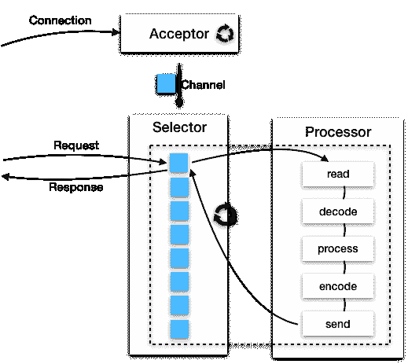
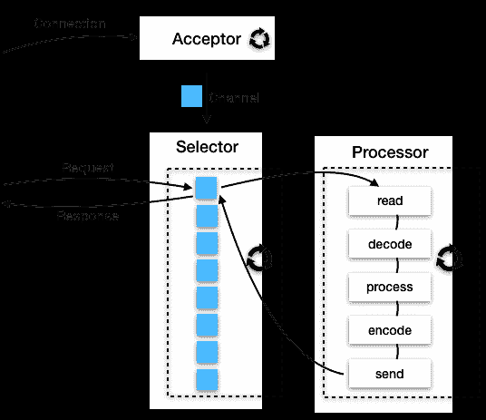
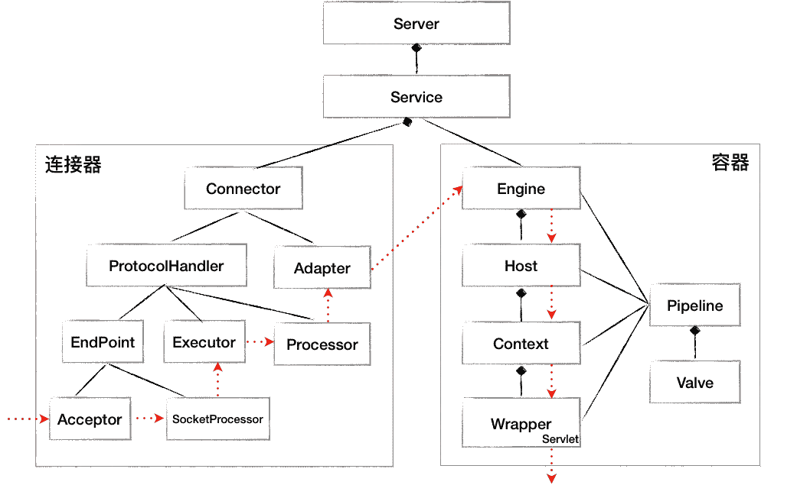

# 13 | 热点问题答疑（1）：如何学习源码？

 

不知道你有没有留意到，不少高端开发岗位在招聘要求里往往会写这么一条：研究过框架和中间件源码的优先考虑。这是因为一切秘密都藏在源码之中，阅读源码会让我们对框架或者中间件的理解更加深刻。有时候即使你阅读了大量原理性的文档，但如果不看源码，可能仍然会觉得还没有理解透。另外如果你能深入源码，招聘者从侧面也能感觉到你的学习热情和探索精神。

今天我们就来聊聊源码学习这个话题。对于 Java 后端开发来说，有不少经典的开源框架和中间件，下面我帮你按照后端的分层架构整理出来供你参考。

 
- **服务接入层**：反向代理 Nginx；API 网关 Node.js。 
- **业务逻辑层**：Web 容器 Tomcat、Jetty；应用层框架 Spring、Spring MVC 和 Spring Boot；ORM 框架 MyBatis； 
- **数据缓存层**：内存数据库 Redis；消息中间件 Kafka。 
- **数据存储层**：关系型数据库 MySQL；非关系型数据库 MongoDB；文件存储 HDFS；搜索分析引擎 Elasticsearch。 

这其中每一层都要支持水平扩展和高可用，比如业务层普遍采用微服务架构，微服务之间需要互相调用，于是就出现了 RPC 框架：Spring Cloud 和 Dubbo。

除此之外，还有两个非常重要的基础组件：Netty 和 Zookeeper，其中 Netty 用于网络通信，Zookeeper 用于分布式协调。其实很多中间件都用到了这两个基础组件，并且 Zookeeper 的网络通信模块也是通过 Netty 来实现的。

而这些框架或者中间件并不是凭空产生的，它们是在互联网的演化过程中，为了解决各种具体业务的痛点，一点一点积累进化而来的。很多时候我们把这些“零件”按照成熟的模式组装在一起，就能搭建出一个互联网后台系统。一般来说大厂都会对这些框架或者中间件进行改造，或者完全靠自己来实现。这就对后台程序员提出了更高的要求。

那这么多中间件和框架，从哪里入手呢？先学哪个后学哪个呢？我觉得可以先学一些你熟悉的，或者相对来说比较简单的，树立起信心后再学复杂的。比如可以先学 Tomcat、Jetty 和 Spring 核心容器，弄懂了这些以后再扩展到 Spring 的其他组件。

在这个过程中，我们就会积累一些通用的技术，比如网络编程、多线程、反射和类加载技术等，这些通用的技术在不少中间件和框架中会用到。

先说**网络通信**，在分布式环境下，信息要在各个实体之间流动，到处都是网络通信的场景，比如浏览器要将 HTTP 请求发给 Web 容器，一个微服务要调用另一个微服务，Web 应用读写缓存服务器、消息队列或者数据库等，都需要网络通信。

尽管网络通信的场景很多，但无外乎都要考虑这么几个问题：

 
- I/O 模型同步还是异步，是阻塞还是非阻塞？ 
- 通信协议是二进制（gRPC）还是文本（HTTP）？ 
- 数据怎么序列化，是 JSON 还是 Protocol Buffer？ 

此外服务端的线程模型也是一个重点。我们知道多线程可以把要做的事情并行化，提高并发度和吞吐量，但是线程可能会阻塞，一旦阻塞线程资源就闲置了，并且会有线程上下文切换的开销，浪费 CPU 资源。而有些任务执行会发生阻塞，有些则不会阻塞，因此线程模型就是要决定哪几件事情放到一个线程来做，哪几件事情放到另一个线程来做，并设置合理的线程数量，目的就是要让 CPU 忙起来，并且不是白忙活，也就是不做无用功。

我们知道服务端处理一个网络连接的过程是：

accept、select、read、decode、process、encode、send。

一般来说服务端程序有几个角色：Acceptor、Selector 和 Processor。

 
- Acceptor 负责接收新连接，也就是 accept； 
- Selector 负责检测连接上的 I/O 事件，也就是 select； 
- Processor 负责数据读写、编解码和业务处理，也就是 read、decode、process、encode、send。 

Acceptor 在接收连接时，可能会阻塞，为了不耽误其他工作，一般跑在单独的线程里；而 Selector 在侦测 I/O 事件时也可能阻塞，但是它一次可以检测多个 Channel（连接），其实就是用阻塞它一个来换取大量业务线程的不阻塞，那 Selector 检测 I/O 事件到了，是用同一个线程来执行 Processor，还是另一个线程来执行呢？不同的场景又有相应的策略。

比如 Netty 通过 EventLoop 将 Selector 和 Processor 跑在同一个线程。一个 EventLoop 绑定了一个线程，并且持有一个 Selector。而 Processor 的处理过程被封装成一个个任务，一个 EventLoop 负责处理多个 Channel 上的所有任务，而一个 Channel 只能由一个 EventLoop 来处理，这就保证了任务执行的线程安全，并且用同一个线程来侦测 I/O 事件和读写数据，可以充分利用 CPU 缓存。我们通过一张图来理解一下：

请你注意，这要求 Processor 中的任务能在短时间完成，否则会阻塞这个 EventLoop 上其他 Channel 的处理。因此在 Netty 中，可以设置业务处理和 I/O 处理的时间比率，超过这个比率则将任务扔到专门的业务线程池来执行，这一点跟 Jetty 的 EatWhatYouKill 线程策略有异曲同工之妙。

而 Kafka 把 Selector 和 Processor 跑在不同的线程里，因为 Kafka 的业务逻辑大多涉及与磁盘读写，处理时间不确定，所以 Kafka 有专门的业务处理线程池来运行 Processor。与此类似，Tomcat 也采用了这样的策略，同样我们还是通过一张图来理解一下。

我们再来看看**Java 反射机制**，几乎所有的框架都用到了反射和类加载技术，这是为了保证框架的通用性，需要根据配置文件在运行时加载不同的类，并调用其方法。比如 Web 容器 Tomcat 和 Jetty，通过反射来加载 Servlet、Filter 和 Listener；而 Spring 的两大核心功能 IOC 和 AOP，都用到了反射技术；再比如 MyBatis 将数据从数据库读出后，也是通过反射机制来创建 Java 对象并设置对象的值。

因此你会发现，通过学习一个中间件，熟悉了这些通用的技术以后，再学习其他的中间件或者框架就容易多了。比如学透了 Tomcat 的 I/O 线程模型以及高并发高性能设计思路，再学 Netty 的源码就轻车熟路了；Tomcat 的组件化设计和类加载机制理解透彻了，再学 Spring 容器的源码就会轻松很多。

接下来我再来聊聊具体如何学习源码，有很多同学在专栏里问这个问题，我在专栏的留言中也提到过，但我觉得有必要展开详细讲讲我是如何学习源码的。

学习的第一步，首先我们要弄清楚中间件的核心功能是什么，我以专栏所讲的 Tomcat 为例。Tomcat 的核心功能是 HTTP 服务器和 Servlet 容器，因此就抓住请求处理这条线：通过什么样的方式接收连接，接收到连接后以什么样的方式来读取数据，读到数据后怎么解析数据（HTTP 协议），请求数据解析出来后怎么调用 Servlet 容器，Servlet 容器又怎么调到 Spring 中的业务代码。

为了完成这些功能，Tomcat 中有一些起骨架作用的核心类，其他类都是在这个骨架上进行扩展或补充细节来实现。因此在学习前期就要紧紧抓住这些类，先不要深入到其他细节，你可以先画出一张骨架类图。

在此之后，我们还需要将源码跑起来，打打断点，看看变量的值和调用栈。我建议用内嵌式的方式来启动和调试 Tomcat，体会一下 Spring Boot 是如何使用 Tomcat 的，这里有[示例源码](https://github.com/heroku/devcenter-embedded-tomcat)。在源码阅读过程中要充分利用 IDE 的功能，比如通过快捷键查找某个接口的所有实现类、查找某个类或者函数在哪些地方被用到。

我们还要带着问题去学习源码，比如你想弄清楚 Tomcat 如何启停、类加载器是如何设计的、Spring Boot 是如何启动 Tomcat 的、Jetty 是如何通过 Handler 链实现高度定制化的，如果要你来设计这些功能会怎么做呢？带着这些问题去分析相关的源码效率会更高，同时你在寻找答案的过程中，也会碰到更多问题，等你把这些问题都弄清楚了，你获得的不仅仅是知识，更重要的是你会树立起攻克难关的信心。同时我还建议，在你弄清楚一些细节后要及时记录下来，画画流程图或者类图，再加上一些关键备注以防遗忘。

当然在这个过程中，你还可以看看产品的官方文档，熟悉一下大概的设计思路。在遇到难题时，你还可以看看网上的博客，参考一下别人的分析。但最终还是需要你自己去实践和摸索，因为网上的分析也不一定对，只有你自己看了源码后才能真正理解它，印象才更加深刻。

今天说了这么多，就是想告诉你如果理解透彻一两个中间件，有了一定的积累，这时再来学一个新的系统，往往你只需要瞧上几眼，就能明白它所用的架构，而且你会自然联想到系统存在哪些角色，以及角色之间的关系，包括静态的依赖关系和动态的协作关系，甚至你会不由自主带着审视的眼光，来发现一些可以改进的地方。如果你现在就是这样的状态，那么恭喜你，你的技术水平已经成长到一个新的层面了。

不知道今天的内容你消化得如何？如果还有疑问，请大胆的在留言区提问，也欢迎你把你的课后思考和心得记录下来，与我和其他同学一起讨论。如果你觉得今天有所收获，欢迎你把它分享给你的朋友。

