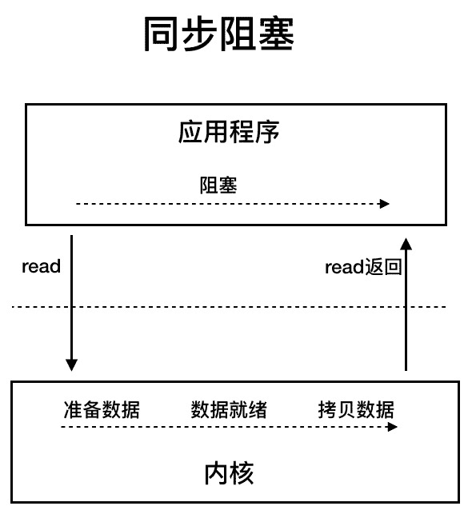
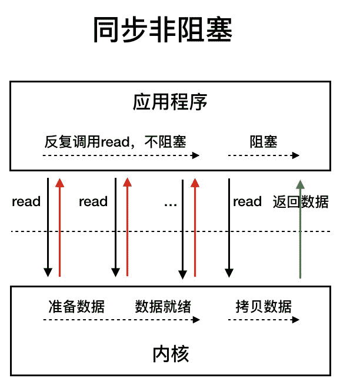
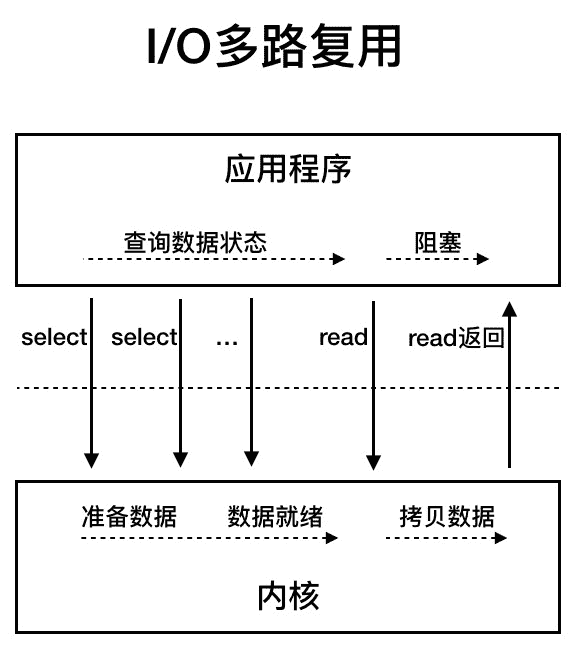
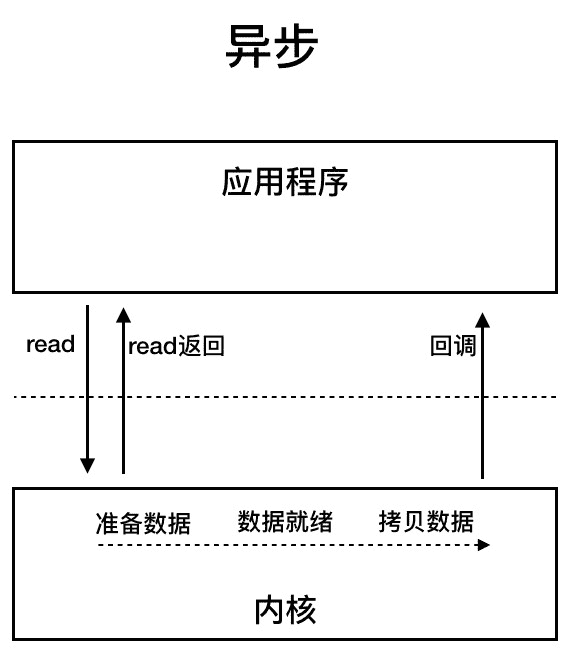
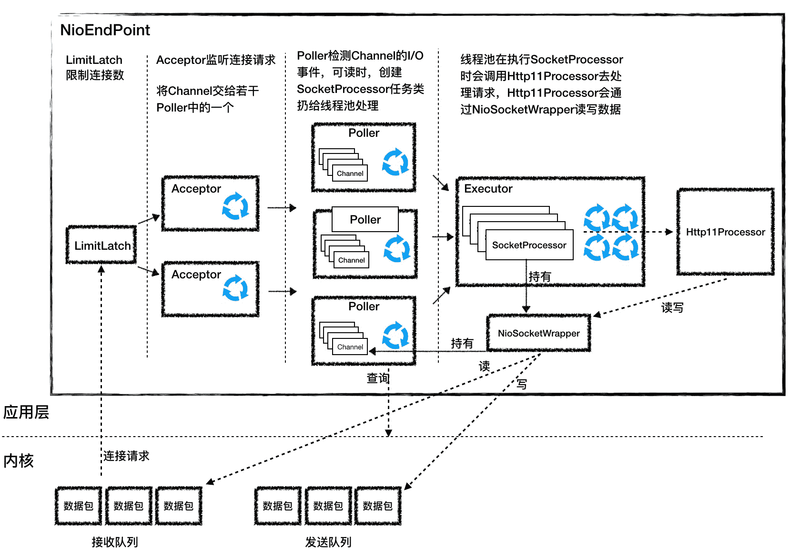

# 14 | NioEndpoint组件：Tomcat如何实现非阻塞I/O？

 

UNIX 系统下的 I/O 模型有 5 种：同步阻塞 I/O、同步非阻塞 I/O、I/O 多路复用、信号驱动 I/O 和异步 I/O。这些名词我们好像都似曾相识，但这些 I/O 通信模型有什么区别？同步和阻塞似乎是一回事，到底有什么不同？等一下，在这之前你是不是应该问自己一个终极问题：什么是 I/O？为什么需要这些 I/O 模型？

所谓的**I/O 就是计算机内存与外部设备之间拷贝数据的过程**。我们知道 CPU 访问内存的速度远远高于外部设备，因此 CPU 是先把外部设备的数据读到内存里，然后再进行处理。请考虑一下这个场景，当你的程序通过 CPU 向外部设备发出一个读指令时，数据从外部设备拷贝到内存往往需要一段时间，这个时候 CPU 没事干了，你的程序是主动把 CPU 让给别人？还是让 CPU 不停地查：数据到了吗，数据到了吗……

这就是 I/O 模型要解决的问题。今天我会先说说各种 I/O 模型的区别，然后重点分析 Tomcat 的 NioEndpoint 组件是如何实现非阻塞 I/O 模型的。

## Java I/O 模型

对于一个网络 I/O 通信过程，比如网络数据读取，会涉及两个对象，一个是调用这个 I/O 操作的用户线程，另外一个就是操作系统内核。一个进程的地址空间分为用户空间和内核空间，用户线程不能直接访问内核空间。

当用户线程发起 I/O 操作后，网络数据读取操作会经历两个步骤：

 
- **用户线程等待内核将数据从网卡拷贝到内核空间。** 
- **内核将数据从内核空间拷贝到用户空间。** 

各种 I/O 模型的区别就是：它们实现这两个步骤的方式是不一样的。

**同步阻塞 I/O**：用户线程发起 read 调用后就阻塞了，让出 CPU。内核等待网卡数据到来，把数据从网卡拷贝到内核空间，接着把数据拷贝到用户空间，再把用户线程叫醒。



**同步非阻塞 I/O**：用户线程不断的发起 read 调用，数据没到内核空间时，每次都返回失败，直到数据到了内核空间，这一次 read 调用后，在等待数据从内核空间拷贝到用户空间这段时间里，线程还是阻塞的，等数据到了用户空间再把线程叫醒。



**I/O 多路复用**：用户线程的读取操作分成两步了，线程先发起 select 调用，目的是问内核数据准备好了吗？等内核把数据准备好了，用户线程再发起 read 调用。在等待数据从内核空间拷贝到用户空间这段时间里，线程还是阻塞的。那为什么叫 I/O 多路复用呢？因为一次 select 调用可以向内核查多个数据通道（Channel）的状态，所以叫多路复用。



**异步 I/O**：用户线程发起 read 调用的同时注册一个回调函数，read 立即返回，等内核将数据准备好后，再调用指定的回调函数完成处理。在这个过程中，用户线程一直没有阻塞。



## NioEndpoint 组件

Tomcat 的 NioEndPoint 组件实现了 I/O 多路复用模型，接下来我会介绍 NioEndpoint 的实现原理，下一期我会介绍 Tomcat 如何实现异步 I/O 模型。

**总体工作流程**

我们知道，对于 Java 的多路复用器的使用，无非是两步：

1. 创建一个 Seletor，在它身上注册各种感兴趣的事件，然后调用 select 方法，等待感兴趣的事情发生。

2. 感兴趣的事情发生了，比如可以读了，这时便创建一个新的线程从 Channel 中读数据。

Tomcat 的 NioEndpoint 组件虽然实现比较复杂，但基本原理就是上面两步。我们先来看看它有哪些组件，它一共包含 LimitLatch、Acceptor、Poller、SocketProcessor 和 Executor 共 5 个组件，它们的工作过程如下图所示。



LimitLatch 是连接控制器，它负责控制最大连接数，NIO 模式下默认是 10000，达到这个阈值后，连接请求被拒绝。

Acceptor 跑在一个单独的线程里，它在一个死循环里调用 accept 方法来接收新连接，一旦有新的连接请求到来，accept 方法返回一个 Channel 对象，接着把 Channel 对象交给 Poller 去处理。

Poller 的本质是一个 Selector，也跑在单独线程里。Poller 在内部维护一个 Channel 数组，它在一个死循环里不断检测 Channel 的数据就绪状态，一旦有 Channel 可读，就生成一个 SocketProcessor 任务对象扔给 Executor 去处理。

Executor 就是线程池，负责运行 SocketProcessor 任务类，SocketProcessor 的 run 方法会调用 Http11Processor 来读取和解析请求数据。我们知道，Http11Processor 是应用层协议的封装，它会调用容器获得响应，再把响应通过 Channel 写出。

接下来我详细介绍一下各组件的设计特点。

**LimitLatch**

LimitLatch 用来控制连接个数，当连接数到达最大时阻塞线程，直到后续组件处理完一个连接后将连接数减 1。请你注意到达最大连接数后操作系统底层还是会接收客户端连接，但用户层已经不再接收。LimitLatch 的核心代码如下：

```
public class LimitLatch {    private class Sync extends AbstractQueuedSynchronizer {             @Override        protected int tryAcquireShared() {            long newCount = count.incrementAndGet();            if (newCount > limit) {                count.decrementAndGet();                return -1;            } else {                return 1;            }        }         @Override        protected boolean tryReleaseShared(int arg) {            count.decrementAndGet();            return true;        }    }     private final Sync sync;    private final AtomicLong count;    private volatile long limit;        // 线程调用这个方法来获得接收新连接的许可，线程可能被阻塞    public void countUpOrAwait() throws InterruptedException {      sync.acquireSharedInterruptibly(1);    }     // 调用这个方法来释放一个连接许可，那么前面阻塞的线程可能被唤醒    public long countDown() {      sync.releaseShared(0);      long result = getCount();      return result;   }}
```

从上面的代码我们看到，LimitLatch 内步定义了内部类 Sync，而 Sync 扩展了 AQS，AQS 是 Java 并发包中的一个核心类，它在内部维护一个状态和一个线程队列，可以用来**控制线程什么时候挂起，什么时候唤醒**。我们可以扩展它来实现自己的同步器，实际上 Java 并发包里的锁和条件变量等等都是通过 AQS 来实现的，而这里的 LimitLatch 也不例外。

理解上面的代码时有两个要点：

1. 用户线程通过调用 LimitLatch 的 countUpOrAwait 方法来拿到锁，如果暂时无法获取，这个线程会被阻塞到 AQS 的队列中。那 AQS 怎么知道是阻塞还是不阻塞用户线程呢？其实这是由 AQS 的使用者来决定的，也就是内部类 Sync 来决定的，因为 Sync 类重写了 AQS 的**tryAcquireShared() 方法**。它的实现逻辑是如果当前连接数 count 小于 limit，线程能获取锁，返回 1，否则返回 -1。

2. 如何用户线程被阻塞到了 AQS 的队列，那什么时候唤醒呢？同样是由 Sync 内部类决定，Sync 重写了 AQS 的**releaseShared() 方法**，其实就是当一个连接请求处理完了，这时又可以接收一个新连接了，这样前面阻塞的线程将会被唤醒。

其实你会发现 AQS 就是一个骨架抽象类，它帮我们搭了个架子，用来控制线程的阻塞和唤醒。具体什么时候阻塞、什么时候唤醒由你来决定。我们还注意到，当前线程数被定义成原子变量 AtomicLong，而 limit 变量用 volatile 关键字来修饰，这些并发编程的实际运用。

**Acceptor**

Acceptor 实现了 Runnable 接口，因此可以跑在单独线程里。一个端口号只能对应一个 ServerSocketChannel，因此这个 ServerSocketChannel 是在多个 Acceptor 线程之间共享的，它是 Endpoint 的属性，由 Endpoint 完成初始化和端口绑定。初始化过程如下：

```
serverSock = ServerSocketChannel.open();serverSock.socket().bind(addr,getAcceptCount());serverSock.configureBlocking(true);
```

从上面的初始化代码我们可以看到两个关键信息：

1.bind 方法的第二个参数表示操作系统的等待队列长度，我在上面提到，当应用层面的连接数到达最大值时，操作系统可以继续接收连接，那么操作系统能继续接收的最大连接数就是这个队列长度，可以通过 acceptCount 参数配置，默认是 100。

2.ServerSocketChannel 被设置成阻塞模式，也就是说它是以阻塞的方式接收连接的。

ServerSocketChannel 通过 accept() 接受新的连接，accept() 方法返回获得 SocketChannel 对象，然后将 SocketChannel 对象封装在一个 PollerEvent 对象中，并将 PollerEvent 对象压入 Poller 的 Queue 里，这是个典型的生产者 - 消费者模式，Acceptor 与 Poller 线程之间通过 Queue 通信。

**Poller**

Poller 本质是一个 Selector，它内部维护一个 Queue，这个 Queue 定义如下：

```
private final SynchronizedQueue<PollerEvent> events = new SynchronizedQueue<>();
```

SynchronizedQueue 的方法比如 offer、poll、size 和 clear 方法，都使用了 Synchronized 关键字进行修饰，用来保证同一时刻只有一个 Acceptor 线程对 Queue 进行读写。同时有多个 Poller 线程在运行，每个 Poller 线程都有自己的 Queue。每个 Poller 线程可能同时被多个 Acceptor 线程调用来注册 PollerEvent。同样 Poller 的个数可以通过 pollers 参数配置。

Poller 不断的通过内部的 Selector 对象向内核查询 Channel 的状态，一旦可读就生成任务类 SocketProcessor 交给 Executor 去处理。Poller 的另一个重要任务是循环遍历检查自己所管理的 SocketChannel 是否已经超时，如果有超时就关闭这个 SocketChannel。

**SocketProcessor**

我们知道，Poller 会创建 SocketProcessor 任务类交给线程池处理，而 SocketProcessor 实现了 Runnable 接口，用来定义 Executor 中线程所执行的任务，主要就是调用 Http11Processor 组件来处理请求。Http11Processor 读取 Channel 的数据来生成 ServletRequest 对象，这里请你注意：

Http11Processor 并不是直接读取 Channel 的。这是因为 Tomcat 支持同步非阻塞 I/O 模型和异步 I/O 模型，在 Java API 中，相应的 Channel 类也是不一样的，比如有 AsynchronousSocketChannel 和 SocketChannel，为了对 Http11Processor 屏蔽这些差异，Tomcat 设计了一个包装类叫作 SocketWrapper，Http11Processor 只调用 SocketWrapper 的方法去读写数据。

**Executor**

Executor 是 Tomcat 定制版的线程池，它负责创建真正干活的工作线程，干什么活呢？就是执行 SocketProcessor 的 run 方法，也就是解析请求并通过容器来处理请求，最终会调用到我们的 Servlet。后面我会用专门的篇幅介绍 Tomcat 怎么扩展和使用 Java 原生的线程池。

## 高并发思路

在弄清楚 NioEndpoint 的实现原理后，我们来考虑一个重要的问题，怎么把这个过程做到高并发呢？

高并发就是能快速地处理大量的请求，需要合理设计线程模型让 CPU 忙起来，尽量不要让线程阻塞，因为一阻塞，CPU 就闲下来了。另外就是有多少任务，就用相应规模的线程数去处理。我们注意到 NioEndpoint 要完成三件事情：接收连接、检测 I/O 事件以及处理请求，那么最核心的就是把这三件事情分开，用不同规模的线程去处理，比如用专门的线程组去跑 Acceptor，并且 Acceptor 的个数可以配置；用专门的线程组去跑 Poller，Poller 的个数也可以配置；最后具体任务的执行也由专门的线程池来处理，也可以配置线程池的大小。

## 本期精华

I/O 模型是为了解决内存和外部设备速度差异的问题。我们平时说的**阻塞或非阻塞**是指应用程序在**发起 I/O 操作时，是立即返回还是等待**。而**同步和异步**，是指应用程序在与内核通信时，**数据从内核空间到应用空间的拷贝，是由内核主动发起还是由应用程序来触发。**

在 Tomcat 中，EndPoint 组件的主要工作就是处理 I/O，而 NioEndpoint 利用 Java NIO API 实现了多路复用 I/O 模型。其中关键的一点是，读写数据的线程自己不会阻塞在 I/O 等待上，而是把这个工作交给 Selector。同时 Tomcat 在这个过程中运用到了很多 Java 并发编程技术，比如 AQS、原子类、并发容器，线程池等，都值得我们去细细品味。

## 课后思考

Tomcat 的 NioEndpoint 组件的名字中有 NIO，NIO 是非阻塞的意思，似乎说的是同步非阻塞 I/O 模型，但是 NioEndpoint 又是调用 Java 的的 Selector 来实现的，我们知道 Selector 指的是 I/O 多路复用器，也就是我们说的 I/O 多路复用模型，这不是矛盾了吗？

不知道今天的内容你消化得如何？如果还有疑问，请大胆的在留言区提问，也欢迎你把你的课后思考和心得记录下来，与我和其他同学一起讨论。如果你觉得今天有所收获，欢迎你把它分享给你的朋友。


