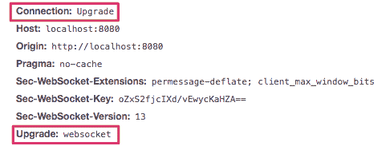
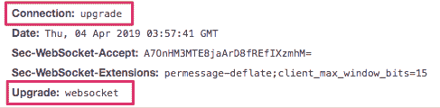
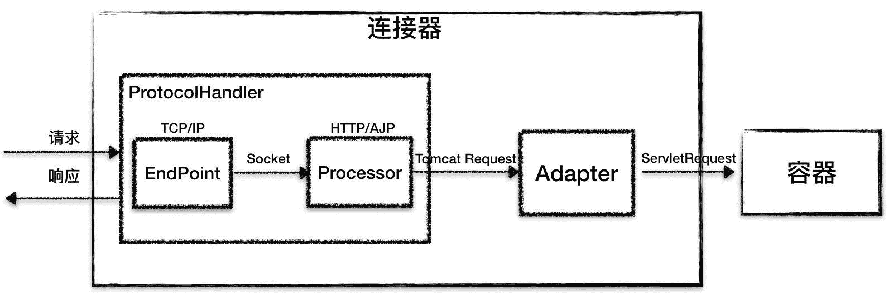
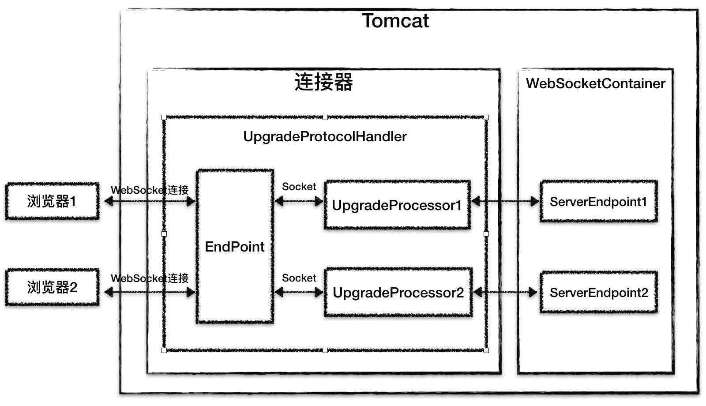

# 18 | 新特性：Tomcat如何支持WebSocket？

 

我们知道 HTTP 协议是“请求 - 响应”模式，浏览器必须先发请求给服务器，服务器才会响应这个请求。也就是说，服务器不会主动发送数据给浏览器。

对于实时性要求比较的高的应用，比如在线游戏、股票基金实时报价和在线协同编辑等，浏览器需要实时显示服务器上最新的数据，因此出现了 Ajax 和 Comet 技术。Ajax 本质上还是轮询，而 Comet 是在 HTTP 长连接的基础上做了一些 hack，但是它们的实时性不高，另外频繁的请求会给服务器带来压力，也会浪费网络流量和带宽。于是 HTML5 推出了 WebSocket 标准，使得浏览器和服务器之间任何一方都可以主动发消息给对方，这样服务器有新数据时可以主动推送给浏览器。

今天我会介绍 WebSocket 的工作原理，以及作为服务器端的 Tomcat 是如何支持 WebSocket 的。更重要的是，希望你在学完之后可以灵活地选用 WebSocket 技术来解决实际工作中的问题。

## WebSocket 工作原理

WebSocket 的名字里带有 Socket，那 Socket 是什么呢？网络上的两个程序通过一个双向链路进行通信，这个双向链路的一端称为一个 Socket。一个 Socket 对应一个 IP 地址和端口号，应用程序通常通过 Socket 向网络发出请求或者应答网络请求。Socket 不是协议，它其实是对 TCP/IP 协议层抽象出来的 API。

但 WebSocket 不是一套 API，跟 HTTP 协议一样，WebSocket 也是一个应用层协议。为了跟现有的 HTTP 协议保持兼容，它通过 HTTP 协议进行一次握手，握手之后数据就直接从 TCP 层的 Socket 传输，就与 HTTP 协议无关了。浏览器发给服务端的请求会带上跟 WebSocket 有关的请求头，比如`Connection: Upgrade`和`Upgrade: websocket`。



如果服务器支持 WebSocket，同样会在 HTTP 响应里加上 WebSocket 相关的 HTTP 头部。



这样 WebSocket 连接就建立好了，接下来 WebSocket 的数据传输会以 frame 形式传输，会将一条消息分为几个 frame，按照先后顺序传输出去。这样做的好处有：

 
- 大数据的传输可以分片传输，不用考虑数据大小的问题。 
- 和 HTTP 的 chunk 一样，可以边生成数据边传输，提高传输效率。 

## Tomcat 如何支持 WebSocket

在讲 Tomcat 如何支持 WebSocket 之前，我们先来开发一个简单的聊天室程序，需求是：用户可以通过浏览器加入聊天室、发送消息，聊天室的其他人都可以收到消息。

**WebSocket 聊天室程序**

浏览器端 JavaScript 核心代码如下：

```
var Chat = {};Chat.socket = null;Chat.connect = (function(host) {     // 判断当前浏览器是否支持 WebSocket    if ('WebSocket' in window) {        // 如果支持则创建 WebSocket JS 类        Chat.socket = new WebSocket(host);    } else if ('MozWebSocket' in window) {        Chat.socket = new MozWebSocket(host);    } else {        Console.log('WebSocket is not supported by this browser.');        return;    }     // 回调函数，当和服务器的 WebSocket 连接建立起来后，浏览器会回调这个方法    Chat.socket.onopen = function () {        Console.log('Info: WebSocket connection opened.');        document.getElementById('chat').onkeydown = function(event) {            if (event.keyCode == 13) {                Chat.sendMessage();            }        };    };     // 回调函数，当和服务器的 WebSocket 连接关闭后，浏览器会回调这个方法    Chat.socket.onclose = function () {        document.getElementById('chat').onkeydown = null;        Console.log('Info: WebSocket closed.');    };     // 回调函数，当服务器有新消息发送到浏览器，浏览器会回调这个方法    Chat.socket.onmessage = function (message) {        Console.log(message.data);    };});
```

上面的代码实现逻辑比较清晰，就是创建一个 WebSocket JavaScript 对象，然后实现了几个回调方法：onopen、onclose 和 onmessage。当连接建立、关闭和有新消息时，浏览器会负责调用这些回调方法。我们再来看服务器端 Tomcat 的实现代码：

```
//Tomcat 端的实现类加上 @ServerEndpoint 注解，里面的 value 是 URL 路径@ServerEndpoint(value = "/websocket/chat")public class ChatEndpoint {     private static final String GUEST_PREFIX = "Guest";        // 记录当前有多少个用户加入到了聊天室，它是 static 全局变量。为了多线程安全使用原子变量 AtomicInteger    private static final AtomicInteger connectionIds = new AtomicInteger(0);        // 每个用户用一个 CharAnnotation 实例来维护，请你注意它是一个全局的 static 变量，所以用到了线程安全的 CopyOnWriteArraySet    private static final Set<ChatEndpoint> connections =            new CopyOnWriteArraySet<>();     private final String nickname;    private Session session;     public ChatEndpoint() {        nickname = GUEST_PREFIX + connectionIds.getAndIncrement();    }     // 新连接到达时，Tomcat 会创建一个 Session，并回调这个函数    @OnOpen    public void start(Session session) {        this.session = session;        connections.add(this);        String message = String.format("* %s %s", nickname, "has joined.");        broadcast(message);    }    // 浏览器关闭连接时，Tomcat 会回调这个函数    @OnClose    public void end() {        connections.remove(this);        String message = String.format("* %s %s",                nickname, "has disconnected.");        broadcast(message);    }     // 浏览器发送消息到服务器时，Tomcat 会回调这个函数    @OnMessage    public void incoming(String message) {        // Never trust the client        String filteredMessage = String.format("%s: %s",                nickname, HTMLFilter.filter(message.toString()));        broadcast(filteredMessage);    }     //Websocket 连接出错时，Tomcat 会回调这个函数    @OnError    public void onError(Throwable t) throws Throwable {        log.error("Chat Error: " + t.toString(), t);    }     // 向聊天室中的每个用户广播消息    private static void broadcast(String msg) {        for (ChatAnnotation client : connections) {            try {                synchronized (client) {                    client.session.getBasicRemote().sendText(msg);                }            } catch (IOException e) {              ...            }        }    }}
```

根据 Java WebSocket 规范的规定，Java WebSocket 应用程序由一系列的 WebSocket Endpoint 组成。**Endpoint 是一个 Java 对象，代表 WebSocket 连接的一端，就好像处理 HTTP 请求的 Servlet 一样，你可以把它看作是处理 WebSocket 消息的接口**。跟 Servlet 不同的地方在于，Tomcat 会给每一个 WebSocket 连接创建一个 Endpoint 实例。你可以通过两种方式定义和实现 Endpoint。

第一种方法是编程式的，就是编写一个 Java 类继承`javax.websocket.Endpoint`，并实现它的 onOpen、onClose 和 onError 方法。这些方法跟 Endpoint 的生命周期有关，Tomcat 负责管理 Endpoint 的生命周期并调用这些方法。并且当浏览器连接到一个 Endpoint 时，Tomcat 会给这个连接创建一个唯一的 Session（`javax.websocket.Session`）。Session 在 WebSocket 连接握手成功之后创建，并在连接关闭时销毁。当触发 Endpoint 各个生命周期事件时，Tomcat 会将当前 Session 作为参数传给 Endpoint 的回调方法，因此一个 Endpoint 实例对应一个 Session，我们通过在 Session 中添加 MessageHandler 消息处理器来接收消息，MessageHandler 中定义了 onMessage 方法。**在这里 Session 的本质是对 Socket 的封装，Endpoint 通过它与浏览器通信。**

第二种定义 Endpoint 的方法是注解式的，也就是上面的聊天室程序例子中用到的方式，即实现一个业务类并给它添加 WebSocket 相关的注解。首先我们注意到`@ServerEndpoint(value = "/websocket/chat")`注解，它表明当前业务类 ChatEndpoint 是一个实现了 WebSocket 规范的 Endpoint，并且注解的 value 值表明 ChatEndpoint 映射的 URL 是`/websocket/chat`。我们还看到 ChatEndpoint 类中有`@OnOpen`、`@OnClose`、`@OnError`和在`@OnMessage`注解的方法，从名字你就知道它们的功能是什么。

对于程序员来说，其实我们只需要专注具体的 Endpoint 的实现，比如在上面聊天室的例子中，为了方便向所有人群发消息，ChatEndpoint 在内部使用了一个全局静态的集合 CopyOnWriteArraySet 来维护所有的 ChatEndpoint 实例，因为每一个 ChatEndpoint 实例对应一个 WebSocket 连接，也就是代表了一个加入聊天室的用户。**当某个 ChatEndpoint 实例收到来自浏览器的消息时，这个 ChatEndpoint 会向集合中其他 ChatEndpoint 实例背后的 WebSocket 连接推送消息。**

那么这个过程中，Tomcat 主要做了哪些事情呢？简单来说就是两件事情：**Endpoint 加载和 WebSocket 请求处理**。下面我分别来详细说说 Tomcat 是如何做这两件事情的。

**WebSocket 加载**

Tomcat 的 WebSocket 加载是通过 SCI 机制完成的。SCI 全称 ServletContainerInitializer，是 Servlet 3.0 规范中定义的用来**接收 Web 应用启动事件的接口**。那为什么要监听 Servlet 容器的启动事件呢？因为这样我们有机会在 Web 应用启动时做一些初始化工作，比如 WebSocket 需要扫描和加载 Endpoint 类。SCI 的使用也比较简单，将实现 ServletContainerInitializer 接口的类增加 HandlesTypes 注解，并且在注解内指定的一系列类和接口集合。比如 Tomcat 为了扫描和加载 Endpoint 而定义的 SCI 类如下：

```
@HandlesTypes({ServerEndpoint.class, ServerApplicationConfig.class, Endpoint.class})public class WsSci implements ServletContainerInitializer {    public void onStartup(Set<Class<?>> clazzes, ServletContext ctx) throws ServletException {  ...  }}
```

一旦定义好了 SCI，Tomcat 在启动阶段扫描类时，会将 HandlesTypes 注解中指定的类都扫描出来，作为 SCI 的 onStartup 方法的参数，并调用 SCI 的 onStartup 方法。注意到 WsSci 的 HandlesTypes 注解中定义了`ServerEndpoint.class`、`ServerApplicationConfig.class`和`Endpoint.class`，因此在 Tomcat 的启动阶段会将这些类的类实例（注意不是对象实例）传递给 WsSci 的 onStartup 方法。那么 WsSci 的 onStartup 方法又做了什么事呢？

它会构造一个 WebSocketContainer 实例，你可以把 WebSocketContainer 理解成一个专门处理 WebSocket 请求的**Endpoint 容器**。也就是说 Tomcat 会把扫描到的 Endpoint 子类和添加了注解`@ServerEndpoint`的类注册到这个容器中，并且这个容器还维护了 URL 到 Endpoint 的映射关系，这样通过请求 URL 就能找到具体的 Endpoint 来处理 WebSocket 请求。

**WebSocket 请求处理**

在讲 WebSocket 请求处理之前，我们先来回顾一下 Tomcat 连接器的组件图。



你可以看到 Tomcat 用 ProtocolHandler 组件屏蔽应用层协议的差异，其中 ProtocolHandler 中有两个关键组件：Endpoint 和 Processor。需要注意，这里的 Endpoint 跟上文提到的 WebSocket 中的 Endpoint 完全是两回事，连接器中的 Endpoint 组件用来处理 I/O 通信。WebSocket 本质就是一个应用层协议，因此不能用 HttpProcessor 来处理 WebSocket 请求，而要用专门 Processor 来处理，而在 Tomcat 中这样的 Processor 叫作 UpgradeProcessor。

为什么叫 Upgrade Processor 呢？这是因为 Tomcat 是将 HTTP 协议升级成 WebSocket 协议的，我们知道 WebSocket 是通过 HTTP 协议来进行握手的，因此当 WebSocket 的握手请求到来时，HttpProtocolHandler 首先接收到这个请求，在处理这个 HTTP 请求时，Tomcat 通过一个特殊的 Filter 判断该当前 HTTP 请求是否是一个 WebSocket Upgrade 请求（即包含`Upgrade: websocket`的 HTTP 头信息），如果是，则在 HTTP 响应里添加 WebSocket 相关的响应头信息，并进行协议升级。具体来说就是用 UpgradeProtocolHandler 替换当前的 HttpProtocolHandler，相应的，把当前 Socket 的 Processor 替换成 UpgradeProcessor，同时 Tomcat 会创建 WebSocket Session 实例和 Endpoint 实例，并跟当前的 WebSocket 连接一一对应起来。这个 WebSocket 连接不会立即关闭，并且在请求处理中，不再使用原有的 HttpProcessor，而是用专门的 UpgradeProcessor，UpgradeProcessor 最终会调用相应的 Endpoint 实例来处理请求。下面我们通过一张图来理解一下。



你可以看到，Tomcat 对 WebSocket 请求的处理没有经过 Servlet 容器，而是通过 UpgradeProcessor 组件直接把请求发到 ServerEndpoint 实例，并且 Tomcat 的 WebSocket 实现不需要关注具体 I/O 模型的细节，从而实现了与具体 I/O 方式的解耦。

## 本期精华

WebSocket 技术实现了 Tomcat 与浏览器的双向通信，Tomcat 可以主动向浏览器推送数据，可以用来实现对数据实时性要求比较高的应用。这需要浏览器和 Web 服务器同时支持 WebSocket 标准，Tomcat 启动时通过 SCI 技术来扫描和加载 WebSocket 的处理类 ServerEndpoint，并且建立起了 URL 到 ServerEndpoint 的映射关系。

当第一个 WebSocket 请求到达时，Tomcat 将 HTTP 协议升级成 WebSocket 协议，并将该 Socket 连接的 Processor 替换成 UpgradeProcessor。这个 Socket 不会立即关闭，对接下来的请求，Tomcat 通过 UpgradeProcessor 直接调用相应的 ServerEndpoint 来处理。

今天我讲了可以通过两种方式来开发 WebSocket 应用，一种是继承`javax.websocket.Endpoint`，另一种通过 WebSocket 相关的注解。其实你还可以通过 Spring 来实现 WebSocket 应用，有兴趣的话你可以去研究一下 Spring WebSocket 的原理。

## 课后思考

今天我举的聊天室的例子实现的是群发消息，如果要向某个特定用户发送消息，应该怎么做呢？

不知道今天的内容你消化得如何？如果还有疑问，请大胆的在留言区提问，也欢迎你把你的课后思考和心得记录下来，与我和其他同学一起讨论。如果你觉得今天有所收获，欢迎你把它分享给你的朋友。


