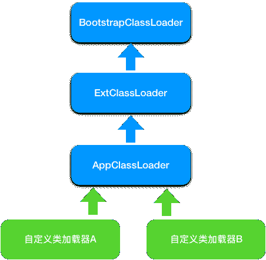

# 24 | Context容器（上）：Tomcat如何打破双亲委托机制？

 

相信我们平时在工作中都遇到过 ClassNotFound 异常，这个异常表示 JVM 在尝试加载某个类的时候失败了。想要解决这个问题，首先你需要知道什么是类加载，JVM 是如何加载类的，以及为什么会出现 ClassNotFound 异常？弄懂上面这些问题之后，我们接着要思考 Tomcat 作为 Web 容器，它是如何加载和管理 Web 应用下的 Servlet 呢？

Tomcat 正是通过 Context 组件来加载管理 Web 应用的，所以今天我会详细分析 Tomcat 的类加载机制。但在这之前，我们有必要预习一下 JVM 的类加载机制，我会先回答一下一开始抛出来的问题，接着再谈谈 Tomcat 的类加载器如何打破 Java 的双亲委托机制。

## JVM 的类加载器

Java 的类加载，就是把字节码格式“.class”文件加载到 JVM 的**方法区**，并在 JVM 的**堆区**建立一个`java.lang.Class`对象的实例，用来封装 Java 类相关的数据和方法。那 Class 对象又是什么呢？你可以把它理解成业务类的模板，JVM 根据这个模板来创建具体业务类对象实例。

JVM 并不是在启动时就把所有的“.class”文件都加载一遍，而是程序在运行过程中用到了这个类才去加载。JVM 类加载是由类加载器来完成的，JDK 提供一个抽象类 ClassLoader，这个抽象类中定义了三个关键方法，理解清楚它们的作用和关系非常重要。

```
public abstract class ClassLoader {     // 每个类加载器都有个父加载器    private final ClassLoader parent;        public Class<?> loadClass(String name) {          // 查找一下这个类是不是已经加载过了        Class<?> c = findLoadedClass(name);                // 如果没有加载过        if( c == null ){          // 先委托给父加载器去加载，注意这是个递归调用          if (parent != null) {              c = parent.loadClass(name);          }else {              // 如果父加载器为空，查找 Bootstrap 加载器是不是加载过了              c = findBootstrapClassOrNull(name);          }        }        // 如果父加载器没加载成功，调用自己的 findClass 去加载        if (c == null) {            c = findClass(name);        }                return c；    }        protected Class<?> findClass(String name){       //1. 根据传入的类名 name，到在特定目录下去寻找类文件，把.class 文件读入内存          ...                 //2. 调用 defineClass 将字节数组转成 Class 对象       return defineClass(buf, off, len)；    }        // 将字节码数组解析成一个 Class 对象，用 native 方法实现    protected final Class<?> defineClass(byte[] b, int off, int len){       ...    }}
```

从上面的代码我们可以得到几个关键信息：

 
- JVM 的类加载器是分层次的，它们有父子关系，每个类加载器都持有一个 parent 字段，指向父加载器。 
- defineClass 是个工具方法，它的职责是调用 native 方法把 Java 类的字节码解析成一个 Class 对象，所谓的 native 方法就是由 C 语言实现的方法，Java 通过 JNI 机制调用。 
- findClass 方法的主要职责就是找到“.class”文件，可能来自文件系统或者网络，找到后把“.class”文件读到内存得到字节码数组，然后调用 defineClass 方法得到 Class 对象。 
- loadClass 是个 public 方法，说明它才是对外提供服务的接口，具体实现也比较清晰：首先检查这个类是不是已经被加载过了，如果加载过了直接返回，否则交给父加载器去加载。请你注意，这是一个递归调用，也就是说子加载器持有父加载器的引用，当一个类加载器需要加载一个 Java 类时，会先委托父加载器去加载，然后父加载器在自己的加载路径中搜索 Java 类，当父加载器在自己的加载范围内找不到时，才会交还给子加载器加载，这就是双亲委托机制。 

JDK 中有哪些默认的类加载器？它们的本质区别是什么？为什么需要双亲委托机制？JDK 中有 3 个类加载器，另外你也可以自定义类加载器，它们的关系如下图所示。



 
- BootstrapClassLoader 是启动类加载器，由 C 语言实现，用来加载 JVM 启动时所需要的核心类，比如`rt.jar`、`resources.jar`等。 
- ExtClassLoader 是扩展类加载器，用来加载`\jre\lib\ext`目录下 JAR 包。 
- AppClassLoader 是系统类加载器，用来加载 classpath 下的类，应用程序默认用它来加载类。 
- 自定义类加载器，用来加载自定义路径下的类。 

这些类加载器的工作原理是一样的，区别是它们的加载路径不同，也就是说 findClass 这个方法查找的路径不同。双亲委托机制是为了保证一个 Java 类在 JVM 中是唯一的，假如你不小心写了一个与 JRE 核心类同名的类，比如 Object 类，双亲委托机制能保证加载的是 JRE 里的那个 Object 类，而不是你写的 Object 类。这是因为 AppClassLoader 在加载你的 Object 类时，会委托给 ExtClassLoader 去加载，而 ExtClassLoader 又会委托给 BootstrapClassLoader，BootstrapClassLoader 发现自己已经加载过了 Object 类，会直接返回，不会去加载你写的 Object 类。

这里请你注意，类加载器的父子关系不是通过继承来实现的，比如 AppClassLoader 并不是 ExtClassLoader 的子类，而是说 AppClassLoader 的 parent 成员变量指向 ExtClassLoader 对象。同样的道理，如果你要自定义类加载器，不去继承 AppClassLoader，而是继承 ClassLoader 抽象类，再重写 findClass 和 loadClass 方法即可，Tomcat 就是通过自定义类加载器来实现自己的类加载逻辑。不知道你发现没有，如果你要打破双亲委托机制，就需要重写 loadClass 方法，因为 loadClass 的默认实现就是双亲委托机制。

## Tomcat 的类加载器

Tomcat 的自定义类加载器 WebAppClassLoader 打破了双亲委托机制，它**首先自己尝试去加载某个类，如果找不到再代理给父类加载器**，其目的是优先加载 Web 应用自己定义的类。具体实现就是重写 ClassLoader 的两个方法：findClass 和 loadClass。

**findClass 方法**

我们先来看看 findClass 方法的实现，为了方便理解和阅读，我去掉了一些细节：

```
public Class<?> findClass(String name) throws ClassNotFoundException {    ...        Class<?> clazz = null;    try {            //1. 先在 Web 应用目录下查找类             clazz = findClassInternal(name);    }  catch (RuntimeException e) {           throw e;       }        if (clazz == null) {    try {            //2. 如果在本地目录没有找到，交给父加载器去查找            clazz = super.findClass(name);    }  catch (RuntimeException e) {           throw e;       }        //3. 如果父类也没找到，抛出 ClassNotFoundException    if (clazz == null) {        throw new ClassNotFoundException(name);     }     return clazz;}
```

在 findClass 方法里，主要有三个步骤：

 
1. 先在 Web 应用本地目录下查找要加载的类。 
2. 如果没有找到，交给父加载器去查找，它的父加载器就是上面提到的系统类加载器 AppClassLoader。 
3. 如何父加载器也没找到这个类，抛出 ClassNotFound 异常。 

**loadClass 方法**

接着我们再来看 Tomcat 类加载器的 loadClass 方法的实现，同样我也去掉了一些细节：

```
public Class<?> loadClass(String name, boolean resolve) throws ClassNotFoundException {     synchronized (getClassLoadingLock(name)) {         Class<?> clazz = null;         //1. 先在本地 cache 查找该类是否已经加载过        clazz = findLoadedClass0(name);        if (clazz != null) {            if (resolve)                resolveClass(clazz);            return clazz;        }         //2. 从系统类加载器的 cache 中查找是否加载过        clazz = findLoadedClass(name);        if (clazz != null) {            if (resolve)                resolveClass(clazz);            return clazz;        }         // 3. 尝试用 ExtClassLoader 类加载器类加载，为什么？        ClassLoader javaseLoader = getJavaseClassLoader();        try {            clazz = javaseLoader.loadClass(name);            if (clazz != null) {                if (resolve)                    resolveClass(clazz);                return clazz;            }        } catch (ClassNotFoundException e) {            // Ignore        }         // 4. 尝试在本地目录搜索 class 并加载        try {            clazz = findClass(name);            if (clazz != null) {                if (resolve)                    resolveClass(clazz);                return clazz;            }        } catch (ClassNotFoundException e) {            // Ignore        }         // 5. 尝试用系统类加载器 (也就是 AppClassLoader) 来加载            try {                clazz = Class.forName(name, false, parent);                if (clazz != null) {                    if (resolve)                        resolveClass(clazz);                    return clazz;                }            } catch (ClassNotFoundException e) {                // Ignore            }       }        //6. 上述过程都加载失败，抛出异常    throw new ClassNotFoundException(name);}
```

loadClass 方法稍微复杂一点，主要有六个步骤：

 
1. 先在本地 Cache 查找该类是否已经加载过，也就是说 Tomcat 的类加载器是否已经加载过这个类。 
2. 如果 Tomcat 类加载器没有加载过这个类，再看看系统类加载器是否加载过。 
3. 如果都没有，就让**ExtClassLoader**去加载，这一步比较关键，目的**防止 Web 应用自己的类覆盖 JRE 的核心类**。因为 Tomcat 需要打破双亲委托机制，假如 Web 应用里自定义了一个叫 Object 的类，如果先加载这个 Object 类，就会覆盖 JRE 里面的那个 Object 类，这就是为什么 Tomcat 的类加载器会优先尝试用 ExtClassLoader 去加载，因为 ExtClassLoader 会委托给 BootstrapClassLoader 去加载，BootstrapClassLoader 发现自己已经加载了 Object 类，直接返回给 Tomcat 的类加载器，这样 Tomcat 的类加载器就不会去加载 Web 应用下的 Object 类了，也就避免了覆盖 JRE 核心类的问题。 
4. 如果 ExtClassLoader 加载器加载失败，也就是说 JRE 核心类中没有这类，那么就在本地 Web 应用目录下查找并加载。 
5. 如果本地目录下没有这个类，说明不是 Web 应用自己定义的类，那么由系统类加载器去加载。这里请你注意，Web 应用是通过`Class.forName`调用交给系统类加载器的，因为`Class.forName`的默认加载器就是系统类加载器。 
6. 如果上述加载过程全部失败，抛出 ClassNotFound 异常。 

从上面的过程我们可以看到，Tomcat 的类加载器打破了双亲委托机制，没有一上来就直接委托给父加载器，而是先在本地目录下加载，为了避免本地目录下的类覆盖 JRE 的核心类，先尝试用 JVM 扩展类加载器 ExtClassLoader 去加载。那为什么不先用系统类加载器 AppClassLoader 去加载？很显然，如果是这样的话，那就变成双亲委托机制了，这就是 Tomcat 类加载器的巧妙之处。

## 本期精华

今天我介绍了 JVM 的类加载器原理和源码剖析，以及 Tomcat 的类加载器是如何打破双亲委托机制的，目的是为了优先加载 Web 应用目录下的类，然后再加载其他目录下的类，这也是 Servlet 规范的推荐做法。

要打破双亲委托机制，需要继承 ClassLoader 抽象类，并且需要重写它的 loadClass 方法，因为 ClassLoader 的默认实现就是双亲委托。

## 课后思考

如果你并不想打破双亲委托机制，但是又想定义自己的类加载器来加载特定目录下的类，你需要重写 findClass 和 loadClass 方法中的哪一个？还是两个都要重写？

不知道今天的内容你消化得如何？如果还有疑问，请大胆的在留言区提问，也欢迎你把你的课后思考和心得记录下来，与我和其他同学一起讨论。如果你觉得今天有所收获，欢迎你把它分享给你的朋友。


