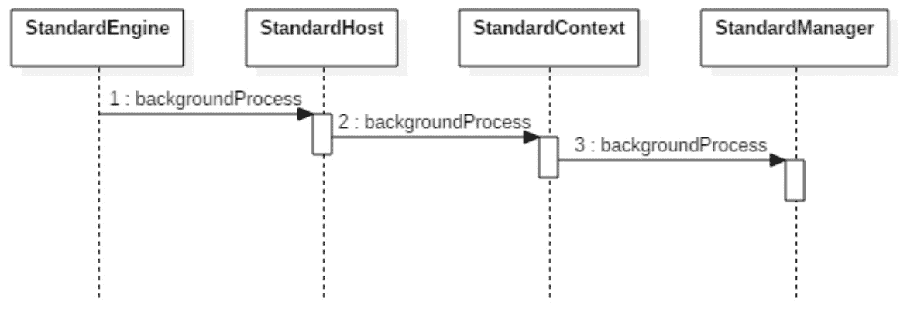
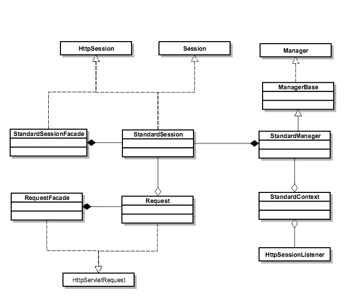

# 32 | Manager组件：Tomcat的Session管理机制解析

 

我们可以通过 Request 对象的 getSession 方法来获取 Session，并通过 Session 对象来读取和写入属性值。而 Session 的管理是由 Web 容器来完成的，主要是对 Session 的创建和销毁，除此之外 Web 容器还需要将 Session 状态的变化通知给监听者。

当然 Session 管理还可以交给 Spring 来做，好处是与特定的 Web 容器解耦，Spring Session 的核心原理是通过 Filter 拦截 Servlet 请求，将标准的 ServletRequest 包装一下，换成 Spring 的 Request 对象，这样当我们调用 Request 对象的 getSession 方法时，Spring 在背后为我们创建和管理 Session。

那么 Tomcat 的 Session 管理机制我们还需要了解吗？我觉得还是有必要，因为只有了解这些原理，我们才能更好的理解 Spring Session，以及 Spring Session 为什么设计成这样。今天我们就从 Session 的创建、Session 的清理以及 Session 的事件通知这几个方面来了解 Tomcat 的 Session 管理机制。

## Session 的创建

Tomcat 中主要由每个 Context 容器内的一个 Manager 对象来管理 Session。默认实现类为 StandardManager。下面我们通过它的接口来了解一下 StandardManager 的功能：

```
public interface Manager {    public Context getContext();    public void setContext(Context context);    public SessionIdGenerator getSessionIdGenerator();    public void setSessionIdGenerator(SessionIdGenerator sessionIdGenerator);    public long getSessionCounter();    public void setSessionCounter(long sessionCounter);    public int getMaxActive();    public void setMaxActive(int maxActive);    public int getActiveSessions();    public long getExpiredSessions();    public void setExpiredSessions(long expiredSessions);    public int getRejectedSessions();    public int getSessionMaxAliveTime();    public void setSessionMaxAliveTime(int sessionMaxAliveTime);    public int getSessionAverageAliveTime();    public int getSessionCreateRate();    public int getSessionExpireRate();    public void add(Session session);    public void changeSessionId(Session session);    public void changeSessionId(Session session, String newId);    public Session createEmptySession();    public Session createSession(String sessionId);    public Session findSession(String id) throws IOException;    public Session[] findSessions();    public void load() throws ClassNotFoundException, IOException;    public void remove(Session session);    public void remove(Session session, boolean update);    public void addPropertyChangeListener(PropertyChangeListener listener)    public void removePropertyChangeListener(PropertyChangeListener listener);    public void unload() throws IOException;    public void backgroundProcess();    public boolean willAttributeDistribute(String name, Object value);}
```

不出意外我们在接口中看到了添加和删除 Session 的方法；另外还有 load 和 unload 方法，它们的作用是分别是将 Session 持久化到存储介质和从存储介质加载 Session。

当我们调用`HttpServletRequest.getSession(true)`时，这个参数 true 的意思是“如果当前请求还没有 Session，就创建一个新的”。那 Tomcat 在背后为我们做了些什么呢？

HttpServletRequest 是一个接口，Tomcat 实现了这个接口，具体实现类是：`org.apache.catalina.connector.Request`。

但这并不是我们拿到的 Request，Tomcat 为了避免把一些实现细节暴露出来，还有基于安全上的考虑，定义了 Request 的包装类，叫作 RequestFacade，我们可以通过代码来理解一下：

```
public class Request implements HttpServletRequest {}
```

```
public class RequestFacade implements HttpServletRequest {  protected Request request = null;    public HttpSession getSession(boolean create) {     return request.getSession(create);  }}
```

因此我们拿到的 Request 类其实是 RequestFacade，RequestFacade 的 getSession 方法调用的是 Request 类的 getSession 方法，我们继续来看 Session 具体是如何创建的：

```
Context context = getContext();if (context == null) {    return null;} Manager manager = context.getManager();if (manager == null) {    return null;      } session = manager.createSession(sessionId);session.access();
```

从上面的代码可以看出，Request 对象中持有 Context 容器对象，而 Context 容器持有 Session 管理器 Manager，这样通过 Context 组件就能拿到 Manager 组件，最后由 Manager 组件来创建 Session。

因此最后还是到了 StandardManager，StandardManager 的父类叫 ManagerBase，这个 createSession 方法定义在 ManagerBase 中，StandardManager 直接重用这个方法。

接着我们来看 ManagerBase 的 createSession 是如何实现的：

```
@Overridepublic Session createSession(String sessionId) {    // 首先判断 Session 数量是不是到了最大值，最大 Session 数可以通过参数设置    if ((maxActiveSessions >= 0) &&            (getActiveSessions() >= maxActiveSessions)) {        rejectedSessions++;        throw new TooManyActiveSessionsException(                sm.getString("managerBase.createSession.ise"),                maxActiveSessions);    }     // 重用或者创建一个新的 Session 对象，请注意在 Tomcat 中就是 StandardSession    // 它是 HttpSession 的具体实现类，而 HttpSession 是 Servlet 规范中定义的接口    Session session = createEmptySession();      // 初始化新 Session 的值    session.setNew(true);    session.setValid(true);    session.setCreationTime(System.currentTimeMillis());    session.setMaxInactiveInterval(getContext().getSessionTimeout() * 60);    String id = sessionId;    if (id == null) {        id = generateSessionId();    }    session.setId(id);// 这里会将 Session 添加到 ConcurrentHashMap 中    sessionCounter++;        // 将创建时间添加到 LinkedList 中，并且把最先添加的时间移除    // 主要还是方便清理过期 Session    SessionTiming timing = new SessionTiming(session.getCreationTime(), 0);    synchronized (sessionCreationTiming) {        sessionCreationTiming.add(timing);        sessionCreationTiming.poll();    }    return session}
```

到此我们明白了 Session 是如何创建出来的，创建出来后 Session 会被保存到一个 ConcurrentHashMap 中：

```
protected Map<String, Session> sessions = new ConcurrentHashMap<>();
```

请注意 Session 的具体实现类是 StandardSession，StandardSession 同时实现了`javax.servlet.http.HttpSession`和`org.apache.catalina.Session`接口，并且对程序员暴露的是 StandardSessionFacade 外观类，保证了 StandardSession 的安全，避免了程序员调用其内部方法进行不当操作。StandardSession 的核心成员变量如下：

```
public class StandardSession implements HttpSession, Session, Serializable {    protected ConcurrentMap<String, Object> attributes = new ConcurrentHashMap<>();    protected long creationTime = 0L;    protected transient volatile boolean expiring = false;    protected transient StandardSessionFacade facade = null;    protected String id = null;    protected volatile long lastAccessedTime = creationTime;    protected transient ArrayList<SessionListener> listeners = new ArrayList<>();    protected transient Manager manager = null;    protected volatile int maxInactiveInterval = -1;    protected volatile boolean isNew = false;    protected volatile boolean isValid = false;    protected transient Map<String, Object> notes = new Hashtable<>();    protected transient Principal principal = null;}
```

## Session 的清理

我们再来看看 Tomcat 是如何清理过期的 Session。在 Tomcat[热加载和热部署](https://time.geekbang.org/column/article/104423)的文章里，我讲到容器组件会开启一个 ContainerBackgroundProcessor 后台线程，调用自己以及子容器的 backgroundProcess 进行一些后台逻辑的处理，和 Lifecycle 一样，这个动作也是具有传递性的，也就是说子容器还会把这个动作传递给自己的子容器。你可以参考下图来理解这个过程。



其中父容器会遍历所有的子容器并调用其 backgroundProcess 方法，而 StandardContext 重写了该方法，它会调用 StandardManager 的 backgroundProcess 进而完成 Session 的清理工作，下面是 StandardManager 的 backgroundProcess 方法的代码：

```
public void backgroundProcess() {    // processExpiresFrequency 默认值为 6，而 backgroundProcess 默认每隔 10s 调用一次，也就是说除了任务执行的耗时，每隔 60s 执行一次    count = (count + 1) % processExpiresFrequency;    if (count == 0) // 默认每隔 60s 执行一次 Session 清理        processExpires();} /** * 单线程处理，不存在线程安全问题 */public void processExpires() {     // 获取所有的 Session    Session sessions[] = findSessions();       int expireHere = 0 ;    for (int i = 0; i < sessions.length; i++) {        // Session 的过期是在 isValid() 方法里处理的        if (sessions[i]!=null && !sessions[i].isValid()) {            expireHere++;        }    }}
```

backgroundProcess 由 Tomcat 后台线程调用，默认是每隔 10 秒调用一次，但是 Session 的清理动作不能太频繁，因为需要遍历 Session 列表，会耗费 CPU 资源，所以在 backgroundProcess 方法中做了取模处理，backgroundProcess 调用 6 次，才执行一次 Session 清理，也就是说 Session 清理每 60 秒执行一次。

## Session 事件通知

按照 Servlet 规范，在 Session 的生命周期过程中，要将事件通知监听者，Servlet 规范定义了 Session 的监听器接口：

```
public interface HttpSessionListener extends EventListener {    //Session 创建时调用    public default void sessionCreated(HttpSessionEvent se) {    }        //Session 销毁时调用    public default void sessionDestroyed(HttpSessionEvent se) {    }}
```

注意到这两个方法的参数都是 HttpSessionEvent，所以 Tomcat 需要先创建 HttpSessionEvent 对象，然后遍历 Context 内部的 LifecycleListener，并且判断是否为 HttpSessionListener 实例，如果是的话则调用 HttpSessionListener 的 sessionCreated 方法进行事件通知。这些事情都是在 Session 的 setId 方法中完成的：

```
session.setId(id); @Overridepublic void setId(String id, boolean notify) {    // 如果这个 id 已经存在，先从 Manager 中删除    if ((this.id != null) && (manager != null))        manager.remove(this);     this.id = id;     // 添加新的 Session    if (manager != null)        manager.add(this);     // 这里面完成了 HttpSessionListener 事件通知    if (notify) {        tellNew();    }}
```

从代码我们看到 setId 方法调用了 tellNew 方法，那 tellNew 又是如何实现的呢？

```
public void tellNew() {     // 通知 org.apache.catalina.SessionListener    fireSessionEvent(Session.SESSION_CREATED_EVENT, null);     // 获取 Context 内部的 LifecycleListener 并判断是否为 HttpSessionListener    Context context = manager.getContext();    Object listeners[] = context.getApplicationLifecycleListeners();    if (listeners != null && listeners.length > 0) {            // 创建 HttpSessionEvent        HttpSessionEvent event = new HttpSessionEvent(getSession());        for (int i = 0; i < listeners.length; i++) {            // 判断是否是 HttpSessionListener            if (!(listeners[i] instanceof HttpSessionListener))                continue;                            HttpSessionListener listener = (HttpSessionListener) listeners[i];            // 注意这是容器内部事件            context.fireContainerEvent("beforeSessionCreated", listener);               // 触发 Session Created 事件            listener.sessionCreated(event);                        // 注意这也是容器内部事件            context.fireContainerEvent("afterSessionCreated", listener);                    }    }}
```

上面代码的逻辑是，先通过 StandardContext 将 HttpSessionListener 类型的 Listener 取出，然后依次调用它们的 sessionCreated 方法。

## 本期精华

今天我们从 Request 谈到了 Session 的创建、销毁和事件通知，里面涉及不少相关的类，下面我画了一张图帮你理解和消化一下这些类的关系：



Servlet 规范中定义了 HttpServletRequest 和 HttpSession 接口，Tomcat 实现了这些接口，但具体实现细节并没有暴露给开发者，因此定义了两个包装类，RequestFacade 和 StandardSessionFacade。

Tomcat 是通过 Manager 来管理 Session 的，默认实现是 StandardManager。StandardContext 持有 StandardManager 的实例，并存放了 HttpSessionListener 集合，Session 在创建和销毁时，会通知监听器。

## 课后思考

TCP 连接的过期时间和 Session 的过期时间有什么区别？

不知道今天的内容你消化得如何？如果还有疑问，请大胆的在留言区提问，也欢迎你把你的课后思考和心得记录下来，与我和其他同学一起讨论。如果你觉得今天有所收获，欢迎你把它分享给你的朋友。


