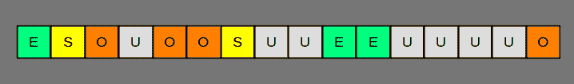
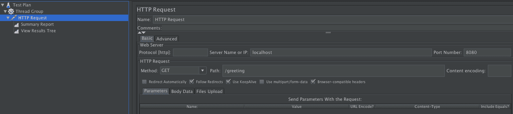
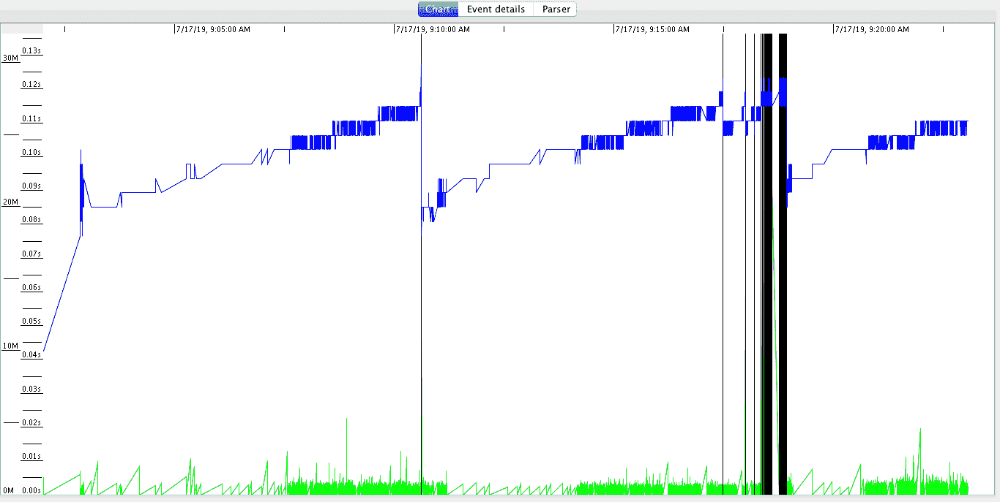
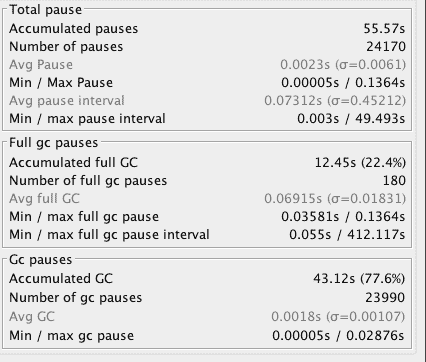
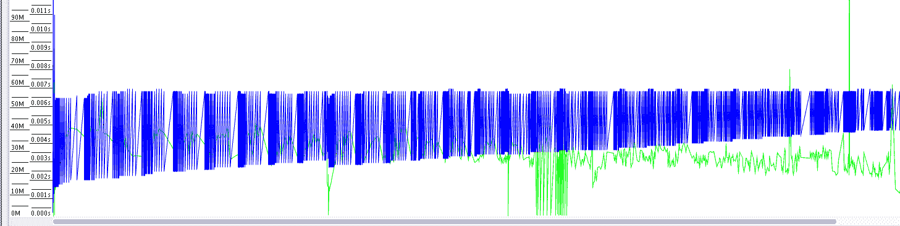
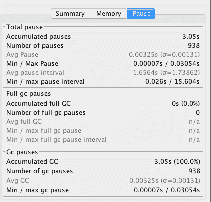

# 34 | JVM GC原理及调优的基本思路

 

和 Web 应用程序一样，Tomcat 作为一个 Java 程序也跑在 JVM 中，因此如果我们要对 Tomcat 进行调优，需要先了解 JVM 调优的原理。而对于 JVM 调优来说，主要是 JVM 垃圾收集的优化，一般来说是因为有问题才需要优化，所以对于 JVM GC 来说，如果你观察到 Tomcat 进程的 CPU 使用率比较高，并且在 GC 日志中发现 GC 次数比较频繁、GC 停顿时间长，这表明你需要对 GC 进行优化了。

在对 GC 调优的过程中，我们不仅需要知道 GC 的原理，更重要的是要熟练使用各种监控和分析工具，具备 GC 调优的实战能力。CMS 和 G1 是时下使用率比较高的两款垃圾收集器，从 Java 9 开始，采用 G1 作为默认垃圾收集器，而 G1 的目标也是逐步取代 CMS。所以今天我们先来简单回顾一下两种垃圾收集器 CMS 和 G1 的区别，接着通过一个例子帮你提高 GC 调优的实战能力。

## CMS vs G1

CMS 收集器将 Java 堆分为**年轻代**（Young）或**年老代**（Old）。这主要是因为有研究表明，超过 90％的对象在第一次 GC 时就被回收掉，但是少数对象往往会存活较长的时间。

CMS 还将年轻代内存空间分为**幸存者空间**（Survivor）和**伊甸园空间**（Eden）。新的对象始终在 Eden 空间上创建。一旦一个对象在一次垃圾收集后还幸存，就会被移动到幸存者空间。当一个对象在多次垃圾收集之后还存活时，它会移动到年老代。这样做的目的是在年轻代和年老代采用不同的收集算法，以达到较高的收集效率，比如在年轻代采用复制 - 整理算法，在年老代采用标记 - 清理算法。因此 CMS 将 Java 堆分成如下区域：


与 CMS 相比，G1 收集器有两大特点：

 
- G1 可以并发完成大部分 GC 的工作，这期间不会“Stop-The-World”。 
- G1 使用**非连续空间**，这使 G1 能够有效地处理非常大的堆。此外，G1 可以同时收集年轻代和年老代。G1 并没有将 Java 堆分成三个空间（Eden、Survivor 和 Old），而是将堆分成许多（通常是几百个）非常小的区域。这些区域是固定大小的（默认情况下大约为 2MB）。每个区域都分配给一个空间。 G1 收集器的 Java 堆如下图所示： 



图上的 U 表示“未分配”区域。G1 将堆拆分成小的区域，一个最大的好处是可以做局部区域的垃圾回收，而不需要每次都回收整个区域比如年轻代和年老代，这样回收的停顿时间会比较短。具体的收集过程是：

 
- 将所有存活的对象将从**收集的区域**复制到**未分配的区域**，比如收集的区域是 Eden 空间，把 Eden 中的存活对象复制到未分配区域，这个未分配区域就成了 Survivor 空间。理想情况下，如果一个区域全是垃圾（意味着一个存活的对象都没有），则可以直接将该区域声明为“未分配”。 
- 为了优化收集时间，G1 总是优先选择垃圾最多的区域，从而最大限度地减少后续分配和释放堆空间所需的工作量。这也是 G1 收集器名字的由来——Garbage-First。 

## GC 调优原则

GC 是有代价的，因此我们调优的根本原则是**每一次 GC 都回收尽可能多的对象**，也就是减少无用功。因此我们在做具体调优的时候，针对 CMS 和 G1 两种垃圾收集器，分别有一些相应的策略。

**CMS 收集器**

对于 CMS 收集器来说，最重要的是**合理地设置年轻代和年老代的大小**。年轻代太小的话，会导致频繁的 Minor GC，并且很有可能存活期短的对象也不能被回收，GC 的效率就不高。而年老代太小的话，容纳不下从年轻代过来的新对象，会频繁触发单线程 Full GC，导致较长时间的 GC 暂停，影响 Web 应用的响应时间。

**G1 收集器**

对于 G1 收集器来说，我不推荐直接设置年轻代的大小，这一点跟 CMS 收集器不一样，这是因为 G1 收集器会根据算法动态决定年轻代和年老代的大小。因此对于 G1 收集器，我们需要关心的是 Java 堆的总大小（`-Xmx`）。

此外 G1 还有一个较关键的参数是`-XX:MaxGCPauseMillis = n`，这个参数是用来限制最大的 GC 暂停时间，目的是尽量不影响请求处理的响应时间。G1 将根据先前收集的信息以及检测到的垃圾量，估计它可以立即收集的最大区域数量，从而尽量保证 GC 时间不会超出这个限制。因此 G1 相对来说更加“智能”，使用起来更加简单。

## 内存调优实战

下面我通过一个例子实战一下 Java 堆设置得过小，导致频繁的 GC，我们将通过 GC 日志分析工具来观察 GC 活动并定位问题。

1. 首先我们建立一个 Spring Boot 程序，作为我们的调优对象，代码如下：

```
@RestControllerpublic class GcTestController {     private Queue<Greeting> objCache =  new ConcurrentLinkedDeque<>();     @RequestMapping("/greeting")    public Greeting greeting() {        Greeting greeting = new Greeting("Hello World!");         if (objCache.size() >= 200000) {            objCache.clear();        } else {            objCache.add(greeting);        }        return greeting;    }} @Data@AllArgsConstructorclass Greeting {   private String message;}
```

上面的代码就是创建了一个对象池，当对象池中的对象数到达 200000 时才清空一次，用来模拟年老代对象。

2. 用下面的命令启动测试程序：

```
java -Xmx32m -Xss256k -verbosegc -Xlog:gc*,gc+ref=debug,gc+heap=debug,gc+age=trace:file=gc-%p-%t.log:tags,uptime,time,level:filecount=2,filesize=100m -jar target/demo-0.0.1-SNAPSHOT.jar
```

我给程序设置的堆的大小为 32MB，目的是能让我们看到 Full GC。除此之外，我还打开了 verbosegc 日志，请注意这里我使用的版本是 Java 12，默认的垃圾收集器是 G1。

3. 使用 JMeter 压测工具向程序发送测试请求，访问的路径是`/greeting`。



4. 使用 GCViewer 工具打开 GC 日志，我们可以看到这样的图：



我来解释一下这张图：

 
- 图中上部的蓝线表示已使用堆的大小，我们看到它周期的上下震荡，这是我们的对象池要扩展到 200000 才会清空。 
- 图底部的绿线表示年轻代 GC 活动，从图上看到当堆的使用率上去了，会触发频繁的 GC 活动。 
- 图中的竖线表示 Full GC，从图上看到，伴随着 Full GC，蓝线会下降，这说明 Full GC 收集了年老代中的对象。 

基于上面的分析，我们可以得出一个结论，那就是 Java 堆的大小不够。我来解释一下为什么得出这个结论：

 
- GC 活动频繁：年轻代 GC（绿色线）和年老代 GC（黑色线）都比较密集。这说明内存空间不够，也就是 Java 堆的大小不够。 
- Java 的堆中对象在 GC 之后能够被回收，说明不是内存泄漏。 

我们通过 GCViewer 还发现累计 GC 暂停时间有 55.57 秒，如下图所示：



因此我们的解决方案是调大 Java 堆的大小，像下面这样：

```
java -Xmx2048m -Xss256k -verbosegc -Xlog:gc*,gc+ref=debug,gc+heap=debug,gc+age=trace:file=gc-%p-%t.log:tags,uptime,time,level:filecount=2,filesize=100m -jar target/demo-0.0.1-SNAPSHOT.jar
```

生成的新的 GC log 分析图如下：



你可以看到，没有发生 Full GC，并且年轻代 GC 也没有那么频繁了，并且累计 GC 暂停时间只有 3.05 秒。



## 本期精华

今天我们首先回顾了 CMS 和 G1 两种垃圾收集器背后的设计思路以及它们的区别，接着分析了 GC 调优的总体原则。

对于 CMS 来说，我们要合理设置年轻代和年老代的大小。你可能会问该如何确定它们的大小呢？这是一个迭代的过程，可以先采用 JVM 的默认值，然后通过压测分析 GC 日志。

如果我们看年轻代的内存使用率处在高位，导致频繁的 Minor GC，而频繁 GC 的效率又不高，说明对象没那么快能被回收，这时年轻代可以适当调大一点。

如果我们看年老代的内存使用率处在高位，导致频繁的 Full GC，这样分两种情况：如果每次 Full GC 后年老代的内存占用率没有下来，可以怀疑是内存泄漏；如果 Full GC 后年老代的内存占用率下来了，说明不是内存泄漏，我们要考虑调大年老代。

对于 G1 收集器来说，我们可以适当调大 Java 堆，因为 G1 收集器采用了局部区域收集策略，单次垃圾收集的时间可控，可以管理较大的 Java 堆。

## 课后思考

如果把年轻代和年老代都设置得很大，会有什么问题？

不知道今天的内容你消化得如何？如果还有疑问，请大胆的在留言区提问，也欢迎你把你的课后思考和心得记录下来，与我和其他同学一起讨论。如果你觉得今天有所收获，欢迎你把它分享给你的朋友。


