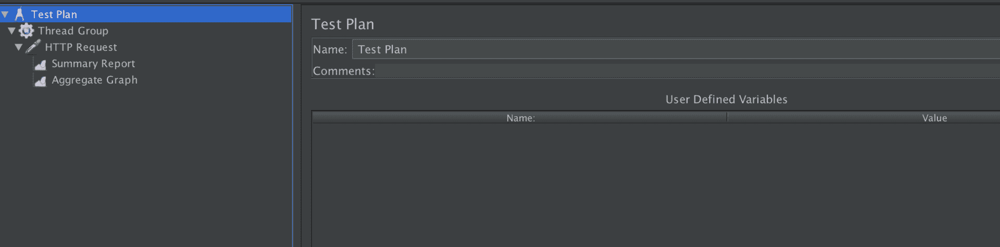
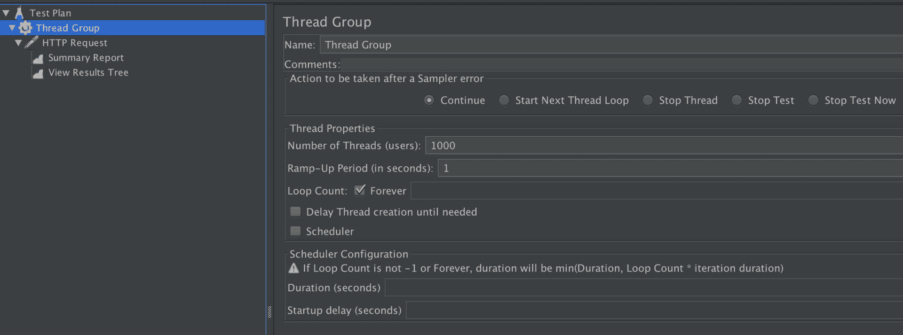
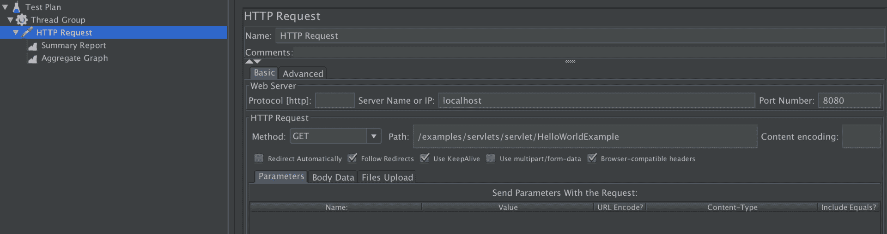
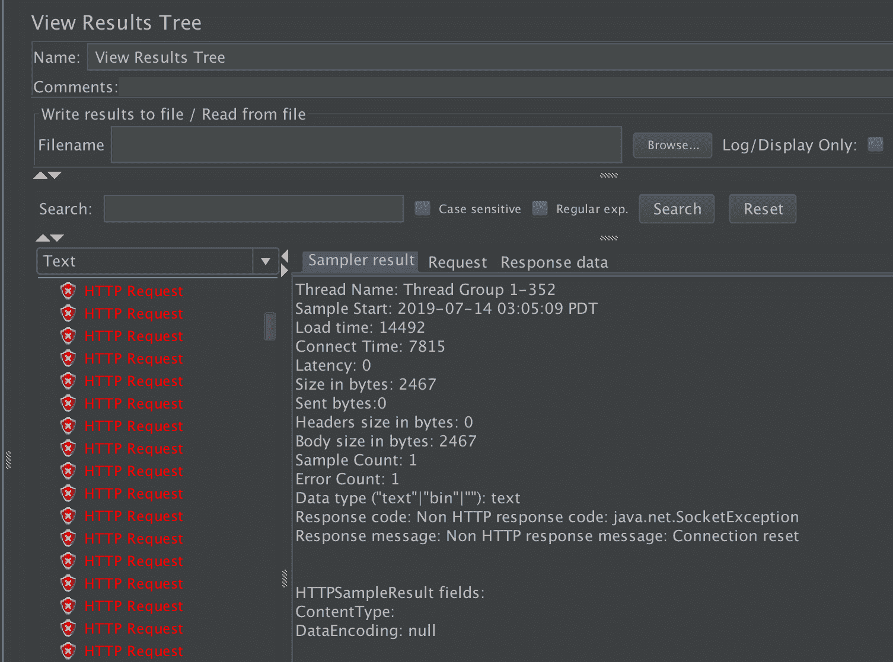
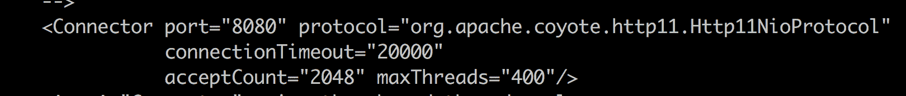
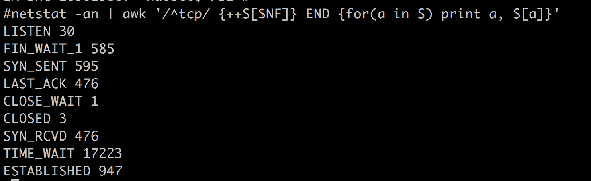

# 38 | Tomcat拒绝连接原因分析及网络优化

 

专栏上一期我们分析各种 JVM OutOfMemory 错误的原因和解决办法，今天我们来看看网络通信中可能会碰到的各种错误。网络通信方面的错误和异常也是我们在实际工作中经常碰到的，需要理解异常背后的原理，才能更快更精准地定位问题，从而找到解决办法。

下面我会先讲讲 Java Socket 网络编程常见的异常有哪些，然后通过一个实验来重现其中的 Connection reset 异常，并且通过配置 Tomcat 的参数来解决这个问题。

## 常见异常

**java.net.SocketTimeoutException**

指超时错误。超时分为**连接超时**和**读取超时**，连接超时是指在调用 Socket.connect 方法的时候超时，而读取超时是调用 Socket.read 方法时超时。请你注意的是，连接超时往往是由于网络不稳定造成的，但是读取超时不一定是网络延迟造成的，很有可能是下游服务的响应时间过长。

**java.net.BindException: Address already in use: JVM_Bind**

指端口被占用。当服务器端调用 new ServerSocket(port) 或者 Socket.bind 函数时，如果端口已经被占用，就会抛出这个异常。我们可以用`netstat –an`命令来查看端口被谁占用了，换一个没有被占用的端口就能解决。

**java.net.ConnectException: Connection refused: connect**

指连接被拒绝。当客户端调用 new Socket(ip, port) 或者 Socket.connect 函数时，可能会抛出这个异常。原因是指定 IP 地址的机器没有找到；或者是机器存在，但这个机器上没有开启指定的监听端口。

解决办法是从客户端机器 ping 一下服务端 IP，假如 ping 不通，可以看看 IP 是不是写错了；假如能 ping 通，需要确认服务端的服务是不是崩溃了。

**java.net.SocketException: Socket is closed**

指连接已关闭。出现这个异常的原因是通信的一方主动关闭了 Socket 连接（调用了 Socket 的 close 方法），接着又对 Socket 连接进行了读写操作，这时操作系统会报“Socket 连接已关闭”的错误。

**java.net.SocketException: Connection reset/Connect reset by peer: Socket write error**

指连接被重置。这里有两种情况，分别对应两种错误：第一种情况是通信的一方已经将 Socket 关闭，可能是主动关闭或者是因为异常退出，这时如果通信的另一方还在写数据，就会触发这个异常（Connect reset by peer）；如果对方还在尝试从 TCP 连接中读数据，则会抛出 Connection reset 异常。

为了避免这些异常发生，在编写网络通信程序时要确保：

 
- 程序退出前要主动关闭所有的网络连接。 
- 检测通信的另一方的关闭连接操作，当发现另一方关闭连接后自己也要关闭该连接。 

**java.net.SocketException: Broken pipe**

指通信管道已坏。发生这个异常的场景是，通信的一方在收到“Connect reset by peer: Socket write error”后，如果再继续写数据则会抛出 Broken pipe 异常，解决方法同上。

**java.net.SocketException: Too many open files**

指进程打开文件句柄数超过限制。当并发用户数比较大时，服务器可能会报这个异常。这是因为每创建一个 Socket 连接就需要一个文件句柄，此外服务端程序在处理请求时可能也需要打开一些文件。

你可以通过`lsof -p pid`命令查看进程打开了哪些文件，是不是有资源泄露，也就是说进程打开的这些文件本应该被关闭，但由于程序的 Bug 而没有被关闭。

如果没有资源泄露，可以通过设置增加最大文件句柄数。具体方法是通过`ulimit -a`来查看系统目前资源限制，通过`ulimit -n 10240`修改最大文件数。

## Tomcat 网络参数

接下来我们看看 Tomcat 两个比较关键的参数：maxConnections 和 acceptCount。在解释这个参数之前，先简单回顾下 TCP 连接的建立过程：客户端向服务端发送 SYN 包，服务端回复 SYN＋ACK，同时将这个处于 SYN_RECV 状态的连接保存到**半连接队列**。客户端返回 ACK 包完成三次握手，服务端将 ESTABLISHED 状态的连接移入**accept 队列**，等待应用程序（Tomcat）调用 accept 方法将连接取走。这里涉及两个队列：

 
- **半连接队列**：保存 SYN_RECV 状态的连接。队列长度由`net.ipv4.tcp_max_syn_backlog`设置。 
- **accept 队列**：保存 ESTABLISHED 状态的连接。队列长度为`min(net.core.somaxconn，backlog)`。其中 backlog 是我们创建 ServerSocket 时指定的参数，最终会传递给 listen 方法： 

```
int listen(int sockfd, int backlog);
```

如果我们设置的 backlog 大于`net.core.somaxconn`，accept 队列的长度将被设置为`net.core.somaxconn`，而这个 backlog 参数就是 Tomcat 中的**acceptCount**参数，默认值是 100，但请注意`net.core.somaxconn`的默认值是 128。你可以想象在高并发情况下当 Tomcat 来不及处理新的连接时，这些连接都被堆积在 accept 队列中，而**acceptCount**参数可以控制 accept 队列的长度，超过这个长度时，内核会向客户端发送 RST，这样客户端会触发上文提到的“Connection reset”异常。

而 Tomcat 中的**maxConnections**是指 Tomcat 在任意时刻接收和处理的最大连接数。当 Tomcat 接收的连接数达到 maxConnections 时，Acceptor 线程不会再从 accept 队列中取走连接，这时 accept 队列中的连接会越积越多。

maxConnections 的默认值与连接器类型有关：NIO 的默认值是 10000，APR 默认是 8192。

所以你会发现 Tomcat 的最大并发连接数等于**maxConnections + acceptCount**。如果 acceptCount 设置得过大，请求等待时间会比较长；如果 acceptCount 设置过小，高并发情况下，客户端会立即触发 Connection reset 异常。

## Tomcat 网络调优实战

接下来我们通过一个直观的例子来加深对上面两个参数的理解。我们先重现流量高峰时 accept 队列堆积的情况，这样会导致客户端触发“Connection reset”异常，然后通过调整参数解决这个问题。主要步骤有：

1. 下载和安装压测工具[JMeter](http://jmeter.apache.org/download_jmeter.cgi)。解压后打开，我们需要创建一个测试计划、一个线程组、一个请求和，如下图所示。

**测试计划**：



**线程组**（线程数这里设置为 1000，模拟大流量）：



**请求**（请求的路径是 Tomcat 自带的例子程序）：



2. 启动 Tomcat。

3. 开启 JMeter 测试，在 View Results Tree 中会看到大量失败的请求，请求的响应里有“Connection reset”异常，也就是前面提到的，当 accept 队列溢出时，服务端的内核发送了 RST 给客户端，使得客户端抛出了这个异常。



4. 修改内核参数，在`/etc/sysctl.conf`中增加一行`net.core.somaxconn=2048`，然后执行命令`sysctl -p`。

5. 修改 Tomcat 参数 acceptCount 为 2048，重启 Tomcat。



6. 再次启动 JMeter 测试，这一次所有的请求会成功，也看不到异常了。我们可以通过下面的命令看到系统中 ESTABLISHED 的连接数增大了，这是因为我们加大了 accept 队列的长度。



## 本期精华

在 Socket 网络通信过程中，我们不可避免地会碰到各种 Java 异常，了解这些异常产生的原因非常关键，通过这些信息我们大概知道问题出在哪里，如果一时找不到问题代码，我们还可以通过网络抓包工具来分析数据包。

在这个基础上，我们还分析了 Tomcat 中两个比较重要的参数：acceptCount 和 maxConnections。acceptCount 用来控制内核的 TCP 连接队列长度，maxConnections 用于控制 Tomcat 层面的最大连接数。在实战环节，我们通过调整 acceptCount 和相关的内核参数`somaxconn`，增加了系统的并发度。

## 课后思考

在上面的实验中，我们通过`netstat`命令发现有大量的 TCP 连接处在 TIME_WAIT 状态，请问这是为什么？它可能会带来什么样的问题呢？

不知道今天的内容你消化得如何？如果还有疑问，请大胆的在留言区提问，也欢迎你把你的课后思考和心得记录下来，与我和其他同学一起讨论。如果你觉得今天有所收获，欢迎你把它分享给你的朋友。


