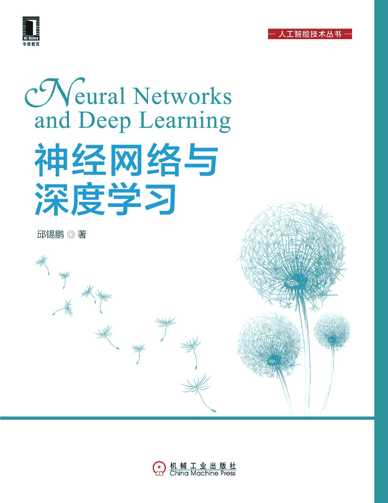
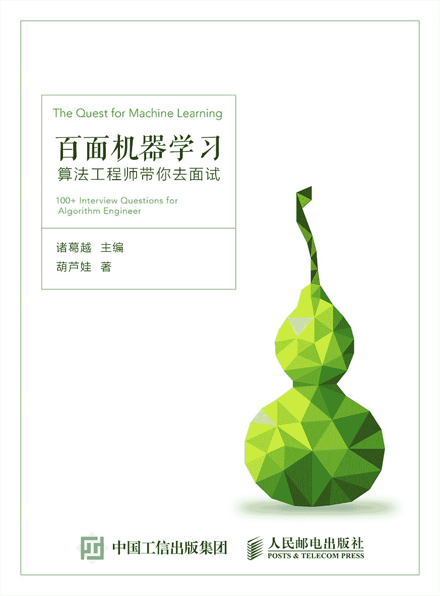
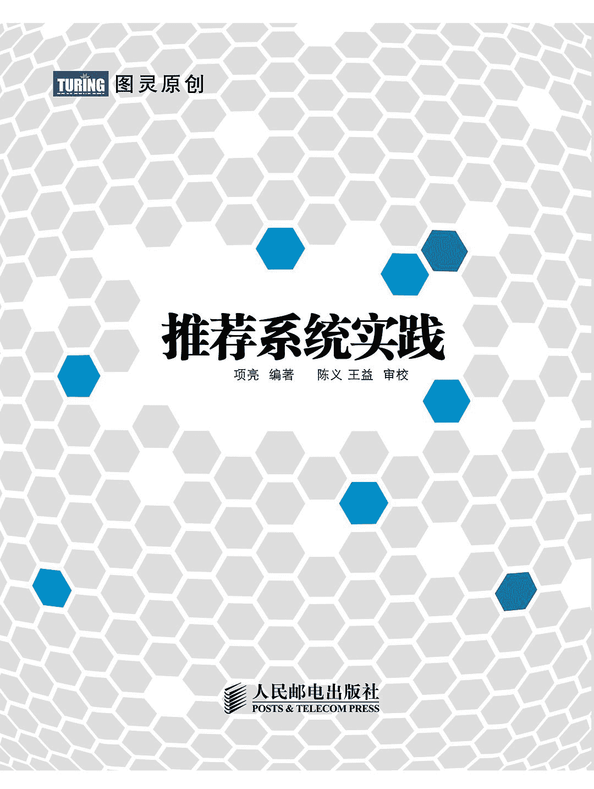
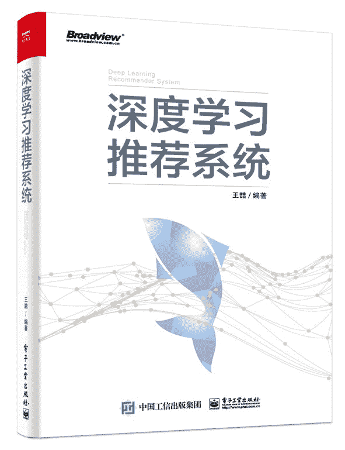
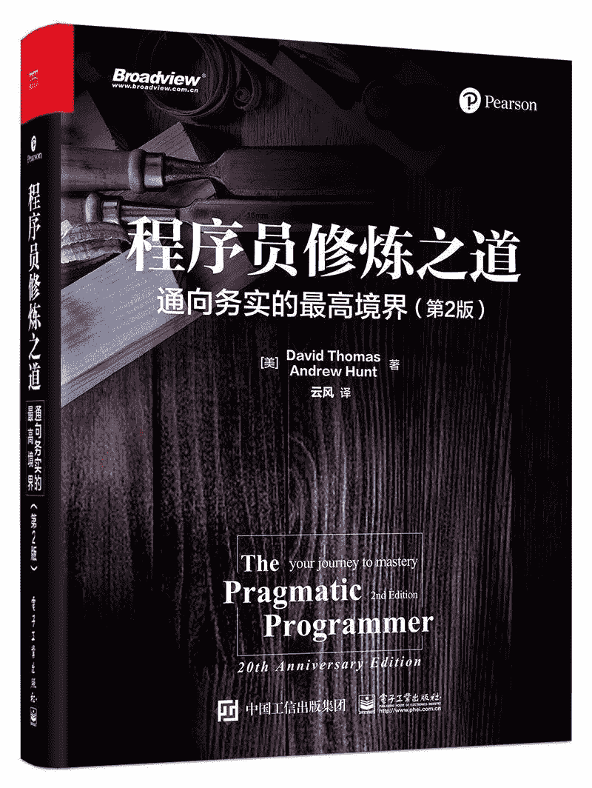

# 国庆策划 | 关于深度学习推荐系统，我有这些资料想推荐给你

 

你好，我是王喆。明天就是国庆和中秋假期了，这里我提前祝你节日快乐！

专栏上线以来，通过跟同学们在留言区讨论，我发现同学们的基础差别很大。有的同学已经是其他领域的资深工程师，希望借这门课丰富一下知识体系。有的同学确实是 0 基础的新手，可能对于机器学习的一些基本概念都不是特别清楚。

所以，我特意准备了一些适合不同阶段学习的参考书目和一些基础的实践项目，希望你能借着国庆假期查漏补缺，为我们后面的学习打好基础。

虽然这些参考书适合的学习阶段不同，但它们有两个特点，一是这些书，我都读过很多遍，它们在我学习、工作生涯的某个阶段让我受益匪浅；二是这些书都非常易读易懂，不是那种诘屈聱牙的“不适合人类阅读”的技术书。好，我们先来看看都有哪些书吧。

## 技术参考书，贵精不贵多

如果你在学习第 3 节课的时候有一些困难，就说明你对机器学习的一些基础概念还不太清楚，我希望你能继续巩固机器学习的基础知识，这里我推荐三本书，你根据自己的偏好和知识基础选择一本就好啦。

**第一本书是南京大学周志华老师的《机器学习》。**

这本书也称“西瓜书”，它的内容比较偏向传统机器学习，深度学习的内容也有，但不是重点。它的特点就是内容非常全面、详尽，语言也流畅易懂。所以，我把它推荐给机器学习基础不太好的同学，希望能够帮助你巩固基础。

**第二本书是复旦大学邱锡鹏老师的《神经网络与深度学习》。**

这本书也叫“蒲公英书”，它更偏向介绍神经网络和深度学习，对深度学习的介绍非常全面、详尽，但又不故作高深，是我们入门深度学习非常好的选择。

**第三本书是诸葛越和 hulu 机器学习团队的《百面机器学习》。**

这本书是我在 hulu 时跟 hulu 的机器学习团队一同编写的，也称“葫芦书”。它重在讲解一些机器学习领域关键的知识点，如果你正在准备算法岗位的知识性面试，它会是你极佳的选择。这本书比较适合有一些机器学习基础，但还不够深入的同学来查漏补缺。

除此之外，如果你在学习推荐系统技术架构时还有一些疑惑的话，我再给你推荐两本推荐系统领域的书籍，你可以利用它们进一步来丰富推荐系统的知识。

在我刚工作的时候，**项亮的这本《推荐系统实践》**让我受益匪浅，它介绍了经典的协同过滤、矩阵分解方法，还有推荐系统可以利用的数据，以及基本的评测方法等等。时至今日，其中经典的推荐系统知识仍然可以让我们受用。如果你想了解经典的推荐系统算法、技术架构，可以尝试读一读它。

这里，我还想给你推荐一本我的新书，**《深度学习推荐系统》**，它是今年年初出版的。我也看到很多同学在留言区提问说“老师，咱们的专栏和这本书的区别在哪呀？”。这里，我统一回复一下。

这本书当然跟咱们专栏有着千丝万缕的联系，因为它们共享了同样的知识框架。不过，咱们的专栏重在实践，这本书注重介绍知识，二者呈互补的关系。在学习这门课的同时，你也可以购买这本书，进一步拓展自己在深度学习推荐系统这个领域的知识面。

除了这些和深度学习推荐系统非常相关的书籍之外，我还想给你推荐两本课外书，这两本书是我非常喜欢的计算机领域的“闲书”。如果假期有时间的话，我非常推荐你读一读，它们可以帮助我们建立更全面的计算机思维和系统设计理念。当然，如果你都读过，也欢迎在留言区和我分享你的看法。

**首先是吴军老师的《数学之美》，**这本书在我刚工作的时候给了我很多的灵感，书中的内容涉及了机器学习、人工智能、信息论、自然语言处理等等重要的计算机科学子领域。虽然涉及面非常广，但是讲得非常透，生动有趣的语言也让我完全没有阅读压力。所以，我把它推荐给想拓展知识面的同学。

计算机经典书籍有很多，但最让我感到惊喜的是这本《**程序员修炼之道**》。我读这本书是两年前，因为已经有了很多大项目的开发和架构经验，所以读这本书时候，很多地方我都会会心一笑，太有感触了。书里面介绍了很多重构、架构、系统设计、程序员哲学相关的经验知识。因为推荐系统毫无疑问是一个复杂的大系统，所以有些时候，我们总要以系统的眼光去看待推荐系统的问题，这本书涉及的理念就至关重要了。

更关键的是，我非常喜欢它的副标题，“通向务实的最高境界”。我认为这是“返璞归真”的程序员的最高境界，也是我们作为一名工程师应该遵循的思考方式

## 初识实践工具，走好入门第一步

咱们这门课之后的实战环节，还会涉及很多推荐系统相关的工具，比如 Spark、TensorFlow、Redis、Jetty Server 等等。为了在之后的学习中避免一些上手的困难，我建议你先熟悉一下 Spark、TensorFlow 和 Redis 这三个工具。如果你对这些工具完全没有概念，可以通过我在下面介绍进行初步的了解。

首先是 Spark。它是业界最流行的分布式计算平台，如果你还没有相关经验的话，我建议你按照我给出的三步来学习。首先，你可以通过这篇文章（如何用形象的比喻描述大数据的技术生态？Hadoop、Hive、Spark 之间是什么关系？）来了解一下大数据的生态，然后，你可以通过 Spark 的官方教程尝试写一个 Spark Hello World 程序（在我们的 SparrowRecSys 里面新建一个 Scala 文件就可以）。因为咱们这门课大量使用了 Spark 的机器学习库 Spark MLlib，所以最后可以通过这个官方教程来做一些初步的了解。

其次是 TensorFlow。它是我们这门课要使用的训练深度学习模型的平台。Keras 是一套 TensorFlow 支持的 API，因为它的易用性，我们主要利用 Keras API 来实现我们的推荐模型。所以，我们第一步可以先看一篇介绍 TensorFlow 和 Keras 的基本概念的文章，对它们有一个初步的认识，再通过给 TensorFlow 的 Keras 接口写一个 Hello World项目做一个基本的上手实践。最后，如果你还有时间，可以通过TensorFlow 官方教程进一步熟悉 TensorFlow 的其他功能。

最后是 Redis。Redis 是我们这门课要频繁使用的内存数据库，用来存储模型所需线上特征。你可以先在官网熟悉一下Redis的基本介绍，然后下载安装它，最后尝试使用 Redis 内置客户端 redis-cli，来执行几条基本的Redis命令。

相信熟悉了深度学习的基础知识和基本工具之后，你学习起来专栏后续的课程就会更加得心应手。对于完全 0 基础的同学，我可以这样说，如果你能通过我列出的书单和项目列表打牢基础，学习后面的课程肯定完全没有问题！

最后，我也想问问你，你在进行推荐、广告、搜索这些领域的学习的时候，还阅读过哪些非常不错的技术书？欢迎也在留言区分享出来，我们可以一起交流读后感，也可以让更多的同学受益。最后，再次祝你假期快乐，我们国庆之后再会！

## 推荐阅读

Spark：

1.大数据生态的介绍

2.写一个 Spark Hello World 程序

3.Spark 的机器学习库 MLlib 官方文档

TensorFlow：

1.TensorFlow 和最常用的接口 Keras 推荐阅读

2.利用 TensorFlow 的 Keras 接口写一个 hello world

3.TensorFlow 官方教程

Redis：

1.Redis 官方简介

2.基本的 Redis 命令
