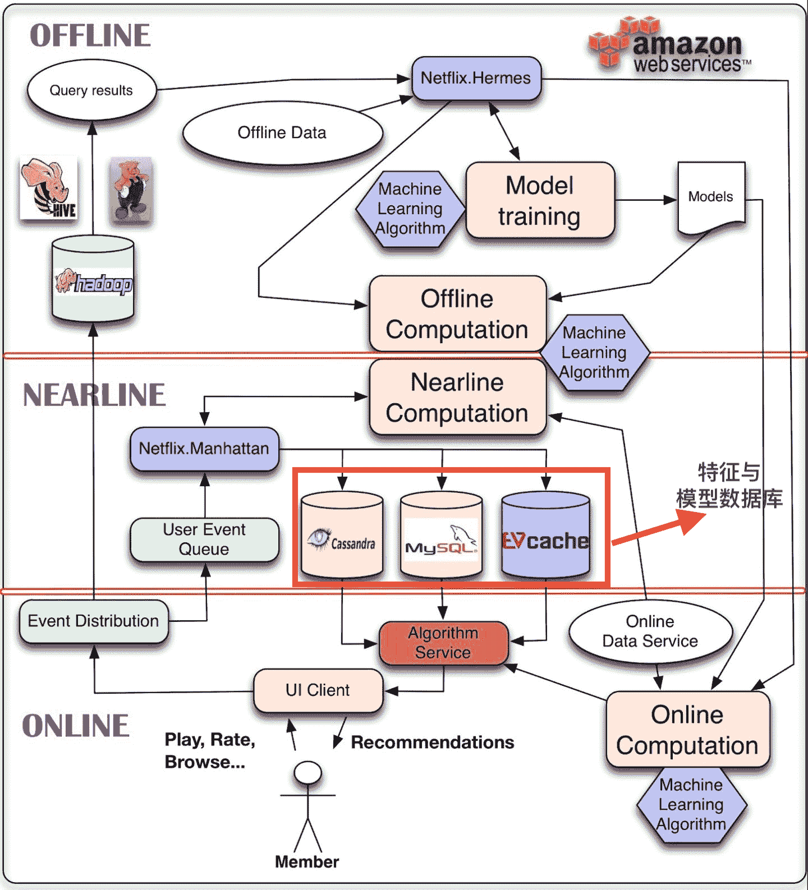
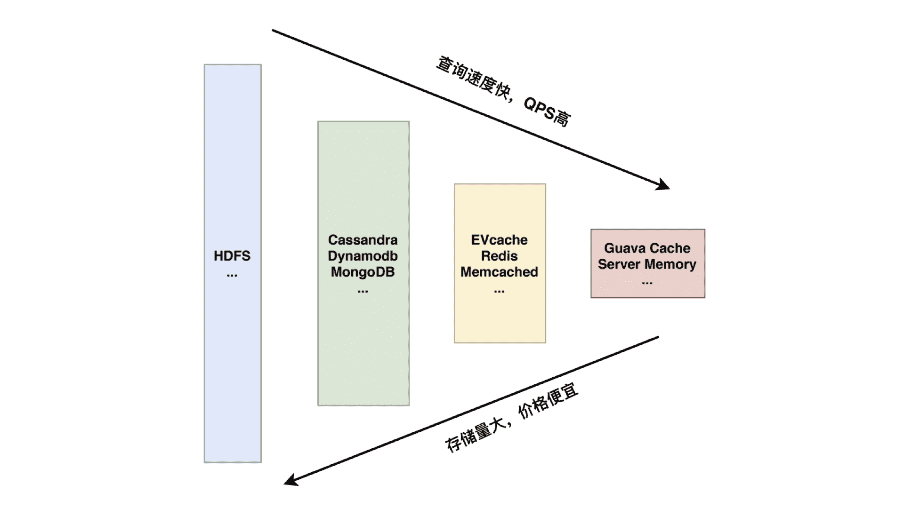
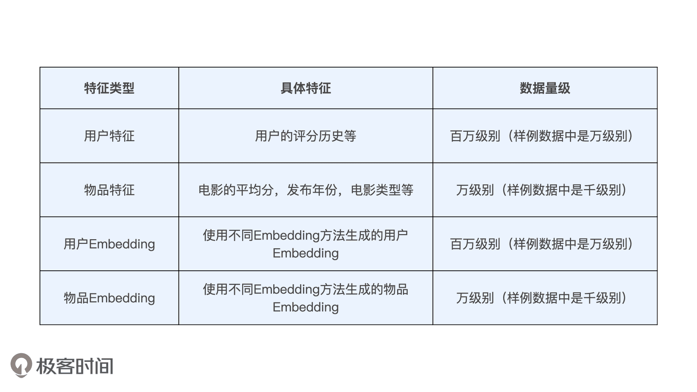
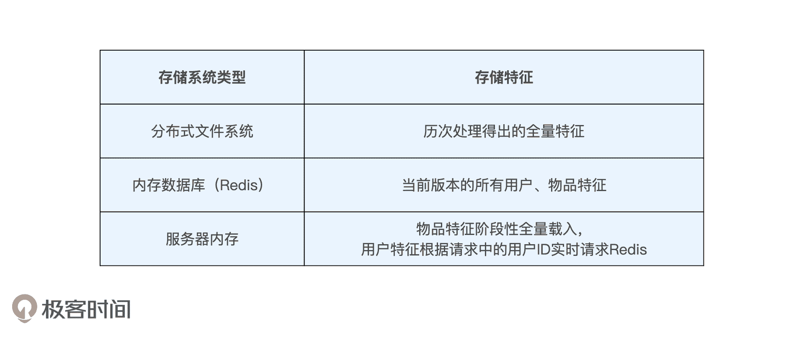
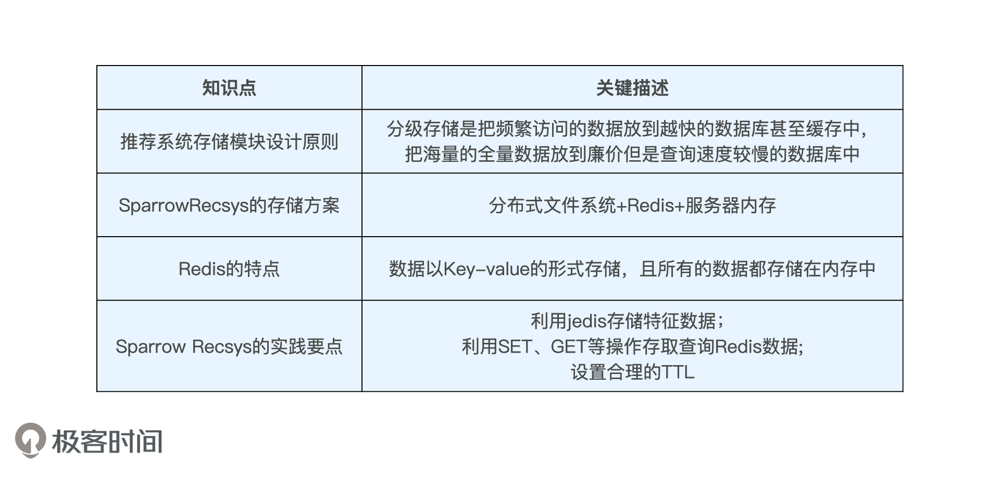

# 10｜存储模块：如何用Redis解决推荐系统特征的存储问题？

 

你好，我是王喆。今天，我们来解决系统特征的存储问题。

在特征工程篇我们说过，在推荐系统这个大饭馆中，特征工程就是负责配料和食材的厨师，那我们上堂课搭建的推荐服务器就是准备做菜的大厨。配料和食材准备好了，做菜的大厨也已经开火热锅了，这时候我们得把食材及时传到大厨那啊。这个传菜的过程就是推荐系统特征的存储和获取过程。

可是我们知道，类似 Embedding 这样的特征是在离线环境下生成的，而推荐服务器是在线上环境中运行的，那这些**离线的特征数据是如何导入到线上让推荐服务器使用的呢？**

今天，我们先以 Netflix 的推荐系统架构为例，来讲一讲存储模块在整个系统中的位置，再详细来讲推荐系统存储方案的设计原则，最后以 Redis 为核心搭建起 SparrowRecsys 的存储模块。

## 推荐系统存储模块的设计原则

你还记得，我曾在第 1 节的课后题中贴出过 Netflix 推荐系统的架构图（如图 1）吗？Netflix 采用了非常经典的 Offline、Nearline、Online 三层推荐系统架构。架构图中最核心的位置就是我在图中用红框标出的部分，它们是三个数据库 Cassandra、MySQL 和 EVcache，这三个数据库就是 Netflix 解决特征和模型参数存储问题的钥匙。



图1 Netflix推荐系统架构中的特征与模型数据库

你可能会觉得，存储推荐特征和模型这件事情一点儿都不难啊。不就是找一个数据库把离线的特征存起来，然后再给推荐服务器写几个 SQL 让它取出来用不就行了吗？为什么还要像 Netflix 这样兴师动众地搞三个数据库呢？

想要搞明白这个问题，我们就得搞清楚设计推荐系统存储模块的原则。对于推荐服务器来说，由于线上的 QPS 压力巨大，每次有推荐请求到来，推荐服务器都需要把相关的特征取出。这就要求推荐服务器一定要“快”。

不仅如此，对于一个成熟的互联网应用来说，它的用户数和物品数一定是巨大的，几千万上亿的规模是十分常见的。所以对于存储模块来说，这么多用户和物品特征所需的存储量会特别大。这个时候，事情就很难办了，又要存储量大，又要查询快，还要面对高 QPS 的压力。很不幸，没有一个独立的数据库能**经济又高效**地单独完成这样复杂的任务。

因此，几乎所有的工业级推荐系统都会做一件事情，就是把特征的存储做成分级存储，把越频繁访问的数据放到越快的数据库甚至缓存中，把海量的全量数据放到便宜但是查询速度较慢的数据库中。

举个不恰当的例子，如果你把特征数据放到基于 HDFS 的 HBase 中，虽然你可以轻松放下所有的特征数据，但要让你的推荐服务器直接访问 HBase 进行特征查询，等到查询完成，这边用户的请求早就超时中断了。而 Netflix 的三个数据库正好满足了这样分级存储的需求。



图2 分级存储的设计

比如说，Netflix 使用的 Cassandra，它作为流行的 NoSQL 数据库，具备大数据存储的能力，但为支持推荐服务器高 QPS 的需求，我们还需要把最常用的特征和模型参数存入 EVcache 这类内存数据库。而对于更常用的数据，我们可以把它们存储在 Guava Cache 等服务器内部缓存，甚至是服务器的内存中。总之，对于一个工程师来说，我们经常需要做出技术上的权衡，达成一个在花销和效果上平衡最优的技术方案。

而对于 MySQL 来说，由于它是一个强一致性的关系型数据库，一般存储的是比较关键的要求强一致性的信息，比如物品是否可以被推荐这种控制类的信息，物品分类的层级关系，用户的注册信息等等。这类信息一般是由推荐服务器进行阶段性的拉取，或者利用分级缓存进行阶段性的更新，避免因为过于频繁的访问压垮 MySQL。

总的来说，推荐系统存储模块的设计原则就是“**分级存储，把越频繁访问的数据放到越快的数据库甚至缓存中，把海量的全量数据放到廉价但是查询速度较慢的数据库中**”。

## SparrowRecsys 的存储系统方案

那在我们要实现的 SparrowRecsys 中，存储模块的设计原则又是怎么应用的呢？

在 SparrowRecsys 中，我们把存储模块的设计问题进行了一些简化，避免由于系统设计得过于复杂导致你不易上手。

我们使用基础的文件系统保存全量的离线特征和模型数据，用 Redis 保存线上所需特征和模型数据，使用服务器内存缓存频繁访问的特征。

在实现技术方案之前，对于问题的整体分析永远都是重要的。我们需要先确定具体的存储方案，这个方案必须精确到哪级存储对应哪些具体特征和模型数据。

存储的工具已经知道了，那特征和模型数据分别是什么呢？这里，我们直接应用特征工程篇为 SparrowRecsys 准备好的一些特征就可以了。我把它们的具体含义和数据量级整理成了表格，如下：



图3 特征和模型数据

根据上面的特征数据，我们一起做一个初步的分析。首先，用户特征的总数比较大，它们很难全部载入到服务器内存中，所以我们把用户特征载入到 Redis 之类的内存数据库中是合理的。其次，物品特征的总数比较小，而且每次用户请求，一般只会用到一个用户的特征，但为了物品排序，推荐服务器需要访问几乎所有候选物品的特征。针对这个特点，我们完全可以把所有物品特征阶段性地载入到服务器内存中，大大减少 Redis 的线上压力。

最后，我们还要找一个地方去存储特征历史数据、样本数据等体量比较大，但不要求实时获取的数据。这个时候分布式文件系统（单机环境下以本机文件系统为例）往往是最好的选择，由于类似 HDFS 之类的分布式文件系统具有近乎无限的存储空间，我们可以把每次处理的全量特征，每次训练的 Embedding 全部保存到分布式文件系统中，方便离线评估时使用。

经过上面的分析，我们就得到了具体的存储方案，如下表：



图4 SparrowRecsys的存储方案

此外，文件系统的存储操作非常简单，在 SparrowRecsys 中就是利用 Spark 的输出功能实现的，我们就不再重点介绍了。而服务器内部的存储操作主要是跟 Redis 进行交互，所以接下来我们重点介绍 Redis 的特性以及写入和读取方法。

## 你需要知道的 Redis 基础知识

Redis 是当今业界最主流的内存数据库，那在使用它之前，我们应该清楚 Redis 的两个主要特点。

**一是所有的数据都以 Key-value 的形式存储。** 其中，Key 只能是字符串，value 可支持的数据结构包括 string(字符串)、list(链表)、set(集合)、zset(有序集合) 和 hash(哈希)。这个特点决定了 Redis 的使用方式，无论是存储还是获取，都应该以键值对的形式进行，并且根据你的数据特点，设计值的数据结构。

**二是所有的数据都存储在内存中，磁盘只在持久化备份或恢复数据时起作用**。这个特点决定了 Redis 的特性，一是 QPS 峰值可以很高，二是数据易丢失，所以我们在维护 Redis 时要充分考虑数据的备份问题，或者说，不应该把关键的业务数据唯一地放到 Redis 中。但对于可恢复，不关乎关键业务逻辑的推荐特征数据，就非常适合利用 Redis 提供高效的存储和查询服务。

在实际的 SparrowRecsys 的 Redis 部分中，我们用到了 Redis 最基本的操作，SET、GET 和 KEYS，value 的数据类型用到了 string。

## SparrowRecsys 中的 Redis 部分的实践流程

Redis 的实践流程还是符合我们“把大象装冰箱”的三部曲，只不过，这三步变成了安装 Redis，把数据写进去，把数据读出来。下面，我们来逐一来讲。

**首先是安装 Redis。** Redis 的安装过程在 linux/Unix 环境下非常简单，你参照官方网站的步骤依次执行就好。而 Windows 环境下的安装过程稍复杂一些，你可以参考这篇文章进行安装。

在启动 Redis 之后，如果没有特殊的设置，Redis 服务会默认运行在 6379 端口，没有特殊情况保留这个默认的设置就可以了，因为我们的 SparrowRecSys 也是默认从 6379 端口存储和读取 Redis 数据的。

**然后是运行离线程序，通过 jedis 客户端写入 Redis。** 在 Redis 运行起来之后，我们就可以在离线 Spark 环境下把特征数据写入 Redis。这里我们以第 8 节课中生成的 Embedding 数据为例，来实现 Redis 的特征存储过程。

实际的过程非常简单，首先我们利用最常用的 Redis Java 客户端 Jedis 生成 redisClient，然后遍历训练好的 Embedding 向量，将 Embedding 向量以字符串的形式存入 Redis，并设置过期时间（ttl）。具体实现请参考下面的代码（代码参考 com.wzhe.sparrowrecsys.offline.spark.featureeng.Embedding 中的 trainItem2vec 函数）：

```
if (saveToRedis) {  
  //创建redis client  
  val redisClient = new Jedis(redisEndpoint, redisPort)  
  val params = SetParams.setParams()  
  //设置ttl为24小时  
  params.ex(60 * 60 * 24)  
  //遍历存储embedding向量  
  for (movieId <- model.getVectors.keys) {  
    //key的形式为前缀+movieId，例如i2vEmb:361  
    //value的形式是由Embedding向量生成的字符串，例如 "0.1693846 0.2964318 -0.13044095 0.37574086 0.55175656 0.03217995 1.327348 -0.81346786 0.45146862 0.49406642"  
    redisClient.set(redisKeyPrefix + ":" + movieId, model.getVectors(movieId).mkString(" "), params)  
  }  
  //关闭客户端连接  
  redisClient.close()  
}  

```

**最后是在推荐服务器中把 Redis 数据读取出来。**

在服务器端，根据刚才梳理出的存储方案，我们希望服务器能够把所有物品 Embedding 阶段性地全部缓存在服务器内部，用户 Embedding 则进行实时查询。这里，我把缓存物品 Embedding 的代码放在了下面。

你可以看到，它的实现的过程也并不复杂，就是先用 keys 操作把所有物品 Embedding 前缀的键找出，然后依次将 Embedding 载入内存。

```
//创建redis client  
Jedis redisClient = new Jedis(REDIS_END_POINT, REDIS_PORT);  
//查询出所有以embKey为前缀的数据  
Set<String> movieEmbKeys = redisClient.keys(embKey + "*");  
int validEmbCount = 0;  
//遍历查出的key  
for (String movieEmbKey : movieEmbKeys){  
    String movieId = movieEmbKey.split(":")[1];  
    Movie m = getMovieById(Integer.parseInt(movieId));  
    if (null == m) {  
        continue;  
    }  
    //用redisClient的get方法查询出key对应的value，再set到内存中的movie结构中  
    m.setEmb(parseEmbStr(redisClient.get(movieEmbKey)));  
    validEmbCount++;  
}  
redisClient.close();  

```

这样一来，在具体为用户推荐的过程中，我们再利用相似的接口查询出用户的 Embedding，与内存中的 Embedding 进行相似度的计算，就可以得到最终的推荐列表了。

如果你已经安装好了 Redis，我非常推荐你运行 SparrowRecsys 中 offline 部分 Embedding 主函数，先把物品和用户 Embedding 生成并且插入 Redis（注意把 saveToRedis 变量改为 true）。然后再运行 online 部分的 RecSysServer，看一下推荐服务器有没有正确地从 Redis 中读出物品和用户 Embedding 并产生正确的推荐结果（注意，记得要把 util.Config 中的 EMB_DATA_SOURCE 配置改为 DATA_SOURCE_REDIS）。

当然，除了 Redis，我们还提到了多种不同的缓存和数据库，如 Cassandra、EVcache、GuavaCache 等等，它们都是业界非常流行的存储特征的工具，你有兴趣的话也可以在课后查阅相关资料进行进一步的学习。在掌握了我们特征存储的基本原则之后，你也可以在业余时间尝试思考一下每个数据库的不同和它们最合适的应用场景。

## 小结

今天我们学习了推荐系统存储模块的设计原则和具体的解决方案，并且利用 SparrowRecsys 进行了实战。

在设计推荐系统存储方案时，我们一般要遵循“分级存储”的原则，在开销和性能之间取得权衡。在 SparrowRecsys 的实战中，我们安装并操作了内存数据库 Redis，你要记住 Redis 的特点“Key-value 形式存储”和“纯内存数据库”。在具体的特征存取过程中，我们应该熟悉利用 jedis 执行 SET，GET 等 Redis 常用操作的方法。

最后，我也把重要的知识点总结在了文稿中，你可以再回顾一下。



对于搭建一套完整的推荐服务来说，我们已经迈过了两大难关，分别是用 Jetty Server 搭建推荐服务器问题，以及用 Redis 解决特征存储的问题。下节课，我们会一起来挑战线上服务召回层的设计。

## 课后思考

你觉得课程中存储 Embedding 的方式还有优化的空间吗？除了 string，我们是不是还可以用其他 Redis value 的数据结构存储 Embedding 数据，那从效率的角度考虑，使用 string 和使用其他数据结构的优缺点有哪些？为什么？

欢迎把你的思考和答案写在留言区，也欢迎你把这节课分享给你的朋友，我们下节课见！
