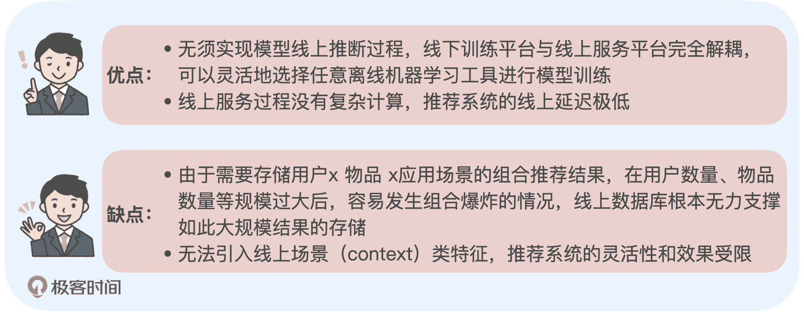
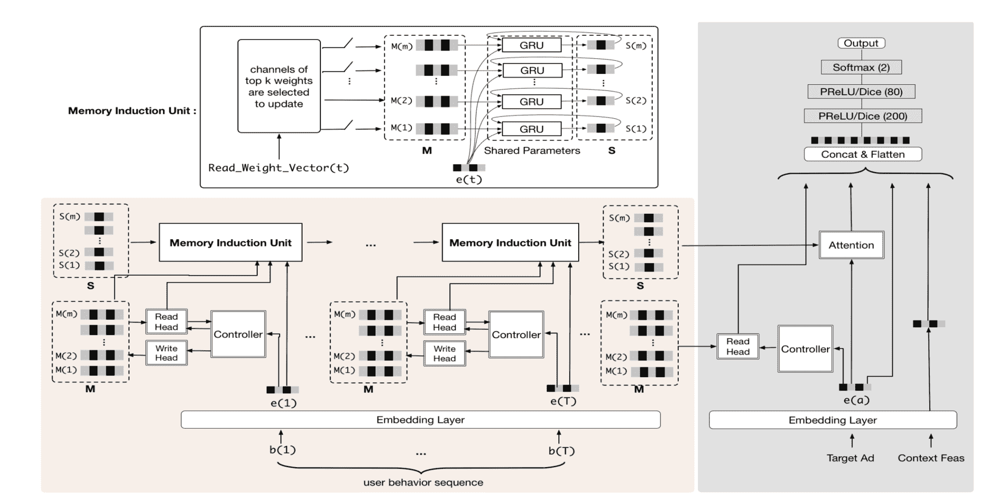
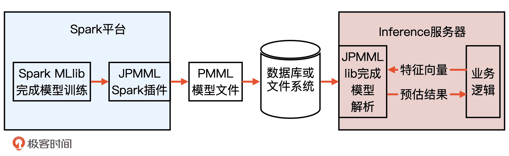
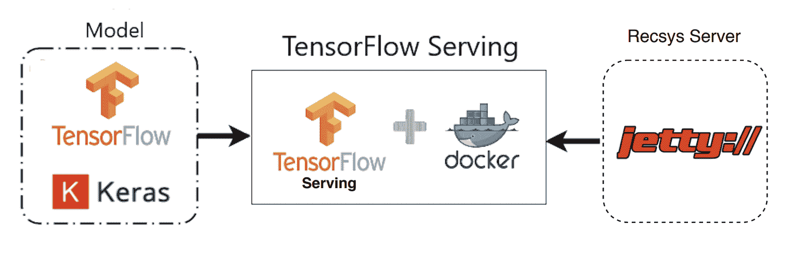
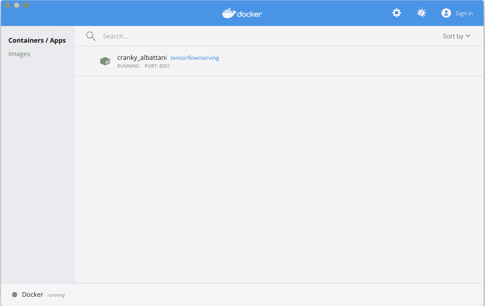
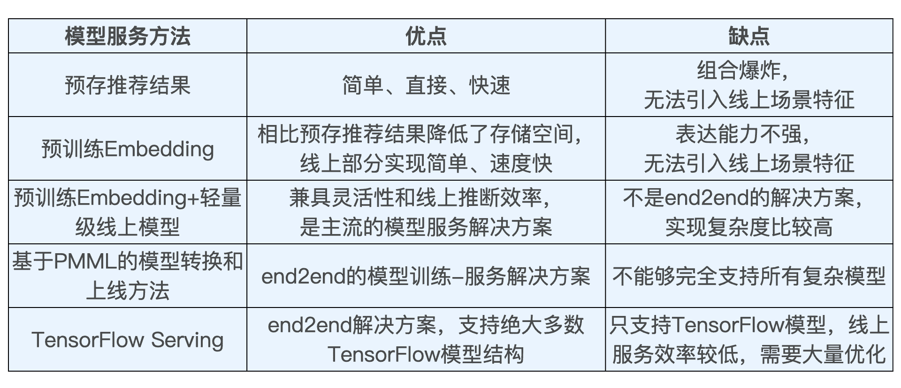

# 13 | 模型服务：怎样把你的离线模型部署到线上？

 

你好，我是王喆。今天我们来讨论“模型服务”（Model Serving）。

在实验室的环境下，我们经常使用 Spark MLlib、TensorFlow、PyTorch 这些流行的机器学习库来训练模型，因为不用直接服务用户，所以往往得到一些离线的训练结果就觉得大功告成了。但在业界的生产环境中，模型需要在线上运行，实时地根据用户请求生成模型的预估值。这个把模型部署在线上环境，并实时进行模型推断（Inference）的过程就是模型服务。

模型服务对于推荐系统来说是至关重要的线上服务，缺少了它，离线的模型只能在离线环境里面“干着急”，不能发挥功能。但是，模型服务的方法可谓是五花八门，各个公司为了部署自己的模型也是各显神通。那么，业界主流的模型服务方法都有哪些，我们又该如何选择呢？

今天，我就带你学习主流的模型服务方法，并通过 TensorFlow Serving 把你的模型部署到线上。

## 业界的主流模型服务方法

由于各个公司技术栈的特殊性，采用不同的机器学习平台，模型服务的方法会截然不同，不仅如此，使用不同的模型结构和模型存储方式，也会让模型服务的方法产生区别。总的来说，那业界主流的模型服务方法有 4 种，分别是预存推荐结果或 Embedding 结果、预训练 Embedding+ 轻量级线上模型、PMML 模型以及 TensorFlow Serving。接下来，我们就详细讲讲这些方法的实现原理，通过对比它们的优缺点，相信你会找到最合适自己业务场景的方法。

### 预存推荐结果或 Embedding 结果

对于推荐系统线上服务来说，最简单直接的模型服务方法就是在离线环境下生成对每个用户的推荐结果，然后将结果预存到以 Redis 为代表的线上数据库中。这样，我们在线上环境直接取出预存数据推荐给用户即可。

这个方法的优缺点都非常明显，我把它们总结在了下图中，你可以看看。



图1 预存推荐结果优缺点对比

由于这些优缺点的存在，这种直接存储推荐结果的方式往往只适用于用户规模较小，或者一些冷启动、热门榜单等特殊的应用场景中。

那如果在用户规模比较大的场景下，我们该怎么减少模型存储所需的空间呢？我们其实可以通过存储 Embedding 的方式来替代直接存储推荐结果。具体来说就是，我们先离线训练好 Embedding，然后在线上通过相似度运算得到最终的推荐结果。

在前面的课程中，我们通过 Item2vec、Graph Embedding 等方法生成物品 Embedding，再存入 Redis 供线上使用的过程，这就是预存 Embedding 的模型服务方法的典型应用。

由于，线上推断过程非常简单快速，因此，预存 Embedding 的方法是业界经常采用的模型服务手段。但它的局限性同样存在，由于完全基于线下计算出 Embedding，这样的方式无法支持线上场景特征的引入，并且无法进行复杂模型结构的线上推断，表达能力受限。因此对于复杂模型，我们还需要从模型实时线上推断的角度入手，来改进模型服务的方法。

### 预训练 Embedding+ 轻量级线上模型

事实上，直接预存 Embedding 的方法让模型表达能力受限这个问题的产生，主要是因为我们仅仅采用了“相似度计算”这样非常简单的方式去得到最终的推荐分数。既然如此，那我们能不能在线上实现一个比较复杂的操作，甚至是用神经网络来生成最终的预估值呢？当然是可行的，这就是业界很多公司采用的“预训练 Embedding+ 轻量级线上模型”的模型服务方式。

详细一点来说，这样的服务方式指的是“**用复杂深度学习网络离线训练生成 Embedding，存入内存数据库，再在线上实现逻辑回归或浅层神经网络等轻量级模型来拟合优化目标**”。

口说无凭，接下来，我们就来看一个业界实际的例子。我们先来看看下面这张模型结构图，这是阿里的推荐模型 MIMN（Multi-channel user Interest Memory Network，多通道用户兴趣记忆网络）的结构。神经网络，才是真正在线上服务的部分。

仔细看这张图你会注意到，左边粉色的部分是复杂模型部分，右边灰色的部分是简单模型部分。看这张图的时候，其实你不需要纠结于复杂模型的结构细节，你只要知道左边的部分不管多复杂，它们其实是在线下训练生成的，而右边的部分是一个经典的多层神经网络，它才是真正在线上服务的部分。



图2 阿里的MIMN模型 （出自Practice on Long Sequential User Behavior Modeling for Click-Through Rate Prediction）

这两部分的接口在哪里呢？你可以看一看图中连接处的位置，有两个被虚线框框住的数据结构，分别是 S(1)-S(m) 和 M(1)-M(m)。它们其实就是在离线生成的 Embedding 向量，在 MIMN 模型中，它们被称为“多通道用户兴趣向量”，这些 Embedding 向量就是连接离线模型和线上模型部分的接口。

线上部分从 Redis 之类的模型数据库中拿到这些离线生成 Embedding 向量，然后跟其他特征的 Embedding 向量组合在一起，扔给一个标准的多层神经网络进行预估，这就是一个典型的“预训练 Embedding+ 轻量级线上模型”的服务方式。

它的好处显而易见，就是我们隔离了离线模型的复杂性和线上推断的效率要求，离线环境下，你可以尽情地使用复杂结构构建你的模型，只要最终的结果是 Embedding，就可以轻松地供给线上推断使用。

### 利用 PMML 转换和部署模型

虽然 Embedding+ 轻量级模型的方法既实用又高效，但它还是把模型进行了割裂，让模型不完全是 End2End（端到端）训练 +End2End 部署这种最“完美”的方式。那有没有能够在离线训练完模型之后什么都不用做，直接部署模型的方式呢？当然是有的，也就是我接下来要讲的脱离于平台的通用模型部署方式，PMML。

PMML 的全称是“预测模型标记语言”(Predictive Model Markup Language, PMML)，它是一种通用的以 XML 的形式表示不同模型结构参数的标记语言。在模型上线的过程中，PMML 经常作为中间媒介连接离线训练平台和线上预测平台。

这么说可能还比较抽象。接下来，我就以 Spark MLlib 模型的训练和上线过程为例，来和你详细解释一下，PMML 在整个机器学习模型训练及上线流程中扮演的角色。



图3 Spark模型利用PMML的上线过程

图 3 中的例子使用了 JPMML 作为序列化和解析 PMML 文件的 library（库），JPMML 项目分为 Spark 和 Java Server 两部分。Spark 部分的 library 完成 Spark MLlib 模型的序列化，生成 PMML 文件，并且把它保存到线上服务器能够触达的数据库或文件系统中，而 Java Server 部分则完成 PMML 模型的解析，生成预估模型，完成了与业务逻辑的整合。

JPMML 在 Java Server 部分只进行推断，不考虑模型训练、分布式部署等一系列问题，因此 library 比较轻，能够高效地完成推断过程。与 JPMML 相似的开源项目还有 MLeap，同样采用了 PMML 作为模型转换和上线的媒介。

事实上，JPMML 和 MLeap 也具备 Scikit-learn、TensorFlow 等简单模型的转换和上线能力。我把JPMML和MLeap的项目地址放在这里，感兴趣的同学可以进一步学习和实践。

### TensorFlow Serving

既然 PMML 已经是 End2End 训练 +End2End 部署这种最“完美”的方式了，那我们的课程中为什么不使用它进行模型服务呢？这是因为对于具有复杂结构的深度学习模型来说，PMML 语言的表示能力还是比较有限的，还不足以支持复杂的深度学习模型结构。由于咱们课程中的推荐模型篇，会主要使用 TensorFlow 来构建深度学习推荐模型，这个时候 PMML 的能力就有点不足了。想要上线 TensorFlow 模型，我们就需要借助 TensorFlow 的原生模型服务模块，也就是 TensorFlow Serving 的支持。

从整体工作流程来看，TensorFlow Serving 和 PMML 类工具的流程一致，它们都经历了模型存储、模型载入还原以及提供服务的过程。在具体细节上，TensorFlow 在离线把模型序列化，存储到文件系统，TensorFlow Serving 把模型文件载入到模型服务器，还原模型推断过程，对外以 HTTP 接口或 gRPC 接口的方式提供模型服务。

再具体到咱们的 SparrowRecsys 项目中，我们会在离线使用 TensorFlow 的 Keras 接口完成模型构建和训练，再利用 TensorFlow Serving 载入模型，用 Docker 作为服务容器，然后在 Jetty 推荐服务器中发出 HTTP 请求到 TensorFlow Serving，获得模型推断结果，最后推荐服务器利用这一结果完成推荐排序。



图4 SparrowRecsys项目模型服务部分的架构

## 实战搭建 TensorFlow Serving 模型服务

好了，清楚了模型服务的相关知识，相信你对各种模型服务方法的优缺点都已经了然于胸了。刚才我们提到，咱们的课程选用了 TensorFlow 作为构建深度学习推荐模型的主要平台，并且选用了 TensorFlow Serving 作为模型服务的技术方案，它们可以说是整个推荐系统的核心了。那为了给之后的学习打下基础，接下来，我就带你搭建一个 TensorFlow Serving 的服务，把这部分重点内容牢牢掌握住。

总的来说，搭建一个 TensorFlow Serving 的服务主要有 3 步，分别是安装 Docker，建立 TensorFlow Serving 服务，以及请求 TensorFlow Serving 获得预估结果。为了提高咱们的效率，我希望你能打开电脑跟着我的讲解和文稿里的指令代码，一块儿来安装。

### 1. 安装 Docker

TensorFlow Serving 最普遍、最便捷的服务方式就是使用 Docker 建立模型服务 API。为了方便你后面的学习，我再简单说说 Docker。Docker 是一个开源的应用容器引擎，你可以把它当作一个轻量级的虚拟机。它可以让开发者打包他们的应用以及依赖包到一个轻量级、可移植的容器中，然后发布到任何流行的操作系统，比如 Linux/Windows/Mac 的机器上。Docker 容器相互之间不会有任何接口，而且容器本身的开销极低，这就让 Docker 成为了非常灵活、安全、伸缩性极强的计算资源平台。

因为 TensorFlow Serving 对外提供的是模型服务接口，所以使用 Docker 作为容器的好处主要有两点，一是可以非常方便的安装，二是在模型服务的压力变化时，可以灵活地增加或减少 Docker 容器的数量，做到弹性计算，弹性资源分配。Docker 的安装也非常简单，我们参考官网的教程，像安装一个普通软件一样下载安装就好。

安装完 Docker 后，你不仅可以通过图形界面打开并运行 Docker，而且可以通过命令行来进行 Docker 相关的操作。那怎么验证你是否安装成功了呢？只要你打开命令行输入 docker --version 命令，它能显示出类似“Docker version 19.03.13, build 4484c46d9d”这样的版本号，就说明你的 Docker 环境已经准备好了。

### 2. 建立 TensorFlow Serving 服务

Docker 环境准备好之后，我们就可以着手建立 TensorFlow Serving 服务了。

首先，我们要利用 Docker 命令拉取 TensorFlow Serving 的镜像:

```
  
# 从docker仓库中下载tensorflow/serving镜像  
docker pull tensorflow/serving  

```

然后，我们再从 TenSorflow 的官方 GitHub 地址下载 TensorFlow Serving 相关的测试模型文件：

```
# 把tensorflow/serving的测试代码clone到本地  
git clone https://github.com/tensorflow/serving  
# 指定测试数据的地址  
TESTDATA="$(pwd)/serving/tensorflow_serving/servables/tensorflow/testdata"
```

最后，我们在 Docker 中启动一个包含 TensorFlow Serving 的模型服务容器，并载入我们刚才下载的测试模型文件 half_plus_two：

```
# 启动TensorFlow Serving容器，在8501端口运行模型服务api  
docker run -t --rm -p 8501:8501 \  
    -v "$TESTDATA/saved_model_half_plus_two_cpu:/models/half_plus_two" \  
    -e MODEL_NAME=half_plus_two \  
    tensorflow/serving &
```

在命令执行完成后，如果你在 Docker 的管理界面中看到了 TenSorflow Serving 容器，如下图所示，就证明 TensorFlow Serving 服务被你成功建立起来了。



图5 TensorFlow Serving容器的Docker启动管理界面

### 3. 请求 TensorFlow Serving 获得预估结果

最，我们再来验证一下是否能够通过 HTTP 请求从 TensorFlow Serving api 中获得模型的预估结果。我们可以通过 curl 命令来发送 HTTP POST 请求到 TensorFlow Serving 的地址，或者利用 Postman 等软件来组装 POST 请求进行验证。

```
# 请求模型服务API  
curl -d '{"instances": [1.0, 2.0, 5.0]}' \  
    -X POST http://localhost:8501/v1/models/half_plus_two:predict
```

如果你看到了下图这样的返回结果，就说明 TensorFlow Serving 服务已经成功建立起来了。

```
# 返回模型推断结果如下  
# Returns => { "predictions": [2.5, 3.0, 4.5] }
```

如果对这整个过程还有疑问的话，你也可以参考 TensorFlow Serving 的官方教程。

不过，有一点我还想提醒你，这里我们只是使用了 TensorFlow Serving 官方自带的一个测试模型，来告诉你怎么准备环境。在推荐模型实战的时候，我们还会基于 TensorFlow 构建多种不同的深度学习模型，到时候 TensorFlow Serving 就会派上关键的用场了。

那对于深度学习推荐系统来说，我们只要选择 TensorFlow Serving 的模型服务方法就万无一失了吗？当然不是，它也有需要优化的地方。在搭建它的过程会涉及模型更新，整个 Docker Container 集群的维护，而且 TensorFlow Serving 的线上性能也需要大量优化来提高，这些工程问题都是我们在实践过程中必须要解决的。但是，它的易用性和对复杂模型的支持，还是让它成为上线 TensorFlow 模型的第一选择。

## 小结

业界主流的模型服务方法有 4 种，分别是预存推荐结果或 Embeding 结果、预训练 Embeding+ 轻量级线上模型、利用 PMML 转换和部署模型以及 TensorFlow Serving。

它们各有优缺点，为了方便你对比，我把它们的优缺点都列在了表格中，你可以看看。



我们的之后的课程会重点使用 TensorFlow Serving，它是 End2End 的解决方案，使用起来非常方便、高效，而且它支持绝大多数 TensorFlow 的模型结构，对于深度学习推荐系统来说，是一个非常好的选择。但它只支持 TensorFlow 模型，而且针对线上服务的性能问题，需要进行大量的优化，这是我们在使用时需要重点注意的。

在实践部分，我们一步步搭建起了基于 Docker 的 TensorFlow Serving 服务，这为我们之后进行深度学习推荐模型的上线打好了基础。整个搭建过程非常简单，相信你跟着我的讲解就可以轻松完成。

## 课后思考

我们今天讲了如此多的模型服务方式，你能结合自己的经验，谈一谈你是如何在自己的项目中进行模型服务的吗？除了我们今天说的，你还用过哪些模型服务的方法？

欢迎在留言区分享你的经验，也欢迎你把这节课分享出去，我们下节课见！
