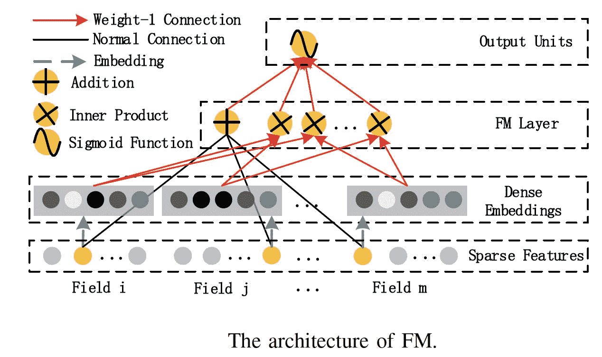
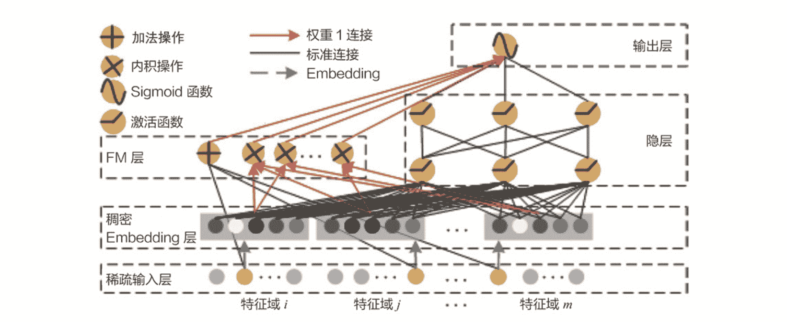
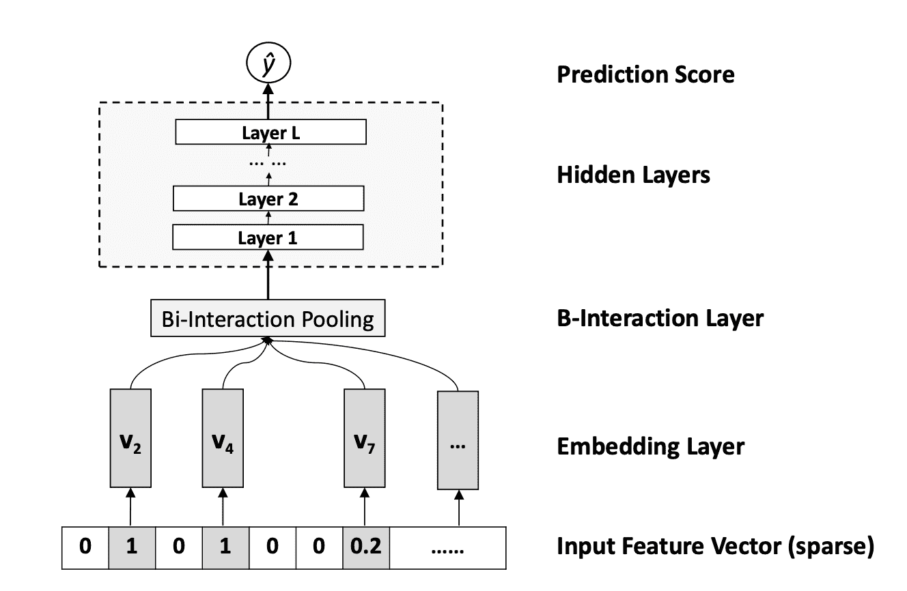
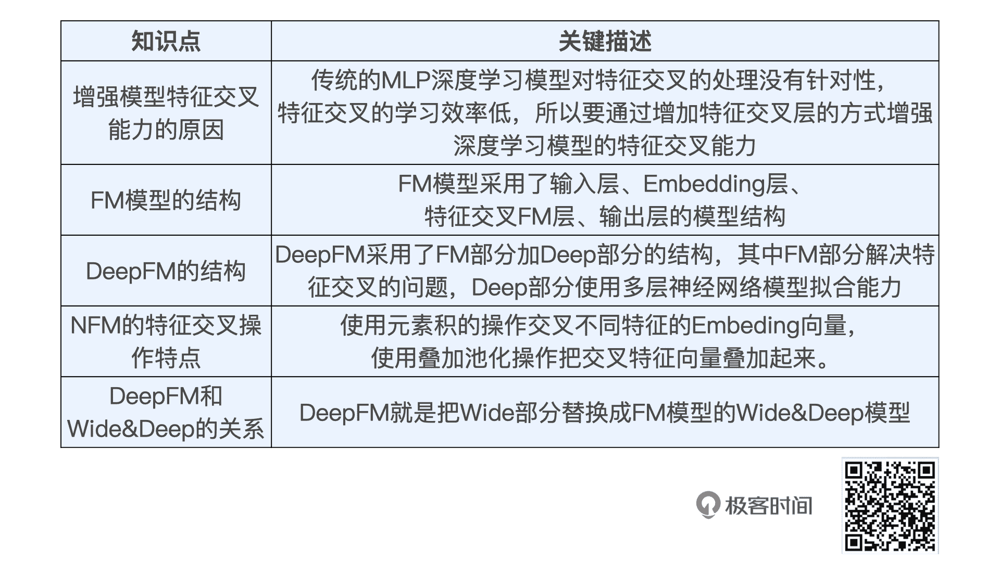

# 20 | DeepFM：如何让你的模型更好地处理特征交叉？

 

你好，我是王喆。

前面几节课，我们学习了 Embedding MLP、Wide&Deep、NerualCF 等几种不同的模型结构。你有没有深入思考过这样一个问题，就是这几种模型都是怎么处理特征交叉这个问题的呢？

比如说，模型的输入有性别、年龄、电影风格这几个特征，在训练样本中我们发现有 25 岁男生喜欢科幻电影的样本，有 35 岁女生喜欢看恐怖电影的样本，那你觉得模型应该怎么推测“25 岁”的女生喜欢看的电影风格呢？

事实上，这类特征组合和特征交叉问题非常常见，而且在实际应用中，特征的种类还要多得多，特征交叉的复杂程度也要大得多。**解决这类问题的关键，就是模型对于特征组合和特征交叉的学习能力，因为它决定了模型对于未知特征组合样本的预测能力，而这对于复杂的推荐问题来说，是决定其推荐效果的关键点之一。**

但无论是 Embedding MLP，还是 Wide&Deep 其实都没有对特征交叉进行特别的处理，而是直接把独立的特征扔进神经网络，让它们在网络里面进行自由组合，就算是 NeuralCF 也只在最后才把物品侧和用户侧的特征交叉起来。那这样的特征交叉方法是高效的吗？深度学习模型有没有更好的处理特征交叉的方法呢？

这节课，我们就一起来解决这些问题。同时，我还会基于特征交叉的思想，带你学习和实现一种新的深度学习模型 DeepFM。

## 为什么深度学习模型需要加强特征交叉的能力？

不过，在正式开始今天的课程之前，我还想和你再深入聊聊，为什么深度学习需要加强特征交叉的能力。我们刚才说 Embedding MLP 和 Wide&Deep 模型都没有针对性的处理特征交叉问题，有的同学可能就会有疑问了，我们之前不是一直说，多层神经网络有很强的拟合能力，能够在网络内部任意地组合特征吗？这两个说法是不是矛盾了？

在进入正题前，我就带你先扫清这个疑问。我们之前一直说 MLP 有拟合任意函数的能力，这没有错，但这是建立在 MLP 有任意多层网络，以及任意多个神经元的前提下的。

在训练资源有限，调参时间有限的现实情况下，MLP 对于特征交叉的处理其实还比较低效。因为 MLP 是通过 concatenate 层把所有特征连接在一起成为一个特征向量的，这里面没有特征交叉，两两特征之间没有发生任何关系。

这个时候，在我们有先验知识的情况下，人为地加入一些负责特征交叉的模型结构，其实对提升模型效果会非常有帮助。比如，在我们 Sparrow RecSys 项目的训练样本中其实有两个这样的特征，一个是用户喜欢的电影风格，一个是电影本身的风格，这两个特征明显具有很强的相关性。如果我们能让模型利用起这样的相关性，肯定会对最后的推荐效果有正向的影响。

既然这样，那我们不如去设计一些特定的特征交叉结构，来把这些相关性强的特征，交叉组合在一起，这就是深度学习模型要加强特征交叉能力的原因了。

## 善于处理特征交叉的机器学习模型 FM

扫清了这个疑问，接下来，我们就要进入具体的深度学习模型的学习了，不过，先别着急，我想先和你聊聊传统的机器学习模型是怎么解决特征交叉问题的，看看深度学习模型能不能从中汲取到“养分”。

说到解决特征交叉问题的传统机器学习模型，我们就不得不提一下，曾经红极一时的机器学习模型因子分解机模型（Factorization Machine）了，我们可以简称它为 FM。



图1 FM的神经网络化结构   
（出自论文 DeepFM: A Factorization-Machine based Neural Network for CTR Prediction）

首先，我们看上图中模型的最下面，它的输入是由类别型特征转换成的 One-hot 向量，往上就是深度学习的常规操作，也就是把 One-hot 特征通过 Embedding 层转换成稠密 Embedding 向量。到这里，FM 跟其他深度学习模型其实并没有区别，但再往上区别就明显了。

FM 会使用一个独特的层 FM Layer 来专门处理特征之间的交叉问题。你可以看到，FM 层中有多个内积操作单元对不同特征向量进行两两组合，这些操作单元会把不同特征的内积操作的结果输入最后的输出神经元，以此来完成最后的预测。

这样一来，如果我们有两个特征是用户喜爱的风格和电影本身的风格，通过 FM 层的两两特征的内积操作，这两个特征就可以完成充分的组合，不至于像 Embedding MLP 模型一样，还要 MLP 内部像黑盒子一样进行低效的交叉。

## 深度学习模型和 FM 模型的结合 DeepFM

这个时候问题又来了，FM 是一个善于进行特征交叉的模型，但是我们之前也讲过，深度学习模型的拟合能力强啊，那二者之间能结合吗？

学习过 Wide&Deep 结构之后，我们一定可以快速给出答案，我们当然可以把 FM 跟其他深度学习模型组合起来，生成一个全新的既有强特征组合能力，又有强拟合能力的模型。基于这样的思想，DeepFM 模型就诞生了。

DeepFM 是由哈工大和华为公司联合提出的深度学习模型，我把它的架构示意图放在了下面。



图2 DeepFM模型架构图   
（出自论文 DeepFM: A Factorization-Machine based Neural Network for CTR Prediction）

结合模型结构图，我们可以看到，DeepFM 利用了 Wide&Deep 组合模型的思想，用 FM 替换了 Wide&Deep 左边的 Wide 部分，加强了浅层网络部分特征组合的能力，而右边的部分跟 Wide&Deep 的 Deep 部分一样，主要利用多层神经网络进行所有特征的深层处理，最后的输出层是把 FM 部分的输出和 Deep 部分的输出综合起来，产生最后的预估结果。这就是 DeepFM 的结构。

## 如何使用元素积的操作进行特征交叉？

接下来我们再思考一个问题，FM 和 DeepFM 中进行特征交叉的方式，都是进行 Embedding 向量的点积操作，那是不是说特征交叉就只能用点积操作了？

答案当然是否定的。事实上还有很多向量间的运算方式可以进行特征的交叉，比如模型 NFM（Neural Factorization Machines，神经网络因子分解机），它就使用了新的特征交叉方法。下面，我们一起来看一下。

图 3 就是 NFM 的模型架构图，相信已经看了这么多模型架构图的你，一眼就能看出它跟其他模型的区别，也就是 Bi-Interaction Pooling 层。那这个夹在 Embedding 层和 MLP 之间的层到底做了什么呢？



图3 NFM的模型架构图   
（出自论文Neural Factorization Machines for Sparse Predictive Analytics）

Bi-Interaction Pooling Layer 翻译成中文就是“两两特征交叉池化层”。假设 Vx 是所有特征域的 Embedding 集合，那么特征交叉池化层的具体操作如下所示。
fPI​(Vx​)=i=1∑n​j=i+1∑n​xi​vi​⊙xj​vj​

其中 ⊙ 运算代表两个向量的元素积（Element-wise Product）操作，即两个长度相同的向量对应维相乘得到元素积向量。其中，第 k 维的操作如下所示。
(Vi​⊙Vj​)K​=vik​vjk​

在进行两两特征 Embedding 向量的元素积操作后，再求取所有交叉特征向量之和，我们就得到了池化层的输出向量。接着，我们再把该向量输入上层的多层全连接神经网络，就能得出最后的预测得分。

总的来说，NFM 并没有使用内积操作来进行特征 Embedding 向量的交叉，而是使用元素积的操作。在得到交叉特征向量之后，也没有使用 concatenate 操作把它们连接起来，而是采用了求和的池化操作，把它们叠加起来。

看到这儿，你肯定又想问，元素积操作和点积操作到底哪个更好呢？还是那句老话，我希望我们能够尽量多地储备深度学习模型的相关知识，先不去关注哪个方法的效果会更好，至于真实的效果怎么样，交给你去在具体的业务场景的实践中验证。

## DeepFM 的 TensorFlow 实战

接下来，又到了 TensorFlow 实践的时间了，今天我们将要实现 DeepFM 模型。有了之前实现 Wide&Deep 模型的经验，我想你实现起 DeepFM 也不会困难。跟前几节课一样，实践过程中的特征处理、模型训练评估的部分都是相同的，我也就不再重复了，我们重点看模型定义的部分。我把这部分的代码也放在了下面，你可以结合它来看我的讲解。

```
item_emb_layer = tf.keras.layers.DenseFeatures([movie_emb_col])(inputs)  
user_emb_layer = tf.keras.layers.DenseFeatures([user_emb_col])(inputs)  
item_genre_emb_layer = tf.keras.layers.DenseFeatures([item_genre_emb_col])(inputs)  
user_genre_emb_layer = tf.keras.layers.DenseFeatures([user_genre_emb_col])(inputs)  
  
  
# FM part, cross different categorical feature embeddings  
product_layer_item_user = tf.keras.layers.Dot(axes=1)([item_emb_layer, user_emb_layer])  
product_layer_item_genre_user_genre = tf.keras.layers.Dot(axes=1)([item_genre_emb_layer, user_genre_emb_layer])  
product_layer_item_genre_user = tf.keras.layers.Dot(axes=1)([item_genre_emb_layer, user_emb_layer])  
product_layer_user_genre_item = tf.keras.layers.Dot(axes=1)([item_emb_layer, user_genre_emb_layer])  
  
  
# deep part, MLP to generalize all input features  
deep = tf.keras.layers.DenseFeatures(deep_feature_columns)(inputs)  
deep = tf.keras.layers.Dense(64, activation='relu')(deep)  
deep = tf.keras.layers.Dense(64, activation='relu')(deep)  
  
  
# concatenate fm part and deep part  
concat_layer = tf.keras.layers.concatenate([product_layer_item_user, product_layer_item_genre_user_genre,  
                                            product_layer_item_genre_user, product_layer_user_genre_item, deep], axis=1)  
output_layer = tf.keras.layers.Dense(1, activation='sigmoid')(concat_layer)  
  
  
model = tf.keras.Model(inputs, output_lay)  

```

在整个实践的过程中，有两个地方需要我们重点注意，一个是 FM 部分的构建，另一个是 FM 部分的输出和 Deep 输出的连接。

在构建 FM 部分的时候，我们先为 FM 部分选择了 4 个用于交叉的类别型特征，分别是用户 ID、电影 ID、用户喜欢的风格和电影自己的风格。接着，我们使用 Dot layer 把用户特征和电影特征两两交叉，这就完成了 FM 部分的构建。

而 Deep 部分的实现，其实和我们之前实现过的 Wide&Deep 模型的 Deep 部分完全一样。只不过，最终我们会使用 concatenate 层，去把 FM 部分的输出和 Deep 部分的输出连接起来，输入到输出层的 sigmoid 神经元，从而产生最终的预估分数。那关于 DeepFM 的全部代码，你可以参照 SparrowRecsys 项目中的 DeepFM.py 文件。

## 小结

DeepFM 模型在解决特征交叉问题上非常有优势，它会使用一个独特的 FM 层来专门处理特征之间的交叉问题。具体来说，就是使用点积、元素积等操作让不同特征之间进行两两组合，再把组合后的结果输入的输出神经元中，这会大大加强模型特征组合的能力。因此，DeepFM 模型相比于 Embedding MLP、Wide&Deep 等模型，往往具有更好的推荐效果。

实现 DeepFM 模型的过程并不困难，我们主要记住三点就可以了：

1. 它是由 FM 和 Deep 两部分组成的；
2. 在实现 FM 部分特征交叉层的时候，我们使用了多个 Dot Product 操作单元完成不同特征的两两交叉；
3. Deep 部分则与 Wide&Deep 模型一样，负责所有输入特征的深度拟合，提高模型整体的表达能力

刚才说的重点知识，我都整理在了下面的表格中，你可以看一看。



好了，到今天这节课，我们已经在 SparrowRecsys 中实现了四个深度学习模型，相信你对 TensorFlow 的 Keras 接口也已经十分熟悉了。我希望你不只满足于读懂、用好 SparrowRecsys 中实现好的模型，而是真的在课后自己多去尝试不同的特征输入，不同的模型结构，甚至可以按照自己的理解和思考去改进这些模型。

因为深度学习模型结构没有标准答案，我们只有清楚不同模型之间的优缺点，重点汲取它们的设计思想，才能在实际的工作中结合自己遇到的问题，来优化和改造已有的模型。也只有这样，你们才能成为一名能真正解决实际问题的算法工程师。

## 课后思考

你觉得除了点积和元素积这两个操作外，还有没有其他的方法能处理两个 Embedding 向量间的特征交叉？

关于深度学习中特征交叉问题的处理方法，你是不是学会了？欢迎把你的思考和疑问写在留言区，如果你的朋友也对 DeepFM 这个模型感兴趣，那不妨也把这节课转发给他，我们下节课见！
