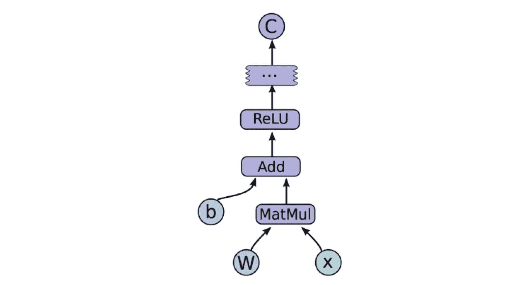
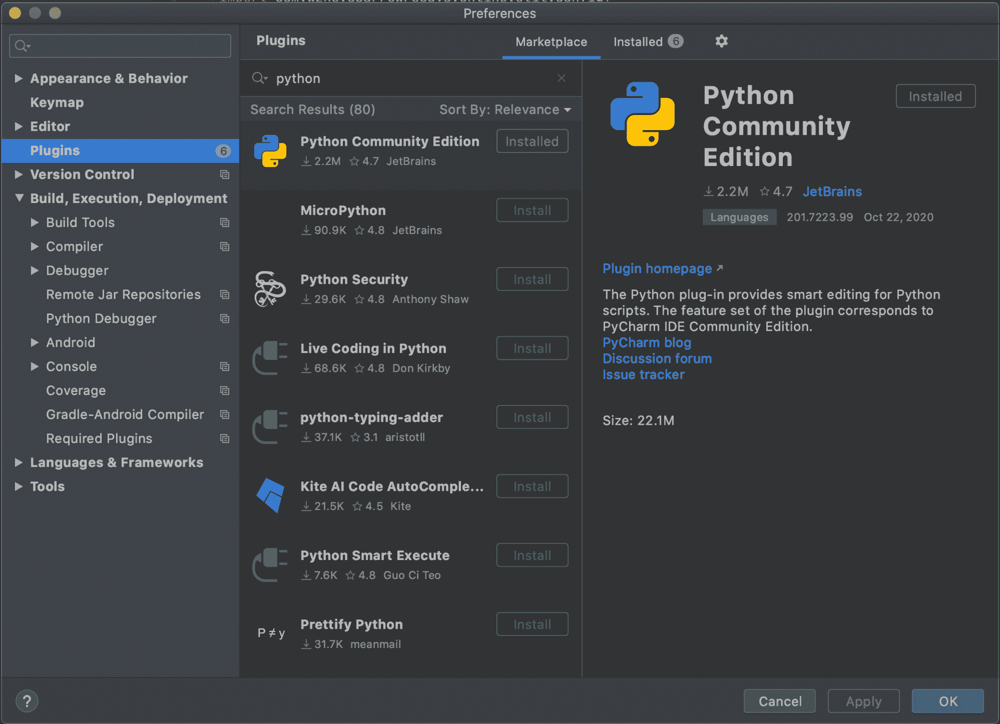
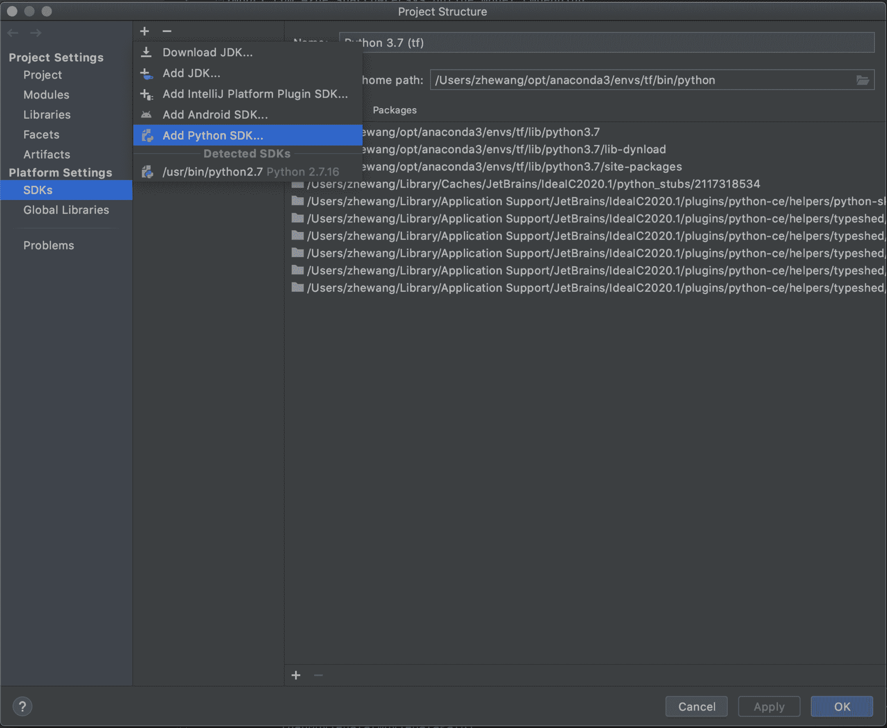
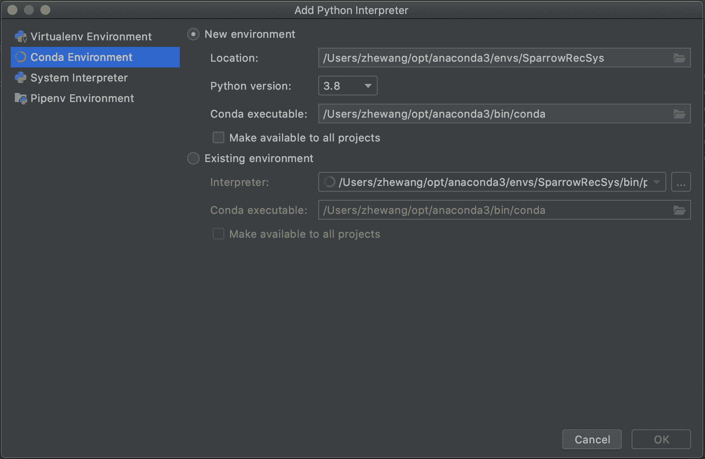
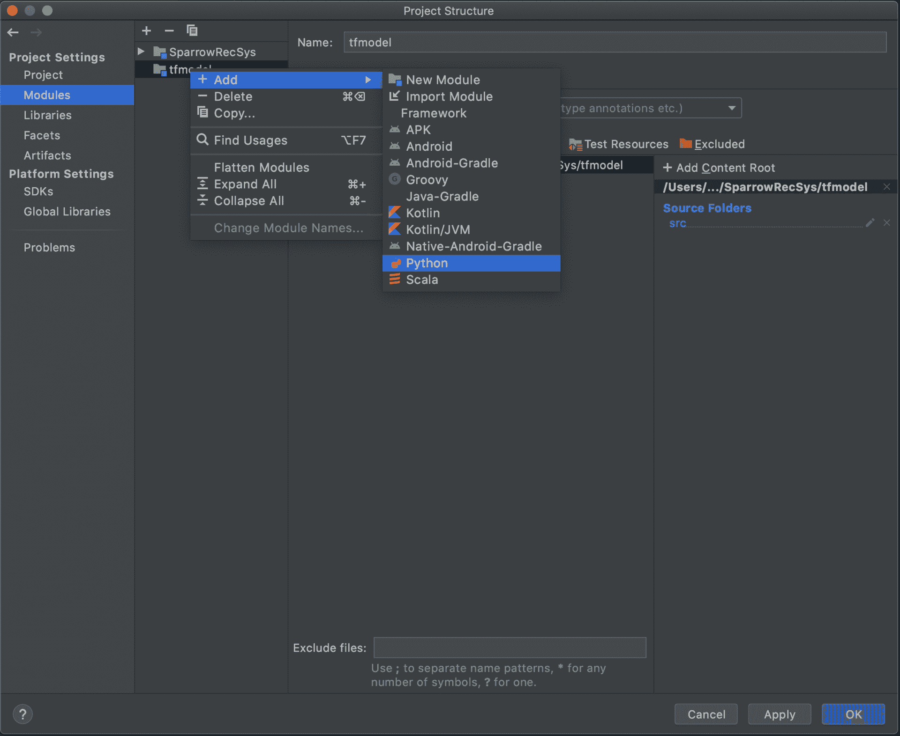
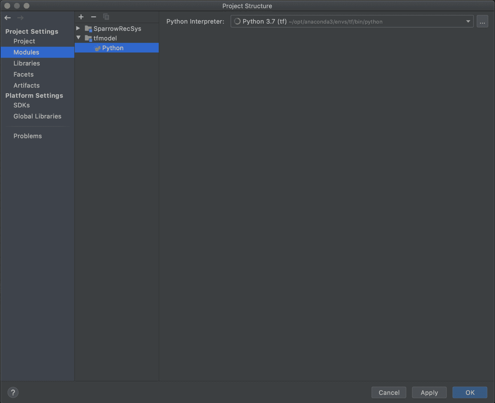
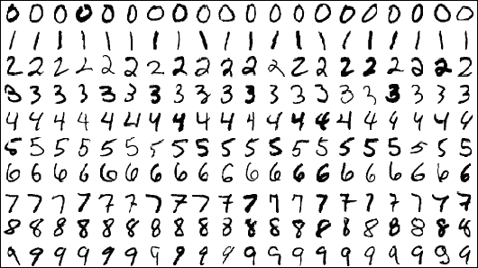
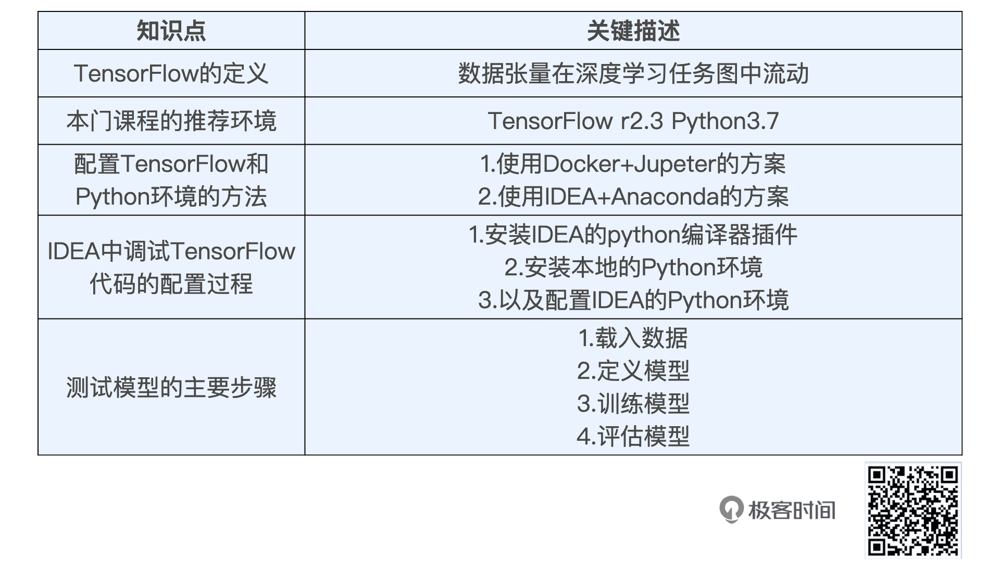

# 模型实战准备（一） | TensorFlow入门和环境配置

 

你好，我是王喆。

我在留言区看到，很多同学对 TensorFlow 的用法还不太熟悉，甚至可能还没接触过它。但我们必须要熟练掌握 TensorFlow，因为接下来，它会成为我们课程主要使用的工具和平台。为此，我特意准备了两堂模型实战准备课，来帮助你掌握 TensorFlow 的基础知识，以及为构建深度学习模型做好准备。

这节课，我们先来学习 TensorFlow 的环境配置，讲讲什么是 TensorFlow，怎么安装 TensorFlow，以及怎么在 TensorFlow 上构建你的第一个深度学习模型。下节课，我们再来学习模型特征和训练样本的处理方法。

## 什么是 TensorFlow？

TensorFlow 是由 Google Brain 团队开发的深度学习平台，于 2015 年 11 月首次发布，目前最新版本是 2.3。因为 TensorFlow 自从 2.0 版本之后就发生了较大的变化，所以咱们这门课程会使用 TensorFlow2.3 作为实践版本。

TensorFlow 这个名字还是很有意思的，翻译过来是“张量流动”，这非常准确地表达了它的基本原理，就是根据深度学习模型架构构建一个有向图，让数据以张量的形式在其中流动起来。

这里的张量（Tensor）其实是指向量的高维扩展，比如向量可以看作是张量的一维形式，矩阵可以看作张量在二维空间上的特例。在深度学习模型中，大部分数据是以矩阵甚至更高维的张量表达的，为了让这些张量数据流动起来，每一个深度学习模型需要根据模型结构建立一个由点和边组成的有向图，图里面的点代表着某种操作，比如某个激活函数、某种矩阵运算等等，而边就定义了张量流动的方向。

这么说还是太抽象，我们来看一个简单 TensorFlow 任务的有向图。从图中我们可以看出，向量 b、矩阵 W 和向量 x 是模型的输入，紫色的节点 MatMul、Add 和 ReLU 是操作节点，分别代表了矩阵乘法、向量加法、ReLU 激活函数这样的操作。模型的输入张量 W、b、x 经过操作节点的变形处理之后，在点之间传递，这就是 TensorFlow 名字里所谓的张量流动。



图1 一个简单的TensorFlow有向图

事实上，任何复杂模型都可以抽象为操作有向图的形式。这样做不仅有利于操作的模块化，还可以厘清各操作间的依赖关系，有利于我们判定哪些操作可以并行执行，哪些操作只能串行执行，为并行平台能够最大程度地提升训练速度打下基础。

说起 TensorFlow 的并行训练，就不得不提 GPU，因为 GPU 拥有大量的计算核心，所以特别适合做矩阵运算这类易并行的计算操作。业界主流的 TensorFlow 平台都是建立在 CPU+GPU 的计算环境之上的。但咱们这门课程，因为考虑到大多数同学都是使用个人电脑进行学习的，所以所有的项目实践都建立在 TensorFlow CPU 版本上，我在这里先给你说明一下。

## TensorFlow 的运行环境如何安装？

知道了 TensorFlow 的基本概念之后，我们就可以开始着手配置它的运行环境了。我先把这门课使用的环境版本告诉你，首先，TensorFlow 我推荐 2.3 版本也就是目前的最新版本 ，Python 我推荐 3.7 版本，其实 3.5-3.8 都可以，我建议你在学习过程中不要随意更换版本，尽量保持一致。

虽然Python 环境和TensorFlow 环境有自己的官方安装指南，但是安装起来也并不容易，所以接下来，我会带你梳理一遍安装中的重点步骤。一般来说，安装 TensorFlow 有两种方法，一种是采用 Docker+Jupyter 的方式，另一种是在本地环境安装 TensorFlow 所需的 python 环境和所需依赖库。其中，Docker+Jupyter 的方式比较简单，我们先来看看它。

### 最简单的方法，Docker+Jupyter

经过第 13 节模型服务的实践，我们已经把 Docker 安装到了自己的电脑上。这里，它就可以再次派上用场了。因为 TensorFlow 官方已经为我们准备好了它专用的 Docker 镜像，你只要运行下面两行代码，就可以拉取并运行最新的 TensorFlow 版本，还能在http://localhost:8888/ 端口运行起 Jupyter Notebook。

```
docker pull tensorflow/tensorflow:latest  # Download latest stable image  
docker run -it -p 8888:8888 tensorflow/tensorflow:latest-jupyter  # Start Jupyter server   

```

如果你已经能够在浏览器中打开 Jupyter 了，就在这个 Notebook 上开始你“肆无忌惮”地尝试吧。在之后的实践中，我们也可以把 SparrowRecsys 中的 TensorFlow 代码 copy 到 Notebook 上直接执行。因为不用操心非常复杂的 python 环境配置的过程，而且 docker 的运行与你的主系统是隔离的，如果把它“玩坏了”，我们再重新拉取全新的镜像就好，所以这个方式是最快捷安全的方式。

### 在 IDEA 中调试你的 TensorFlow 代码

不过，Docker+Jupyter 的方式虽然非常方便，但我们在实际工作中，还是会更多地使用 IDE 来管理和维护代码。所以，掌握 IDEA 或者 PyCharm 这类 IDE 来调试 TensorFlow 代码的方法，对我们来说也非常重要。

比如说，SparrowRecSys 中就包含了 TensorFlow 的 Python 代码，我把所有 Python 和 TensorFlow 相关的代码都放在了 TFRecModel 模块。那我们能否利用 IDEA 一站式地调试 SparrowRecSys 项目中的 Python 代码和之前的 Java、Scala 代码呢？当然是可以的，要实现这一操作，我们需要进行三步的配置，分别是安装 IDEA 的 Python 编译器插件，安装本地的 Python 环境，以及配置 IDEA 的 Python 环境。下面，我们一步一步地详细说一说。

**首先是安装 IDEA 的 Python 编译器插件。**

因为 IDEA 默认不支持 Python 的编译，所以我们需要为它安装 Python 插件。具体的安装路径是点击顶部菜单的 IntelliJ IDEA -> Preferences -> Plugins -> 输入 Python -> 选择插件 Python Community Edition 进行安装。



图2 为IDEA安装Python插件

**接着是安装本地 Python 环境。**

使用过 Python 的同学可能知道，由于 Python 的流行版本比较多，不同软件对于 Python 环境的要求也不同，所以我们直接更改本地的 Python 环境比较危险，因此，我推荐你使用Anaconda来创建不同 Python 的虚拟环境，这样就可以为咱们的 SparrowRecsys 项目，专门创建一个使用 Python3.7 和支持 TensorFlow2.3 的虚拟 Python 环境了。

具体的步骤我推荐你参考 Anaconda 的官方 TensorFlow 环境安装指导。

这里，我再带你梳理一下其中的关键步骤。首先，我们去[Anaconda 的官方地址] (https://www.anaconda.com/products/individual) 下载并安装 Anaconda（最新版本使用 Python3.8，你也可以去历史版本中安装 Python3.7 的版本）。然后，如果你是 Windows 环境，就打开 Anaconda Command Prompt，如果是 Mac 或 Linux 环境，你就打开 terminal。都打开之后，你跟着我输入下面的命令：

```
conda create -n tf tensorflow  
conda activate tf
```

第一条命令会创建一个名字为 tf 的 TensorFlow 环境，第二条命令会让 Anaconda 为我们在这个 Python 环境中准备好所有 Tensorflow 需要的 Python 库依赖。接着，我们直接选择 TensorFlow 的 CPU 版本。不过，如果是有 GPU 环境的同学，可以把命令中的`tensorflow`替换为`tensorflow-gpu`，来安装支持 GPU 的版本。到这里，我们就利用 Anaconda 安装好了 TensorFlow 的 Python 环境。

**最后是配置 IDEA 的项目 Python 环境。**

现在 IDEA 的 Python 插件有了，本地的 TensorFlow Python 环境也有了，接下来，我们就要在 IDEA 中配置它的 Python 环境。这个配置的过程主要可以分成三步，我们一起来看看。

第一步，在 IDEA 中添加项目 Python SDK。你直接按照我给出的这个路径配置就可以了：File->Project Structure -> SDKs -> 点击 + 号 ->Add Python SDK ，这个路径在操作界面的显示如图 3。



图3 添加Python SDK

添加完 Python SDK，接下来，我们配置 Conda Environment 为项目的 Python SDK，IDEA 会自动检测到系统的 Conda 环境相关路径，你选择按照自动填充的路径就好，具体的操作你可以看下图 4。



图4 选择Conda Enviroment为IDEA Python环境

最后，我们为 TFRecModel 模块配置 Python 环境。我们选择 Project Structure Modules 部分的 tfmodel 模块，在其上点击右键来 add python。



图5 为tfmodel模块配置Python环境

设置好的 tfmode 模块的 Python 环境应该如图 6 所示。



图6 配置好的Python环境

如果你按照上面的步骤，那 Python 和 TensorFlow 的环境应该已经配置好了，但我们到底怎么验证一下所有的配置是否成功呢？下面，我们就来写一个测试模型来验证一下。

## 如何在 TensorFlow 上构建你的第一个深度学习模型？

这里，我们选择了 TensorFlow 官方教程上的例子作为我们深度学习模型的“初体验”，你可以参考 https://www.tensorflow.org/tutorials/quickstart/beginner?hl=zh_cn 来构建这个模型。这里，我再对其中的关键内容做一个补充讲解。

我先把测试模型的代码放到了下面，你可以边看代码边参考我的讲解。首先，我们要清楚的是这个测试模型做了一件什么事情。它要处理的数据集是一个手写数字的 MNIST 数据集，所以模型其实是一个多分类模型，它的输入是这个手写数字的图片（一个 28*28 维的图片），输出是一个 0-9 的多分类概率模型。



图7 MNIST数据集

其次，我们要清楚如何定义这个深度学习模型的结构。从代码中我们可以看出，测试模型使用了 TensorFlow 的 Keras 接口，这样就可以很清晰方便地定义一个三层神经网络了，它包括 28*28 的输入层，128 维的隐层，以及由 softmax 构成的多分类输出层。

之后是模型的训练，这里有 3 个参数的设定是很关键的，分别是 compile 函数中的 optimizer、loss，以及 fit 函数中的 epochs。其中，optimizer 指的是模型训练的方法，这里我们采用了深度学习训练中经常采用的 adam 优化方法，你也可以选择随机梯度下降（SGD），自动变更学习率的 AdaGrad，或者动量优化 Momentum 等等。

loss 指的是损失函数，因为这个问题是一个多分类问题，所以这个测试模型，我们使用了多分类交叉熵（Sparse Categorical Crossentropy）作为损失函数。

epochs 指的是训练时迭代训练的次数，单次训练指的是模型训练过程把所有训练数据学习了一遍。这里 epochs=5 意味着模型要反复 5 次学习训练数据，以便模型收敛到一个局部最优的位置。

最后是模型评估的过程，因为在构建模型时，我们选择了准确度（Accuracy）作为评估指标，所以 model.evaluate 函数会输出准确度的结果。

```
import tensorflow as tf  
//载入MINST数据集  
mnist = tf.keras.datasets.mnist  
//划分训练集和测试集  
(x_train, y_train), (x_test, y_test) = mnist.load_data()  
x_train, x_test = x_train / 255.0, x_test / 255.0  
  
  
//定义模型结构和模型参数  
model = tf.keras.models.Sequential([  
    //输入层28*28维矩阵  
    tf.keras.layers.Flatten(input_shape=(28, 28)),   
    //128维隐层，使用relu作为激活函数  
    tf.keras.layers.Dense(128, activation='relu'),   
    tf.keras.layers.Dropout(0.2),  
    //输出层采用softmax模型，处理多分类问题  
    tf.keras.layers.Dense(10, activation='softmax')  
])  
//定义模型的优化方法(adam)，损失函数(sparse_categorical_crossentropy)和评估指标(accuracy)  
model.compile(optimizer='adam',  
              loss='sparse_categorical_crossentropy',  
              metrics=['accuracy'])  
  
  
//训练模型，进行5轮迭代更新(epochs=5）  
model.fit(x_train, y_train, epochs=5)  
//评估模型  
model.evaluate(x_test,  y_test, verbose=2
```

到这里，我们就介绍完了整个测试模型的全部流程。事实上，之后利用 TensorFlow 构建深度学习推荐模型的过程也是非常类似的，只是把其中特征处理、模型结构、训练方法进行了替换，整体的结构并没有变化。所以，理解测试模型的每一步对我们来说是非常重要的。

说回我们的测试模型，如果 Python 和 TensorFlow 的环境都配置正确的话，在 IDEA 中执行测试模型程序，你会看到 5 轮训练过程，每一轮的准确度指标，以及最终模型的评估结果。

```
Epoch 1/5  
1875/1875 [==============================] - 1s 527us/step - loss: 0.3007 - accuracy: 0.9121  
Epoch 2/5  
1875/1875 [==============================] - 1s 516us/step - loss: 0.1451 - accuracy: 0.9575  
Epoch 3/5  
1875/1875 [==============================] - 1s 513us/step - loss: 0.1075 - accuracy: 0.9670  
Epoch 4/5  
1875/1875 [==============================] - 1s 516us/step - loss: 0.0873 - accuracy: 0.9729  
Epoch 5/5  
1875/1875 [==============================] - 1s 517us/step - loss: 0.0748 - accuracy: 0.9767  
313/313 - 0s - loss: 0.0800 - accuracy: 0.9743

## 小结

这节课，我们一起学习了 TensorFlow 的基础知识，搭建起了 TensorFlow 的使用环境，并且编写了第一个基于 Keras 的深度学习模型。
```

TensorFlow 的基本原理，就是根据深度学习模型架构构建一个有向图，让数据以张量的形式在其中流动起来。

而安装 TensorFlow 有两种方法，一种是采用 Docker+Jupyter 的方式，另一种是在本地环境安装 TensorFlow 所需的 python 环境和所需依赖库。其中，Docker+Jupyter 的方式比较简单，而利用 IDEA 来调试 TensorFlow 代码的方法比较常用，我们要重点掌握。

想要实现在 IDEA 中调试 TensorFlow 代码，我们需要进行三步配置，分别是安装 IDEA 的 python 编译器插件，安装本地的 Python 环境，以及配置 IDEA 的 Python 环境。配置好了 Python 和 TensorFlow 的环境之后，我们还要验证一下是不是所有的配置都成功了。

在测试模型中，我们牢牢记住实现它的四个主要步骤，分别是载入数据、定义模型、训练模型和评估模型。当然，我把这些关键知识点总结在了下面的知识表格里，你可以看看。



## 课后思考

这是一堂实践课，所以今天的课后题就是希望你能完成 TensorFlow 的环境配置。在配置、试验过程中遇到任何问题，你都可以在留言区提问，我会尽力去解答，也欢迎同学们分享自己的实践经验，互相帮助。我们下节课见！
