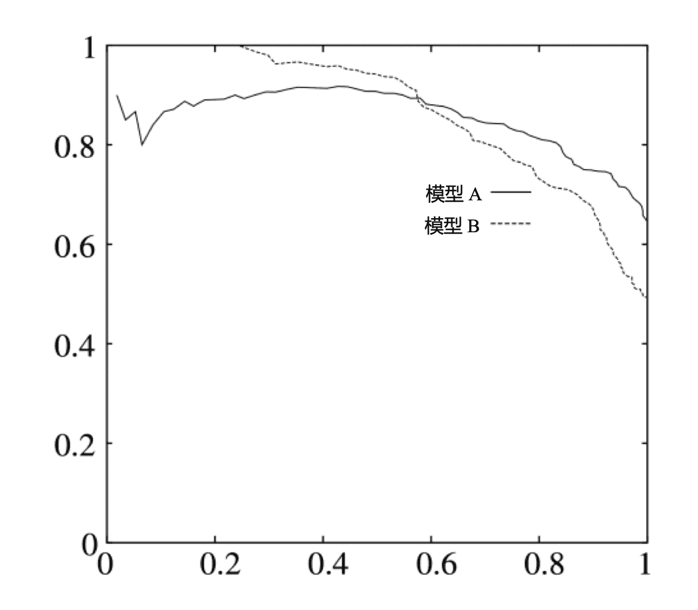
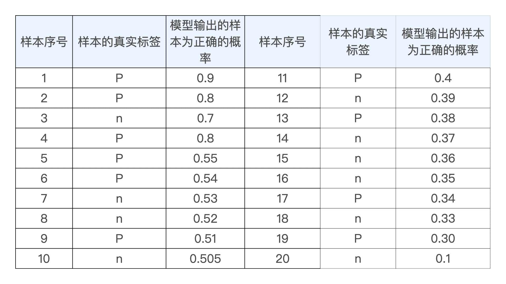
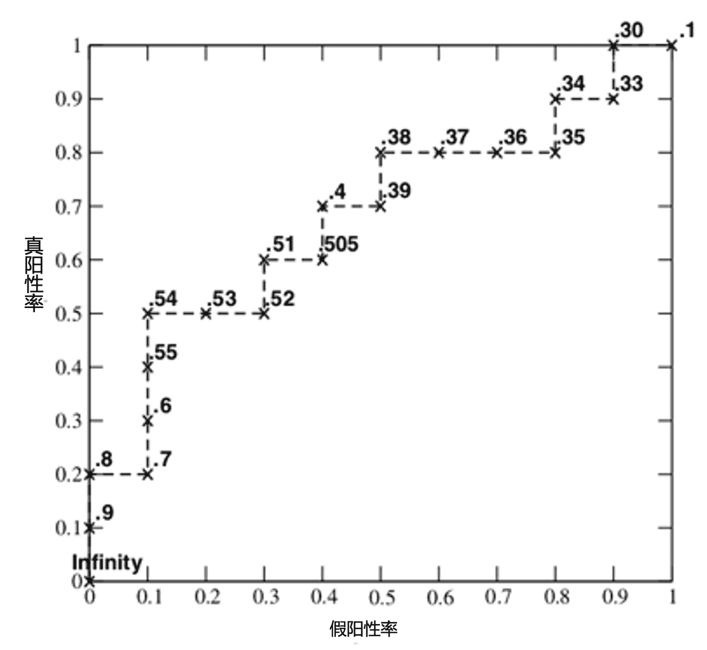
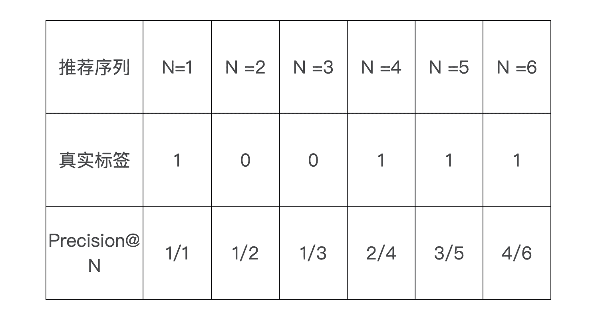
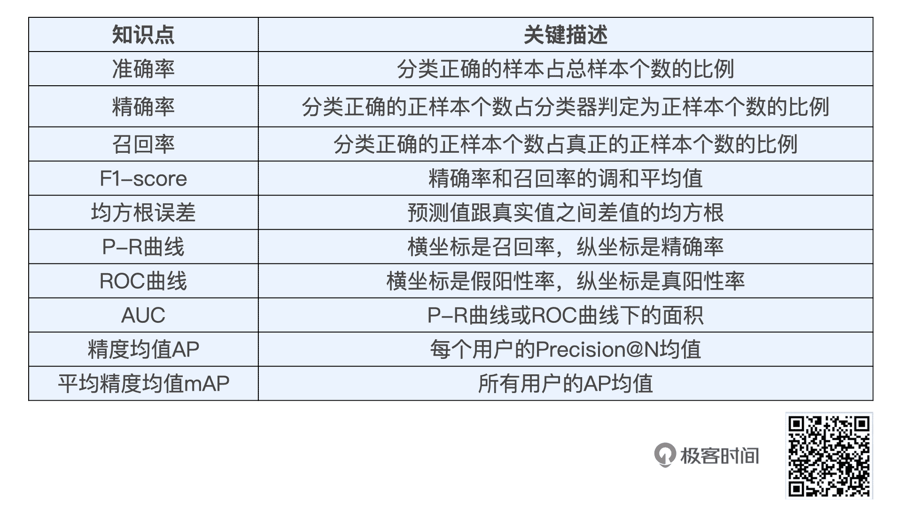

# 25 | 评估指标：我们可以用哪些指标来衡量模型的好坏？

 

你好，我是王喆。今天，我们来学习推荐模型的评估指标。

上节课，我们讲了五种评估方法，清楚了它们都是怎么把样本分割为训练集和测试集的。但是只分割样本是远远不够的，为了比较模型效果的好坏，还得用一些指标进行衡量。就像我们工作中经常说，我的模型提高了“一个点”的效果，那所谓的“一个点”指的是什么呢？它其实说的就是，我们的模型在一些经典的推荐指标上提升了 1% 的效果，这节课我就带你来捋一捋这些经典的推荐评估指标。

## 低阶评估指标

我按照指标计算的难易程度，和评估的全面性，把推荐系统的评估指标可以分成低阶评估指标和高阶评估指标两大类。对于低阶评估指标来说，准确率、精确率与召回率、对数损失、均方根误差，这四个指标在推荐模型评估中最常用，计算起来也最容易。所以，我们就先来学习一下这几个低阶评估指标的具体含义。

### 1. 准确率

准确率 (Accuracy) 是指分类正确的样本占总样本个数的比例，公式 1 就是：Accuracy=ntotal ​ncorrect ​​。

其中， ncorrect 是正确分类的样本个数， ntotal 是样本的总数。

准确率是分类任务中非常直观的评价指标，可解释性也很强，但它也存在明显的缺陷，就是当不同类别的样本比例非常不均衡的时候，占比大的类别往往成为影响准确率的最主要因素。比如，负样本占 99%，那么分类器把所有样本都预测为负样本也可以获得 99% 的准确率。

在之前的课程中，我们经常把推荐问题看作是一个点击率预估型的分类问题。这个时候，我们就可以用准确率来衡量推荐模型的好坏。但在实际的推荐场景中，我们往往会生成一个推荐列表，而不是用所谓的分类正不正确来衡量最终的效果，那我们该怎么评估一个推荐列表的效果呢？这个时候，我们就会利用到精确率和召回率这两个指标。

### 2. 精确率与召回率

我这里所说的**精确率（Precision）指的是分类正确的正样本个数占分类器判定为正样本个数的比例，召回率（Recall）是分类正确的正样本个数占真正的正样本个数的比例**。

在推荐列表中，通常没有一个确定的阈值来把预测结果直接判定为正样本或负样本，而是采用 Top N 排序结果的精确率（Precision@N）和召回率（Recall@N）来衡量排序模型的性能。具体操作，就是认为模型排序的前 N 个结果就是模型判定的正样本，然后分别计算 Precision@N 和 Recall@N。

事实上，精确率和召回率其实是矛盾统一的一对指标。这是什么意思呢？就是，为了提高精确率，模型需要尽量在“更有把握”时把样本预测为正样本，但此时，我们往往会因为过于保守而漏掉很多“没有把握”的正样本，导致召回率降低。

那有没有一个指标能综合地反映精确率和召回率的高低呢？其实是有的，那就是 F1-score。F1-score 的定义是精确率和召回率的调和平均值，具体的定义你可以看看下面的公式 2。F1-score 的值越高，就证明模型在精确率和召回率的整体表现上越好。
F1= precision + recall 2⋅ precision ⋅ recall ​

### 3. 对数损失

接着，我们来说一说对数损失（Logloss）这个评估指标。

首先，在一个二分类问题中，对数损失函数的定义就是下面的公式 3。
−N1​i=1∑N​(yi​logPi​+(1−yi​)log(1−Pi​))

在这个公式中，yi​ 是输入实例 xi​ 的真实类别, pi​ 是预测输入实例 xi​ 是正样本的概率，N 是样本总数。

而面对多分类问题的时候，对数损失函数定义就变成了下面公式 4 的样子：
 Multi-LogLoss =−n1​i=1∑n​j=1∑m​yi,j​log(pi,j​)

如果你仔细看公式就会发现，二分类和多分类模型的 Logloss 其实就是我们之前讲过的逻辑回归和 Softmax 模型的损失函数，而大量深度学习模型的输出层正是逻辑回归或 Softmax，因此，采用 Logloss 作为评估指标能够非常直观地反映模型损失函数的变化。所以在训练模型的过程中，我们在每一轮训练中都会输出 Logloss，来观察模型的收敛情况。

### 4. 均方根误差

刚才我们说的准确率、精确率、召回率、LogLoss 都是针对分类模型指定的指标。分类模型就是指预测某个样本属于哪个类别的模型，最典型的就是点击率预估模型。除了这类分类模型以外，还有回归模型，它是用来预测一个连续值，比如预测某个用户对某个电影会打多少分，这就是一个回归模型。

那我们对于回归模型有什么合适的评估指标吗？对于回归模型来说，最常用的评估指标就是**均方根误差**（RMSE，Root Mean Square Error）。它的公式是求预测值跟真实值之间差值的均方根：
RMSE=n∑i=1n​(yi​−y^​l​)2​​

这个公式中，yi​ 是第 i 个样本点的真实值，y^​l​ 是第 i 个样本点的预测值，n 是样本点的个数。那么均方根误差越小，当然就证明这个回归模型预测越精确。

总的来说，我们刚才说的这四个评估指标，虽然在推荐系统中最常用，计算起来也最简单，但它们反应的结果还不够精确和全面。

比如说，精确率和召回率可以反应模型在 Top n 个排序结果上的表现，但我们要知道，在真正的推荐问题中，n 的值是变化的，因为用户可能会通过不断的翻页、下滑来拉取更多的推荐结果，这就需要有更高阶的评估指标来衡量模型在不同数量推荐结果上的综合性能。所以，我们接下来再讲几个非常流行，也非常权威的高阶评估指标。

## 高阶评估指标

那在高阶评估指标部分，我会给你讲 P-R 曲线、ROC 曲线、平均精度均值，这三个最常用的评估指标。

### 1. P-R 曲线

首先，我要说的是 P-R 曲线，这里的 P 就是我们之前学过的精确率 Precision，R 就是召回率 Recall。刚才我们说了，为了综合评价一个推荐模型的好坏，不仅要看模型在一个 Top n 值下的精确率和召回率，还要看到模型在不同 N 取值下的表现，甚至最好能绘制出一条 n 从 1 到 N，准确率和召回率变化的曲线。这条曲线就是 P-R 曲线。

P-R 曲线的横轴是召回率，纵轴是精确率。对于一个推荐模型来说，它的 P-R 曲线上的一个点代表“在某一阈值下，模型将大于该阈值的结果判定为正样本，将小于该阈值的结果判定为负样本时，整体结果对应的召回率和精确率”。整条 P-R 曲线是通过从高到低移动正样本阈值生成的。如图 1 所示，它画了两个测试模型，模型 A 和模型 B 的对比曲线。其中，实线代表模型 A 的 P-R 曲线，虚线代表模型 B 的 P-R 曲线。

从图中我们可以看到，在召回率接近 0 时，模型 A 的精确率是 0.9，模型 B 的精确率是 1。这说明模型 B 预测的得分前几位的样本全部是真正的正样本，而模型 A 即使是得分最高的几个样本也存在预测错误的情况。

然而，随着召回率的增加，两个模型的精确率整体上都有所下降。特别是当召回率在 0.6 附近时，模型 A 的精确率反而超过了模型 B。这就充分说明了，只用一个点的精确率和召回率是不能全面衡量模型性能的，只有通过 P-R 曲线的整体表现，才能对模型进行更全面的评估。

虽然 P-R 曲线能全面衡量模型的性能，但是它总归是一条曲线，不是一个数字，我们很难用它直接来判断模型的好坏。那有没有一个指标能用来衡量 P-R 曲线的优劣呢？当然是有的，这个指标就是 AUC(Area Under Curve)，曲线下面积。顾名思义，AUC 指的是 P-R 曲线下的面积大小，因此计算 AUC 值只需要沿着 P-R 曲线横轴做积分。AUC 越大，就证明推荐模型的性能越好。

### 2. ROC 曲线

接着，我们再来介绍第二个高阶指标，ROC 曲线，它也是一个非常常用的衡量模型综合性能的指标。ROC 曲线的全称是 the Receiver Operating Characteristic 曲线，中文名为“受试者工作特征曲线”。ROC 曲线最早诞生于军事领域，而后在医学领域应用甚广，“受试者工作特征曲线”这一名称也正是来源于医学领域。

ROC 曲线的横坐标是 False Positive Rate（FPR，假阳性率），纵坐标是 True Positive Rate （TPR，真阳性率）。这两个名字读上去就有点拗口，我们还是通过它们的定义来理解一下 ：
FPR=NFP​,TPR=PTP​

在公式中，P 指的是真实的正样本数量，N 是真实的负样本数量；TP 指的是 P 个正样本中被分类器预测为正样本的个数，FP 指的是 N 个负样本中被分类器预测为正样本的个数。但我估计你看了这个定义，可能还是不好理解这个 ROC 曲线是怎么得到的。没关系，我们真正去画一条 ROC 曲线，你就明白了。

和 P-R 曲线一样，ROC 曲线也是通过不断移动模型正样本阈值生成的。假设测试集中一共有 20 个样本，模型的输出如下表所示，表中第一列为样本序号，Class 为样本的真实标签，Score 为模型输出的样本为正的概率，样本按照预测概率从高到低排序。在输出最终的正例、负例之前，我们需要指定一个阈值，并且设定预测概率大于该阈值的样本会被判为正例，小于该阈值的会被判为负例。

比如，我们指定 0.9 为阈值，那么只有第一个样本会被预测为正例，其他全部都是负例。这里的阈值也被称为 “截断点”。

接下来，我们要做的就是动态地调整截断点，从最高的得分开始（实际上是从正无穷开始，对应着 ROC 曲线的零点），逐渐调整到最低得分。每一个截断点都会对应一个 FPR 和 TPR 的值，在 ROC 图上绘制出每个截断点对应的位置，再连接每个点之后，我们就能得到最终的 ROC 曲线了。那么 ROC 曲线上的点具体应该怎么确定呢？

我们来看几个例子，当截断点选择为正无穷的时候，模型会把全部样本预测为负例，那 FP 和 TP 必然都为 0，FPR 和 TPR 也都为 0，因此曲线的第一个点就是 (0,0) 。当把截断点调整为 0.9 的时候，模型预测 1 号样本为正样本，并且这个样本也确实是正样本。因此，在 20 个样本中，当 TP=1，所有正例数量 P=10 的时候，TPR=TP/P=1/10。

我们还可以看到，这个例子里没有预测错的正样本，也就是说当 FP=0，负样本总数 N=10 的时候，FPR=FP/N=0/10=0，对应着 ROC 图上的点 (0,0.1)。

其实，还有一种更直观的绘制 ROC 曲线的方法。首先，我们根据样本标签统计出正负样本的数量，假设正样本数量为 P，负样本数量为 N。然后，我们把横轴的刻度间隔设置为 1/N，纵轴的刻度间隔设置为 1/P。接着，我们再根据模型输出的预测概率对样本进行从高到低的排序。

最后，依次遍历样本。同时，从零点开始绘制 ROC 曲线，每遇到一个正样本就沿纵轴方向绘制一个刻度间隔的曲线，每遇到一个负样本就沿横轴方向绘制一个刻度间隔的曲线，直到遍历完所有样本，曲线最终停在 (1,1) 这个点，整个 ROC 曲线就绘制完成了。

在绘制完 ROC 曲线后，我们也可以像 P-R 曲线一样，计算出 ROC 曲线的 AUC，AUC 越高，推荐模型的效果就越好。

### 3. 平均精度均值

最后，我们来说平均精度均值 mAP（mAP，mean average precision）这个高阶指标，它除了在推荐系统中比较常用，在信息检索领域也很常用。mAP 其实是对平均精度（AP，average precision）的再次平均，因此在计算 mAP 前，我们需要先学习什么是平均精度 AP。

假设，推荐系统对某一用户测试集的排序结果是 1, 0, 0, 1, 1, 1。其中，1 代表正样本，0 代表负样本。接下来，我们就按照之前学过的方法，计算这个序列中每个位置上的 precision@N。你可以自己先试着计算一下，也可以直接看我下面计算好的结果。

每个位置的precision@N值

计算平均精度 AP 的时候，我们只取正样本处的 precision 进行平均，根据得到的表格 AP =（1/1 + 2/4 + 3/5 + 4/6）/4 = 0.6917。接下来，我们再来看什么是 mAP。

如果推荐系统对测试集中的每个用户都进行样本排序，那么每个用户都会计算出一个 AP 值，再对所有用户的 AP 值进行平均，就得到了 mAP。也就是说，mAP 是对精确度平均的平均。

这里就需要注意了，mAP 的计算方法和 P-R 曲线、ROC 曲线的计算方法是完全不同的，因为 mAP 需要对每个用户的样本进行分用户排序，而 P-R 曲线和 ROC 曲线均是对全量测试样本进行排序。这一点在实际操作中是需要注意的。

## 合理选择评估指标

到这里，这节课的 7 个评估指标我们就讲完了。如果你是第一次接触它们，可能现在已经有点茫然了。事实上，除了这些评估指标，还有很多其他的推荐系统指标，比如归一化折扣累计收益（Normalized Discounted Cumulative Gain,NDCG）、覆盖率（Coverage）、多样性（Diversity）等等。那面对这么多评估指标，你肯定想问，我们应该怎么选择它们呢？

很可惜，这次又是一个开放式的问题，评估指标的选择同样没有标准答案。但我还是会把一些经验性的选择总结出来，希望能够帮助到你。

比如，在对推荐模型的离线评估中，大家默认的权威指标是 ROC 曲线的 AUC。但 AUC 评估的是整体样本的 ROC 曲线，所以我们往往需要补充分析 mAP，或者对 ROC 曲线进行一些改进，我们可以先绘制分用户的 ROC，再进行用户 AUC 的平均等等。

再比如，在评估 CTR 模型效果的时候，我们可以采用准确率来进行初步的衡量，但我们很有可能会发现，不管什么模型，准确率都在 95% 以上。仔细查看数据我们会发现，由于现在电商点击率、视频点击率往往都在 1%-10% 之间。也就是说，90% 以上都是负样本，因此准确率这个指标就不能够精确地反应模型的效果了。这时，我们就需要加入精确率和召回率指标进行更精确的衡量，比如我们采用了 Precision@20 和 Recall@20 这两个评估指标，但它终究只衡量了前 20 个结果的精确率和召回率。

如果我们要想看到更全面的指标，就要多看看 Precision@50 和 Recall@50，Precision@100 和 Recall@100，甚至逐渐过渡到 P-R 曲线。

总的来说，评估指标的选择不是唯一的，而是一个动态深入，跟你评测的“深度”紧密相关的过程。而且，在真正的离线实验中，虽然我们要通过不同角度评估模型，但也没必要陷入“完美主义”和“实验室思维”的误区，选择过多指标评估模型，更没有必要为了专门优化某个指标浪费过多时间。

离线评估的目的在于快速定位问题，快速排除不可行的思路，为线上评估找到“靠谱”的候选者。因此，我们根据业务场景选择 2~4 个有代表性的离线指标，进行高效率的离线实验才是离线评估正确的“打开方式”。

## 小结

这节课，我们重点介绍了模型离线评估中使用的评估指标。我把它们分成了两部分，简单直接的低阶评估指标，还有复杂全面的高阶评估指标。

低阶评估指标主要包括准确率，精确率，召回率和均方根误差。**准确率是指分类正确的样本占总样本个数的比例，精确率指的是分类正确的正样本个数占分类器判定为正样本个数的比例**，**召回率是分类正确的正样本个数占真正的正样本个数的比例，而均方根误差**的定义是预测值跟真实值之间差值的均方根。

高阶指标包括 P-R 曲线，ROC 曲线和平均精度均值。P-R 曲线的横坐标是召回率，纵坐标是精确率；ROC 曲线的横坐标是假阳性率，纵坐标是真阳性率。P-R 曲线和 ROC 曲线的绘制都不容易，我希望你能多看几遍我在课程中讲的例子，巩固一下。最后是平均精度均值 mAP，这个指标是对每个用户的精确率均值的再次平均。

最后，为了方便你记忆和对比，我也把所有指标的概念都总结在了文稿的表格里，你可以去看看。

## 课后问题

对于我们今天学到的 P-R 曲线和 ROC 曲线，你觉得它们的优缺点分别是什么呢？在正负样本分布极不均衡的情况下，你觉得哪个曲线的表现会更稳定、更权威一点？

期待在留言区看到你对这节课的思考，我们下节课见！
