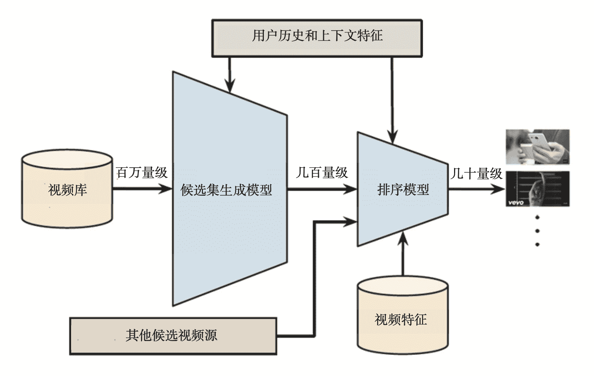
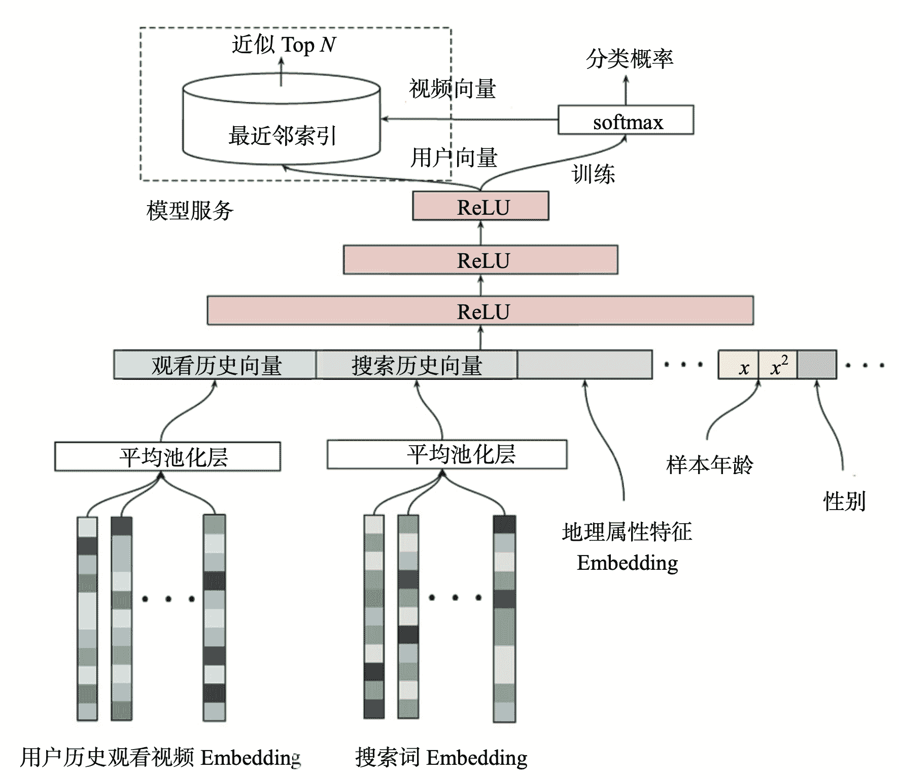
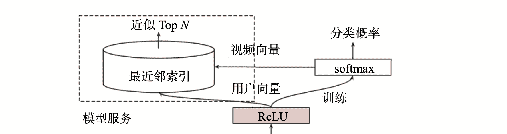
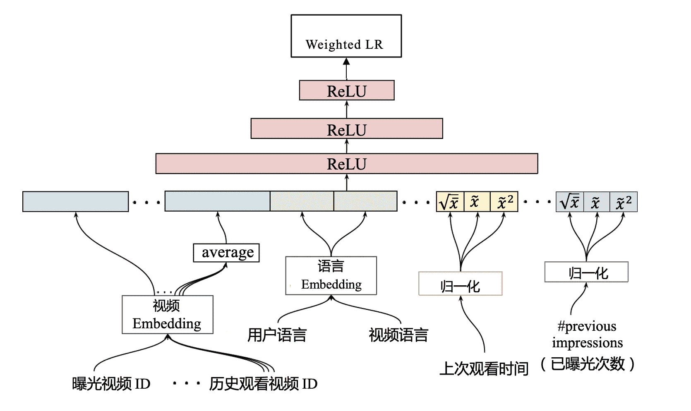
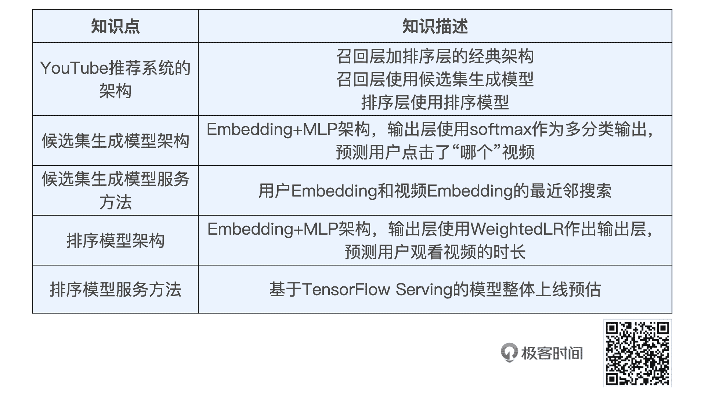

# 28 | 业界经典：YouTube深度学习推荐系统的经典架构长什么样？

 

你好，我是王喆。今天我们一起来开启前沿拓展篇的学习。

如果你是跟着课程安排学到这里的，我可以很自信地说，你几乎已经掌握了推荐系统的全部重点知识。从数据特征的处理，模型构建，到模型的评估和上线，再到推荐服务器的实现，你的知识广度已经覆盖了推荐系统领域的全部要点。但要想成为一名合格的推荐工程师，我们还需要做两件事情，一件是追踪前沿，另一件是融会贯通。

因此，在这一篇中，我会通过详细讲解几个一线大厂的推荐系统解决方案，来帮你追踪行业的热点、创新点。它们既包括一些推荐模型的业界实现，如 YouTube 和 Pinterest 的推荐模型，也包括推荐系统的工程落地方案，如 Flink 的经典应用和美团对于强化学习的落地方案。最后，我还会对算法工程师的所需能力做一个全面的总结。

今天，我们今天先来学习 YouTube 的经典深度学习推荐系统架构。YouTube 这套深度学习解决方案，已经经典到可以成为一个业界标杆式的方案了，也是我在国内外和同学、同事们交流、讨论的时候经常会提到的方案。

话不多说，我们正式开始今天的学习吧！

## YouTube 推荐系统架构

提起 YouTube，我想你肯定不会陌生，作为全球最大的视频分享网站，YouTube 平台中几乎所有的视频都来自 UGC（User Generated Content，用户原创内容），这样的内容产生模式有两个特点：

1. 一是其商业模式不同于 Netflix，以及国内的腾讯视频、爱奇艺这样的流媒体，这些流媒体的大部分内容都是采购或自制的电影、剧集等头部内容，而 YouTube 的内容都是用户上传的自制视频，种类风格繁多，头部效应没那么明显；
2. 二是由于 YouTube 的视频基数巨大，用户难以发现喜欢的内容。

这样的内容特点简直就是深度学习推荐系统最适合扎根的土壤，所以 YouTube 也是最早落地深度学习的一线公司。那 YouTube 的深度学习推荐系统架构长什么样呢？

图1 YouTube推荐系统整体架构

上图就是 YouTube 在 2016 年发布的推荐系统架构。我们可以看到，为了对海量的视频进行快速、准确的排序，YouTube 也采用了经典的召回层 + 排序层的推荐系统架构。

**它的推荐过程可以分成二级。第一级是用候选集生成模型（Candidate Generation Model）完成候选视频的快速筛选，在这一步，候选视频集合由百万降低到几百量级，这就相当于经典推荐系统架构中的召回层。第二级是用排序模型（Ranking Model）完成几百个候选视频的精排，这相当于经典推荐系统架构中的排序层。**

无论是候选集生成模型还是排序模型，YouTube 都采用了深度学习的解决方案。下面，就让我们详细讲讲这两个深度学习模型是如何构建起来的。

## 候选集生成模型

首先，是用于视频召回的候选集生成模型，它的模型架构如下图所示。

图2 YouTube候选集生成模型架构

我们一起自下而上地好好看一看这个模型的结构。

最底层是它的输入层，输入的特征包括用户历史观看视频的 Embedding 向量，以及搜索词的 Embedding 向量。对于这些 Embedding 特征，YouTube 是利用用户的观看序列和搜索序列，采用了类似 Item2vec 的预训练方式生成的。

当然，我们也完全可以采用 Embedding 跟模型在一起 End2End 训练的方式来训练模型。至于预训练和 End2End 训练这两种方式孰优孰劣，我们也探讨过很多次了，你可以自己再深入思考一下。

除了视频和搜索词 Embedding 向量，特征向量中还包括用户的地理位置 Embedding、年龄、性别等特征。这里我们需要注意的是，对于样本年龄这个特征，YouTube 不仅使用了原始特征值，还把经过平方处理的特征值也作为一个新的特征输入模型。

这个操作其实是为了挖掘特征非线性的特性，当然，这种对连续型特征的处理方式不仅限于平方，其他诸如开方、Log、指数等操作都可以用于挖掘特征的非线性特性。具体使用哪个，需要我们根据实际的效果而定。

确定好了特征，跟我们之前实践过的深度学习模型一样，这些特征会在 concat 层中连接起来，输入到上层的 ReLU 神经网络进行训练。

三层 ReLU 神经网络过后，YouTube 又使用了 softmax 函数作为输出层。值得一提的是，**这里的输出层不是要预测用户会不会点击这个视频，而是要预测用户会点击哪个视频**，这就跟我们之前实现过的深度推荐模型不一样了。

比如说，YouTube 上有 100 万个视频，因为输出层要预测用户会点击哪个视频，所以这里的 sofmax 就有 100 万个输出。因此，这个候选集生成模型的最终输出，就是一个在所有候选视频上的概率分布。为什么要这么做呢？它其实是为了更好、更快地进行线上服务，这一点我们等会再详细讲。

总的来讲，YouTube 推荐系统的候选集生成模型，是一个标准的利用了 Embedding 预训练特征的深度推荐模型，它遵循我们之前实现的 Embedding MLP 模型的架构，只是在最后的输出层有所区别。

## 候选集生成模型独特的线上服务方法

好，现在我们就详细说一说，为什么候选集生成模型要用“视频 ID”这个标签，来代替“用户会不会点击视频”这个标签作为预测目标。事实上，这跟候选集生成模型独特的线上服务方式紧密相关。

图3 模型服务部分示意图

细心的同学可能已经留意到，架构图左上角的模型服务（Serving）方法与模型训练方法完全不同。在候选集生成模型的线上服务过程中，YouTube 并没有直接采用训练时的模型进行预测，而是采用了一种最近邻搜索的方法，我们曾经在第 12 课详细讲过基于 Embedding 的最近邻搜索方法，不记得的同学可以先去回顾一下。

具体来说，在模型服务过程中，网络结构比较复杂，如果我们对每次推荐请求都端到端地运行一遍模型，处理一遍候选集，那模型的参数数量就会巨大，整个推断过程的开销也会非常大。

** 因此，在通过“候选集生成模型”得到用户和视频的 Embedding 后，我们再通过 Embedding 最近邻搜索的方法，就可以提高模型服务的效率了。这样一来，我们甚至不用把模型推断的逻辑搬上服务器，只需要将用户 Embedding 和视频 Embedding 存到特征数据库就行了。**再加上可以使用局部敏感哈希这类快速 Embedding 查找方法，这对于百万量级规模的候选集生成过程的效率提升是巨大的。

那么问题又来了，这里的用户 Embedding 和视频 Embedding 到底是从哪里来的呢？这个问题的答案就是，候选集生成模型为什么要用视频 ID 作为多分类输出的答案了。我们再仔细看一下图 2 的架构，架构图中从 softmax 向模型服务模块画了个箭头，用于代表视频 Embedding 向量的生成。

由于最后的输出层是 softmax，而这个 softmax 层的参数本质上就是一个 m x n 维的矩阵，其中 m 指的是最后一层红色的 ReLU 层的维度 m，n 指的是分类的总数，也就是 YouTube 所有视频的总数 n。因此，视频 Embedding 就是这个 m x n 维矩阵的各列向量。

这样的 Embedding 生成方法其实和 word2vec 中词向量的生成方法是相同的，你也可以参考第 6 节课的内容来理解它。

清楚了视频 Embedding 的生成原理，用户 Embedding 的生成就非常好理解了，因为输入的特征向量全部都是用户相关的特征，一个物品和场景特征都没有，所以在使用某用户 u 的特征向量作为模型输入时，最后一层 ReLU 层的输出向量就可以当作该用户 u 的 Embedding 向量。

在模型训练完成后，逐个输入所有用户的特征向量到模型中，YouTube 就可以得到所有用户的 Embedding 向量，之后就可以把它们预存到线上的特征数据库中了。

在预测某用户的视频候选集时，YouTube 要先从特征数据库中拿到该用户的 Embedding 向量，再在视频 Embedding 向量空间中，利用局部敏感哈希等方法搜索该用户 Embedding 向量的 K 近邻，这样就可以快速得到 k 个候选视频集合。这就是整个候选集生成模型的训练原理和服务过程。

到这里，你一定已经体会到了咱们前沿拓展篇案例分析的作用，通过一个 YouTube 候选集生成模型的原理分析，我们就已经把第 6 课的 Embedding、第 10 课的特征数据库、第 12 课的局部敏感哈希，以及第 17 课的 Embedding MLP 模型都回顾了一遍。

如果你喜欢这种通过学习业界实践方案，把知识串联起来的方式，可以给我留言反馈，我也会在之后的课程中多采用这样的方式。

## 排序模型

通过候选集生成模型，YouTube 已经得到了几百个候选视频的集合了，下一步就是利用排序模型进行精排序。下图就是 YouTube 深度学习排序模型的架构，我们一起来看一看。

图3 YouTube的深度学习排序模型的架构

第一眼看上去，你可能会认为排序模型的网络结构与候选集生成模型没有太大区别，在模型结构上确实是这样的，它们都遵循 Embedding MLP 的模型架构。但是我们来看其中的细节，特别是输入层和输出层的部分，它们跟候选集生成模型还是有很大不同的，这就是我们要重点关注的。

我们先看输入层，相比于候选集生成模型需要对几百万候选集进行粗筛，排序模型只需对几百个候选视频进行排序，因此可以引入更多特征进行精排。具体来说，YouTube 的输入层从左至右引入的特征依次是：

1. impression video ID embedding：当前候选视频的 Embedding；
2. watched video IDs average embedding：用户观看过的最后 N 个视频 Embedding 的平均值；
3. language embedding：用户语言的 Embedding 和当前候选视频语言的 Embedding；
4. time since last watch：表示用户上次观看同频道视频距今的时间；
5. #previous impressions：该视频已经被曝光给该用户的次数；

上面 5 个特征中，前 3 个 Embedding 特征的含义很好理解，我就不细说了。第 4 个特征和第 5 个特征，因为很好地引入了 YouTube 工程师对用户行为的观察，所以我来重点解释一下。

第 4 个特征 **time since last watch** 说的是用户观看同类视频的间隔时间。如果从用户的角度出发，假如某用户刚看过“DOTA 比赛经典回顾”这个频道的视频，那他很大概率会继续看这个频道的其他视频，该特征就可以很好地捕捉到这一用户行为。

第 5 个特征 **#previous impressions** 说的是这个视频已经曝光给用户的次数。我们试想如果一个视频已经曝光给了用户 10 次，用户都没有点击，那我们就应该清楚，用户对这个视频很可能不感兴趣。所以 **#previous impressions** 这个特征的引入就可以很好地捕捉到用户这样的行为习惯，避免让同一个视频对同一用户进行持续的无效曝光，尽量增加用户看到新视频的可能性。

把这 5 类特征连接起来之后，需要再经过三层 ReLU 网络进行充分的特征交叉，然后就到了输出层。这里我们要重点注意，排序模型的输出层与候选集生成模型又有所不同。不同主要有两点：**一是候选集生成模型选择了 softmax 作为其输出层，而排序模型选择了 weighted logistic regression（加权逻辑回归）作为模型输出层；二是候选集生成模型预测的是用户会点击“哪个视频”，排序模型预测的是用户“要不要点击当前视频”。**

那么问题来了，YouTube 为什么要这么做呢？

其实，排序模型采用不同输出层的根本原因就在于，YouTube 想要更精确地预测用户的观看时长，因为观看时长才是 YouTube 最看中的商业指标，而使用 Weighted LR 作为输出层，就可以实现这样的目标。

这是怎么做到的呢？在 Weighted LR 的训练中，我们需要为每个样本设置一个权重，权重的大小，代表了这个样本的重要程度。为了能够预估观看时长，YouTube 将正样本的权重设置为用户观看这个视频的时长，然后再用 Weighted LR 进行训练，就可以让模型学到用户观看时长的信息。

这是因为观看时长长的样本更加重要，严格一点来说，就是观看时长长的样本被模型预测的为正样本的概率更高，这个概率与观看时长成正比，这就是使用 Weighted LR 来学习观看时长信息的基本原理。

最后，我们再聊一聊排序模型的模型服务方法。我刚才讲过了，候选集生成模型是可以直接利用用户 Embedding 和视频 Embedding 进行快速最近邻搜索的。那排序模型还能这样做吗？

这就不可以了，原因有两点：一是因为我们的输入向量中同时包含了用户和视频的特征，不再只是单纯的用户特征。这样一来，用户 x 物品特征的组合过多，就无法通过预存的方式保存所有模型结果；二是因为排序模型的输出层不再是预测视频 ID，所以我们也无法拿到视频 Embedding。因此对于排序模型，我们必须使用 TensorFlow Serving 等模型服务平台，来进行模型的线上推断。

到这里，我们就讲完了 YouTube 推荐模型的全部细节。如果你有任何疑惑的地方，可以在留言区提问，同时我也建议你多看几遍这节课的内容，因为这个解决方案真的是太经典了。

## 小结

好了，这节课的内容讲完了，我们再总结一下 YouTube 推荐系统的重点知识。

YouTube 推荐系统的架构是一个典型的召回层加排序层的架构，其中候选集生成模型负责从百万候选集中召回几百个候选视频，排序模型负责几百个候选视频的精排，最终选出几十个推荐给用户。

候选集生成模型是一个典型的 Embedding MLP 的架构，我们要注意的是它的输出层，它是一个多分类的输出层，预测的是用户点击了“哪个”视频。在候选集生成模型的 serving 过程中，需要从输出层提取出视频 Embedding，从最后一层 ReLU 层得到用户 Embedding，然后利用最近邻搜索快速得到候选集。

排序模型同样是一个 Embedding MLP 的架构，不同的是，它的输入层包含了更多的用户和视频的特征，输出层采用了 Weighted LR 作为输出层，并且使用观看时长作为正样本权重，让模型能够预测出观看时长，这更接近 YouTube 要达成的商业目标。

好了，这些关键知识点，我也总结在了下面的表格中，希望它能帮助你加深记忆。

在这节课结束前，关于 YouTube 的推荐模型我还想多说几句。事实上，YouTube 的推荐系统论文中还包含了更多的细节，业界真正好的论文并不多，YouTube 的这篇《Deep Neural Networks for YouTube Recommendations》绝对是不可多得的一篇，我甚至推荐大家逐句来读，抓住每一个细节。

当然，你也可以在我的书《深度学习推荐系统》中的相应章节找到更多的实现细节。这些内容让我曾经受益匪浅，相信也会对你有所帮助。

## 课后思考

YouTube 的排序模型和候选集生成模型，都使用了平均池化这一操作，来把用户的历史观看视频整合起来。你能想到更好的方法来改进这个操作吗？

期待在留言区看到你的思考和总结，我们下节课见！
