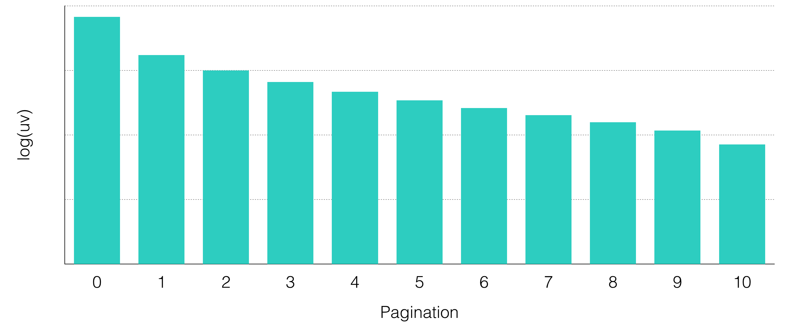
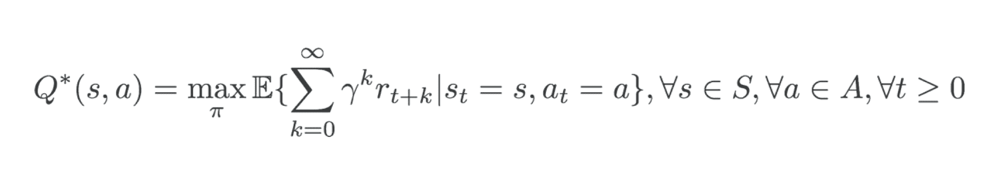
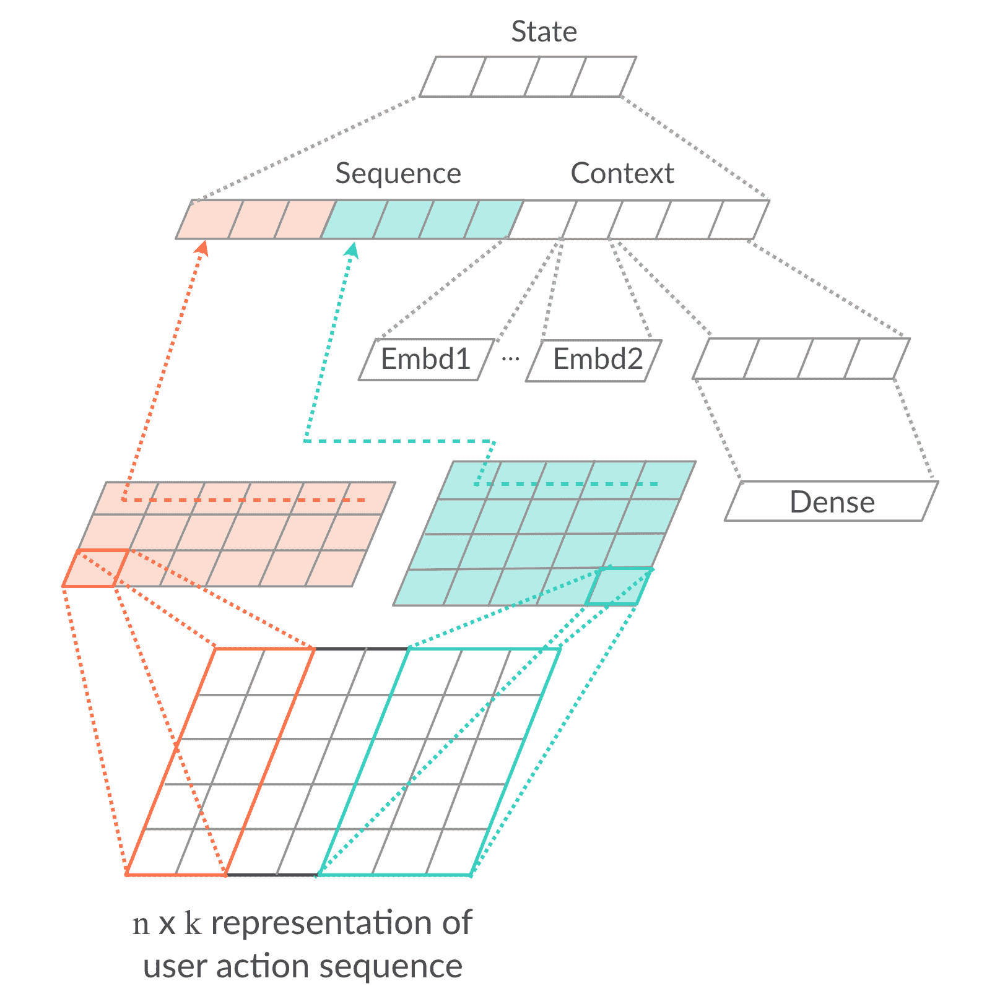
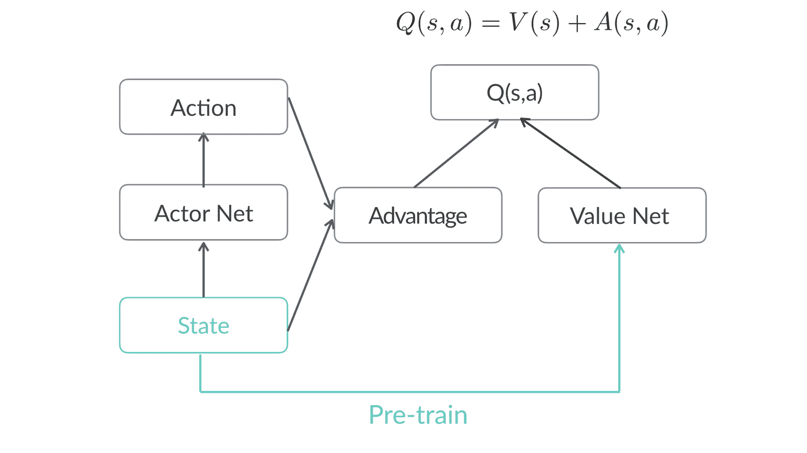
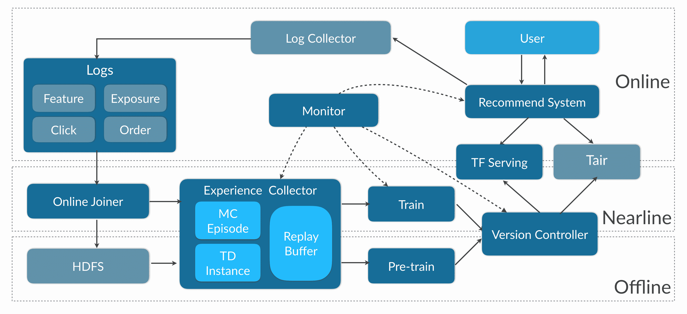

# 32 | 强化学习案例：美团是如何在推荐系统中落地强化学习的？

 

你好，我是王喆。今天我们来聊一聊美团的强化学习落地案例。

我们在第 22 讲中学过强化学习的基本原理、优点，以及微软的强化学习模型 DRN，但我们也说了强化学习在推荐系统中落地会有一个难点：因为强化学习涉及模型训练、线上服务、数据收集、实时模型更新等几乎推荐系统的所有工程环节，所以强化学习整个落地过程的工程量非常大，需要工程和研究部门通力合作才能实现。

即使很难，但业界依然有成功落地强化学习的案例，典型的就是美团在“猜你喜欢”功能中的应用。美团曾在官方博客中详细介绍过这一落地方案的技术细节，我们这节课就借助这个方案，来好好学习一下强化学习的实践。我也希望你能通过这个案例，串联起我们学过的所有推荐系统知识。

## 美团的强化学习应用场景

“猜你喜欢”是美团这个团购 App 中流量最大的推荐展位，产品形态是信息流。从图 1 的 App 截图中你可以看到，“猜你喜欢”列表中推荐了用户可能喜欢的餐厅，用户可以通过下滑和翻页的方式实现与 App 的多轮交互，在这个过程中，用户还可能发生点击、购买等多种行为。

图1 美团首页“猜你喜欢”场景

强化学习的应用场景就藏在用户和美团 App 的多轮交互之中。如果推荐系统能够在用户每次翻页的时候都考虑到用户刚刚发生的行为，就能够提供实时性更强的推荐体验。图 2 是美团的同学统计的用户翻页次数的分布图，我们可以看到，多轮交互确实是美团 App 中非常常见的用户场景，这也说明强化学习还是非常有用武之地的。

图2 “猜你喜欢”展位用户翻页情况统计

## 美团的强化学习建模方法

清楚了美团为什么要使用强化学习，我们就要开始思考强化学习是怎么应用到这样的场景之上的。

通过 22 课讲的学习，我们知道了强化学习有六个要素，分别是：智能体、环境、行动、奖励、目标和状态。清楚这六个要素在“猜你喜欢”功能中的具体含义，以及建模过程，我们就能知道美团 App 是怎么应用强化学习了。

那接下来，我就带你依次看一看美团是怎么针对这六个要素进行建模的。

首先是“智能体”，它指的就是美团的推荐系统，这其中最重要的部分自然就是强化学习的模型，这个我们等会再详细讲。“环境”我们刚才介绍过了，指的是美团 App 这个“猜你喜欢”的推荐场景。“行动”也不难理解，就是推荐系统选出商铺的列表，然后推荐给用户这个动作。接下来的三个要素是整个系统的重点，就是“奖励”、“目标”和“状态”。下面，我们一一来看它们的具体含义。

“奖励”指的是推荐系统把推荐列表推送给用户之后，用户在这个列表之上的反馈。对于美团来说，“猜你喜欢”展位的核心优化指标是点击率和下单率，这里的奖励就可以被定义成推荐列表中物品的点击次数和下单次数的加权和。如下面的公式所示，其中的 wc 和 wp 分别是点击次数和下单次数的权重，这两个超参数可以根据你对它们的重视程度进行调整。
r=wc​∗∑Iclick​+wp​∗∑Ipay​

有了奖励的定义，那么整个强化学习过程的目标就很好定义了，就是多轮交互后的奖励期望之和最大，它的形式化表达如下所示：

你可以看到，公式中的 k 指的是交互的轮数，r 指的是我们在上面定义的奖励函数，Gamma 是一个 0-1 之间的损失系数。综合来看这个目标函数的含义就是，在状态 s 的基础上，采取动作 a 让之后 k 轮的奖励之和期望最大。在强化学习模型参数的更新过程中，美团就是根据这个目标函数，并且通过梯度下降的方式进行参数的更新。

然后是状态的定义，在推荐系统的强化学习模型中，状态实质上代表了用户的意图、兴趣和所处场景，所以它在整个搭建过程中非常重要。

那我们如何来表达这个要素呢？美团设计了图 3 所示的网络结构来提取状态的 Embedding 表达，这个状态 Embedding 就是当前推荐系统所处的状态。

**这个网络主要分为两个部分：第一个部分是把用户实时行为序列的 Item Embedding 作为输入（就是翻页前点击下单等动作对应的物品），使用一维 CNN 层学习用户实时意图的表达，也就是图中的彩色部分；另一部分是传统的特征工程，它使用了特征值组成的稠密向量来表示用户所处的时间、地点、场景，以及使用兴趣 Embedding 来代表更长时间周期内用户的行为习惯。**

图3 状态建模网络结构

这里比较有意思的是第一个部分，它采用了单层 CNN，也就是卷积神经网络来学习用户的实时意图表达，这是我们之前没有遇到过的处理手法。

那它是怎么做的呢？它首先把用户交互获得的 Item Embedding 组成了一个矩阵，然后在这个矩阵之上使用了两个不同尺度的卷积层，再对卷积层中的每个行向量进行池化操作，生成两个代表了用户实时意图的 Embedding，把它们与第二部分的场景特征向量连接后，再经过全连接层，生成最终代表状态的 State Embedding。

强化学习这 6 大要素是什么、怎么实现，我们已经搞清楚了，但我们之前还留了一个问题，就是智能体部分的强化学习模型的结构到底什么样。下面，我们就来解决这个疑问。图 4 就是这个强化学习模型的框图。

我们看到，这个模型跟强化学习模型 DRN 一样，都采用了 DQN 的模型框架，也都分成了两个部分，一个部分叫做 Advantage 函数部分 A(s,a)，它与状态、动作都相关，这里面的 s 就是状态，a 就是动作，另一部分叫做 Value Net，它只与状态相关。最终的模型输出得分 Q(s,a) = V(s) + A(s,a)，就是把这两部分的得分融合起来。

图4 美团强化学习模型

这个框图中的状态网络是预训练好的，也就是说在线上推荐的过程中，状态网络是不会进行在线学习的，那么强化学习动态学习的参数到底是什么呢？它学习的其实是 V(s) 和 A(s,a) 这两部分的融合参数，以及跟 Action 相关的参数。

V(s) 和 A(s,a) 这两个函数的具体细节，美团并没有披露，但是一种典型的做法就是采用便于学习的线性模型来构建这两个函数。比如，对于 V(s) 这部分来说，输入是状态 Embedding 向量，那么我们就可以使用一个 LR 的结构生成 Value Net 的得分。

同理，A(s,a) 也一样，我们可以通过另一个 LR 结构把状态向量和动作相关的特征综合起来，生成一个 Advantage 函数得分。最后，我们再通过加权和的方式把 Value Net 得分和 Advantage 函数得分加起来。

总的来说，整个美团强化学习方案的执行过程可以分成 4 步：

1. 根据历史数据预训练 State Embedding 网络，初始化 Value Net 和 Advantage 函数的相关参数；
2. 在用户打开 APP 时，根据初始化模型来生成推荐列表；
3. 随着用户的不断交互，产生了一些实时的交互数据，这些数据经过 State Embedding 网络的在线推断过程，生成用户的实时 State Embedding，从而实时地影响用户每一轮交互的结果；
4. State Embedding 网络不进行在线更新，Value Net 和 Advantage 函数部分进行在线学习来更新相关参数，让强化学习框架具备实时学习的能力。

以上就是美团强化学习方案的理论部分，但是我们知道，强化学习落地最难的地方在于工程与模型的紧密融合，那下面就让我们看一看美团是如何落地这套方案的。

## 美团强化学习的工程架构

图 5 就是美团强化学习方案相关的工程架构。从整体上看，它确实像一整个推荐系统的框图，跟我们的 SparrowRecys 项目一样，包含了线上（Online）部分、近线（Nearline）部分和离线（Offline）部分。其中的模块也非常复杂，包含了数据流、模型训练、模型服务、线上推荐等多个模块。

虽然它复杂，但你也不用着急，它里面每个模块之间都有很强的逻辑关系。接下来，你就和我随着数据的整体流向，一起来过一遍这整个架构图吧。

图5 实时更新的强化学习框架

我们从最上方的 Log Collector 开始，它收集了推荐系统产生的各种日志，包括曝光、点击、下单，以及与这些行为相关的特征。

这些数据经过消息缓存系统 Kafka 收集之后，会形成数据流来到 Online Joiner 模块，那么 Online Joiner 正是从 Kafka 的数据流中实时收集特征和用户反馈，处理成包含了特征和标签的样本，再分别把样本数据输出到下游的 Kafka 和离线的 HDFS，来分别支持模型的在线和离线更新。

对于在线部分，Kafka 中的数据继续流向了一个叫 Experience Collector 的模块。这个模块是对样本做进一步处理，主要是把离散开的一个个样本点做进一步的整合，生成 App 中展现的推荐列表，然后以列表的形式“喂”给模型进行训练。

到这里，数据流的部分我们就基本讲完了，熟悉 Flink 的同学肯定会说，这部分基于数据流的处理过程不就是 Flink 最擅长的吗？没错，Online Joiner、Experience Collector 这些模块确实是最适合运行在 Flink 这类流处理平台之上。虽然美团没有具体透漏他们的流处理平台，但我们只需要知道这些近线的数据流操作都会运行在 Flink、Spark Streaming 这类流处理平台就可以了。

再说回到整个流程中，生成好的样本数据就来到了训练这一环节。美团使用了 TensorFlow 作为深度学习模型的训练平台。

当然，整个模型的训练也分为两部分。**一部分是离线的训练，刚才我们提到的 State 网络、Item Embedding 等都是通过离线训练生成的。另一部分需要在线训练，比如 Advantage 和 Value 函数相关的参数，这部分并不是在 TensorFlow 中训练的，而是利用实时数据流中的样本进行在线学习，并实时调整相关参数值。**

虽然 TensorFlow 的深度模型部分是在离线预训练好的，但是深度学习模型的线上服务效率问题一直是工程的难点。那美团是怎么解决的呢？和我们的项目一样，美团同样采用了 TensorFlow Serving 作为模型服务的方式，但它进行了 2 点优化。

**首先是剥离 State 模型的 Embedding 层，它采取预训练的方式生成 Item Embedding，减小模型的整体体积，方便上线。**这些预训练的 Embedding 会预存在内存数据库 Tair 中。Tair 的具体使用方法你不用特别关心，只要知道它是类似 Redis 的 Key-value 内存数据库就可以了。

**其次是优化了模型更新过程。**你可以看到 Version Controller 的模块，它是负责深度学习模型的版本管理的，在训练好一个新的模型之后，就需要把新模型进行上线。

但是在模型上线的时候，TensorFlow Serving 往往会在一两分钟内，产生响应时间骤然增加的现象，产生这种现象的原因主要有两点：一是 TensorFlow Serving 的模型加载和请求共用一个线程池，导致切换模型阻塞请求的处理；二是 TensorFlow 模型的计算图初始化要等到新模型接收第一次请求后才开始。

美团分别针对这两点进行了优化：**针对第一点，切分了模型加载部分和请求处理部分的线程池，使之互不干扰；针对第二点，采用了 warm up，也就是预热初始化的方式进行解决，在真实请求到来之前，先用一些预热的请求让模型完成计算图加载的过程。**

到这里，我们就讲完了美团的整个强化学习解决方案，从数据流的产生，近线的数据处理，到离线的模型训练，在线的模型学习更新、模型服务，强化学习需要整个系统通盘配合，才能够完成落地。通过今天的讲解，我相信你对强化学习的落地难点应该有了更深刻的理解，如果之后遇到这样的考验，也希望你能好好利用这些内容。

## 小结

这节课我们一起学习了美团的强化学习方案。

在美团的建模方法中，我们要关注强化学习的六要素。其中，智能体指的是美团的强化学习推荐模型，环境是“猜你喜欢”这个推荐场景，行动指的是强化学习模型生成的推荐列表，奖励是由点击和下单共同组成的奖励函数，目标是最大化多轮交互过程的奖励综合，状态是由深度学习网络生成的状态 Embedding。

在工程落地方案中，我们要清楚整个数据流的流向。推荐系统产生日志以后，它首先会被日志流系统 Kafka 收集，然后依次流经 Online Joiner 模块进行数据处理，生成训练样本，再由 Experience Collector 生成推荐列表样本，接着 TensorFlow 模型会根据列表样本进行离线训练，以及 Advantage 函数和 Value 函数利用相关参数进行在线学习，最后，等 TensorFlow 模型训练完成后通过 TensorFlow Serving 进行模型更新和服务。

同时，针对 TensorFlow Serving 延迟大，更新时效率低的特点，美团也采取了很多改进措施，比如剥离 Embedding 层、切分线程池，以及模型预热等等。

## 课后思考

你觉得我们在离线训练中使用的随机梯度下降之类的方法能用到在线学习上吗？除此之外，你还知道哪些在线学习的方法？

欢迎把你的经验和思考写在留言区，我们下节课见！
