# 17 | 远程控制：怎样打造联网的智能电灯？

 

你好，我是郭朝斌。

在上一讲，我们把智能电灯开发的实验环境搭好了。今天，我们就一起去完成智能电灯的开发工作，并且连接到腾讯云的物联网平台吧。

那为什么一定要连接到一个物联网平台呢？这是因为物联网平台提供了基本的设备管理功能，可以帮助我们更快速地实现设备的远程控制功能。比如说，我们可以通过“腾讯连连”小程序，来控制电灯的状态，而不用自己花费时间和精力去写相应的代码等工作。

## 物联网平台上需要做什么准备？

那为什么要选择腾讯云的物联网平台呢？

主要是两个原因。一方面是，它的平台是开放注册的，我们普通的用户也可以注册来使用，不像很多平台那样需要企业用户才能注册。另一方面是，腾讯云提供的交互方式非常方便，不需要编译，或者下载其他 App，在微信上用小程序就可以进行。

### 注册与登录

确定了要接入腾讯云的物联网平台以后，我们就需要先在这个平台上做一些准备工作了。准备工作的第一步，当然就是你得先注册个账号并且登录。注册和登录的流程非常简单，你打开这个链接，一眼就能看明白。

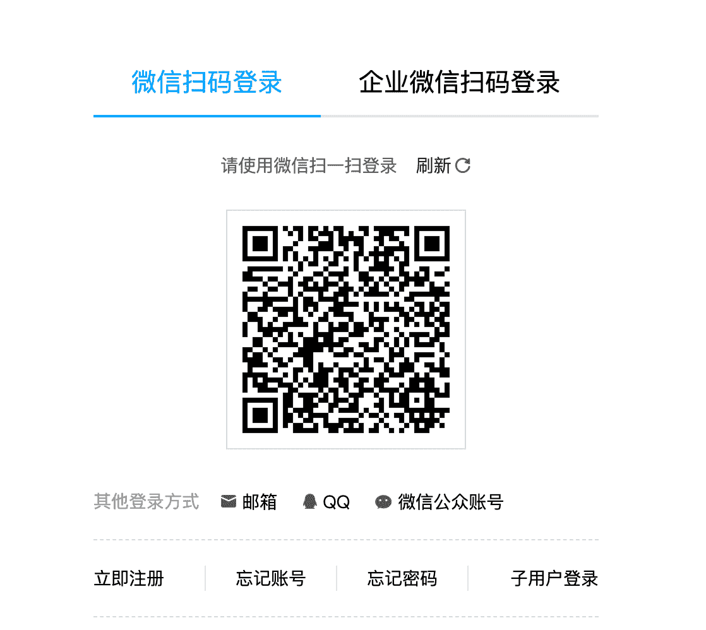

### 创建项目和产品

登录之后，我们直接进入准备工作的第二步，创建项目和产品。我们先在物联网开发平台创建一个新项目“智能家居”。

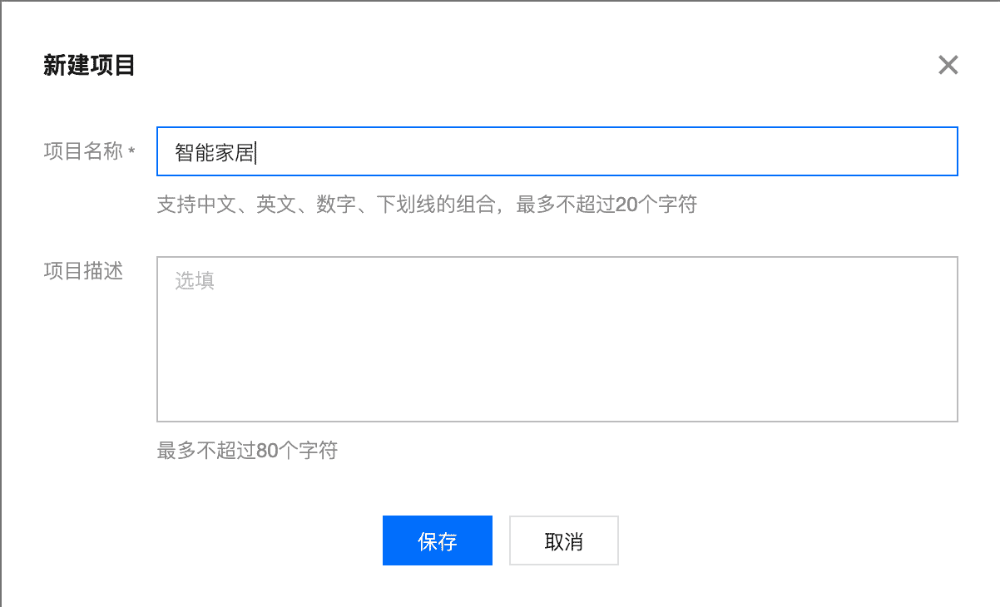

然后，进入这个“智能家居”项目，创建一个新产品“智能电灯”。到这里，我们需要简单设置几个参数：

1. 产品品类，直接选择“智能生活”-->“电工照明”-->“灯”。
2. 认证方式选择密钥认证，这个比较简单，而且适合我们的开发板 NodeMCU。
3. 通信方式，选择 Wi-Fi。
4. 数据协议选择“数据模板”，也就是基于物模型来解析数据。

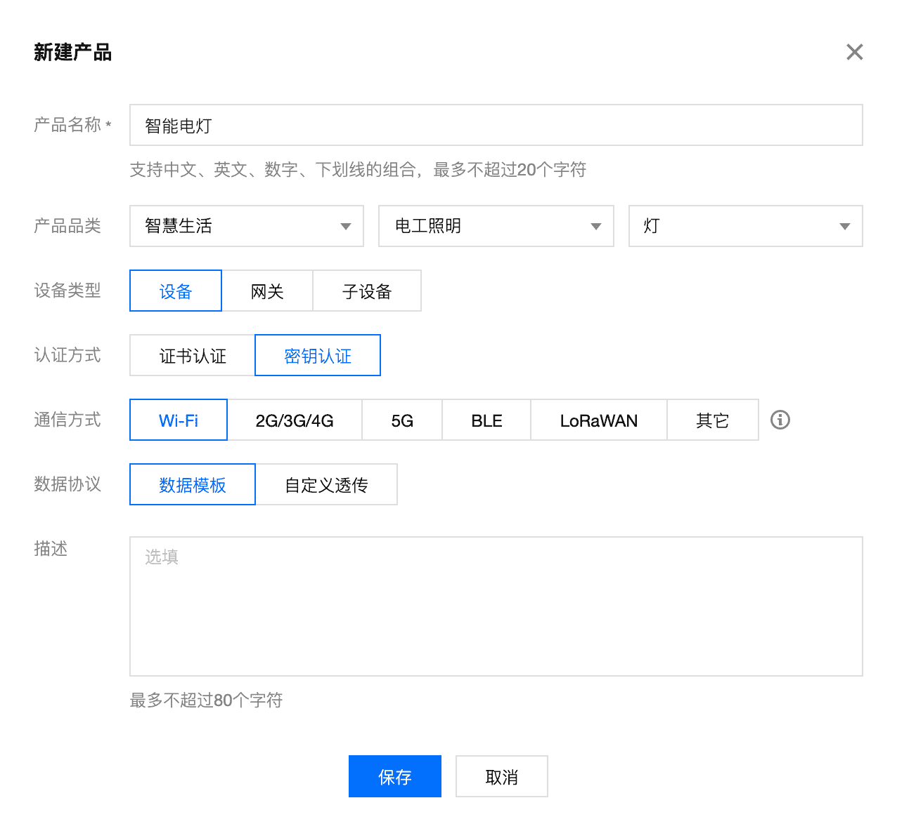

设置完成后，我们就可以点击进入智能电灯这个产品了，然后开始定义物模型。

### 物模型在哪里使用？

点击进入产品，我们可以看到“数据模板”界面中列出了“电灯开关”“亮度”“颜色”和“色温”等属性和事件。这些都是平台根据上一步选择的产品品类，自动生成的。

当然了，我们也可以通过“导入 JSON”的方式，把我们在第 6 讲编写的 JSON 文本导入，完成产品功能的定义。

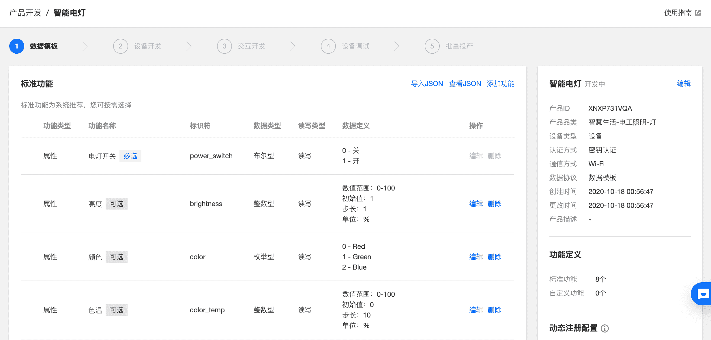

定义好物模型之后，我们就完成了“设备开发”的工作，需要继续完成“交互开发”配置了。

### 交互界面如何定义？

在“交互开发”界面中，我们需要关注两个配置项：“使用官方小程序控制产品”的选项要保持打开，因为我们后面要通过小程序来控制智能电灯；在“扫一扫产品介绍”配置项中，设置产品图片和备注信息。

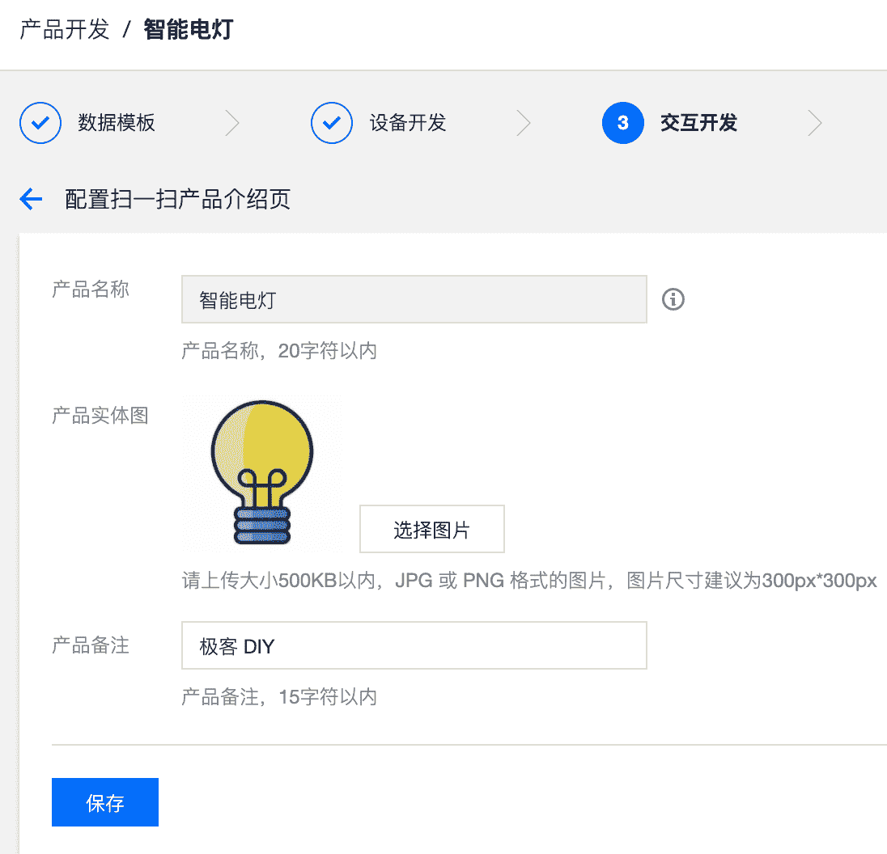

其他项目，比如“配置引导”“面板配置”和“快捷入口配置”，我们保持默认配置就行，当然你也可以根据自己的喜好进行调整。

这些都配置好之后，我们就可以开始准备“调试设备”的配置了。

### 为调试设备做准备

在“设备调试”界面中，我们创建一个测试设备。点击“新建设备”，输入设备名称“Led_1”。

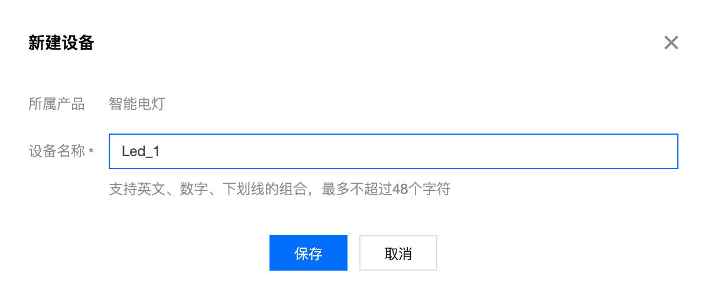

创建成功后，在测试设备列表中，点击“Led_1”，进入设备的详情页面：

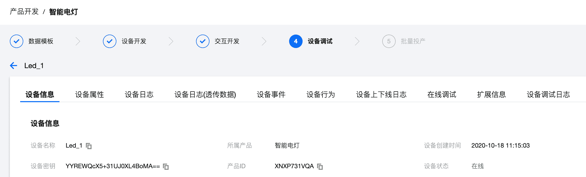

在这个“设备信息”标签页，我们可以看到“设备名称”“设备秘钥”和“产品 ID”的信息。我们需要把这些信息记录下来，因为在后面设备的开发中需要用到。

这里有一点我们要注意下。**设备名称（DeviceName）、设备秘钥（SecretKey）和产品 ID（ProductID）也经常被称为设备三元组**。它完整地标识了一个设备。在调试阶段，设备名称可以手动命名，不过在正式应用中，为了保证设备名称的唯一性，平台会帮你自动生成设备名称。

另外，在“设备调试”标签页，你需要点击下图中“二维码”，获取这个设备的二维码，并保存好。因为在后面的步骤中，你需要使用“腾讯连连”小程序扫描这个二维码，将设备添加到小程序中。

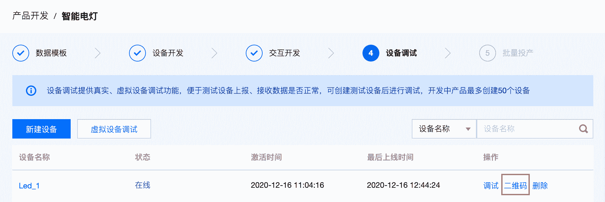

这是我在这个配置界面中定义的产品的二维码。


这个二维码的信息内容，如下所示：

```
{"DeviceName":"Led_1","ProductId":"XNXP231VQA","Signature":"2aa86e4e826b49b2a93949955f50761"}
```

可以看到，这个链接中主要包含了产品 ID 的信息。每个产品 ID 是唯一的，所以你的产品 ID 与这个不同。

到这里，我们就完成了腾讯云的物联网开发平台的准备工作。接下来，我们就要实打实地在开发板上，实现一个功能更加完善的智能电灯产品了。

## 如何打造智能电灯设备？

在上一讲，我们用代码实现了开发板上 LED 的控制。不过那个功能非常简单，为了让我们的智能电灯功能更完善，效果更酷炫，我们可以开发更多的功能，主要包括控制 LED 灯的颜色、开关，并能够实现远程控制。

我们先看看如何控制灯的颜色。

### 如何控制 LED 灯的颜色？

我们使用的 RGB LED 灯模块，是使用 PWM （Pulse Width Modulation，脉冲宽度调制）来实现控制 LED 的颜色和亮度的。PWM 的原理是，通过芯片的数字管脚（GPIO）来获得模拟电路信号的输出，它会控制芯片管脚在高电平和低电平之间进行快速切换。

那如何产生不同的 PWM 信号呢？这涉及到 2 个 PWM 信号的参数：**频率和占空比**。PWM 信号是一个方波信号，如下图的样子：


频率，是指 1 秒内方波的周期个数，一个周期包含一个完整的高、低电平变化。比如一个周期是 20 ms（毫秒），那么通过计算：

1000 毫秒 /20 毫秒 = 50Hz

我们可以知道方波的频率是 50 Hz（赫兹）。

那 PWM 输出的方波信号的频率不同，会对我们有什么影响呢？

如果频率小于 100 Hz 的话，我们的肉眼就会感受到灯的闪烁，甚至产生生理上的不适，比如视觉疲劳、偏头痛等。因此，对于 LED 灯，PWM 的频率必须大于 100Hz，最好在 200Hz 以上。对于我们选择的 NodeMCU 开发板来说，可以选择它支持的最大值，也就是 1000Hz。

在 PWM 的信号图中，我们还可以看到一个叫做“脉宽时间”的标识，它代表的是一个周期里高电平的占用时间。而所谓的占空比，就是脉宽时间占整个周期时间的比例。比如，脉宽时间是 10ms，那占空比的计算公式就是：

10/20 = 50%

占空比等于 50%。关于占空比参数，我需要提前说明一下：在 MicroPython 代码中，占空比 Duty 不是使用百分比数值来表示的，而是 0 到 1023 之间的数值。0 代表占空比为 0%，1023 代表占空比为 100%。

在代码中，当你设置了不同的占空比参数时，对应管脚输出的方波信号也会不同。下图展示了占空比分别为 0%、25%、50%、75% 和 100% 的方波信号，它们的平均电压（下图右侧）逐渐增大。我们正是通过平均电压的变化，达到了控制 LED 颜色和亮度等效果的目的。

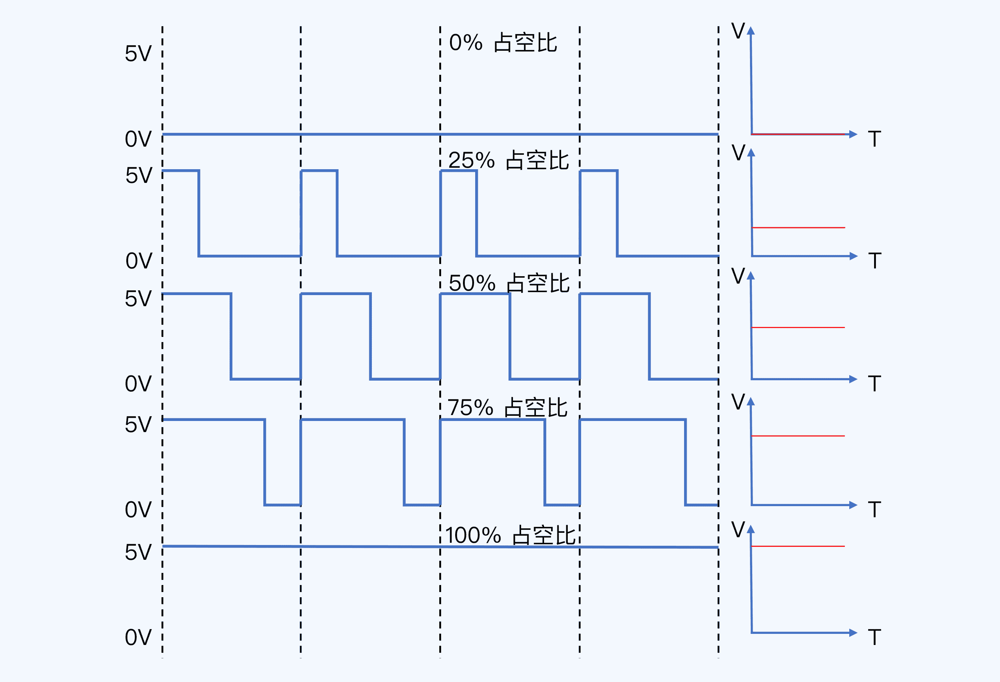

关于 PWM 信号，我们了解这些就够了。接下来，我们解决的问题，就是通过上一讲选定的开发板 NodeMCU 上的 GPIO 管脚来控制 LED 等的颜色了。NodeMCU 的管脚图如下所示：

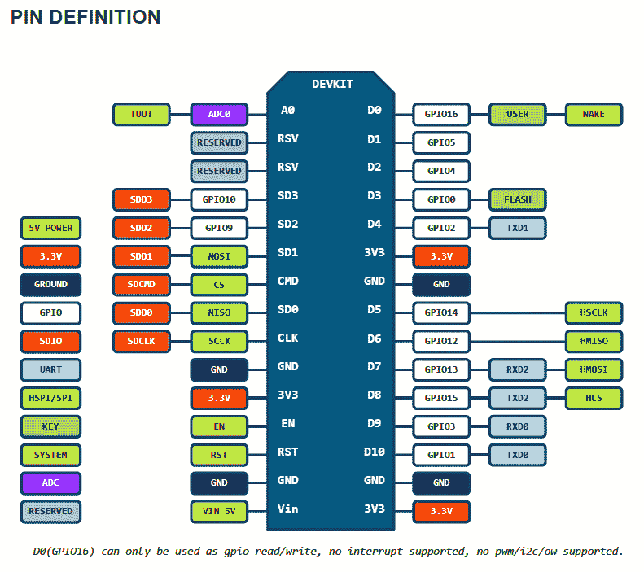

图片来自GitHub

一下子看到这么多管脚，你不要担心，因为只要关注带浅黄色背景的“GPIO”的几个管脚就够了。

我们先考虑一个问题，NodeMCU 开发板中的所有 GPIO 管脚都可以连接 RGB LED 模块吗？

答案是不可以。因为不是所有的 GPIO 管脚都可以输出 PWM 信号。NodeMCU 开发板是基于 ESP8266 芯片的，管脚 GPIO0、GPIO2、GPIO4、GPIO5、GPIO12、GPIO13、GPIO14 和 GPIO15 具备 PWM 的输出能力，它们分别对应 NodeMCU 开发板的 D3、D4、D2、D1、D6、D7、D5 和 D8 接口。

因此，我们选择 D1、D2 和 D3 这三个接口，分别连接 RGB LED 模组的红色、绿色和蓝色通道。

这里，我提供一下我创建的 LED 类文件，供你参考：

```
from machine import PWM  
from machine import Pin  
  
class Led():  
    """  
    创建LED类  
    """  
    def __init__(self, rpin, gpin, bpin, freq=1000):  
        """  
        构造函数  
        :param pin: 接LED的管脚，必须支持PWM  
        :param freq: PWM的默认频率是1000  
        """  
        self.pin_red = Pin(rpin)  
        self.pin_green = Pin(gpin)  
        self.pin_blue = Pin(bpin)  
  
        self.led_red = PWM(self.pin_red, freq = freq)  
        self.led_green = PWM(self.pin_green, freq = freq)  
        self.led_blue = PWM(self.pin_blue, freq = freq)  
  
    def rgb_light(self, red, green, blue, brightness):  
        if red in range(256) and \  
            green in range(256) and \  
            blue in range(256) and \  
            0.0 <= brightness and \  
            brightness >=1.0:  
            self.led_red.duty(int(red/255*brightness*1023))  
            self.led_green.duty(int(green/255*brightness*1023))  
            self.led_blue.duty(int(blue/255*brightness*1023))  
        else:  
            print("red green blue must between 0 and 255, and brightness from 0.0 to 1.0")  
          
    def deinit(self):  
        """  
        析构函数  
        """  
        self.led_red.deinit()  
        self.led_green.deinit()  
        self.led_blue.deinit()

### 如何控制电灯的开关？

智能电灯的“开”和“关”控制，我们使用继电器来实现。
```

继电器分为弱电（小电流、低电压）和强电（大电流、高电压）两个部分。其中，弱电的部分可以接微处理芯片；强电部分可以连接交流电设备，比如电风扇、冰箱和灯泡等。继电器其实就像是我们现实生活中“中间人”的角色，它通过电磁器件、或者光耦单元将弱电和强电联系起来，以完成微处理芯片对强电设备的控制。

在这次的实验中，我使用的一款基于 SRD-05VDC-SL-C 型号的电磁继电器。使用中，模块的控制接口，需要连接 NodeMCU 开发板的 GPIO 管脚。我们通过设置这个 GPIO 的输出电平高、低状态，实现控制继电器强电部分电路的“通”和“断”。

需要注意的是：在我们这一讲的实战中，继电器强电部分连接的 LED 灯，属于低电压设备，电压不超过 5V，这是对人体没有危害的电压；我们实战的目的是学习知识，在这个基础上，我们基于安全考虑，不建议把继电器的强电部分，连接 220V 交流电供电的电灯。

如果你有一定的交流电实践经验，那么在实践时也要注意两点：

1. 注意自身和周围人的安全，比如强电部分不要有裸露的电线，一定用绝缘胶带包扎好；
2. 弱电部分的供电，不要使用电脑的 USB 接口；为了电脑设备安全，建议使用独立的电源为开发板供电。

我同样把我创建的 Relay 类文件放在这里，供你参考：

```
from machine import ADC  
from machine import Pin  
  
class Relay():  
  
    def __init__(self, pin):  
        self.relaypin = Pin(pin, Pin.OUT)  
        self.last_status = 1  
  
    def set_state(self, state):  
        self.relaypin.value(state)  
        self.last_status = state

### 智能电灯的整体电路如何搭建？

确定了 LED 的技术方案和继电器后，我们就可以搭建出智能电灯的电路。我简单画了一下电路中各模块的连线情况，你在连接电路的时候按照这个连线来就行。
```

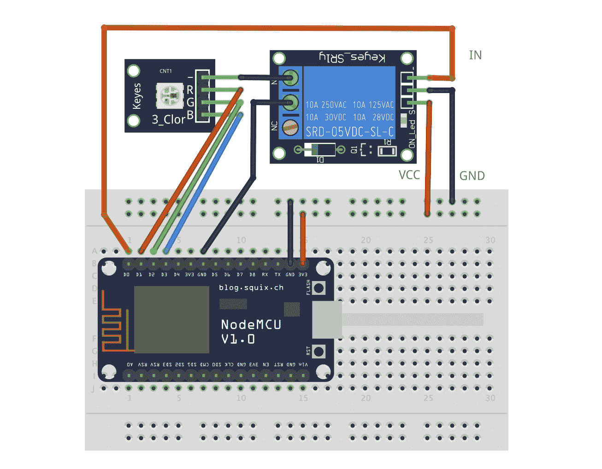

电路搭建完成后，你可以运行下面的代码测试一下：

```
from machine import PWM, Pin  
import time   
  
#设置对应红、绿、蓝的三个GPIO管脚  
led_red = PWM(Pin(5), freq = 1000)    
led_green = PWM(Pin(4), freq = 1000)  
led_blue = PWM(Pin(0), freq = 1000)  
  
#继电器的GPIO管脚  
relaypin = Pin(16, Pin.OUT)#  
  
#通过PWM的占空比设置颜色  
def rgb_light(red, green, blue, brightness):  
    pwm_red = led_red.duty(int(red/255*brightness*1023))  
    pwm_green = led_green.duty(int(green/255*brightness*1023))  
    pwm_blue = led_blue.duty(int(blue/255*brightness*1023))  
  
rgb_light(255, 255, 0, 1.0)  
  
#周期点亮、熄灭  
while True:  
    relaypin.on()  
    time.sleep(2)  
    relaypin.off()  
    time.sleep(2)

### 远程控制如何实现？

准备好了智能电灯设备后，要实现远程控制，我们还需要让智能电灯连接到物联网平台。那智能电灯如何与物联网平台通信交互呢？这里就要用到 MQTT 通信协议了。
```

首先，你需要在 NodeMCU 开发板上安装一个 MQTT 客户端代码库 umqtt.simple 库。它来自 MicroPython 官方维护的非内核标准库 micropython-lib，你可以使用 upip 包管理器来安装。在串口 REPL 中运行下面的命令，就可以完成安装：

```
>>> import upip  
>>> upip.install('micropython-umqtt.simple')
```

安装命令是不是很简单？但是这里有一个前提要求，就是 NodeMCU 需要连接到 Wi-Fi 路由器上，也就是能够访问网络，因为这个安装过程是从网络下载安装文件。

怎么让 NodeMCU 连接到 Wi-Fi 路由器呢？你仍然可以通过串口 REPL 来完成。你可以在 REPL 中依次输入下面的命令来接入网络：

```
>>> import network  
>>> wifi = network.WLAN(network.STA_IF)  
>>> wifi.active(True)   
>>> wifi.scan()   
>>> wifi.isconnected()   
>>> wifi.connect('你家中Wi-Fi的SSID', '你家中Wi-Fi密码')   
>>> wifi.isconnected() 
```

**安装好 umqtt.simple 库之后，我们需要再设置一下物联网平台的 MQTT 协议交互的 Topic 和具体的连接参数。**

我们用到的 MQTT Topic 主要有两个：一个用于发布消息，即消息流向是从设备到物联网平台；另一个用于接收订阅消息，即消息流向是从物联网平台到设备。

```
#发布消息  
$thing/up/property/ProductID/DeviceName  
  
#接收订阅消息  
$thing/down/property/ProductID/DeviceName
```

需要注意的是，ProductID 和 DeviceName 需要替换为我们在上面创建设备的具体值。

设备与物联网平台建立 MQTT 连接，涉及 Broker 服务器地址、端口号、设备 ID（ClientID）、用户名（UserName）和密码（Password）。我把这些参数整理到了一张表里，供你参考。

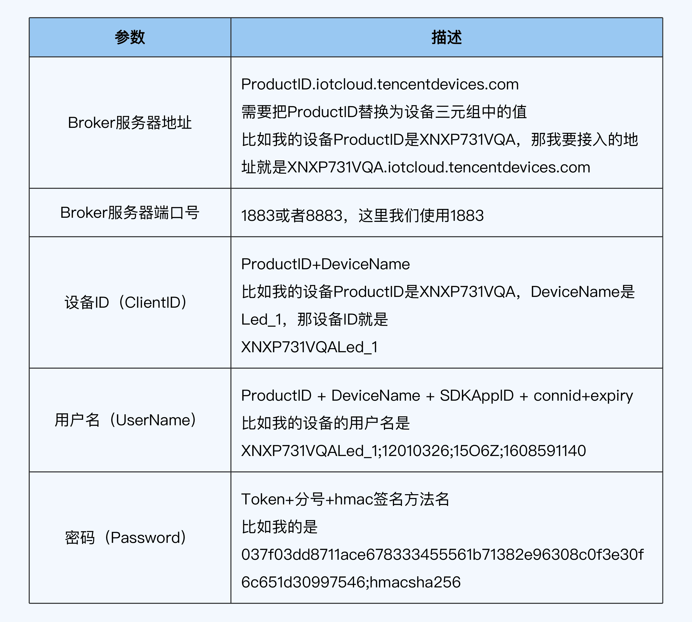

用户名和密码不太好手动生成，我们可以借助一个网页工具来生成。下载完成后，你可以解压缩，得到一些网页原文件，双击打开 sign.html，然后在页面输入设备三元组，点击“Generate”即可生成用户名和密码。

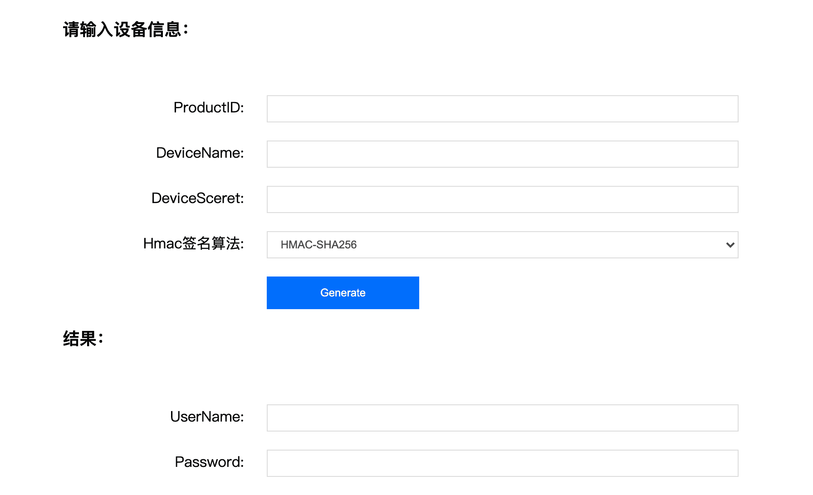

有了这些信息，我们就可以开始为智能电灯设备编写 MQTT 代码了：

```
from LED import Led  
from Button import Button  
from Relay import Relay  
  
import time   
import uasyncio  
import network  
import ujson  
from umqtt.simple import MQTTClient  
  
"""  
Wi-Fi Gateway : SSID and Password  
"""  
WIFI_AP_SSID = "你家的Wi-Fi SSID"  
WIFI_AP_PSW = "你家的Wi-Fi密码"  
  
"""  
QCloud Device Info  
"""  
DEVICE_NAME = "你的设备名称"  
PRODUCT_ID = "你的产品ID"  
DEVICE_KEY = "你的设备密钥"  
  
"""  
MQTT topic  
"""  
MQTT_CONTROL_TOPIC = "$thing/down/property/"+PRODUCT_ID+"/"+DEVICE_NAME  
MQTT_CONTROL_REPLY_TOPIC = "$thing/up/property/"+PRODUCT_ID+"/"+DEVICE_NAME  
  
led = Led(5, 4, 0)  
relay = Relay(16)  
button = Button(14)  
  
mqtt_client = None  
color = 0   #enum 0=red, 1=green, 2=blue  
name= ""    #light name. it is optional  
brightness = 100  # 0%~100%  
light_changed = False  
  
async def wifi_connect(ssid, pwd):  
    sta = network.WLAN(network.STA_IF)  
    sta.active(True)  
    sta.connect(ssid, pwd)  
  
    while not sta.isconnected():  
        print("Wi-Fi Connecting...")  
        time.sleep_ms(500)  
  
def mqtt_callback(topic, msg):  
    global led, relay, button  
    global color, name, brightness, light_changed  
  
    print((topic, msg))  
    msg_json = ujson.loads(msg)  
    if msg_json['method'] == 'control':  
        params = msg_json['params']  
  
        power_switch_tmp = params.get('power_switch')  
        if power_switch_tmp is not None:  
            power_switch = power_switch_tmp  
            relay.set_state(power_switch)  
          
        brightness_tmp = params.get('brightness')  
        if brightness_tmp is not None:  
            brightness = brightness_tmp  
  
        color_tmp = params.get('color')  
        if color_tmp is not None:  
            color = color_tmp  
          
        name_tmp = params.get('name')  
        if name_tmp is not None:  
            name = name_tmp  
          
        if brightness_tmp is not None or color_tmp is not None:  
            light_changed = True  
  
async def mqtt_connect():  
    global mqtt_client  
  
    MQTT_SERVER = PRODUCT_ID + ".iotcloud.tencentdevices.com"  
    MQTT_PORT = 1883  
    MQTT_CLIENT_ID = PRODUCT_ID+DEVICE_NAME  
    MQTT_USER_NAME = "你的用户名"  
    MQTTT_PASSWORD = "你的密码"  
  
    mqtt_client = MQTTClient(MQTT_CLIENT_ID, MQTT_SERVER, MQTT_PORT,MQTT_USER_NAME, MQTTT_PASSWORD, 60)  
    mqtt_client.set_callback(mqtt_callback)  
    mqtt_client.connect()  
  
def mqtt_report(client, color, name, switch, brightness):  
  
    msg = {  
        "method": "report",  
        "clientToken": "clientToken-2444532211",  
        "params": {  
            "color": color,  
            "color_temp": 0,  
            "name": name,  
            "power_switch": switch,  
            "brightness": brightness  
        }     
    }  
  
    client.publish(MQTT_CONTROL_REPLY_TOPIC.encode(), ujson.dumps(msg).encode())  
  
async def light_loop():  
    global led, relay, button  
    global color, name, brightness, light_changed  
  
    switch_status_last = 1  
    LED_status = 1    
  
    color = 2   #blue  
    brightness = 100    #here 100% == 1  
    led.rgb_light(0, 0, 255, brightness/100.0)  
  
    time_cnt = 0  
  
    mqtt_client.subscribe(MQTT_CONTROL_TOPIC.encode())  
  
    while True:  
        mqtt_client.check_msg()  
  
        switch_status = button.state()  
        LED_status = relay.state()  
        if switch_status != switch_status_last:  
            if switch_status == 0 and switch_status_last == 1:  
                LED_status = 0 if LED_status else 1  
            relay.set_state(LED_status)  
            switch_status_last = switch_status  
          
        if light_changed:  
            light_changed = False  
            led.rgb_light(255 if color==0 else 0, 255 if color==1 else 0, 255 if color==2 else 0, brightness/100.0)  
  
        if time_cnt >= 20:  
            mqtt_report(mqtt_client, color, name, LED_status, brightness)  
            time_cnt = 0  
        time_cnt = time_cnt+1  
        time.sleep_ms(50)  
  
       uasyncio.sleep_ms(50)  
  
async def main():  
    global mqtt_client  
  
    # Wi-Fi connection  
    try:  
        await uasyncio.wait_for(wifi_connect(WIFI_AP_SSID, WIFI_AP_PSW), 20)  
    except uasyncio.TimeoutError:  
        print("wifi connected timeout!")  
      
    # MQTT connection  
    try:  
        await uasyncio.wait_for(mqtt_connect(), 20)  
    except uasyncio.TimeoutError:  
        print("mqtt connected timeout!")  
  
    await uasyncio.gather(light_loop())  
  
uasyncio.run(main())

## 如何通过手机远程控制？

在完成代码后，我们通过 ampy 工具或者 pyboard.py 工具，将这些源代码上传到 NodeMCU 开发板中。程序开始自动执行，智能电灯自动接入物联网平台。打开物联网平台的设备调试页面，我们就可以看到设备显示“在线”。
```

点击“调试”，通过调试界面发送 MQTT 消息来控制智能电灯。

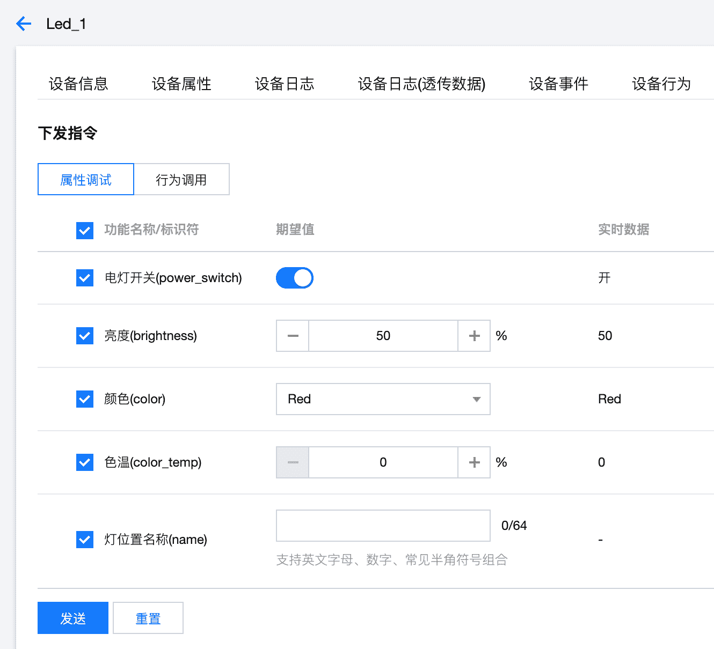

点击“发送”，物联网平台会向设备发送下面这样的消息内容：

```
{  
  "method": "control",  
  "clientToken": "clientToken-e9d920ea-a1f4-4a53-aada-a1d36fbbdd20",  
  "params": {  
    "power_switch": 1,  
    "brightness": 50,  
    "color": 0,  
    "color_temp": 0,  
    "name": ""  
  }  
}
```

那怎么通过手机小程序控制电灯呢？这也很好实现，我们只需要在小程序上添加设备，就可以使用小程序界面控制了。

打开“腾讯连连”小程序，点击“+”按钮，扫描我们在“设备调试”界面保存的二维码，就完成添加动作了。

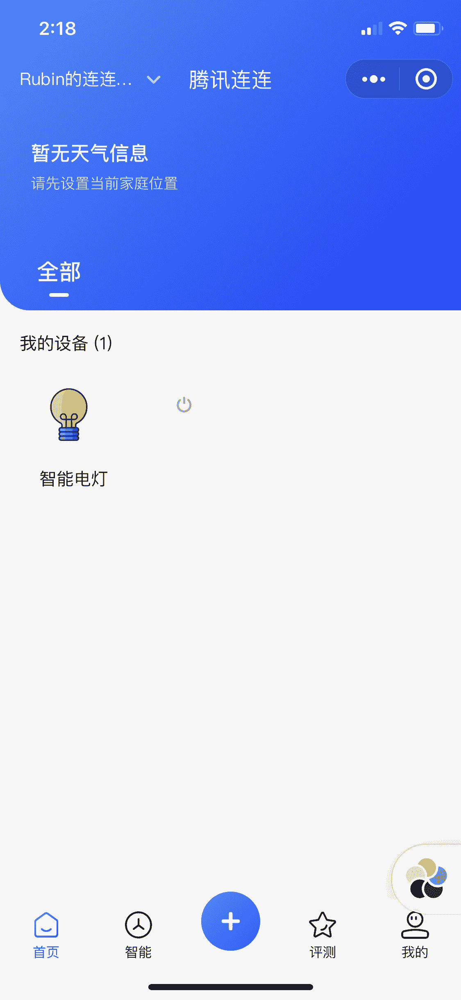

然后，点击设备卡片，进入设备交互界面，就可以进行远程控制了。

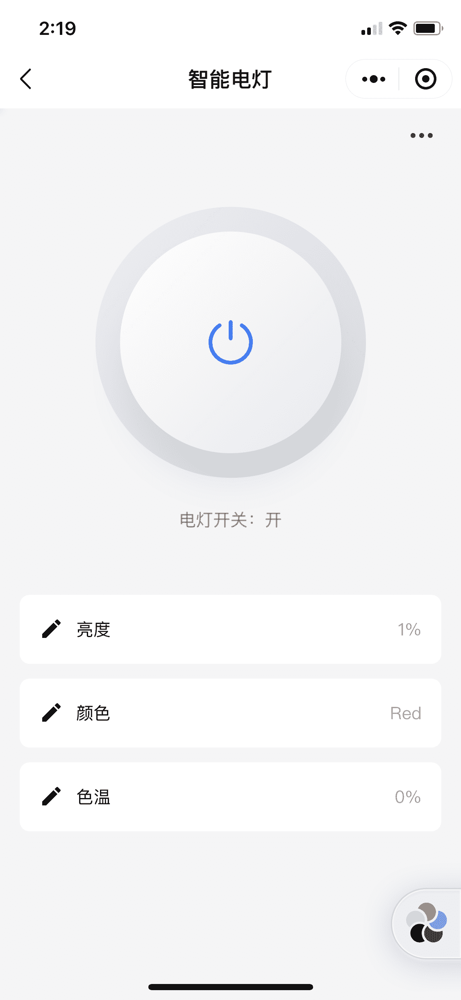

到这里，我们就可以用手机来远程控制智能电灯的开关状态和颜色了。

## 小结

在这一讲中，我们边实战边学习了智能电灯的电路组成、程序代码，以及与腾讯云物联网平台进行 MQTT 通信的相关知识。我再来帮你总结下需要记住的几个核心知识点。

1. 基于物联网平台开发产品，我们一般需要完成三件事，分别是物理网平台的创建和设置、智能设备的功能开发（每个产品最重要的部分），以及用户交互界面的开发。
2. 物模型是在物联网平台上定义设备的重要概念，你可以将第 6 讲的物模型直接导入来创建设备。
3. PWM 是照明控制中非常重要的一种技术手段，了解了频率和占空比的概念，也就掌握了它的工作原理。
4. 智能电灯通过 MQTT 通信协议与物联网平台交互。在 NodeMCU 开发板上可以安装一个 MQTT 客户端代码库 umqtt.simple 库，来开发 MQTT 客户端代码。

其实今天我们控制的 RGB LED 灯只是一颗灯珠，但是在实际产品中，我们很可能要控制多颗 LED。这时候，我们面临的首要问题，就是微控制芯片（MCU）的管脚不够用了。那怎么办呢？

关于这个问题，行业里已经有很多解决方案了。其中，NeoPixel 是开源硬件方案，你可以在网上搜索、了解一下，当然也可以和我多多交流。

## 思考题

最后，我给你留一道思考题吧。

在物联网平台的设备调试界面，我们可以发送 MQTT 消息来控制设备，而且我还给出了具体的消息内容。你可以和我说说，这个消息的主题（Topic）是什么吗？

另外，在智能电灯的功能实现中，我们通过继电器实现了电路通断的控制，通过 LED 灯实现了颜色的调节。你可以实现一下按钮的功能吗？这样就可以通过设备本身来控制电灯的打开和熄灭了。这也更符合现实中灯的样式。

欢迎你在留言区和我分享你的思考，如果在实战今天的智能电灯控制时遇到了什么问题，也可以和我进一步交流。同时，也欢迎你把今天的内容分享给你的朋友，一起动手实现一个酷炫的智能电灯控制系统吧。
