# 19 | 场景联动：智能电灯如何感知光线？（下）

 

你好，我是郭朝斌。

在上一讲，我们基于 NodeMCU ESP32 开发板，开发了一款光照传感器。考虑到低功耗的需求，它是基于低功耗蓝牙技术来实现的。但是蓝牙设备本身无法直接联网上报数据，那么我们要怎么根据光照强度数据来联动控制智能电灯呢？

不知道你还记不记得第 9 讲的内容？对于蓝牙设备，我们需要借助**网关**来实现联网的目的。所以在这一讲中，我会带你用树莓派打造蓝牙网关，最终实现光照传感器和智能电灯的场景联动。

## 网关系统架构

首先，我们先看一下网关的系统架构。

网关的主要功能是**协议转换**，一方面它需要接收低功耗蓝牙技术的光照传感器的广播数据，另一方面，它需要把解析的数据上传到云平台。

具体的架构图如下所示。

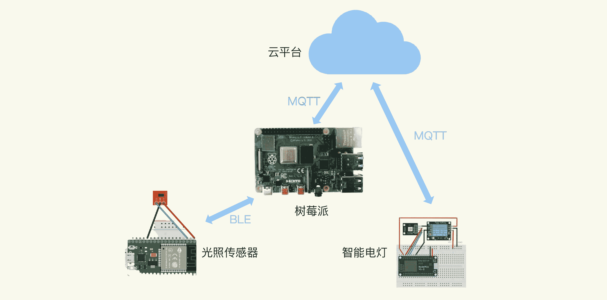

## 南向蓝牙通信

在树莓派上进行蓝牙开发，你可以使用bluepy软件包。它提供了一个 Python 语言版本的低功耗蓝牙 API 接口，而且对树莓派的适配非常好。

### 通过终端登录树莓派

在学习第 15 讲的时候，你应该已经在树莓派上部署好了包含 Gladys Assistant 系统的 Raspbian 操作系统，现在你可以直接使用这个系统。安装软件包之前，我们在电脑终端上输入下面的命令，通过 SSH 协议登录到树莓派系统中。

```
$ ssh pi@gladys.local
```

其中，pi 就是默认的登录用户名，gladys.local 是树莓派开发板的本地域名。

当提示输入密码时，我们输入默认密码 raspberry，然后回车，就登录到了树莓派系统中。

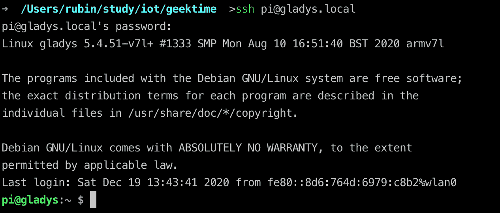

### 通过图形化窗口软件登录树莓派

当然，你也可以使用提供图形化窗口的软件来登录树莓派，比如 **SecureCRT**，它除了支持串口协议，同时也支持 SSH 协议。你只需要新建一个连接会话，按照下图所示的内容填写就行了：

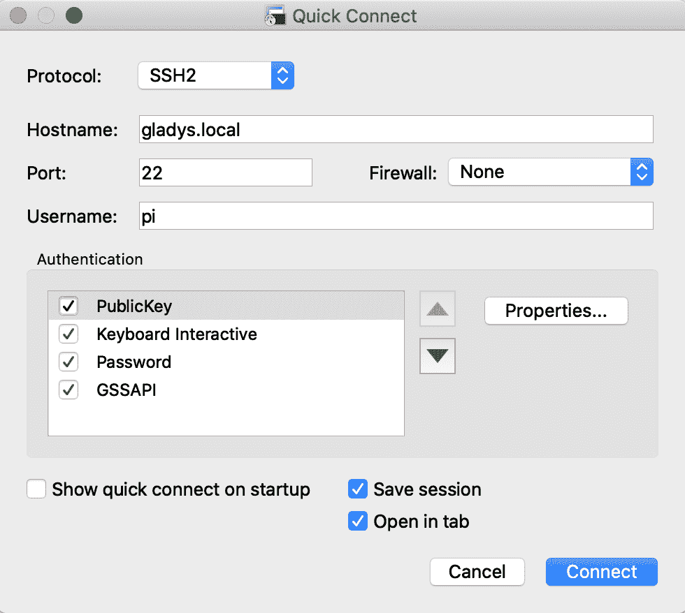

第一次登录时，SecureCRT 会弹窗提示我们查看“Host Key”，这时点击“Accept Once”即可。

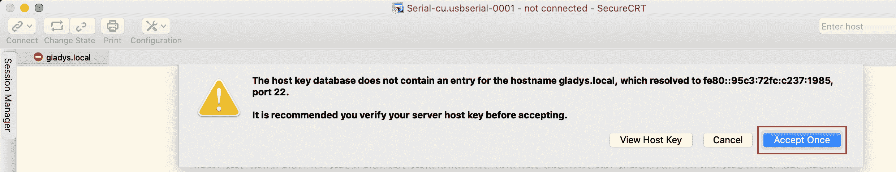

然后我们输入密码“raspberry”，同时勾选“Save password”，省去以后重复输入密码的麻烦。点击“OK”后，就进入树莓派系统了。

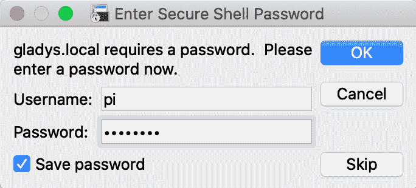

### 在树莓派开发蓝牙程序

我们在树莓派的终端上输入下面命令，就可以完成 bluepy 的安装：

```
$ sudo apt-get install python3-pip libglib2.0-dev  
$ sudo pip3 install bluepy
```

另外，我们还需要安装 interruptingcow 软件包。它主要是便于编写定时任务。它的安装命令是：

```
$ sudo pip3 install interruptingcow
```

具体代码如下，供参考：

```
#File: blescan.py  
import time  
from threading import Thread  
from interruptingcow import timeout  
  
from bluepy.btle import DefaultDelegate, Peripheral, Scanner, UUID, capitaliseName, BTLEInternalError  
from bluepy.btle import BTLEDisconnectError, BTLEManagementError, BTLEGattError  
  
class LightScanner():  
    SCAN_TIMEOUT = 5  
  
    def __init__(self, name):  
        self._name = name  
      
    def status_update(self):  
        results = self._get_data()  
  
        # messages = [  
        #     MqttMessage(  
        #         topic=self.format_topic("property/light"),  
        #         payload=results.lightlevel,  
        #     )  
        # ]  
  
        return results  
  
    def _get_data(self):  
  
        scan_processor = ScanProcessor(self._name)  
        scanner = Scanner().withDelegate(scan_processor)  
        scanner.scan(self.SCAN_TIMEOUT, passive=True)  
  
        with timeout(  
            self.SCAN_TIMEOUT,  
            exception=Exception(  
                "Retrieving data from {} device {} timed out after {} seconds".format(  
                    repr(self), self._name, self.SCAN_TIMEOUT  
                )  
            ),  
        ):  
            while not scan_processor.ready:  
                time.sleep(1)  
            return scan_processor.results  
  
        return scan_processor.results  
  
class ScanProcessor:  
  
    ADV_TYPE_SERVICE_DATA = 0x16  
    def __init__(self, name):  
        self._ready = False  
        self._name = name  
        self._results = MiBeaconData()  
  
    def handleDiscovery(self, dev, isNewDev, _):  
        is_nodemcu = False  
        if isNewDev:  
            for (adtype, desc, value) in dev.getScanData():  
                #Service Data UUID == 0xFE95 according to MiBeacon  
                if adtype == self.ADV_TYPE_SERVICE_DATA and value.startswith("95fe"):  
                    print("FOUND service Data:",adtype, desc, value)  
                    #Object ID == 0x1007 according to MiBeacon  
                    if len(value) == 38 and value[26:30] == '0710':  
                        light_den = int((value[-2:] + value[-4:-2]), 16)  
                        mac = value[14:26]  
  
                        self._results.lightlevel = light_den  
                        self._results.mac = mac  
  
                        self.ready = True  
  
    @property  
    def mac(self):  
        return self._mac  
  
    @property  
    def ready(self):  
        return self._ready  
  
    @ready.setter  
    def ready(self, var):  
        self._ready = var  
  
    @property  
    def results(self):  
        return self._results  
  
class MiBeaconData:  
    def __init__(self):  
        self._lightlevel = None  
        self._mac = None  
  
    @property  
    def lightlevel(self):  
        return self._lightlevel  
  
    @lightlevel.setter  
    def lightlevel(self, var):  
        self._lightlevel = var  
  
    @property  
    def mac(self):  
        return self._mac  
  
    @mac.setter  
    def mac(self, var):  
        self._mac = var

## 北向 MQTT 对接云平台

接下来，我们要实现网关和云平台的对接。

### MQTT 开发环境准备

安装软件包
```

蓝牙网关与云平台交互的通信协议也是使用 MQTT 协议，所以我们需要安装 MQTT 的软件包。

使用哪个软件包呢？在第 8 讲中我介绍过几个常用的 MQTT 软件包，这里我们选择支持 Python 语言开发的Eclipse Paho软件包。我们在树莓派的终端上输入下面的命令来安装。

```
$ sudo pip3 install paho-mqtt
```

安装成功后，我们可以写一个 demo 程序测试一下。下面是我测试的代码，你可以参考。和第 8 讲一样，这段代码仍然会连接到 test.mosquitto.org，并且订阅“/geektime/iot”的主题消息。

```
#File: mqttdemo.py   
import paho.mqtt.client as mqtt  
  
def on_connect(client, userdata, flags, rc):  
    print("Connected with result code "+str(rc))  
  
    client.subscribe("/geektime/iot")  
  
def on_message(client, userdata, msg):  
    print(msg.topic+" "+str(msg.payload))  
  
client = mqtt.Client()  
client.on_connect = on_connect  
client.on_message = on_message  
  
#Still connect to mqtt.eclipse.org  
client.connect("test.mosquitto.org", 1883, 60)  
  
client.loop_forever()
```

1. **部署文件到树莓派**

现在，我们把测试文件 mqttdemo.py 上传到树莓派上。

你可以在电脑终端上，运行下面的命令。（注意，你需要先在树莓派上创建 pi-gateway 这个目录。）

```
$ scp mqttdemo.py pi@gladys.local:/home/pi/pi-gateway/
```

其中这个 scp 命令是基于 SSH 协议实现的安全文档传输功能。

当然，你也可能更习惯图形化的软件，所以我再介绍一个能实现 scp 功能的软件 FileZilla。它支持 MacOS、Windows 和 Linux 操作系统，操作界面也非常直观。

打开“站点管理器”，创建“新站点”。你可以按照下图设置具体配置参数，然后点击“连接”，登录到树莓派系统。为了方便之后的使用，你可以勾选“保存密码”选项。

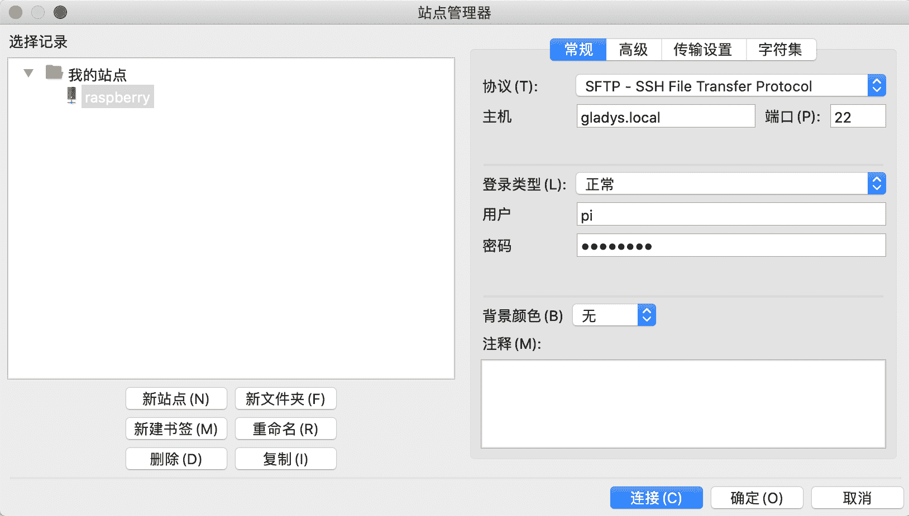

在软件界面的左半部分是你的电脑上的文件目录，右半部分是树莓派上的目录。你只需要双击左边的某个文件，就可以将文件传输到树莓派上。当然你也可以双击右边树莓派上的文件，将它传输到你的电脑。

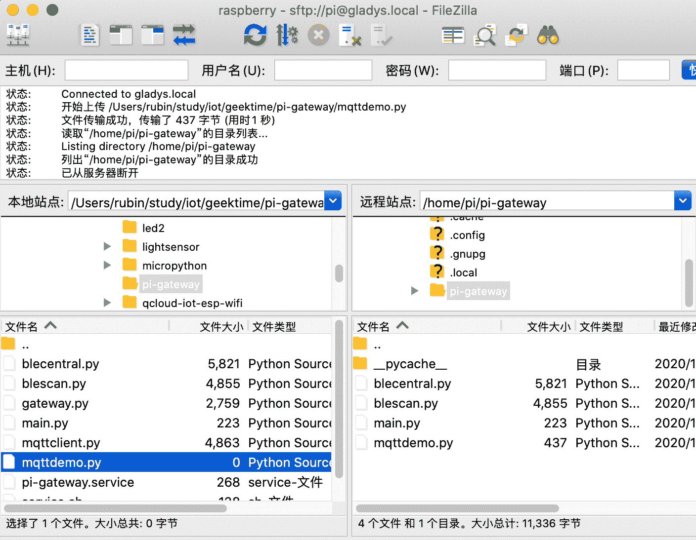

把文件传输到树莓派之后，我们就可以在树莓派的终端上输入下面的命令，运行上面的 demo 程序。

```
$ sudo python3 mqttdemo.py
```

这时我们把第 8 讲中的发布消息命令再执行一次，如果一切顺利执行，那么就可以在树莓派的终端上看到这个消息。

```
hbmqtt_pub --url mqtt://test.mosquitto.org:1883 -t /geektime/iot -m Hello,World!
```

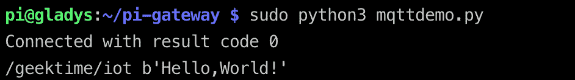

### 云平台创建光照传感器设备

现在，我们已经做好了对接云平台的准备工作。在树莓派上开发与云平台的通信代码之前，我们还需要在腾讯云平台上创建对应的光照传感器设备。

创建的过程与第 17 讲智能电灯的过程类似。我快速介绍一下，你重点关注不同的地方就可以了。

在“新建产品”中，产品类别选择“智慧生活”-->“安防报警”-->“光照度传感器”。数据协议仍然选择“数据模板”，其他的保持默认值即可。

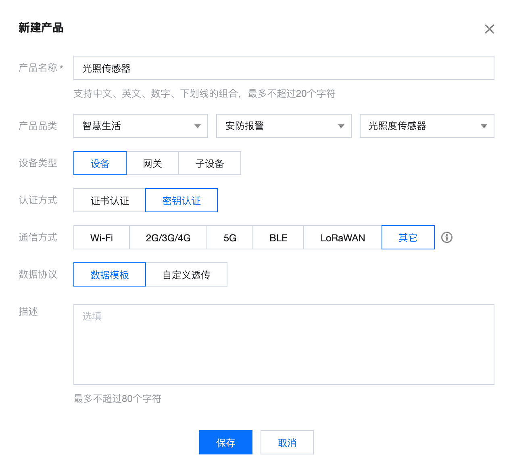

创建成功后，我们点击进入数据模板的设置界面。为了尽量简单，我只定义了一个属性“光照度”，而且是只读类型。你可以直接导入下面的 JSON 文件完成数据模板的设置。

```
{  
  "version": "1.0",  
  "profile": {  
    "ProductId": "你的ProductID",  
    "CategoryId": "112"  
  },  
  "properties": [  
    {  
      "id": "Illuminance",  
      "name": "光照度",  
      "desc": "光照度检测",  
      "mode": "r",  
      "define": {  
        "type": "float",  
        "min": "0",  
        "max": "6000",  
        "start": "0",  
        "step": "1",  
        "unit": "Lux"  
      }  
    }  
  ],  
  "events": [],  
  "actions": []  
}
```

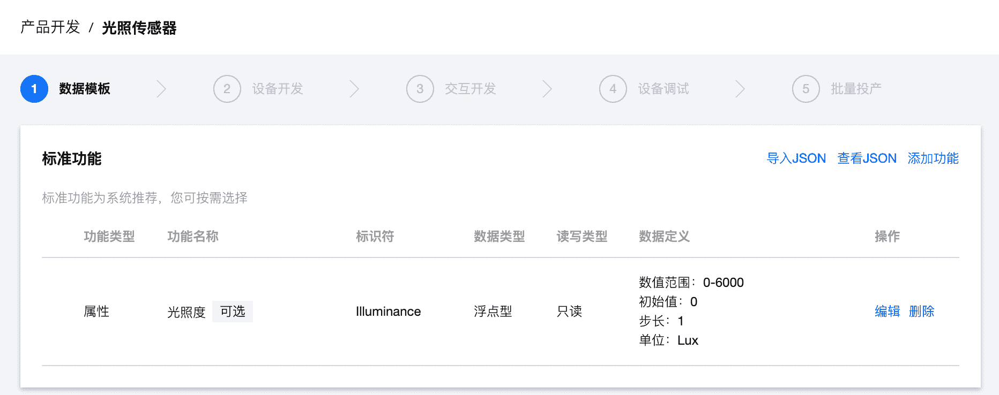

在“交互开发”标签页中，和智能电灯一样，我们仍然保持“使用官方小程序控制产品”选项是打开状态。另外，还有一个配置项需要关注，那就是“智能联动配置”，因为后面我们要为光照传感器设置联动场景。

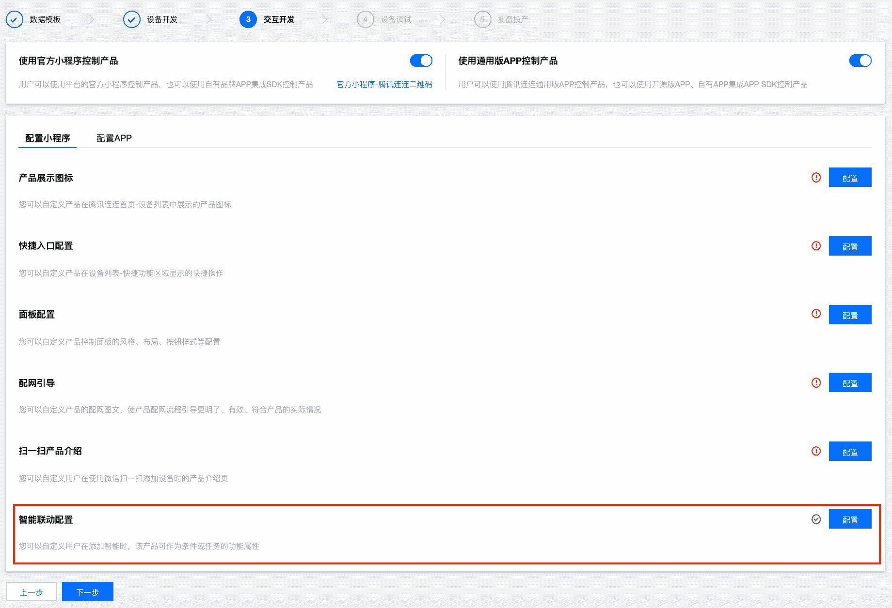

我们点击“配置”，在设置页面中，就可以看到“光照度”这个属性，因为它是只读属性，所以只能作为联动的触发条件。我们勾选“作为条件”的选项，完成配置。

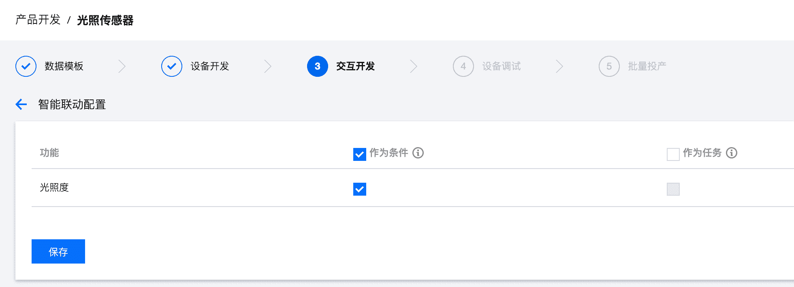

下一步，在“设备调试”界面中，我们创建一个测试设备。点击“新建设备”，输入设备名称“Lightsensor_1”。

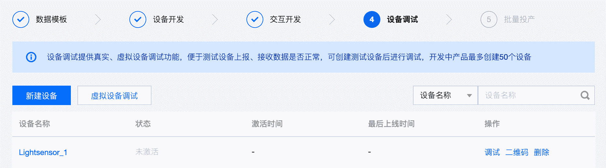

创建成功后，在测试设备列表中，点击“Lightsensor_1”，进入设备的详情页面，我们可以看到设备三元组的信息。你需要将这些信息记录下来，因为后面的开发中需要使用。

在测试设备列表中，我们点击“二维码”操作，获取测试设备的二维码，以便在小程序“腾讯连连”中添加这个设备。

到这里，腾讯云平台上的产品创建工作就完成了。

### 产品联网开发

在腾讯云平台准备好产品的配置工作之后，我们继续在树莓派上完成北向的通信交互的开发工作。

在第 17 讲中，我们已经了解了 MQTT 通信的主题 Topic ，以及 Broker 服务器地址、端口号、设备 ID（ClientID）、用户名（UserName）和密码（Password）等连接参数的知识。

我们还是可以使用 **sign.html** 这个网页工具生产用户名和密码，然后就能得到所有的参数。这时，把这些参数替换到下面这段代码的对应位置就可以了。

```
#File: gateway.py  
from blescan import LightScanner, MiBeaconData  
  
import time   
import asyncio  
import json  
import uuid  
import paho.mqtt.client as MQTTClient  
  
"""  
QCloud Device Info  
"""  
DEVICE_NAME = "Lightsensor_1"  
PRODUCT_ID = "MAO3SVUCFO"  
DEVICE_KEY = "TYjuKNc2GpDykXUv4MWBOA=="  
  
"""  
MQTT topic  
"""  
MQTT_CONTROL_TOPIC = "$thing/down/property/"+PRODUCT_ID+"/"+DEVICE_NAME  
MQTT_CONTROL_REPLY_TOPIC = "$thing/up/property/"+PRODUCT_ID+"/"+DEVICE_NAME  
  
def mqtt_callback(client, userdata, msg):  
    # Callback  
    print(f"Received `{msg.payload.decode()}` from `{msg.topic}` topic")  
  
async def mqtt_connect():  
    #connect callback  
    def on_connect(client, userdata, flags, rc):  
        if rc == 0:  
            print("Connected to MQTT Broker!")  
        else:  
            print("Failed to connect, return code %d\n", rc)  
  
    mqtt_client = None  
    MQTT_SERVER = PRODUCT_ID + ".iotcloud.tencentdevices.com"  
    MQTT_PORT = 1883  
    MQTT_CLIENT_ID = PRODUCT_ID+DEVICE_NAME  
    MQTT_USER_NAME = "MAO3SVUCFOLightsensor_1;12010126;2OYA5;1609057368"  
    MQTTT_PASSWORD = "8f79b7f1b0bef9cde7fd9652383b6ff8bfeb8003cc994c64f3c8e069c11fd4c7;hmacsha256"  
  
    mqtt_client = MQTTClient.Client(MQTT_CLIENT_ID)  
    mqtt_client.username_pw_set(MQTT_USER_NAME, MQTTT_PASSWORD)  
    mqtt_client.on_connect = on_connect  
      
    mqtt_client.connect(MQTT_SERVER, MQTT_PORT, 60)  
  
    return mqtt_client  
  
def mqtt_report(client, light_level):  
    client_token = "clientToken-" + str(uuid.uuid4())  
  
    msg = {  
        "method": "report",  
        "clientToken": client_token,  
        "params": {  
            "Illuminance": light_level  
        }  
    }  
  
    client.publish(MQTT_CONTROL_REPLY_TOPIC, json.dumps(msg))  
  
async def light_loop(mclient):  
  
    bles = LightScanner('Nodemcu')  
  
    mclient.subscribe(MQTT_CONTROL_TOPIC)  
    mclient.on_message = mqtt_callback  
  
    mclient.loop_start()  
  
    while True:  
        try:  
            data = bles.status_update()  
        except Exception as e:  
            print("BLE SCAN error:", e)  
            continue  
          
        print("Light Level:", data.lightlevel)  
  
        mqtt_report(mclient, data.lightlevel)  
          
        time.sleep(0.1)  
  
async def main():  
    mqtt_client = None  
    # MQTT connection  
    try:  
        mqtt_client = await asyncio.wait_for(mqtt_connect(), 20)  
    except asyncio.TimeoutError:  
        print("mqtt connected timeout!")  
  
    if mqtt_client is not None:  
        await asyncio.gather(light_loop(mqtt_client))  
  
asyncio.run(main())

### 在树莓派上部署软件

接下来，我们把代码文件 gateway.py 和 blescan.py 两个文件也上传到树莓派的 /home/pi/pi-gateway 目录中。
```

同时，为了让程序作为后台服务运行，并且能够开机自启动，我们来做一个 Pi Gateway Service。

首先，你需要新建一个 service.sh 脚本文件，内容如下：

```
#!/bin/sh  
set -e  
SCRIPT_DIR=$( cd "$( dirname "$0" )" >/dev/null 2>&1 && pwd )  
  
cd "$SCRIPT_DIR"  
sudo python3 ./gateway.py "$@"
```

然后，创建我们 service 的配置文件，内容如下：

```
[Unit]  
Description=Pi Gateway  
Documentation=https://time.geekbang.org/column/intro/100063601  
After=network.target  
  
[Service]  
Type=simple  
WorkingDirectory=/home/pi/pi-gateway  
ExecStart=/home/pi/pi-gateway/service.sh  
Restart=always  
  
[Install]  
WantedBy=multi-user.target
```

接着，把这两个文件上传到树莓派系统的 /home/pi/pi-gateway 目录中，并且运行下面命令，修改文件的属性。

```
$ sudo chmod a+x service.sh   
$ sudo chmod a+x pi-gateway.service
```

最后，执行下面的几条命令，为树莓派系统增添上 Pi Gateway 这个服务。

```
$ sudo cp /home/pi/pi-gateway/pi-gateway.service /etc/systemd/system/  
$ sudo systemctl daemon-reload  
$ sudo systemctl start pi-gateway  
$ sudo systemctl status pi-gateway  
$ sudo systemctl enable pi-gateway
```

到这里，网关程序已经在树莓派上运行起来。我们在腾讯云物联网平台上可以看到，光照传感器变为“在线”状态。

## 设置场景联动

在第 17 讲和第 18 讲的实战中，我们分别完成了智能电灯和光照传感器的开发，现在终于可以为它们设置场景联动了。

### 场景联动任务分解

我们希望实现的联动场景是，基于环境的光照强度自动控制电灯的开和关。具体来说，这个目标可以拆解为 3 个自动触发任务：

1. 当光照强度大于 1024Lux 时，关闭电灯。
2. 当光照强度小于 1024Lux 时，打开电灯。
3. 至于光照强度等于 1024Lux 时，也打开电灯。

注意，这里的 1024Lux 是我自己选择的一个值，你可以根据房屋情况自己调整。

### 联动设备准备

如果你还没有在小程序中添加光照传感器设备，这时可以打开微信中的腾讯连连小程序，扫描上面云平台“设备调试”中保存的那个二维码，添加光照传感器测试设备“Lightsensor_1”。

现在你的小程序里面已经有了两个设备，如下图所示。

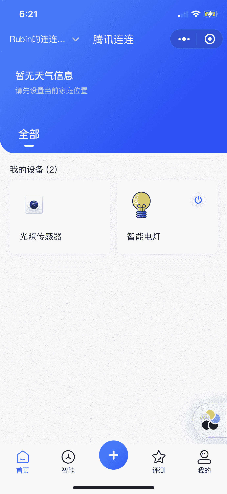

刚才我们已经在腾讯云物联网平台上，为光照传感器设置了“智能联动配置”。现在，我们来为智能电灯配置智能联动能力。

我们进入智能电灯的“交互开发”页面，打开下面的“智能联动配置”页面，然后，像下图显示的那样，把“电灯开关”的“作为任务”条件勾选上。

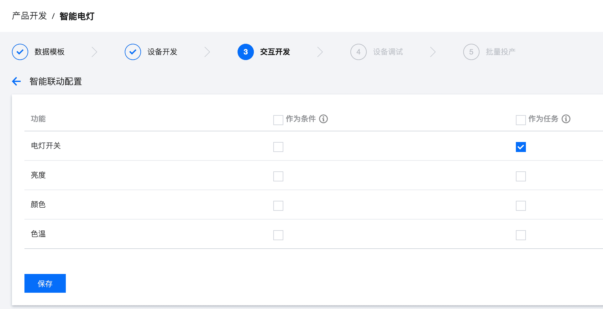

### 联动任务创建

然后，我们进入腾讯连连小程序，点击下面的“+”，选择“添加智能”，开始配置工作。

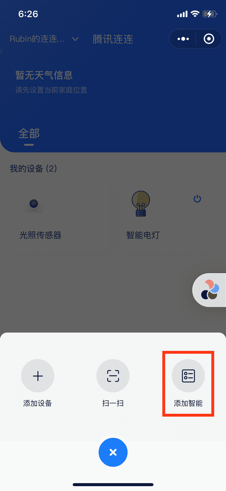

我们从弹框里选择“自动智能”，可以看到下图的配置界面：

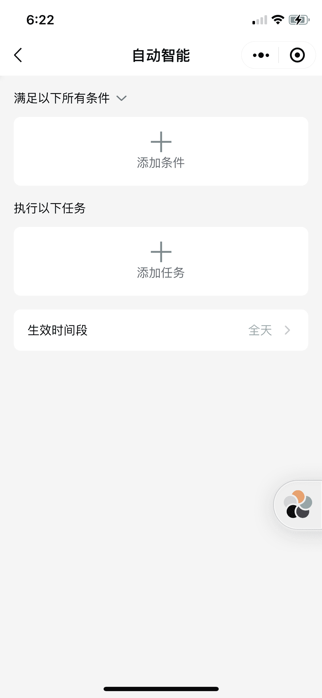

首先，我们添加条件，选择光照传感器设备，然后就会看到光照度属性。我们先设置大于 1024Lux 的条件。

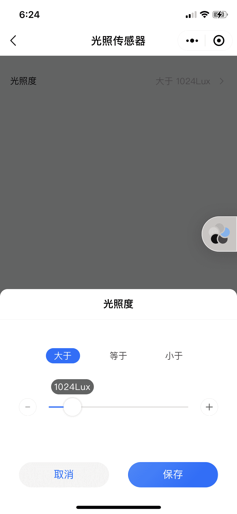

然后，我们添加任务，选择智能电灯设备后，可以看到电灯开关的属性，选择“关”，点击保存。

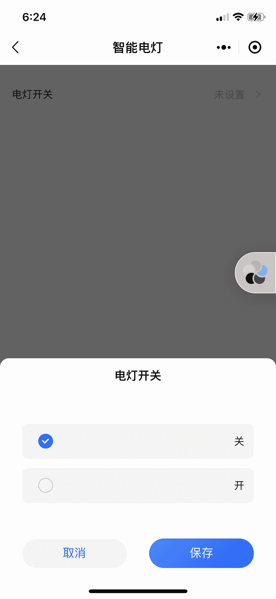

这时，我们可以看到这个智能联动的条件和任务已经配置完成。腾讯连连小程序还支持配置“生效时间段”，可以限定智能联动在选定的时间段内运行。

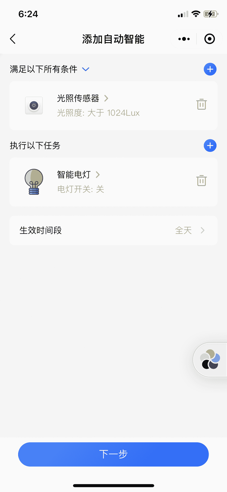

接下来，我们还可以设置一个主题图片和名称，这个根据喜好来就行了。

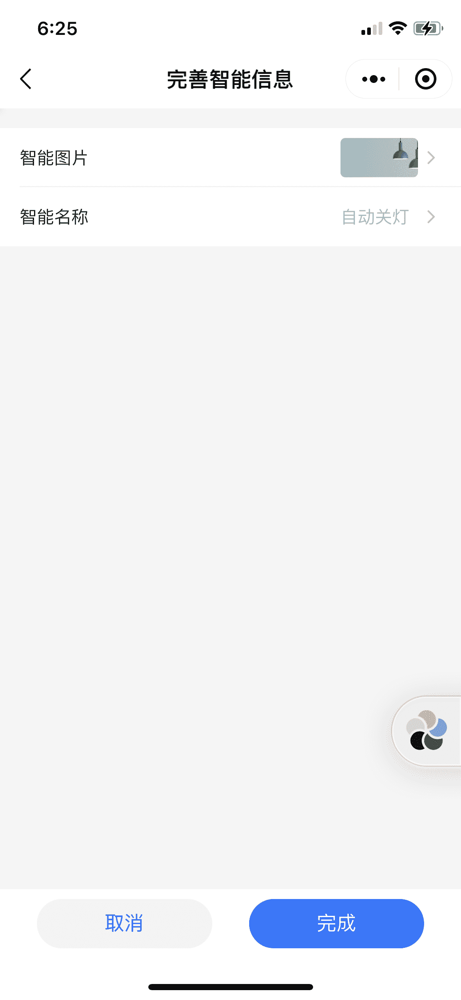

按照相同的方法，我们可以设置其他两个条件，如下图所示：

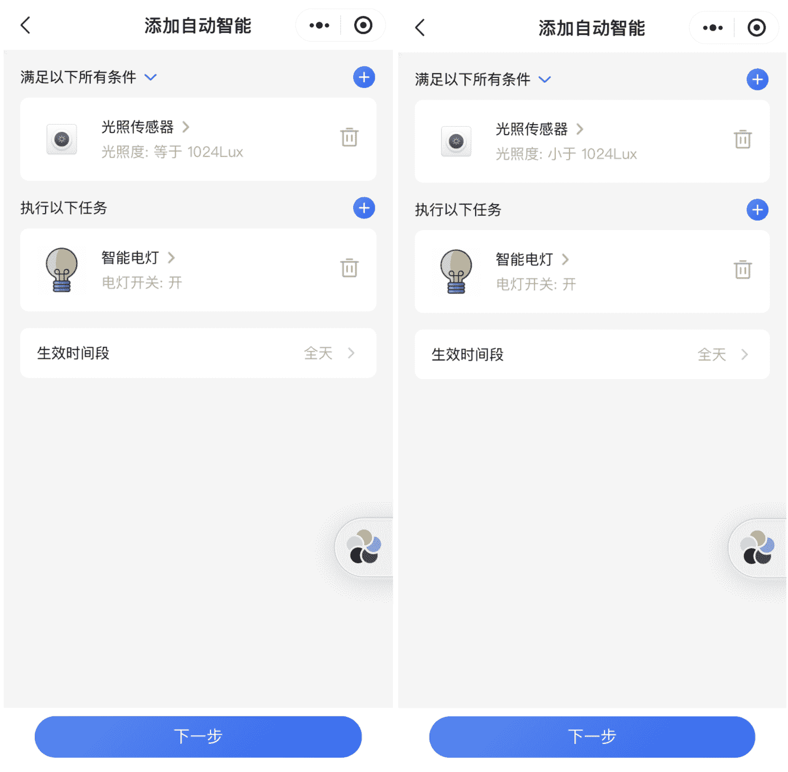

最终的智能联动，包括了刚才提到的 3 个不同的触发条件。

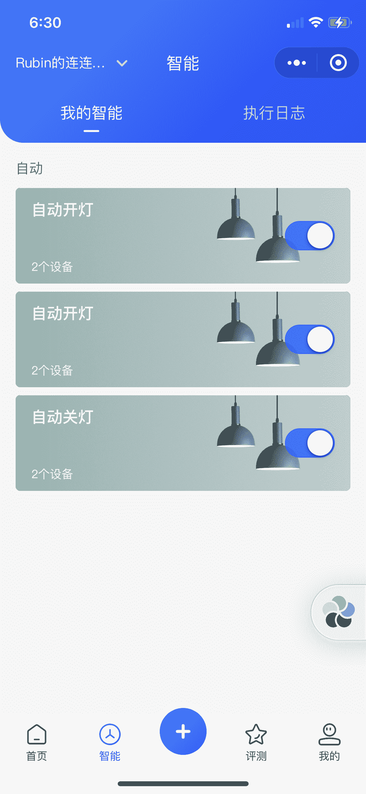

现在，你可以通过控制光照传感器的光照明暗（比如用手遮挡光敏元器件然后再把手拿开），来观察智能电灯的打开和关闭，检验功能是否正常。

## 小结

总结一下，在这一讲中，我介绍了利用树莓派打造网关，让光照传感器接入物联网平台的办法，并且带你实现了光照传感器和智能电灯的场景联动。你需要重点关注的内容有：

1. 为了实现协议转换，树莓派的南向接口，也就是蓝牙功能，你可以基于 bluepy 软件包开发。这里实现的功能是扫描光照传感器的广播包，并按照 MiBeacon 蓝牙协议解析出光照强度的数值。
2. 北向接口要实现对接云平台的功能，这是基于 MQTT 协议实现的。你可以基于 Eclipse paho 的 Python 语言版本来开发 MQTT Client 的功能。
3. 场景联动一般由条件和任务组成。其中，条件和任务是从我们的设备中定义的智能联动配置中选择的。

为了避免光照的短暂变化，导致智能电灯的忽明忽暗，我将光照传感器的数据上报间隔设置得比较长。如果你有特殊的需求，可以修改光照传感器和网关程序中的参数来实现。

下一讲，我将讲解智能音箱的实现，并通过智能音箱控制智能电灯的开关。

## 思考题

最后，我给你留一个动手实践题。

在这一讲的场景联动中，我们实现了光照强度对电灯打开和关闭的自动控制。你可以通过光照强度的不同数值实现对智能电灯亮度，或者颜色的控制吗？

你可以动手设置一下，并且在留言区和我分享你的成果，同时，也欢迎你将这一讲分享给你的朋友，大家一起讨论学习。
