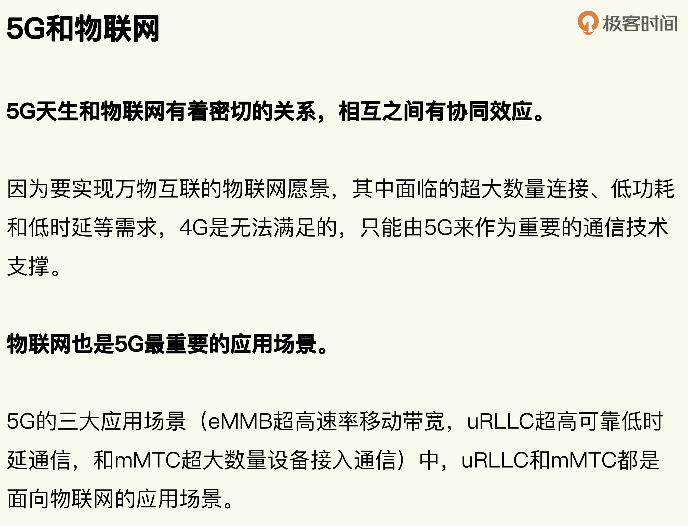
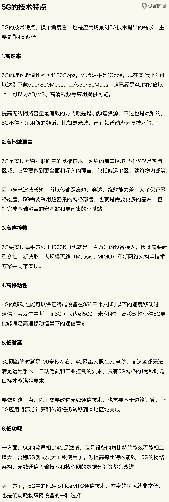
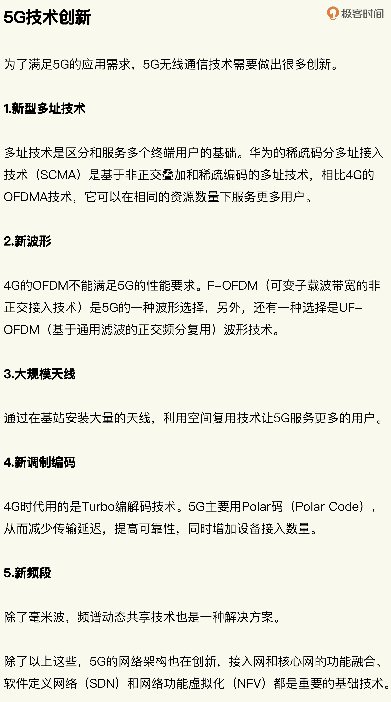
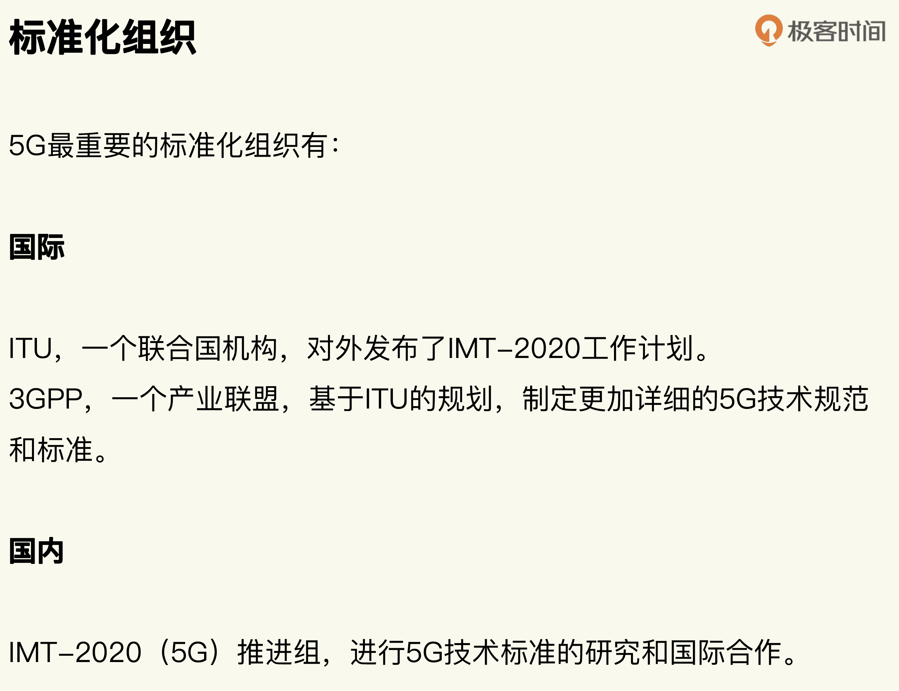
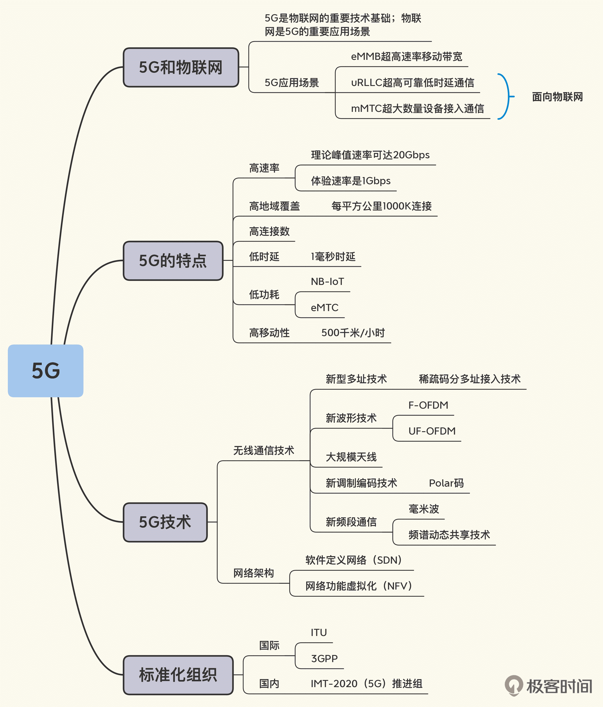

# 加餐四 | 5G技术将如何推动物联网的发展？

 

你好，我是郭朝斌。

今天我继续给大家讲讲司马特的故事。

这天，通信技术专家 Vincent 来到司马特的公司做 5G 技术讲座，司马特非常兴奋。他上次去物联网展会的时候就注意到，很多物联网系统都用到了 5G 技术，所以他早就想深入地了解一下 5G 了，这次讲座正好是一个机会。

他早早地就来到了报告厅，此时报告厅里还一个人都没有呢。他选了一个前排的座位坐下，等待的过程中，在电脑上搜索、阅读着 5G 相关的文章。

讲座快开始了，报告厅里来的人越来越多，已经有 6、7 成的座位上坐上了人。司马特心想：“看来对 5G 感兴趣的人真是不少啊！”

专家提前 5 分钟到了，在讲台上准备着。时间一到，讲座就正式开始了。

## 演讲笔记

司马特一边听，一边在电脑上记着笔记。

司马特的笔记之一：5G和物联网

司马特的笔记之二：5G的技术特点

司马特的笔记之三：5G技术创新

司马特的笔记之四：5G标准化组织

## 问答交流

讲座结束后，司马特心想，这么难得的学习机会，绝对不能放过，于是趁着专家还没有离场，立即走上前去提问：“Vincent 老师，能请教您几个问题吗？”

“叫我 Vincent 就行。”专家笑着说，“没问题，我还有几分钟时间。”

### 为什么 5G 这么热？

司马特说：“谢谢！请问 5G 现在为什么这么热呢？”其实他心中一直有这个疑问。

Vincent 回答道：“要理解这个问题，你就要看 4G 时代发生了什么。4G 出来之前，很多人认为 3G 已经够用了，手机无非是打电话、发短信和偶尔上网查个网页；但是当 4G 真正到来的时候，我们的生活方式发生了巨大的变化。

“比如，一系列的创新业务开始出现，移动支付取代了钱包、ATM 机，我们用手机叫出租车、导航、骑共享单车，用手机点外卖，用手机看视频、玩游戏。总之，移动互联网改变了生活方式，也创造了很多新产业和新业态。”

“我们看到了通信基础设施发展的具体威力，所以希望 5G 能够做强做大移动互联网，甚至实现万物互联。技术是推动社会发展的根本，我们期待 5G 能够创造更大的价值，推动更多产业的发展。”

### 毫米波是什么？

“我刚才听您讲 5G 技术创新的时候，提到了一个新的频段，毫米波。请问毫米波到底是什么呢？”司马特接着问。

“毫米波是频率在 30GHz 到 300GHz 的电磁波。现在的蜂窝网络频率主要在 3GHz 以下，虽然这部分频率利用率并不高，但是能分配给 5G 使用的资源并不多，所以 5G 技术只能向高频率发展。不过毫米波因为频率高，波长自然就短，这导致穿透障碍物的能力不强。实践中，我们需要使用多天线波束成形技术来实现稳定的信号收发。”Vincent 解释道。

### 为什么要用 Polar 码？

“您刚才还提到，5G 会使用新的调制编码，Polar Code。关于这个编码，您能再多说明一下吗？”司马特问道。

Vincent 笑道：“一看你就是个技术控。Polar 码的提出充分说明了数学的重要性。之前的 Turbo 码都没有能达到香农极限，而 Polar 码基于信道极化的概念，在理论上已经可以达到香农极限，并且它的编解码算法的复杂度并不高。”

### SDN 和 NFV 的意义是什么呢？

“嗯，具体算法我回去查一下资料学习一下。”司马特说道：“那么 5G 网络架构中，SDN 和 NFV 的意义是什么呢？”

Vincent 介绍说：“这两个技术其实都来自 IT 领域，现在用到了通信领域。SDN 主要是实现了控制和转发的分离，路由决策等控制功能由独立的控制器来统一处理，网络设备只负责具体的转发工作。这样可以通过编程来灵活定义网络功能。

“NFV 是将传统的核心网功能部署到虚拟机上，从而实现硬件资源的高效利用。在 5G 网络架构中，SDN 和 NFV 是结合起来使用的。这样网络可以根据负载情况灵活调度网络资源，实现网络高峰时的横向、纵向扩展。”

### 如何思考 5G 在物联网中的具体应用呢？

“明白了。最后一个问题，5G 在物联网中有哪些具体应用呢？”司马特说道。

“你需要结合 5G 的发展阶段来考虑。从 2019 年我们国家的 5G 元年开始，起步阶段主要是 eMBB 的应用，也就是传统业务和高网络速率的应用，比如高清视频、云游戏。接着是低时延的渐进式发展，这个阶段有工业制造、自动驾驶、远程医疗等场景。最后是基于 5G 的海量物联网设备的接入和应用。应用场景的创新一定是一个不断探索、验证到正式商用的过程。”Vincent 说道。

低头看了一眼手表，Vincent 接着说道：“你也可以回头看看 4G 时代，新应用的诞生过程，这会有启发的。我必须得走了，否则时间来不及了。”

交流完，司马特满意地离开了报告厅，心里想着：“我对 5G 的理解，终于不是混沌一片了。改天也给小王他们几个科普科普。”。

## 小结

总而言之，5G 是我们非常关注的通信技术，它蕴含着巨大的产业机会。接下来，我对司马特的笔记中的重点内容做一个梳理：

1. 5G 是物联网发展的重要基础，而物联网也是 5G 最重要的应用场景。5G 的三大应用场景是 eMMB 超高速率移动带宽，uRLLC 超高可靠低时延通信，和 mMTC 超大数量设备接入通信。其中 uRLLC 和 mMTC 都是面向物联网的应用场景。
2. 5G 的特点主要有高速率、高地域覆盖、高连接数、高移动性、低时延和低功耗，这些也是 5G 的技术需求。
3. 5G 的的无线通信技术主要有新型多址技术、新波形技术、大规模天线（Massive MIMO）、新调制编码技术和新频段通信等。
4. 5G 的网络架构也在创新，包括接入网和核心网的功能融合、软件定义网络（SDN）和网络功能虚拟化（NFV）等。
5. 5G 的标准化组织，国际上有 ITU 和 3GPP，国内有 IMT-2020（5G）推进组。

### 思考题

最后，我给你留一个思考题吧。

你使用过支持 5G 通信的手机吗，有什么使用感受呢？你认为随着 5G 技术的推广，还会有哪些创新应用和产品出现呢？

欢迎你在留言区写一写自己的思考。也欢迎你将这一讲分享给对 5G 技术感兴趣的朋友，大家一起交流学习。
