# 24 | VIM：如何高性价比地学习VIM的实用技巧？

 

你好，我是葛俊。今天，我来和你聊聊 VIM 的使用技巧。

在“[特别放送 | 每个开发人员都应该学一些 VIM](https://time.geekbang.org/column/article/144470)”这篇文章中，我和你详细介绍了 VIM 提高研发效能背后的原因。我推荐每个开发者都应该学一些 VIM 的原因，主要有两个：

 
- 独特的命令模式，可以大量减少按键次数，使得编辑更高效； 
- 支持跨平台，同时可以在很多其他 IDE、编辑器中作为插件使用，真正做到一次学习，处处使用。 

VIM 确实可以帮助我们提高效率，但面对这样一个学习曲线长而且陡的编辑器，我们很容易因为上手太难而放弃。所以，如何性价比高地学习 VIM 的使用技巧非常重要。

我推荐你按照以下三步，来高效地学习如何使用 VIM：

 
1. 学习 VIM 的命令模式和命令组合方式； 
2. 学习 VIM 最常用的命令； 
3. 在自己的工作环境中使用 VIM，比如与命令行环境的集成使用。 

接下来，我们分别看看这三步吧。

## VIM 的模式机制

VIM 的基本模式是命令模式，在命令模式中，敲击主体键的效果不是直接插入字符，而是执行命令实现对文本的修改。

### 使用 VIM 的最佳工作流

在我看来，在命令模式下工作，效率高、按键少，所以我推荐你**尽量让 VIM 处于命令模式，使用各种命令进行工作。进入编辑模式完成编辑工作之后也立即返回命令模式。**

事实上，我们从命令模式进入编辑模式修改文件，之后再返回命令模式的全过程，就是一个编辑命令。它跟其他的命令，比如使用 dd 删除一行，并没有本质区别。接下来，我们一起看个具体的例子吧。

比如，我要在一行文字后面加上一个大括号，后面再写一行代码。开始编辑时，光标处于这一行的开头。

```
  config = ^ 
```

修改的目标是这样：

```
  config = {    timeout: 1000ms,  }
```

在 VIM 中，我的操作是，首先敲击大写字母 A，将光标移到这一行的末尾，并进入编辑模式：

```
 config =           ^
```

然后，输入“{ timeout: 1000ms, 回车}”，在文件中插入内容。最后，敲击 Esc 键回到命令模式。编辑完成。

```
  config = {    timeout: 1000ms,  }   ^
```

实际上，整个过程就是执行了一条“在本行末尾插入文字”的命令。整条命令的输入是“A{ timeout: 1000ms, 回车}Esc”。虽然比较长，但仍然是一条文本编辑命令。

所以实际上，**我们在 VIM 中的工作，正是在命令模式里执行一条条的命令完成的**。理解了这一点，你就可以有意识地学习、设计命令来高效地完成工作了。

为了让命令更加高效，VIM 还提供了强大的命令组合功能，使得命令的功能效果呈指数级增长。

### 命令的组合方式

在 VIM 中，有相当一部分命令可以扩展为 3 部分：

 
- 开头的部分是一个数字，代表重复次数； 
- 中间的部分是命令； 
- 最后的部分，代表命令的对象。 

比如，命令 3de 中，3 表示执行 3 次，d 是删除命令，e 表示从当前位置到单词的末尾。整条命令的意思就是，从当前位置向后，删除 3 个单词。类似的，命令 3ce 表示从当前位置向后，删除三个单词，然后进入编辑模式。

可以看到，命令组合的前两个部分比较简单，但第三个部分也就是命令对象，技巧就比较多了。所以接下来，我就与你详细介绍下到底有**哪些命令对象可以使用。**

其实，对命令对象并没有一个完整的分类。但我根据经验，将其总结为光标移动命令和文本对象两种。

**第一种是光标移动命令**。比如，命令是移动光标到本行末尾，那么d命令是移动光标到本行末尾，那么d 就表示删除到本行末尾；再比如，4}表示向下移动 4 个由空行隔开的段落，那么 d4}就是删除这 4 个段落。

这一类命令功能很强大，我们也很熟悉了，但它有一个缺陷，就是选择的出发点始终是当前光标所在位置。而我们在处理文本的过程中，尤其是在编写程序的时候，光标所在位置常常是处于需要修改内容的中间，而不是开头。比如，我们常常在写一个注释字符串的时候，需要修改整个字符串：

```
    comment: 'this is standalone mode',                          ^
```

如果使用上面的光标移动作为命令对象的话，我们需要执行 bbbct’命令，也就是向左移动三个单词之后，再向右删除到第一个单引号的地方，操作起来很麻烦。

针对这种情况，VIM 提供了第二种命令对象：**文本对象**。具体来说就是，用字符代表一定的文字单位。比如，i"代表两个双引号之间的字符串，aw 表示当前的单词。使用这种文本对象很方便，比如上面的编辑例子，我们只需要命令 ci"就可以实现，比 bbbct’命令方便了很多。

具体来说，文本对象命令由两部分组成：

 
- 第一部分只能是字符 i 或者 a，表示是否包含对象边界。比如，i"表示不包括两边的引号，而 a"就包括引号； 
- 第二部分选择比较多，表示各种不同的文本对象。比如 

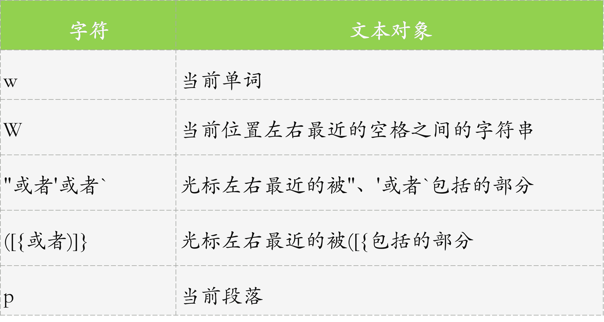

如果你要查看完整的文本对象，可以使用:help text-objects。

这一组文本对象选择功能很强大，而且是 VIM 自带功能，不需要安装任何插件。神奇的是，不知道为什么，很多使用 VIM 很久的人都不知道这个功能。我个人把它叫作 vip 功能，如果你以前没有用过，可以在文件中输入命令 vip 看看效果。相信不会让你失望。

可见，VIM 的命令操作及其组合功能非常强大，要高效使用 VIM，我们就必须使用命令模式以及命令组合。我看到有些开发者使用 VIM 时，一上来就使用 i 命令进入编辑模式，然后在编辑模式中工作。但是，编辑模式的功能很有限，完全发挥不出 VIM 提供的高效文本编辑功能。

接下来，我们进入第二步，也就是学习 VIM 最常用的命令。

## 命令模式中的基础命令

VIM 有大量的命令可供我们使用，这里我主要与你介绍针对单个文件编辑的命令，因为这是编辑工作最基础的部分，也是各种跨平台场景，尤其在其他 IDE 中通过插件使用 VIM 的方式的共性部分。

至于更多的命令和细节，你可以参考我的“[命令模式中的基础命令](https://jungejason.github.io/vim-commands/)”这篇博客，或者自行搜索查询。

接下来，我会按照以下编辑文件的逻辑顺序，来与你介绍关键知识点和技巧：

 
1. 打开文件，以及进行设置操作； 
2. 移动光标； 
3. 编辑文本； 
4. 查找、替换。 

### 第一组常用命令是，打开文件以及对文件的设置

这些命令包括打开文件、退出、保存、设置等。关于设置，如果在远端的服务器上，我常常运行一条命令进行基本设置：

```
:set ic hls is hid nu
```

其中，ic 表示搜索时忽略大小写，hls 表示高亮显示搜索结果，is 表示增量搜索，也就是在搜索输入的过程中，在按回车键之前就实时显示当前的匹配结果，hid 表示让 VIM 支持多文件操作，nu 表示显示行号。

如果要关闭其中某一个选项的话，在前面添加一个 no 即可。比如，关闭显示行号，使用

```
:set nonu
```

### 第二组常用命令是，移动光标

VIM 提供了非常细粒度的光标移动命令，包括水平移动、上下移动、文字段落的移动。这些命令之间的差别很细微。比如，w 和 e 都是向右边移动一个单词，只不过 w 是把光标放到下一个单词开头，而 e 是把光标放到这一个单词结尾。

虽然差别很小，但正是这样的细粒度，才使得 VIM 能够让我们使用最少的按键次数去完成编辑任务。

### 第三组常用命令是，编辑命令

编辑工作中我们应该大量使用命令组合来提高效率。关于组合命令的威力，我建议你看下“[命令模式中的基础命令](https://jungejason.github.io/vim-commands/)”那篇博客，我与你详细解释了一个 ct"的例子。

这里，**我重点与你分享一个设计命令的技巧**。VIM 的取消命令 u、重复命令.，都是针对上一个完整的编辑命令而言。所以，我们可以设计一个完整的编辑命令，从而可以使用重复命令. 来提高效率。比如，你要把一段文本中的几个时间都修改成 20ms，这段文本原来是

```
    timeout: 1000000ms,    waiting: 300000ms,    starting: 40000ms,
```

希望改变成

```
    timeout: 20ms,    waiting: 20ms,    starting: 20ms,
```

在 VIM 中有多种实现方法。一种还不错的方法是，使用修改命令 c 和移动命令 l 的组合，在每一行用一个命令搞定。具体操作是，将光标挪到 1000000ms 里数字 1 的地方，用 c7l20 命令对第一行进行修改，然后在第二行、第三行的相同位置分别使用 c6l20 和 c5l20 进行修改。

这个命令可以完成工作，但每条命令都不一样，不能重复。实际上，还有一种更好的方法。

你可以设计一条命令，在每一行重复使用。在这个例子里，这个命令是 ctm20，意思是从当前位置删除到下一个字母 m 的位置，进入编辑模式，插入 20，然后返回命令模式。

使用这条命令对第一行进行修改之后，你可以把光标挪到第二、三行使用重复命令. 来完成编辑任务，如下所示。

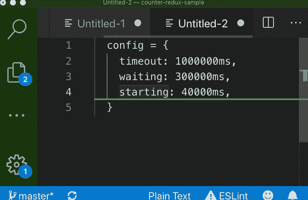

当然了，你还可以使用正则表达式进行查找替换，但是远比上面这个重复命令要复杂。这个设计命令并重复使用的方法非常好用，建议你上手实践下。

关于重复命令，VIM 另外还有一个录制命令 q 和重复命令 @，功能更强大，但也比较重。如果你想深入了解的话，[可以参考这篇文章](https://xu3352.github.io/linux/2018/11/04/practical-vim-skills-chapter-11)。

### 第四组常用命令是，查找、替换

这组命令主要有 /、* 和 s 等，很常用，网络上也有很多描述，这里我就不再详细介绍了。比如，我在“[命令模式中的基础命令](https://jungejason.github.io/vim-commands/)”这篇博客中详细介绍了 s 命令，可供你参考。

除了上述 4 种常见命令外，VIM 中还有一种很强大的可视模式（Visual Mode），可以提高编辑体验。接下来，我们再一起看看。

### 可视模式

可视模式一共有 3 种，包括基于字符的可视模式、基于行的可视模式和基于列的可视模式，详见“[命令模式中的基础命令](https://jungejason.github.io/vim-commands/)”这篇博客中的介绍。

接下来，我以基于列的可视模式为例，带你看看可视模式是如何提高编辑体验的吧。

我们先来看看第一个例子。有一段文本，每一行都用 var 声明变量（比如 var gameMode），现在我希望改成使用 const 来声明。我们来看看具体的实现方式。

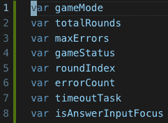

第一步，把光标挪到第一行开头的 v 字符处，使用组合键 Ctrl-v 进入列可视模式，然后使用 7j 下移动七行，再用 e 向右移动一个单词，从而选中一个包含所有 var 的矩形区域。

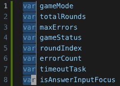

第二步是开始编辑。输入 c，删除所有的 var，并进入编辑模式。

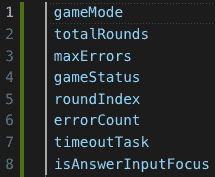

第三步是输入 const，并输入 Esc 完成编辑操作，回到命令模式，整个修改完成。

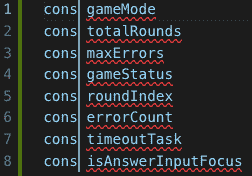

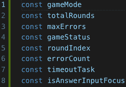

我们再来看看第二个例子。我希望在上面这段文字的每一行末尾都添加一个分号。具体的操作步骤如下所示：

首先，用 $ 命令把光标挪到最后一行的末尾，然后 Ctrl-v 进入列模式，再用 7j 命令将光标挪到第一行，这时，每一行的末尾都被包含到了一个方块里。不过因为每一行的长度不同，所以方块没有显示完全。

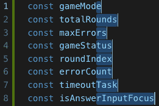

然后，输入 A 命令，光标挪到每一行的末尾，并进入编辑模式。

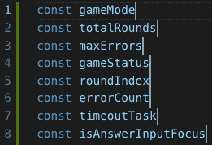

最后，输入要插入的分号，输入 Esc 完成编辑。这样，每一行的末尾都添加了一个分号。

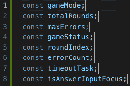

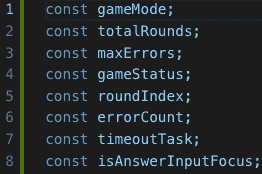

最后，关于可视模式我还有三个比较有用的小贴士：

 
- 第一，在退出了可视模式之后，可以使用 gv 命令重新进入可视模式并选择上一次的选择。这个命令出乎意料得有用，因为我们常常需要对上一次的选择进行进一步的操作。 
- 第二，进入可视模式之后，可以直接使用 v、V、Ctrl-v 在三种模式之间切换，而不需要退出可视模式再重新进入。比如，你一开始使用 v 进入了字符可视模式，这时发现你需要删除几行，就可以直接输入 V 进入行的可视模式。 
- 第三，修改选取的区域范围。当你进入可视模式之后，光标默认处于所选区域的结尾处，你可以挪动光标调节选择区域的结尾部分。但，如果你想调节的是所选区域的开头部分，则可以使用命令 o 将光标跳到选择区域的开始部分，再次输入命令 o 光标又会跳到选择区域的末尾。一个更好玩的情况是，在列模式中，你可以使用小写 o 在对角线上跳转，大写 O 在水平方向跳转，从而可以灵活调整所选矩形的四个角。 

以上就是命令模式中的常用基础命令了。理解了这些命令，再加上命令组合，你就可以比较高效地使用 VIM 进行文本编辑了。但，要更高效地使用 VIM，我们还有一个问题没有解决：VIM 虽然强大，但也只是整个工作环境中的一个工具，怎样才能在整个工作中高效地使用 VIM 技能呢？

所以，接下来我将带你探索如何寻找合适的 VIM 使用场景。

## 寻找合适的 VIM 使用场景

寻找合适的适用场景，常常包括两种情况，一是 VIM 不是主力 IDE 的情况，二是 VIM 与其他工具的集成。接下来，我们先看第一种情况。

### 我的工作环境中，VIM 不是主力 IDE 怎么办？

这种情况下，我会建议你先看一下你的主力 IDE 是否支持 VI 模式。目前，绝大部分主流 IDE 都支持，而且大都做得不错。如果你的主力 IDE 中能使用 VIM 命令的话，那从 VIM 特有的命令模式就能让你收益颇丰。

从我的经验来看，我只有在 Facebook 那几年使用 VIM 作为主力 IDE，其他时间使用的编辑器主要是 Intellij 的 IDE 系列和 VS Code。在这些 IDE 里，我一直在使用 VI 模式，效果也都很好。

除了在主力 IDE 中使用 VI 模式外，你还可以选择把 VIM 只作为一个单纯的文本编辑器，需要强大的编辑功能时，临时用一下就可以。比如，我在写微信小程序的时候，一开始使用的是原生的微信开发工具，编辑功能不是太强。所以在遇到一些重量级的编辑工作时，我就打开 VIM 快速搞定，然后再回到微信原生开发工具 IDE 里继续工作。

### VIM 能在 Linux 命令行环境中与其他工具结合的很好

Unix/Linux 系统的一个设计理念是，每个工具都只做一个功能，并且把这个功能做到极致，然后由操作系统把这些功能集成起来。VI 当初就是作为 Unix 系统里的编辑器而存在的，到了 40 年后的今天，虽然 VIM 已经可以被配置成为一个强大的 IDE，但很大程度上依然是 Unix/Linux 系统的基础编辑器，仍然可以很方便地和 Unix/Linux 的其他工具集成。

为了帮助你理解，我再和你分享 3 个适用场景。

**第一个场景：使用 VIM 作为其他工具的编辑器。**

在大部分 Linux 系统里，默认的编辑器就是 VIM。如果不是的话，可以使用如下命令来设置：

```
// 全局使用 VIMexport EDITOR='vim'
```

**第二个适用场景：使用管道（Pipe）。**

管道是 Linux 环境中最常用的工具之间的集成方式。VIM 可以接收管道传过来的内容。比如，我们要查看 GitHub 上用户 xxx 的代码仓的情况，可以使用下面这条命令

```
curl -s https://api.github.com/users/xxx/repos | vim -
```

curl 命令访问 GitHub 的 API，把输出通过管道传给 VIM，方便我直接在 VIM 中查看用户 xxx 的代码仓的细节。

这里需要注意的是，在 VIM 命令后面有一个 -，表示 VIM 将使用管道作为输入。

**第三个适用场景：在 VIM 中调用系统工具**

除了系统调用 VIM 和使用管道进行集成之外，我们还可以在 VIM 中反过来调用系统的其他工具。这里，我与你介绍一个最实用的命令：**在可视模式中使用! 命令调用外部程序。**

比如，我想给一个文件里的中间几行内容前加上从 1000 开始的数字序号。

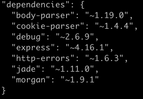

在 Linux 系统里，我们可以使用 nl 这个命令行工具完成，具体的命令是 nl -v 1000。所以，我们可以把这一部分文本单独保存为文件，使用 nl 处理后，再把处理结果拷贝回 VIM 中。

虽然可以达到目的，但过程繁琐。幸运的是，我们可以在 VIM 里面直接使用 nl，并把处理结果插入 VIM 中，具体操作如下。

首先，使用命令 V 进入可视模式，并选择这一部分文字。

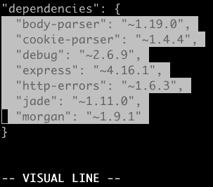

然后，输入命令!，VIM 的最后一行会显示’<,’>! ，表示由外部程序操作选中的部分。这时，我们输入 nl -v 1000 并回车。

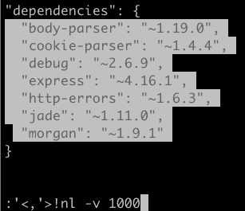

VIM 就会把选择的文本传给 nl，nl 在每一行前面添加序号，再把处理结果传给 VIM，从而完成了我们想要的编辑结果，也就是在所选的几行文字前面添加从 1000 到 1006 的序号。

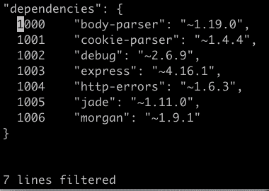

同时，在 VIM 的底部，会显示 7 lines filtered，意思是 VIM 里面的 7 行文本被使用外部工具处理过。是不是很方便？

我每次使用这样的功能时都觉得很爽，因为这可以让我聚焦在工作上，而不会把时间花在繁琐的操作上。

以上就是 3 个最常用的 VIM 和其他工具集成的例子。这种工具的集成工作方式，可以大大提高单个工具所能带来的效率提升，我还会在后面的文章中与你详细讨论。

## 总结

在今天这篇文章中，我与你介绍了高效学习 VIM 的三个步骤，即：第一，学习 VIM 的命令模式和命令组合方式；第二，学习文本编辑过程中各个环节最常用的命令；第三，在自己的工作环境中找到适用 VIM 的场景。

事实上，我今天与你讲述的 VIM 命令和使用技巧，只是最常见的跨平台使用中的共性部分，对效能提升带来的效果也最直接、最明显。

但，这些远没有覆盖 VIM 的强大功能。比如，我没有与你讨论多文件、多 Tab、多窗口编辑的场景，以及插件的话题。如果你需要的话，可以把 VIM 配置成一个类似 IDE 的开发环境，进入沉浸式的 VIM 使用体验。关于插件方面的内容，我推荐 3 个插件：

 
- [pathogen](https://github.com/tpope/vim-pathogen)。它是一个插件管理软件，很好地解决了 VIM 自带插件删除不理想的问题。关于 pathogen 的使用，你可以参考下[这篇文章](https://gist.github.com/romainl/9970697)。 
- [nerdtree](https://github.com/scrooloose/nerdtree)，在 VIM 中添加文件夹管理的功能。 
- [fugitive](https://github.com/tpope/vim-fugitive)，在 VIM 中添加查看、编辑 Git 内容的功能。它的功能简直是强大到变态。 

其中，pathogen 和 fugitive 的作者都是[Tim Pope](https://github.com/tpope)，一个 VIM 牛人。如果你想了解更多的插件的话，可以看看他的其他 VIM 插件。

不容置疑的是，VIM 的学习曲线非常长，即使我已经使用了 15 年，仍然会时不时地学习到一些新东西。只要你愿意，就可以一直学习一直提高。

## 思考题

你想要分享的最炫酷的 VIM 技巧是什么呢？

感谢你的收听，欢迎你在评论区给我留言分享你的观点，也欢迎你把这篇文章分享给更多的朋友一起阅读。我们下期再见！


