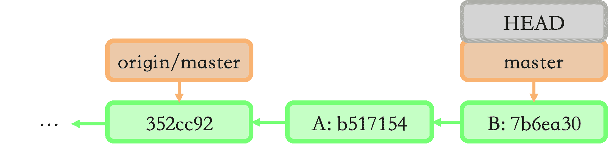
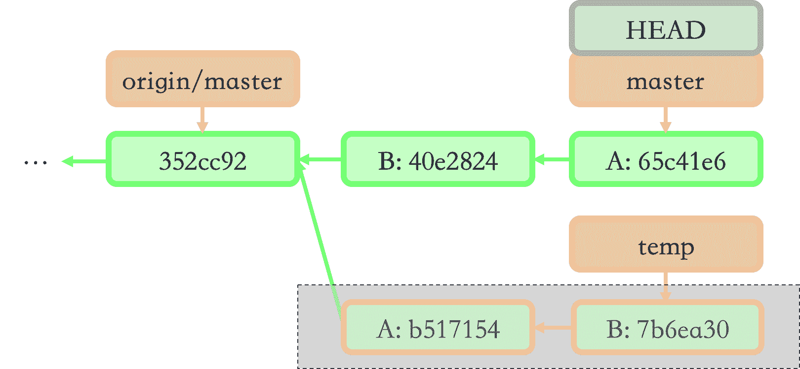
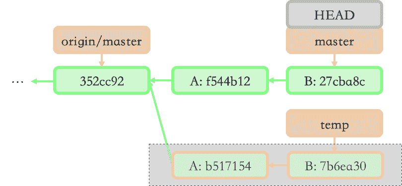

# 25 | 玩转Git：五种提高代码提交原子性的基本操作

 

你好，我是葛俊。今天，我们来聊一聊 Git 吧。

毫无疑问，Git 是当前最流行的代码仓管理系统，可以说是开发者的必备技能。它非常强大，使用得当的话可以大幅助力个人效能的提升。一个最直接的应用就是，可以帮助我们提升代码提交的原子性。如果一个团队的成员都能熟练使用 Git 的话，可以大大提高团队代码的模块化、可读性、可维护性，从而提高团队的研发效能。但可惜的是，现实情况中，由于 Git 比较复杂，用得好的人并不多。

所以接下来，我会通过两篇文章，与你详细讲述如何使用 Git 助力实现代码原子性。今天这篇文章，我先与你分享 Git 支持原子性的 5 种基础操作；下一篇文章，则会给你介绍 Facebook 开发人员是怎样具体应用这些基础操作去实现代码原子性的。

通过这两篇文章，我希望你能够：

 
1. 了解在分布式代码仓管理系统中，如何通过对代码提交的灵活处理，实现提交的原子性； 
2. 帮你学习到 Git 的实用技巧，提高开发效率。 

我在[第 21 篇文章](https://time.geekbang.org/column/article/148170)中提到，代码提交的原子性指的是，一个提交包含一个不可分割的特性、修复或者优化。如果用一个提交完成一个功能，这个提交还是会比较大的话，我们需要把这个功能再拆分为子功能。

为什么要强调代码提交的原子性呢？这是因为它有以下 3 大好处：

 
- 可以让代码结构更清晰、更容易理解； 
- 出了问题之后方便定位，并可以针对性地对问题提交进行“回滚”； 
- 在功能开关的协助下，可以让开发者尽快把代码推送到 origin/master 上进行合并。这正是持续集成的基础。 

而 Git 之所以能够方便我们实现原子性提交，主要有两方面的原因：

 
- Git 提供方便、灵活的提交、分支处理功能，使得我们可以灵活地产生提交、修改提交、拆分提交，甚至改变提交的先后顺序。 
- Git 是一个分布式代码仓管理系统，每个开发人员在本地都有一个代码仓，从而可以放心在本地代码仓中使用上述功能，不用操心会影响到远程共享代码仓。 

下面，我就来与你分享 Git 支持原子性的 5 种基础操作，具体包括：

 
1. 用工作区改动的一部分产生提交； 
2. 对当前提交进行拆分； 
3. 修改当前提交； 
4. 交换多个提交的先后顺序； 
5. 修改非当前提交。 

需要注意的是，在接下来的两篇文章里，我只会与你详细介绍针对原子性相关的操作，而关于 Git 的一些基础概念和使用方法，推荐你参考“[图解 Git](https://marklodato.github.io/visual-git-guide/index-zh-cn.html)”这篇文章。

## 基本操作一：把工作区里代码改动的一部分转变为提交

如果是把整个文件添加到提交中，操作很简单：先用 git add < 文件名 > 把需要的文件添加到 Git 暂存区，然后使用 git commit 命令提交即可。这个操作比较常见，我们应该都比较熟悉。

但在工作中，一个文件里的改动常常会包含多个提交的内容。比如，开发一个功能时，我们常常会顺手修复一些格式规范方面的东西；再比如，一个功能比较大的时候，改动常常会涉及几个提交内容。那么，在这些情况下，为了实现代码提交的原子性，我们就需要只把文件里的一部分改动添加到提交中，剩下的部分暂时不产生提交。针对这个需求，Git 提供了 git add -p 命令。

比如，我在 index.js 文件里有两部分改动，一部分是添加一个叫作 timestamp 的 endpoint，另一部分是使用变量来定义一个魔术数字端口：

```
## 显示工作区中的改动> git diffdiff --git a/index.js b/index.jsindex 63b6300..986fcd8 100644--- a/index.js+++ b/index.js@@ -1,8 +1,14 @@+var port = 3000  ## <-- 魔术数字变量化 var express = require('express') var app = express() ## vvv 添加 endpoint+app.get('/timestamp', function (req, res) {+  res.send('' + Date.now())+})+ app.get('/', function (req, res) {   res.send('hello world') }) -app.listen(3000)+// Start the server+app.listen(port) ## <-- 端口魔术数字变量化
```

这时，运行 git add -p index.js 命令，Git 会把文件改动分块儿显示，并提供操作选项，比如我可以通过 y 和 n 指令来选择是否把当前改动添加到 Git 的提交暂存区中，也可以通过 s 指令把改动块儿再进行进一步拆分。通过这些指令，我就可以选择性地只把跟端口更改相关的改动添加到 Git 的暂存区中。

```
> git add -p index.jsdiff --git a/index.js b/index.jsindex 63b6300..986fcd8 100644--- a/index.js+++ b/index.js@@ -1,8 +1,14 @@+var port = 3000 var express = require('express') var app = express() +app.get('/timestamp', function (req, res) {+  res.send('' + Date.now())+})+ app.get('/', function (req, res) {   res.send('hello world') }) -app.listen(3000)+// Start the server+app.listen(port)Stage this hunk [y,n,q,a,d,s,e,?]? sSplit into 3 hunks.@@ -1,3 +1,4 @@+var port = 3000 var express = require('express') var app = express() Stage this hunk [y,n,q,a,d,j,J,g,/,e,?]? y@@ -1,7 +2,11 @@ var express = require('express') var app = express() +app.get('/timestamp', function (req, res) {+  res.send('' + Date.now())+})+ app.get('/', function (req, res) {   res.send('hello world') }) Stage this hunk [y,n,q,a,d,K,j,J,g,/,e,?]? n@@ -4,5 +9,6 @@ app.get('/', function (req, res) {   res.send('hello world') }) -app.listen(3000)+// Start the server+app.listen(port)Stage this hunk [y,n,q,a,d,K,g,/,e,?]? y
```

当整个文件的所有改动块儿都处理完成之后，通过 git diff --cached 命令可以看到，我的确只是把需要的那一部分改动，也就是端口相关的改动，添加到了暂存区:

```
> git diff --cacheddiff --git a/index.js b/index.jsindex 63b6300..7b82693 100644--- a/index.js+++ b/index.js@@ -1,3 +1,4 @@+var port = 3000 var express = require('express') var app = express() @@ -5,4 +6,5 @@ app.get('/', function (req, res) {   res.send('hello world') }) -app.listen(3000)+// Start the server+app.listen(port) 
```

通过 git diff 命令，我们可以看到，endpoint 相关的改动仍留在工作区：

```
> git diffdiff --git a/index.js b/index.jsindex 7b82693..986fcd8 100644--- a/index.js+++ b/index.js@@ -2,6 +2,10 @@ var port = 3000 var express = require('express') var app = express() +app.get('/timestamp', function (req, res) {+  res.send('' + Date.now())+})+ app.get('/', function (req, res) {   res.send('hello world') })
```

最后，再通过 git commit 命令，我就可以产生一个只包含端口相关改动的提交，实现了将本地代码改动的一部分转变为提交的目的。

如果你想深入了解 git add -p 的内容，可以参考[这篇文章](https://johnkary.net/blog/git-add-p-the-most-powerful-git-feature-youre-not-using-yet/)。

通过 git add -p，我们可以把工作区中的代码拆分成多个提交。但是，如果需要拆分的代码已经被放到了一个提交中，怎么办？如果这个提交已经推送到了远程代码仓共享分支，那就没有办法了。但如果这个提交还只是在本地，我们就可以对它进行拆分。

## 基本操作二：对当前提交进行拆分

所谓当前提交，指的是当前分支的 HEAD 指向的提交。

我继续以上面的代码示例向你解释应该如何操作。假如，我已经把关于 endpoint 的改动和端口的改动产生到了同一个提交里，具体怎么拆分呢？

这时，我可以先“取消”已有的提交，也就是把提交的代码重新放回到工作区中，然后再使用 git add -p 的方法重新产生提交。这里的取消是带引号的，因为**在 Git 里所有的提交都是永久存在的，所谓取消，只不过是把当前分支指到了需要取消的提交的前面而已。**

首先，我可以用 git log 查看历史，并使用 git show 确认提交包含了 endpoint 改动和端口改动：

```
## 查看提交历史> git log --graph --oneline --all* 7db082a (HEAD -> master) Change magic port AND add a endpoint* 352cc92 Add gitignore file for node_modules* e2dacbc (origin/master) Added the simple web server endpoint...  ## 查看提交> git showcommit 7db082ab0f105ea185c89a0ba691857b55566469 (HEAD -> master)... diff --git a/index.js b/index.jsindex 63b6300..986fcd8 100644--- a/index.js+++ b/index.js@@ -1,8 +1,14 @@+var port = 3000 var express = require('express') var app = express() +app.get('/timestamp', function (req, res) {+  res.send('' + Date.now())+})+ app.get('/', function (req, res) {   res.send('hello world') }) -app.listen(3000)+// Start the server+app.listen(port)
```

然后，用 git branch temp 命令产生一个临时分支 temp，指向当前 HEAD。temp 分支的作用是，预防代码丢失。如果后续工作出现问题的话，我可以使用 git reset --hard temp 把代码仓、暂存区和工作区都恢复到这个位置，从而不会丢失代码。

```
> git branch temp > git log --graph --oneline --all* 7db082a (HEAD -> master, temp) Change magic port AND add a endpoint* 352cc92 Add gitignore file for node_modules* e2dacbc (origin/master) Added the simple web server endpoint...
```

接下来，运行 git reset HEAD^ 命令，把当前分支指向目标提交 HEAD^，也就是当前提交的父提交。同时，在没有接–hard 或者–soft 参数时，git reset 会把目标提交的内容同时复制到暂存区，但不会复制到工作区。所以，工作区的内容仍然是当前提交的内容，仍然有 endpoint 相关改动和端口相关改动。也就是说，这个命令的效果，就是让我回到了对这两个改动进行提交之前的状态：

```
> git reset HEAD^Unstaged changes after reset:M index.js > git statusOn branch masterYour branch is ahead of 'origin/master' by 1 commit.  (use "git push" to publish your local commits) Changes not staged for commit:  (use "git add <file>..." to update what will be committed)  (use "git checkout -- <file>..." to discard changes in working directory)  modified:   index.js no changes added to commit (use "git add" and/or "git commit -a")15:06:58 (master) jasonge@Juns-MacBook-Pro-2.local:~/jksj-repo/git-atomic-demo  ## 改动在工作区> git diff diff --git a/index.js b/index.jsindex 63b6300..986fcd8 100644--- a/index.js+++ b/index.js@@ -1,8 +1,14 @@+var port = 3000 var express = require('express') var app = express() +app.get('/timestamp', function (req, res) {+  res.send('' + Date.now())+})+ app.get('/', function (req, res) {   res.send('hello world') }) -app.listen(3000)+// Start the server+app.listen(port)  ## 输出为空> git diff --cached
```

最后，我就可以使用上面介绍过的 git add -p 的方法把工作区中的改动拆分成两个提交了。

## 基本操作三：修改当前提交

如果只需要修改 Commit Message 的话，直接使用 git commit --amend 命令，Git 就会打开你的默认编辑器让你修改，修改完成之后保存退出即可。

如果要修改的是文件内容，可以使用 git add、git rm 等命令把改动添加到暂存区，再运行 git commit --amend，最后输入 Commit Message 保存退出即可。

## 基本操作四：交换多个提交的先后顺序

有些时候，我们需要把多个提交交换顺序。比如，master 分支上有两个提交 A 和 B，B 在 A 之上，两个提交都还没有推送到 origin/master 上。



这时，我先完成了提交 B，想把它先单独推送到 origin/master 上去，就需要交换 A 和 B 的位置，使得 A 在 B 之上。我可以使用 git rebase --interactive（选项–interactive 可以简写为 -i）来实现这个功能。

首先，还是使用 git branch temp 产生一个临时分支，确保代码不会丢失。然后，使用 git log --oneline --graph 来确认当前提交历史：

```
> git log --oneline --graph* 7b6ea30 (HEAD -> master, temp) Add a new endpoint to return timestamp* b517154 Change magic port number to variable* 352cc92 (origin/master) Add gitignore file for node_modules* e2dacbc Added the simple web server endpoint* 2f65a89 Init commit created by installing express module
```

接下来，运行

```
> git rebase -i origin/master
```

Git 会打开我的默认编辑器，让我选择 rebase 的具体操作：

```
pick b517154 Change magic port number to variablepick 7b6ea30 Add a new endpoint to return timestamp # Rebase 352cc92..7b6ea30 onto 352cc92 (2 commands)## Commands:# p, pick <commit> = use commit# r, reword <commit> = use commit, but edit the commit message# e, edit <commit> = use commit, but stop for amending# s, squash <commit> = use commit, but meld into previous commit# f, fixup <commit> = like "squash", but discard this commit's log message# x, exec <command> = run command (the rest of the line) using shell# b, break = stop here (continue rebase later with 'git rebase --continue')# d, drop <commit> = remove commit# l, label <label> = label current HEAD with a name# t, reset <label> = reset HEAD to a label# m, merge [-C <commit> | -c <commit>] <label> [# <oneline>]# .       create a merge commit using the original merge commit's# .       message (or the oneline, if no original merge commit was# .       specified). Use -c <commit> to reword the commit message.## These lines can be re-ordered; they are executed from top to bottom.## If you remove a line here THAT COMMIT WILL BE LOST.## However, if you remove everything, the rebase will be aborted.## Note that empty commits are commented out
```

rebase 命令一般翻译为变基，意思是改变分支的参考基准。**具体到 git rebase -i origin/master 命令**，就是把从 origin/master 之后到当前 HEAD 的所有提交，也就是 A 和 B，重新有选择地放到 origin/master 上面。你可以选择放或者不放某一个提交，也可以选择放置顺序，还可以选择将多个提交合并成一个，等等。另外，这里说的放一个提交，指的就是在 HEAD 之上应用一个提交的意思。

Git rebase -i 打开编辑器时，里面默认的操作列表是把原有提交全部原封不动地放到新的参考基准上去，具体到这个例子，是用两个 pick 命令把 A 和 B 先后重新放到 origin/master 之上，如果我直接保存退出的话，结果跟 rebase 之前没有任何改变。

这里，因为我需要的操作是交换 A 和 B 的顺序，所以交换两个 pick 指令行，保存退出即可。Git rebase 就会先后把 B 和 A 放到 origin/master 上。

```
pick 7b6ea30 Add a new endpoint to return timestamppick b517154 Change magic port number to variable # Rebase 352cc92..7b6ea30 onto 352cc92 (2 commands)# ...
```

至此，我就完成了交换两个提交的先后顺序。接下来，我可以用 git log 命令，来确认 A 和 B 的确是交换了顺序。

```
## 以下是 git rebase -i origin/master 的输出结果Successfully rebased and updated refs/heads/master.  ## 查看提交历史> git log --oneline --graph --all* 65c41e6 (HEAD -> master) Change magic port number to variable* 40e2824 Add a new endpoint to return timestamp| * 7b6ea30 (temp) Add a new endpoint to return timestamp| * b517154 Change magic port number to variable|/* 352cc92 (origin/master) Add gitignore file for node_modules* e2dacbc Added the simple web server endpoint* 2f65a89 Init commit created by installing express module
```



值得注意的是，A 和 B 的 commit SHA1 改变了，因为它们实际上是新产生出来的 A 和 B 的拷贝，原来的两个提交仍然存在（图中的阴影部分），我们还可以用分支 temp 找到它们，但不再需要它们了。如果 temp 分支被删除，A 和 B 也会自动被 Git 的垃圾收集过程 gc 清除掉。

其实，git rebase -i 的功能非常强大，除了交换提交的顺序外，还可以删除提交、和并多个提交。如果你想深入了解这部分内容的话，可以参考“[Git 工具 - 重写历史](https://git-scm.com/book/zh/v2/Git-%E5%B7%A5%E5%85%B7-%E9%87%8D%E5%86%99%E5%8E%86%E5%8F%B2)”这篇文章。

## 基本操作五：修改非头部提交

在上面的基本操作二、三、四中，我与你介绍的都是对当前分支头部的一个提交或者多个提交进行操作。但在工作中，为了方便实现原子性，我们常常需要修改历史提交，也就是修改非头部提交。对历史提交操作，最方便的方式依然是使用强大的 git rebase -i。

接下来，我继续用上面修改 A 和 B 两个提交的顺序的例子来做说明。在还没有交换提交 A 和 B 的顺序时，也就是 B 在 A 之上的时候，我发现我需要修改提交 A。


首先，我运行 git rebase -i origin/master；然后，在弹出的编辑窗口中把原来的“pick b517154”的一行改为“edit b517154”。其中，b517154 是提交 A 的 SHA1。

```
edit b517154 Change magic port number to variablepick 7b6ea30 Add a new endpoint to return timestamp # Rebase 352cc92..7b6ea30 onto 352cc92 (2 commands)# ...
```

而“edit b517154”，是告知 Git rebase 命令，在应用了 b517154 之后，暂停后续的 rebase 操作，直到我手动运行 git rebase --continue 通知它继续运行。这样，当我在编辑器中保存修改并退出之后，git rebase 就会暂停。

```
> git rebase -i origin/masterStopped at b517154...  Change magic port number to variableYou can amend the commit now, with   git commit --amend Once you are satisfied with your changes, run   git rebase --continue 22:29:35 (master|REBASE-i) ~/jksj-repo/git-atomic-demo >
```

这时，我可以运行 git log --oneline --graph --all，确认当前 HEAD 已经指向了我想要修改的提交 A。

```
> git log --oneline --graph --all* 7b6ea30 (master) Add a new endpoint to return timestamp* b517154 (HEAD) Change magic port number to variable* 352cc92 (origin/master) Add gitignore file for node_modules* e2dacbc Added the simple web server endpoint* 2f65a89 Init commit created by installing express module
```

接下来，我就可以使用基本操作二中提到的方法对当前提交（也就是 A）进行修改了。具体来说，就是修改文件，之后用 git add < 文件名 >，然后再运行 git commit --amend。

```
## 检查当前 HEAD 内容> git showcommit b51715452023fcf12432817c8a872e9e9b9118eb (HEAD)Author: Jason Ge <gejun_1978@yahoo.com>Date:   Mon Oct 14 12:50:36 2019     Change magic port number to variable     Summary:    It's not good to have a magic number. This commit changes it to a    varaible.     Test:    Run node index.js and verified the root endpoint still works. diff --git a/index.js b/index.jsindex 63b6300..7b82693 100644--- a/index.js+++ b/index.js@@ -1,3 +1,4 @@+var port = 3000 var express = require('express') var app = express() @@ -5,4 +6,5 @@ app.get('/', function (req, res) {   res.send('hello world') }) -app.listen(3000)+// Start the server+app.listen(port)  ## 用 VIM 对文件进行修改，在注释部分添加 "at a predefined port"> vim index.js  ## 查看工作区中的修改> git diffdiff --git a/index.js b/index.jsindex 7b82693..eb53f5f 100644--- a/index.js+++ b/index.js@@ -6,5 +6,5 @@ app.get('/', function (req, res) {   res.send('hello world') }) -// Start the server+// Start the server at a predefined port app.listen(port)22:40:10 (master|REBASE-i) jasonge@Juns-MacBook-Pro-2.local:~/jksj-repo/git-atomic-demo> git add index.js  ## 对修改添加到提交 A 中去> git commit --amend[detached HEAD f544b12] Change magic port number to variable Date: Mon Oct 14 12:50:36 2019 +0800 1 file changed, 3 insertions(+), 1 deletion(-)22:41:18 (master|REBASE-i) jasonge@Juns-MacBook-Pro-2.local:~/jksj-repo/git-atomic-demo  ## 查看修改过后的 A。确认其包含了新修改的内容 "at a predefined port"> git showcommit f544b1247a10e469372797c7dd08a32c0d59b032 (HEAD)Author: Jason Ge <gejun_1978@yahoo.com>Date:   Mon Oct 14 12:50:36 2019     Change magic port number to variable     Summary:    It's not good to have a magic number. This commit changes it to a    varaible.     Test:    Run node index.js and verified the root endpoint still works. diff --git a/index.js b/index.jsindex 63b6300..eb53f5f 100644--- a/index.js+++ b/index.js@@ -1,3 +1,4 @@+var port = 3000 var express = require('express') var app = express() @@ -5,4 +6,5 @@ app.get('/', function (req, res) {   res.send('hello world') }) -app.listen(3000)+// Start the server at a predefined port+app.listen(port)
```

执行完成之后，我就可以运行 git rebase --continue，完成 git rebase -i 的后续操作，也就是在 A 之上再应用提交 B，并把 HEAD 重新指向了 B，从而完成了对历史提交 A 的修改。

```
## 继续运行 rebase 命令的其他步骤> git rebase --continueSuccessfully rebased and updated refs/heads/master.  ## 查看提交历史> git log --oneline --graph --all* 27cba8c (HEAD -> master) Add a new endpoint to return timestamp* f544b12 Change magic port number to variable| * 7b6ea30 (temp) Add a new endpoint to return timestamp| * b517154 Change magic port number to variable|/* 352cc92 (origin/master) Add gitignore file for node_modules* e2dacbc Added the simple web server endpoint* 2f65a89 Init commit created by installing express module
```

经过 rebase 命令，我重新产生了提交 A 和 B。同样的，A 和 B 是新生成的两个提交，原来的 A 和 B 仍然存在。



以上，就是修改历史提交内容的步骤。

如果我们需要对历史提交进行拆分的话，步骤也差不多：首先，使用 git rebase -i，在需要拆分的提交处使用 edit 指令；然后，在 git rebase -i 暂停的时候，使用基本操作 2 的方法对目标提交进行拆分；拆分完成之后，运行 git rebase --continue 即可。

## 小结

今天，我与你介绍了 Git 支持代码提交原子性的五种基本操作，包括用工作区改动的一部分产生提交、对当前提交进行拆分、修改当前提交、交换多个提交的先后顺序，以及对非头部提交进行修改。

掌握这些基本操作，可以让我们更灵活地对代码提交进行修改、拆分、合并和交换顺序，为使用 Git 实现代码原子性的工作流打好基础。

其实，这些基本操作非常强大和实用，除了可以用来提高提交的原子性外，还可以帮助我们日常开发。比如，我们可以把还未完成的功能尽快产生提交，确保代码不会丢失，等到后面再修改。又比如，可以产生一些用来帮助自己本地开发的提交，始终放在本地，不推送到远程代码仓。

在我看来，Git 学习曲线比较陡而且长，帮助手册也可以说是晦涩难懂，但一旦弄懂，它能让你超级灵活地对本地代码仓进行处理，帮助你发现代码仓管理系统的新天地。git rebase -i 命令，就是一个非常典型的例子。一开始，你会觉得它有些难以理解，但搞懂之后就超级有用，可以帮助你高效地解决非常多的问题。所以，在我看来，在 Git 上投入一些时间绝对值得！

为了方便你学习，我把这篇文章涉及的代码示例放到了[GitHub](https://github.com/jungejason/git-atomic-demo)上，推荐你 clone 下来多加练习。

## 思考题

 
1. 对于交换多个提交的先后顺序，除了使用 rebase -i 命令外，你还知道什么其他办法吗？ 
2. 文章中提到，如果一个提交已经推送到了远程代码仓共享分支，那就没有办法对它进行拆分了。这个说法其实有些过于绝对。你知道为什么绝大部分情况下不能拆分，而什么情况下还可以拆分呢？ 

感谢你的收听，欢迎你在评论区给我留言分享你的观点，也欢迎你把这篇文章分享给更多的朋友一起阅读。我们下期再见！


