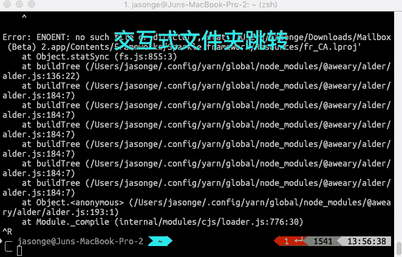
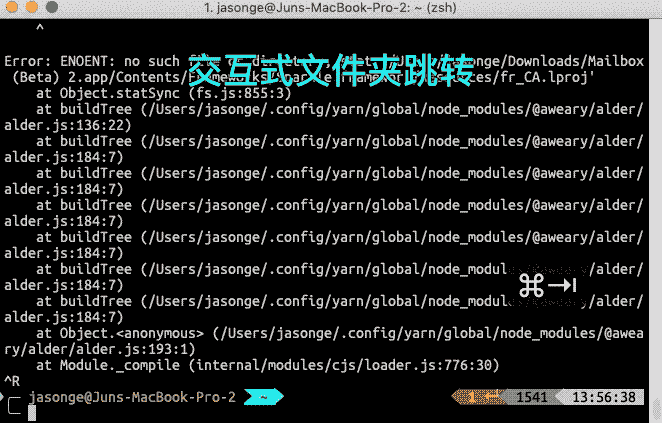
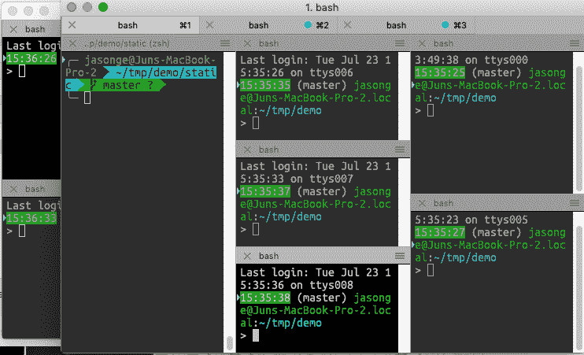
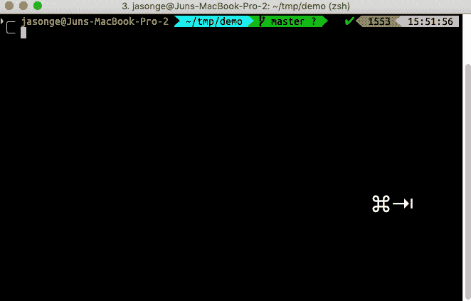
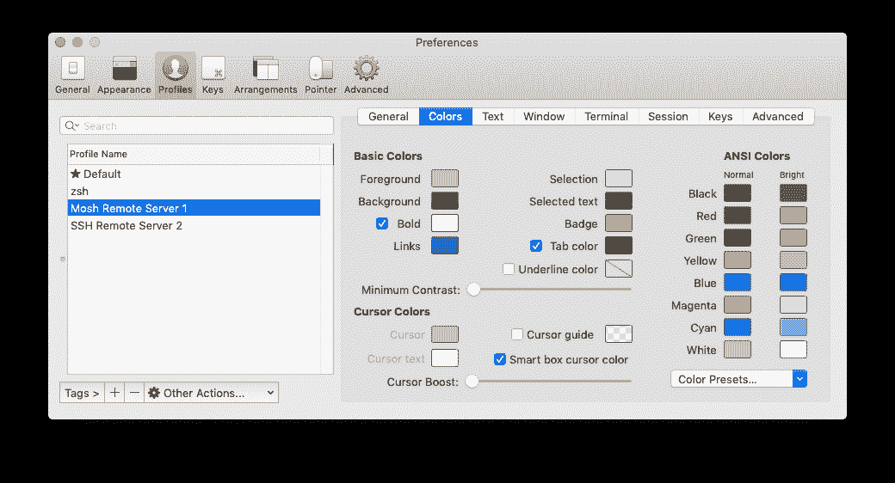
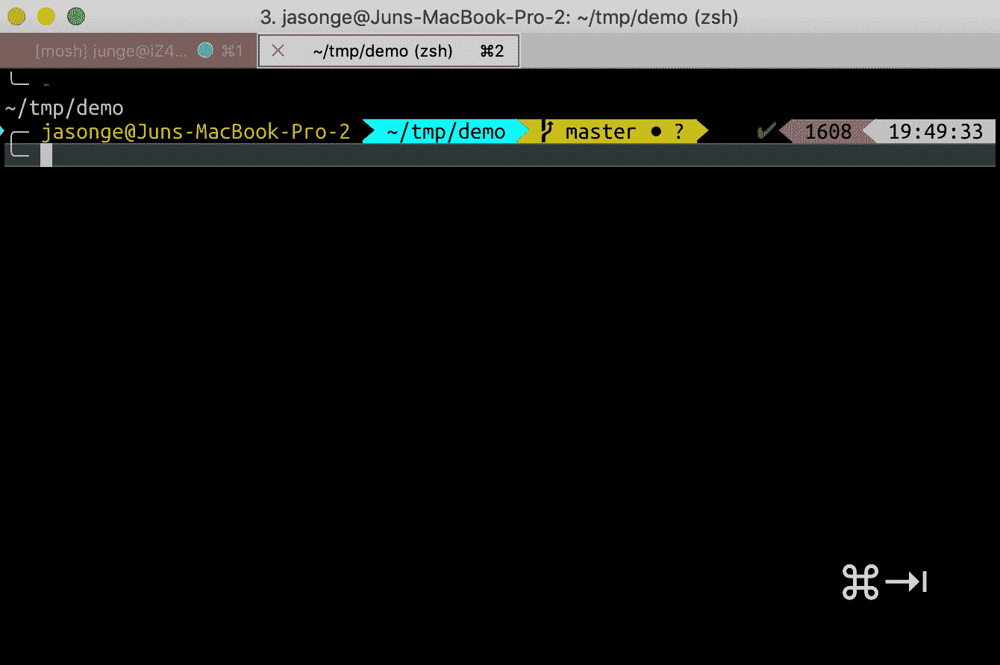
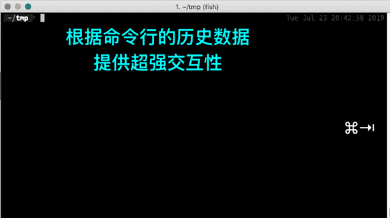
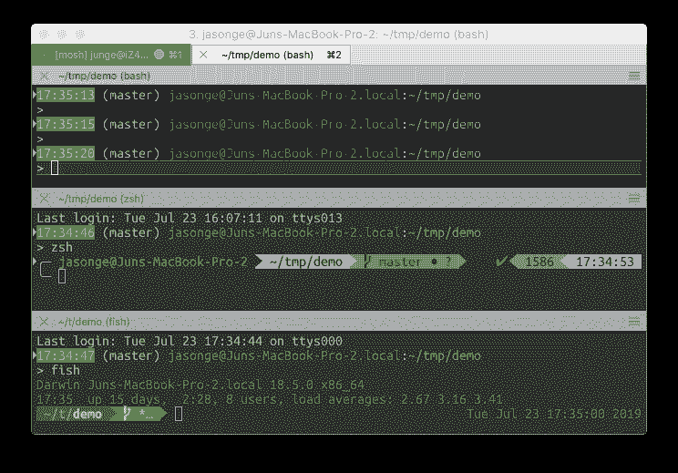
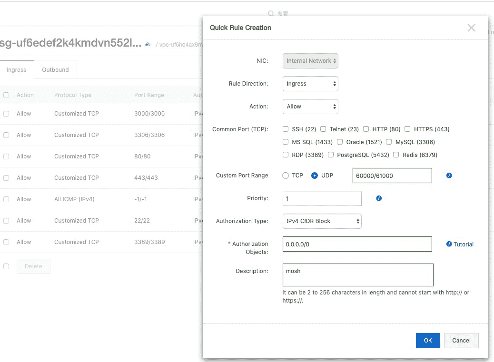
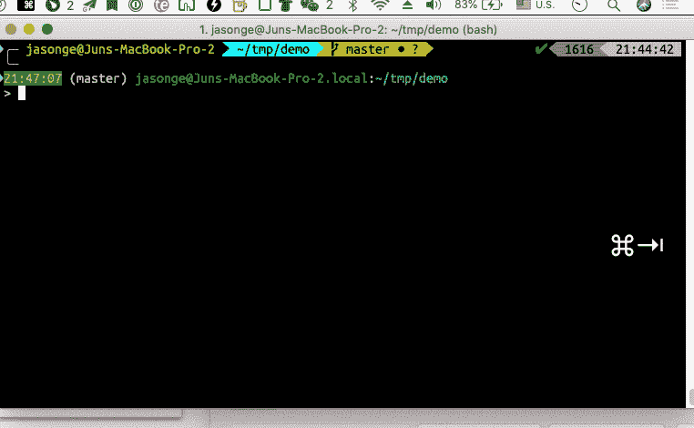

# 27 | 命令行：不只是酷，更重要的是能提高个人效能

 

你好，我是葛俊。今天，我要与你分享的主题是，命令行下的高效工作技巧。

我先和你讲一个有意思的话题吧。命令行工具常常会给人一种黑客的感觉，好莱坞的电影里面常常出现命令行窗口的使用。不知道你听说过没有，很多好莱坞电影在拍摄时使用的其实是一个叫作nmap的工具。这个工具是做安全扫描的，只不过因为它的显示特别花哨，所以被很多电影采用。在 nmap 官方网站上，还专门列出来了这些电影的名单。

类似这种可以让自己看起来很忙的工具还有很多，比如Genact。下面是一个使用 Genact 的录屏，当然这里的命令并没有真正运行。这可能是整个专栏中，唯一一个让你看起来效率很高，实际上却是降低效率的工具，但说不定对你有用，你懂的。

讲完这个娱乐性的话题，我们进入正题吧。

## 为什么要使用命令行？

GUI 图形界面的出现是计算机技术的变革，极大方便了用户。但在这么多年后的今天，命令行工具为什么仍然有如此强大的生命力呢？

在我看来，对软件工程师来说，想要高效开发就必须掌握命令行，主要原因包括：

1. 虽然鼠标的移动和点击比较直观，但要完成重复性的工作，使用键盘会快捷得多。这一点从超市的结算人员就可以看出来，使用键盘系统的收银员总是噼里啪啦地很快就可以完成结算，而使用鼠标点击的话明显慢很多。
2. 作为开发人员，可以比较容易地使用命令行的脚本，对自己的工作进行自动化，以及和其他系统工具联动。但使用 GUI 的话，就会困难得多。
3. 命令行通常可以暴露更完整的功能，让使用者对整个系统有更透彻的理解。Git 就是一个典型的例子，再好的 GUI Git 系统都只能封装一部分 Git 命令行功能，要想真正了解 Git，我们必须要使用命令行。
4. 有一些情况是必须使用命令行的，比如 SSH 到远程服务器上工作的时候。

为了演示命令行的强大功能给我们带来的方便，下面是一个在本地查看文件并上传到服务器的流程的录屏。





通过这个案例，你可以看到命令行的以下几个功能：

1. 在提示行会高亮显示时间、机器名、用户名、Git 代码仓的分支和状态，以及上一个命令的完成状态。
2. 输入命令的时候，高亮显示错误并自动纠错。
3. 使用交互的形式进行文件夹的跳转，并方便查找文件，还可以直接在命令行里显示图片。
4. 使用交互的工具，把文件上传到远端的服务器，并快速连接到远端查看传输是否成功。

整个流程全部都是在命令行里完成的，速度非常快，用户体验也非常好。正因为如此，我看到的硅谷特别高效的开发人员，绝大多数都大量使用命令行。那，面对成百上千的命令行工具，我们**怎样才能高效地学习和使用**呢？

我将高效学习使用命令行的过程，归纳为两大步：

1. 配置好环境；
2. 针对自己最常使用命令行的场景，有的放矢地选择工具。

今天，我就与你详细讲述**环境配置**这个话题。而关于选择工具的话题，我会在下一篇文章中与你详细介绍。总结来讲，环境配置主要包括以下四步：

1. 选择模拟终端；
2. 选择 Shell；
3. 具体的 Shell 配置；
4. 远程 SSH 的处理。

这里需要注意的是，在命令行方面，macOS 和 Linux 系统比 Windows 系统要强大许多，所以我主要以 macOS 和 Linux 系统来介绍，而关于 Windows 的环境配置，我只会捎带提一下。不过，macOS 和 Linux 系统中的工具选择和配置思路，你可以借鉴到 Windows 系统中。

## 第一步，选择模拟终端

我将一个好的终端应该具有的特征，归纳为 4 个：

1. 快，稳定；
2. 支持多终端，比如可以方便地水平和纵向分屏，有 tab 等；
3. 方便配置字体颜色等；
4. 方便管理常用 SSH 的登录。

macOS 系统自带的终端不太好用，常见的替代工具有 iTerm2、Terminator、Hyper 和 Upterm。我平时使用的 iTerm2，是一个免费软件，功能强大，具备上面提到的 4 个特征。下面我就以 iTerm2 为例展开介绍。其他几个工具上也有类似功能，所以你不必担心。

在多终端的场景方面，iTerm2 支持多窗口、多标签页，同一窗口中可以进行多次水平和纵向分屏。这些操作以及窗口的跳转都有快捷键支持，你可以很方便地在网络上搜索到。



在管理常用 SSH 的登录方面，iTerm2 使用 Profile（用户画像）来控制。比如，下面是一个连接到远程服务器案例的录屏。

可以看到，在我的工作环境里常会用到 4 个 Profile，其中有两个是连接到远端服务器的，包括 Mosh Remote Server 1 和 SSH Remote Server 2。工作时，我使用 Cmd+O，然后选择 Server 1 这个 Profile，就可以打开一个新窗口，连接到这个远程服务器上。



每一个 Profile 都可以定义自己的字体、颜色、shell 命令等。比如，Server 1 是类生产服务器，我就把背景设置成了棕红色，提醒自己在这个机器上工作时一定要小心。所以在上面的录屏中你可以看到，连接到远端的 SSH 标签页，它的背景、标签页都是棕红色。另外，下面是如何对 Profile 颜色进行设置的截屏。



除了这些基础功能外，iTerm2 还有很多贴心的设计。比如：

1. **在屏幕中显示运行历史**（Cmd+Opt+B/F）。有些情况下，向上滚动终端并不能看到之前的历史，比如运行 VIM 或者 Tmux 的时候。这时，浏览显示历史就特别有用了。
2. **高亮显示当前编辑位置**，包括高亮显示当前行（Cmd+Opt+；）高亮显示光标所在位置（Cmd+/）。
3. **与上一次运行命令相关的操作**，包括显示上一次运行命令的地方（Cmd+Shift+up），选中上一个命令的输出（Cmd+Shift+A）。

其中第 2、3 项功能是由一组macOS 的集成工具提供的。这个工具集还包括显示图片的命令 imgls、imgcat，显示自动补全命令，显示时间、注释，以及在主窗口旁显示额外信息等。这些设计虽然很小，但非常实用。

关于 Windows 系统，2019 年 5 月微软推出了Windows Terminal，支持多 Tab，定制性很强，据说体验很不错。

选择好了终端，环境设置的第二步就是选择 Shell。

## 第二步，选择 Shell

在我看来，选择 Shell 主要有普遍性和易用性这两条原则。

Linux/Unix 系统下，**Bash**最普遍、用户群最广，但是易用性不是很好。常用来替代 Bash 的工具有**Zsh**和**Fish**，它们的易用性都很好。下面是两张图片，用于展示 Zsh 和 Fish 在易用性方面的一些功能。

Zsh：



Fish：



我个人觉得 Fish 比 Zsh 更方便。事实上，Fish 是 Friendly Interactive Shell 的简称。所以，交互是 Fish 的强项。可惜的是，Fish 不严格遵循 POSIX 的语法，与 Bash 的脚本不兼容，而 Zsh 则兼容，所以我目前主要使用的是 Zsh。

选好了模拟终端和 Shell 之后，便是配置环境的第三步，具体的 Shell 配置了。

## 第三步，具体的 Shell 配置

接下来，我以我自己使用的设置为例，向你介绍 Bash、Zsh、Fish 的具体配置吧。这里，主要包括**命令行提示符**的配置和其他配置两个方面。

之所以把命令行提示符单独提出来，是因为它一直展现在界面上，能提供很有用的价值，对命令行高效工作至关重要。下面是一张图片，展示了 Bash、Zsh 和 Fish 的命令行提示符。



这个窗口分为三部分，最上面是 Bash，中间是 Zsh，最下面是 Fish，都配置了文件路径、Git 信息和时间戳等信息。接下来，我带你一起看看这 3 个工具应该如何配置吧。

**Bash 比较麻烦，**配置文件包括定义颜色和命令行提示符的两部分：

```
## 文件 $HOME/.bash/term_colors，定义颜色  
# Basic aliases for bash terminal colors  
N="\[\033[0m\]"    # unsets color to term's fg color  
  
# regular colors  
K="\[\033[0;30m\]"    # black  
R="\[\033[0;31m\]"    # red  
G="\[\033[0;32m\]"    # green  
Y="\[\033[0;33m\]"    # yellow  
B="\[\033[0;34m\]"    # blue  
M="\[\033[0;35m\]"    # magenta  
C="\[\033[0;36m\]"    # cyan  
W="\[\033[0;37m\]"    # white  
  
# empahsized (bolded) colors  
MK="\[\033[1;30m\]"  
MR="\[\033[1;31m\]"  
MG="\[\033[1;32m\]"  
MY="\[\033[1;33m\]"  
MB="\[\033[1;34m\]"  
MM="\[\033[1;35m\]"  
MC="\[\033[1;36m\]"  
MW="\[\033[1;37m\]"  
  
# background colors  
BGK="\[\033[40m\]"  
BGR="\[\033[41m\]"  
BGG="\[\033[42m\]"  
BGY="\[\033[43m\]"  
BGB="\[\033[44m\]"  
BGM="\[\033[45m\]"  
BGC="\[\033[46m\]"  
BGW="\[\033[47m\]"
```

```
## 文件 $HOME/.bashrc，设置提示符及其解释  
###### PROMPT ######  
# Set up the prompt colors  
source $HOME/.bash/term_colors  
PROMPT_COLOR=$G  
if [ ${UID} -eq 0 ]; then  
  PROMPT_COLOR=$R ### root is a red color prompt  
fi  
  
#t Some good thing about this prompt:  
# (1) The time shows when each command was executed, when I get back to my terminal  
# (2) Git information really important for git users  
# (3) Prompt color is red if I'm root  
# (4) The last part of the prompt can copy/paste directly into an SCP command  
# (5) Color highlight out the current directory because it's important  
# (6) The export PS1 is simple to understand!  
# (7) If the prev command error codes, the prompt '>' turns red  
export PS1="\e[42m\t\e[m$N $W"'$(__git_ps1 "(%s) ")'"$N$PROMPT_COLOR\u@\H$N:$C\w$N\n\["'$CURSOR_COLOR'"\]>$W "  
export PROMPT_COMMAND='if [ $? -ne 0 ]; then CURSOR_COLOR=`echo -e "\033[0;31m"`; else CURSOR_COLOR=""; fi;'
```

命令行提示符之外的其他方面的配置，在 Bash 方面，我主要设置了一些命令行补全（completion）和别名设置（alias）：

```
## git alias  
alias g=git  
alias gro='git r origin/master'  
alias grio='git r -i origin/master'  
alias gric='git r --continue'  
alias gria='git r --abort'  
  
  
## ls aliases  
alias ls='ls -G'  
alias la='ls -la'  
alias ll='ls -l'  
  
  
## git completion，请参考 https://github.com/git/git/blob/master/contrib/completion/git-completion.bash  
source ~/.git-completion.bash
```

**Zsh 的配置就容易得多了，而且是模块化的**。基本上就是安装一个配置的框架，然后选择插件和主题即可。具体来说，我的 Zsh 命令行提示符配置步骤包括以下三步。

第一，安装 oh-my-zsh。这是一个对 Zsh 进行配置的常用开源框架。

```
brew install zsh
```

第二，安装 powerline 字体，供下一步使用。

```
brew install powerlevel9k
```

第三，在~/.zshrc 中配置 ZSH_THEME，指定使用 powerlevel9k 这个主题。

```
ZSH_THEME="powerlevel9k/powerlevel9k"
```

命令行提示符以外的其他配置，主要是通过安装和使用 oh-my-zsh 插件的方式来完成。下面是我使用的各种插件，供你参考。

```
## 文件~/.zshrc.sh 中关 oh-my-zsh 的插件列表，具体插件细节请参考 https://github.com/robbyrussell/oh-my-zsh，以及使用 Web 搜索查询  
plugins=(  
  git  
  z  
  vi-mode  
  zsh-syntax-highlighting  
  zsh-autosuggestions  
  osx  
  colored-man-pages  
  catimg  
  web-search  
  vscode  
  docker  
  docker-compose  
  copydir  
  copyfile  
  npm  
  yarn  
  extract  
  fzf-z  
)  
  
source $ZSH/oh-my-zsh.sh
```

**至于 Fish 的配置，和 Zsh 差不多，也是安装一个配置的框架，然后选择插件和主题即可。**在配置命令行提示符时，主要步骤包括以下两步。

第一，安装配置管理框架 oh-my-fish：

```
curl -L https://get.oh-my.fish | fish
```

第二，查看、安装、使用 oh-my-fish 的某个主题，主题会自动配置好命令行提示符：

```
omf theme  
omf install <theme>  
omf theme <theme>  
  
## 我使用的是 bobthefish 主题  
omf theme bobthefish
```

这里有一篇不错的关于使用 oh-my-fish 配置的文章，供你参考。

Fish 的其他方面的配置，也是使用 oh-my-fish 配置会比较方便。关于具体的配置方法，建议你参照官方文档。

关于环境的最后一个配置，是远程 SSH 的处理。

## 第四步，远程 SSH 的处理

SSH 到其他机器，是开发人员的常见操作，最大的痛点是，怎样保持多次连接的持久性。也就是说，连接断开以后，远端的 SSH 进程被杀死，之前的工作记录、状态丢失，导致下一次连接进去需要重新设置，交易花销太大。有两类工具可以很好地解决这个问题。

**第一类工具是 Tmux 或者 Screen**，这两个工具比较常见，用来管理一组窗口。

接下来，我以 Tmux 为例，与你描述其工作流程：首先 SSH 到远程服务器，然后用远程机器上的 Tmux Client 连接到已经运行的 Tmux Session 上。SSH 断开之后，Tmux Client 被杀死，但 Tmux Session 仍然保持运行，意味着命令的运行状态继续存在，下次 SSH 过去再使用 Tmux Client 连接即可。

如果你想深入了解 Tmux 的概念和搭建过程，可以参考这篇文章。

**第二类是一个保持连接不中断的工具，移动 Shell**（Mobile Shell）。这也是我目前唯一见到的一个。这个工具是 MIT 做出来的，知道的人不多，是针对移动设备的网络经常断开设计的。

它的具体原理是，每次初始登录使用 SSH，之后就不再使用 SSH 了，而是使用一个基于 UDP 的 SSP 协议，能够在网络断开重连的时候自动重新连接，所以从使用者的角度来看就像从来没有断开过一样。

接下来，**我以阿里云 ECS 主机、运行 Ubuntu18.04 为例，与你分享 Mosh+Tumx 的具体安装和设置方法。**

第一，服务器端安装并运行 Mosh Server。

```
junge@iZ4i3zrhuhpdbhZ:~$ sudo apt-get install mosh
```

第二，打开服务器上的 UDP 端口 60000~61000。

```
junge@iZ4i3zrhuhpdbhZ:~$ sudo ufw allow 60000:61000/udp
```

第三，在阿里云的 Web 界面上修改主机的安全组设置，允许 UDP 端口 60000~61000。



第四，在客户端（比如 Mac 上），安装 Mosh Client。

```
jasonge@Juns-MacBook-Pro-2@l$ brew isntall mosh
```

第五，客户端使用 Mosh，用与 SSH 一样的命令行连接到服务器。

```
jasonge@Juns-MacBook-Pro-2@l$ mosh junge@<server-ip-or-name>
```

下面这个录屏演示的是，我日常工作中使用 Mosh + Tmux 的流程。期间我会断开无线网，你可以看到 Mosh 自动连接上了，就好像来没有断过一样。



## 小结

今天，我与你分享的是使用命令行工具工作时，涉及的环境配置问题。

首先，我与你介绍了选择模拟终端、选择和配置 Shell 的重要准则，并结合案例给出了具体的工具和配置方法，其中涉及的工具包括 iTerm2、Bash、Zsh、Fish 等。然后，我结合远程 SSH 这一常见工作场景，给出了使用 Tmux 和 Mosh 的优化建议。

掌握了关于环境配置的这些内容以后，在下一篇文章中，我将与你介绍具体命令行工具的选择和使用。

其实，我推荐开发者多使用命令行工具，并不是因为它们看起来炫酷，而是它们确实可以帮助我们节省时间、提高个人的研发效能。而高效使用命令行工具的前提，是配置好环境。

以 Mosh 为例，我最近经常会使用 iPad SSH 到远端服务器做一些开发工作。在这种移动开发的场景下，iPad 的网络经常断开，每次重新连接开销太大，基本上没办法工作。于是，我最终发现了 Mosh，并针对开发场景进行了设置。现在，每次我重新打开 iPad 的终端时，远程连接自动恢复，好像网络从没有断开过一样。这样一来，我就可以在移动端高效地开发了。

而对研发团队来说，如果能够对命令行工作环境进行优化和统一，毫无疑问会节省个人选择和配置工具的时间，进而提升团队的研发效能。

## 思考题

你觉得 Tmux 和 Screen 的最大区别是什么？是否有什么场景，我们必须使用其中的一个吗？

感谢你的收听，欢迎你在评论区给我留言分享你的观点，也欢迎你把这篇文章分享给更多的朋友一起阅读。我们下期再见！


