# 28 | 从工作场景出发，寻找炫酷且有效的命令行工具

 

你好，我是葛俊。今天，我继续和你分享命令行工具的使用。

在上一篇文章中，我与你介绍了命令行环境中的终端、Shell，以及远程连接的设置，解决了环境配置的问题。今天，我们再来看看具体的命令行工具的使用技巧。我会根据常见的工作场景来组织这些工具，因为优化工作流程、提高效率才是学习工具的真正目的。

从我的经验来看，开发人员最常见的、使用命令行的场景主要包括两个：

1. 日常的操作，比如文件夹跳转、处理和搜索文件夹和文件内容、查看和管理系统信息；
2. 开发中常见的工作，比如 Git 的使用、API 调试、查看日志和网络状况等。

我会重点与你分享这些场景中有哪些推荐工具以及使用技巧。而至于这些工具如何安装的内容，网络上已经有很多了，我就不再详细描述了。

## 日常操作中的工具和技巧

关于日常操作，Linux/Unix 系统已经自带了一些工具，另外还有些产生已久、为我们所熟悉的工具。不过，要更高效地完成工作，我们还有更强大的工具可以选择。

### 第一个场景：列举文件夹和文件，查看文件

**列举文件**的默认工具是 ls。除此之外，一个常用的工具是 tree，可以列出文件夹的树形结构：

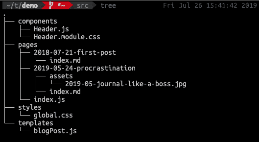

另外，还有些比 tree 更方便的工具，比如 alder 和 exa。exa 尤其好用，优点包括：

1. 默认就有漂亮的颜色显示，并且不同种类文件颜色不同；
2. 可以像 ls 一样显示当前文件夹，也可以像 tree 一样显示树形结构。

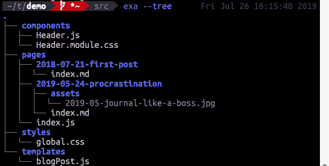

另外，exa 还支持对文件状态显示的加强。

比如，添加–git 选项，exa 会显示文件的 git 状态，在文件名的左边，用两个字母来表示文件在工作区和 Git 暂存区的状态。其中，N 表示新文件，M 表示文件修改等。exa 的显示和 git status 命令输出的简单对比，如下图所示。

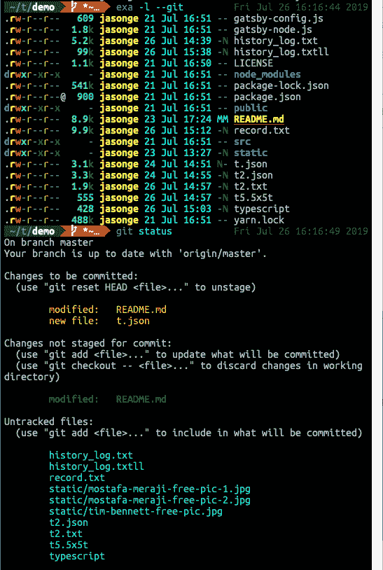

再比如，使用–extend 选项显示文件的额外信息。

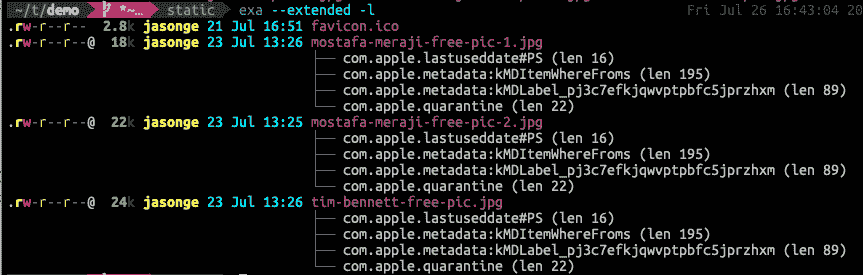

再比如，使用 group-directories-first 选项，先显示文件夹再显示文件。

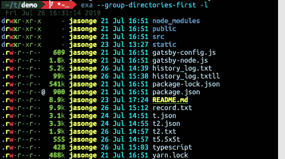

至于**查看文件**，Linux 默认的工具是 cat。相比起来，bat 是一个更好用的替代品，除高亮显示外，还可以显示 Git 的更改状态。

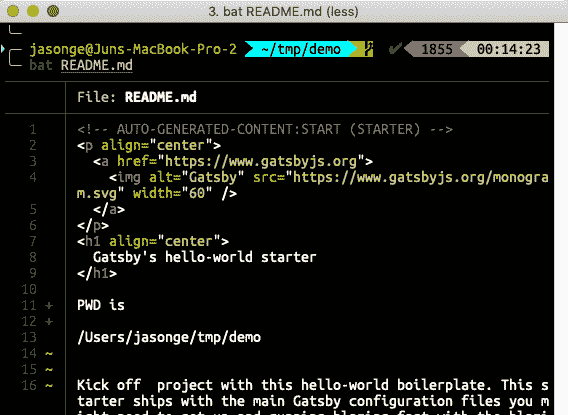

### 第二个场景：查找并打开文件，进行查看和编辑

一个常用的办法是，使用上面提到的工具来列出文件名，然后使用 grep 进行过滤查看，或者 VIM 进行查看和编辑。比如，使用命令

```
tree -I "node_modules" -f | grep -C3 index.md
```

可以得到当前文件夹中的所有 index.md 文件。

命令中，tree 的参数 -I，表示排除文件夹 node_modules；tree 的参数 -f，表示显示文件时包含文件路径，方便你拷贝文件的全名；grep 的参数 -C3，代表显示搜索结果 3 行的上下文。

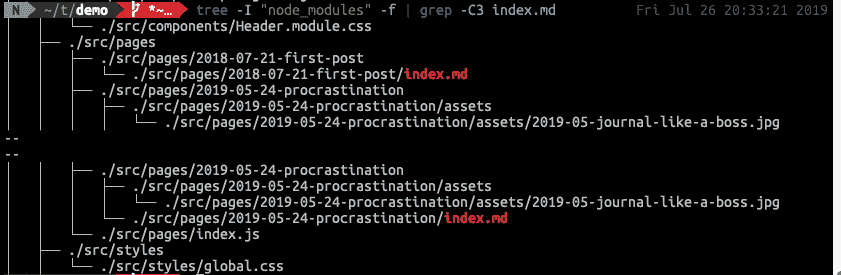

我们也可以使用 VIM 代替 grep，进行更复杂的查找和编辑工作。我可以把 tree 的输出传给 VIM，然后在 VIM 中查找 index.md，使用 n 跳到下一个搜索结果，使用 VIM 命令 gF 直接打开文件，进行编辑后使用\bd 命令关闭这个 index.md 文件。然后，用同样的方式查找并编辑第二、三、四个 index.md，从而实现对当前文件夹下每一个 index.md 文件的查看和修改：

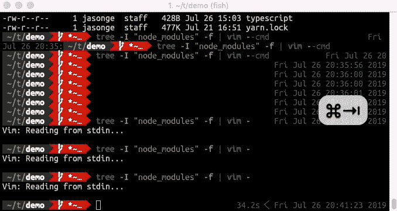

事实上，这正是一个**很常见的命令行工作流**：把某一个命令的输出传给 VIM，输出里包含有其他文件的完整路径，比如上面例子中 index.md 的路径，然后在 VIM 里使用 gF 命令查看并处理这些文件。我推荐你也尝试使用这种工作流。

另外，在上面的例子中，我使用 tree 命令来列举文件名。其实，很多时候我们**使用 find 这种专门用来查找文件的命令会更加方便**。不过，我今天要介绍的不是 find，而是它的一个替代品，即 fd。

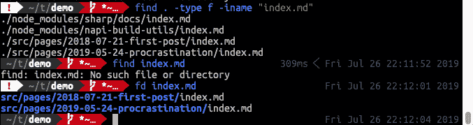

我推荐 fd 的原因主要有 3 个：

1. 语法比 find 简单；
2. fd 默认会忽略.gitignore 文件里指定的文件；
3. 忽略隐藏文件。

后两点对开发者来说非常方便。比如，我在搜索时，并不关心 node_modules 里面的文件，也不关心.git 文件夹里的文件，fd 可以自动帮我过滤掉。

另外，fd 高亮显示，速度也很快。至于对查找到的文件进行编辑，跟上面提到的方法一样，用管道（Pipe）传给 VIM，然后使用 gF 命令即可。

```
fd index.md | vim -
```

另外，关于查找文件内容的工具 grep，我常用的一个替代品是 RipGrep（rg）。跟 fd 类似，它也很适合开发者，有如下 4 个特点：

1. 默认忽略.gitignore 文件里指定的文件；
2. 默认忽略隐藏文件；
3. 默认递归搜索所有子目录；
4. 可以指定文件类型。

比如，使用 rg tags 就可以方便地查找当前目录下所有包含 tags 的文件。它的查找速度非常快，显示也比 grep 要漂亮：

```
> rg tags  
package-lock.json  
2467:    "common-tags": {  
2469:      "resolved": "https://registry.npmjs.org/common-tags/-/common-tags-1.8.0.tgz",  
5306:        "common-tags": "^1.4.0",  
5446:            "common-tags": "^1.4.0",  
  
src/pages/2019-05-24-procrastination/index.md  
6:tags: ['自我成长', '拖延症']  
  
src/pages/2018-07-21-first-post/index.md  
5:tags: ['this', 'that']

### 第三个场景：文件夹之间跳转

关于文件夹间的跳转，在 Bash 中有 cd 和 dirs 命令；在 Zsh 和 Fish 中，可以使用文件夹名字直接跳转；另外，Zsh 支持…、…和 - 等别名，用来分别跳转到父目录、父目录的父目录，以及目录历史中上一次记录，而不需要写 cd。
```

接下来，我与你介绍**几个新的工具来支持更快的跳转**。

实际上文件夹的跳转，有两种常见的情况：

1. 一种是，快速跳转到文件夹跳转历史中的某条记录，即之前曾经去过的某个文件夹；
2. 另一种是，快速找到当前文件夹中的某个子文件夹，并跳转过去。

对于第一种情况，常用的工具有两个，一个是 fasd，另一个是 z，它们差别不是特别大。我用的是 z，具体用法是：z 会按照访问频率列出最近访问过的文件夹，并使用字符串匹配的方式让你实现快速跳转。

比如，用 z dem来进行匹配和自动补全，找到我想去的 demo 文件夹，回车直接完成跳转。同时，我也可以用 z dem< 回车 > 直接跳转。

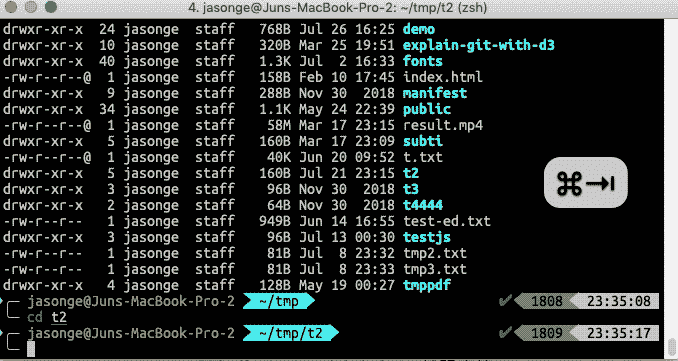

对于第二种情况，即快速定位某个子文件夹，我介绍一个**超级酷的工具 fzf**。本质上讲，fzf 是一个对输入进行交互的模糊查询工具。它的使用场景非常多，文件夹的跳转只是一个应用。所以，我还在再后面文章做更多的详细讨论。

安装好 fzf 之后，你就可以使用 Ctrl+T 进行文件夹的交互式查询，或者使用 Alt+C 进行文件夹跳转。

比如，我想跳转到 src/component 文件夹中，可以输入 Alt+C，fzf 就会列出当前文件夹下的所有文件夹。比如，我输入 com，没输入其他字符，fzf 会更新匹配到的文件夹，这时可以使用 Ctrl+P、Ctrl+N 进行上下选择，按下回车就可以进入选中的文件夹。

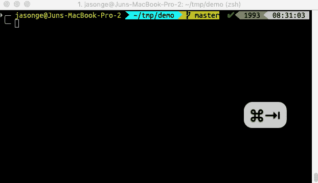

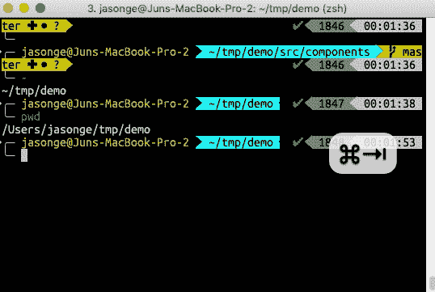

### 第四个场景：文件管理

系统自带的文件管理工具有 cp、mv、rsync 等。这里，我再介绍一些更方便的工具。

首先是一个用来**重命名文件的小工具，叫作 vidir**。顾名思义，vidir 就是 VI 来编辑目录的。具体使用方法很简单，vidir 命令后面接一个文件夹时，vidir 会打开 VIM，VIM 里面列举该文件夹中所包含的文件和子文件夹，然后使用 VIM 的命令来修改文件和文件夹的名字之后保存退出。这时，vidir 会自动帮助我们完成对文件和文件夹的重命名。

vidir 之所以使用 VIM 来修改文件，是因为 VIM 功能强大，修改非常方便。另外，vidir 也可以从管道接收文件夹和文件的列表。比如，我想把当前文件夹下所有前缀为 index 的文件，都在文件名前添加“new-”。这时，我可以使用命令 fd | vidir -。

这样，fd 命令会把当前文件夹下所有文件名传给 vidir。然后，vidir 打开 VIM，我们在 VIM 界面中修改文件名即可。如下所示的录屏图片中，包括了使用 VIM 的重复命令. 的技巧。

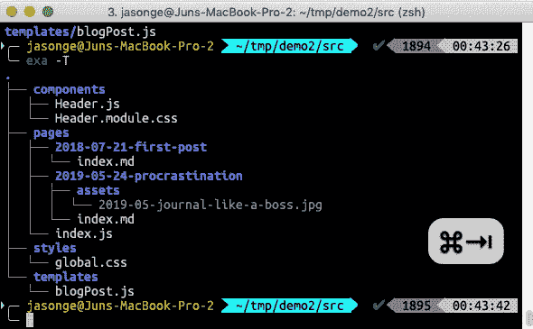

另外一组方便进行文件管理的工具是，**命令行的文件管理器**，即使用键盘命令在终端界面进行文件夹跳转、查看文件和移动文件等操作。这种命令行界面上的 UI 叫做 TUI（Terminal UI）。十多年前的 Borland 终端 IDE，就是这一类工具的翘楚，使用熟练之后效率会很高。

TUI 的文件管理器我用过 3 个：Midnight Commander (以下简称 mc)、Ranger 和 nnn。

mc 是两个窗口的文件管理器。如果你使用过 Windows Commander（Total Commander）的话，你就会对它的用法很熟悉。重要的命令有：使用 tab 进行两个窗口的切换、使用 F4 进行编辑、使用 F5 进行拷贝、使用 F9 进入菜单、使用 F10 退出。

我提供了一张录屏图片，简单演示了在一台远端服务器上使用 mc 进行多文件拷贝和编辑，并通过菜单修改显示主题的场景。

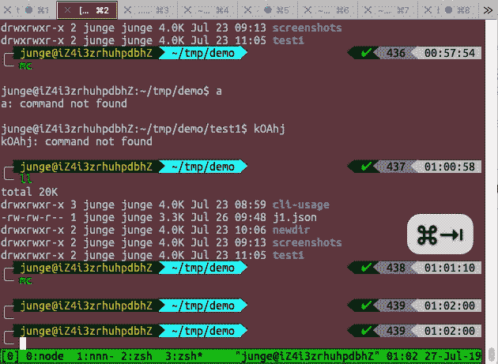

Ranger 和 nnn 是单窗口的文件管理器。Ranger 稍微有一点延迟，所以我一般使用 nnn。因为是单窗口，所以与我们平时在 GUI 中使用的文件管理器比较相似。

比如，在拷贝文件的时候，需要先进入文件所在文件夹，选择文件，然后进入目标文件夹，再使用拷贝命令把文件拷贝过去。我在录屏中演示了在 nnn 中进行文件夹的跳转、创建，文件的选择、拷贝，使用用系统工具打开当前文件，查看帮助等功能。

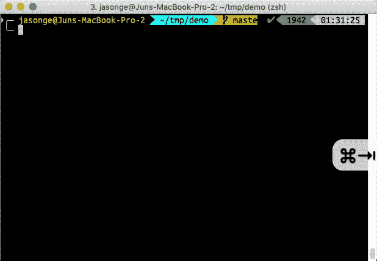

总的来说，这 3 个工具中我使用最多的是 nnn。跟 mc 相比，它最大的好处是快捷键设置跟 VIM 一致，不需要大量使用功能键 F1~F12。

## 开发中常见的工作

### Git

命令行中的 Git 工具，除了原生的 Git 之外，常见的还有 tig、grv、lazygit 和 gitin。

我常用的是 tig。因为在 tig 中，我可以方便地进行查看改动、产生提交、查看历史（blame）等操作，功能非常强大。比如，在查看文件改动时，我们可以方便地使用命令 1 有选择性地把一个文件中改动的一部分添加到一个提交当中，实现第 26 篇文章中提到的 git add -p 的功能。

另外，我还可以通过 tig 快捷地查看一个文件的历史信息。

关于这两个功能的使用，你可以参考下面的录屏图片。

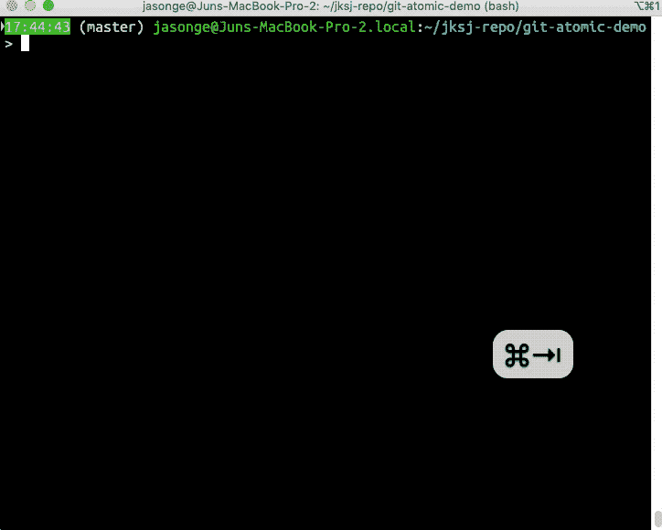

### Web 访问

我常用的 Web 访问工具是 HTTPie，是 curl 命令的一个补充。HTTPie 的强项在于，专门针对 HTTP 协议，所以可以做到格式简单、易用性强两点。

而 curl 的优势，则包括功能强大、支持多种协议和基本所有服务器上都有预装。

关于这两个工具，我的建议是，curl 肯定要学，HTTPie 如果用得到也值得花时间学习。

### 对 JSON 进行处理

在命令行对 JSON 文本进行处理，最常见的工具是 jq。它能够对 JSON 进行查询和修改处理，功能很强大。

举一个查询的例子，我们有这样一个 person.json 文件列举某个人的详细信息：

```
$ cat person.json  
{ "id": { "bioguide": "E000295", "thomas": "02283", "fec": [ "S4IA00129" ], "govtrack": 412667, "opensecrets": "N00035483", "lis": "S376" }, "name": { "first": "Joni", "last": "Ernst", "official_full": "Joni Ernst" }, "bio": { "gender": "F", "birthday": "1970-07-01" }, "terms": [ { "type": "sen", "start": "2015-01-06", "end": "2021-01-03", "state": "IA", "class": 2, "state_rank": "junior", "party": "Republican", "url": "http://www.ernst.senate.gov", "address": "825 B&C Hart Senate Office Building Washington DC 20510", "office": "825 B&c Hart Senate Office Building", "phone": "202-224-3254" } ] }
```

可以方便地使用 cat person.json | jq .”对 JSON 进行格式化输出，

```
$ cat people.json | jq .  
{  
  "id": {  
    "bioguide": "E000295",  
    "thomas": "02283",  
    "fec": [  
      "S4IA00129"  
    ],  
    "govtrack": 412667,  
    "opensecrets": "N00035483",  
    "lis": "S376"  
  },  
  "name": {  
    "first": "Joni",  
    "last": "Ernst",  
    "official_full": "Joni Ernst"  
  },  
  "bio": {  
    "gender": "F",  
    "birthday": "1970-07-01"  
  },  
  "terms": [  
    {  
      "type": "sen",  
      "start": "2015-01-06",  
      "end": "2021-01-03",  
      "state": "IA",  
      "class": 2,  
      "state_rank": "junior",  
      "party": "Republican",  
      "url": "http://www.ernst.senate.gov",  
      "address": "825 B&C Hart Senate Office Building Washington DC 20510",  
      "office": "825 B&c Hart Senate Office Building",  
      "phone": "202-224-3254"  
    }  
  ]  
}
```

以及使用 jq ".terms[0].office"命令查询他的第一个工作任期的办公室地址。

```
$ cat person.json | jq ".terms[0].office"  
"825 B&c Hart Senate Office Building"
```

但，jq 存在的最大问题是，它有一套自己的查询处理语言。如果使用 jq 的频次没那么高的话，很难记住，每次都要去查帮助才可以。

针对这种情况，有人设计了另一种类似的工具，直接使用 JavaScript 作为查询处理语言，典型代表是 fx 和 jq.node。这，就大大方便了使用 JavaScript 的开发者，因为可以使用已经熟悉了的语法。

比如，对于上个案例的 JSON 文件，我可以方便地在 fx 工具中使用 JavaScript 的函数 filter() 进行过滤查询。

```
$ cat person-raw.json| fx 'json => json.terms.filter(x => x.type == "top")'  
[  
  {  
    "type": "top",  
    "office": "333 B&c Hart CIrcle  Building",  
    "phone": "202-224-3254"  
  }  
]

### 查找、关闭进程

通常情况下，我们使用 kill 和 pkill，来查找和关闭进程。但，使用 fzf 之后，我们可以方便地进行交互式的查找目标进程。具体使用方法是，输入 kill，fzf 就会提供一个交互式的界面供你查找目标进程，然后回车确认即可。
```

在命令行上进行交互式的操作，非常爽，我推荐你一定要试试。

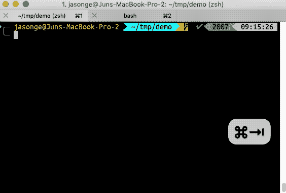

### 查看日志文件

关于查看日志文件的工具，我推荐 lnav。它比 tail -F 要方便、强大得多，有很多很棒的功能，包括：

1. 支持很多日志格式，比如 syslog、sudo、uWSGI 等，并可以根据格式高亮显示；
2. 支持多个日志同时显示，并用不同颜色区分；
3. 支持正则表达式进行过滤等。

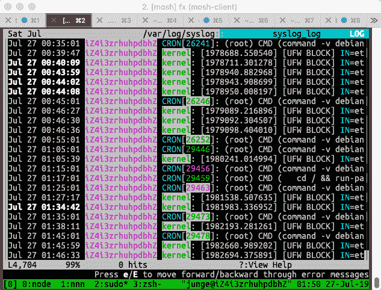

### 命令行本身的实用技巧

关于命令行的使用技巧，有两个非常值得一提：一个是!$，另一个是!!。

**第一个!$**，代表上一个命令行的最后一个参数。比如，如果我上一条命令使用

```
$ vim src/component/README.txt
```

下一步我想为它产生一个备份文件，就可以使用!$：

```
## 以下命令即   copy vim src/component/README.txt vim src/component/README.txt.bak  
$ cp !$ !$.bak
```

**第二个常用的是!!**，表示上一个命令的完整命令。最常用的场景是，我先拷贝一个文件，发现没有权限，需要 sudo，下一步我就可以用 sudo !! 来用 sudo 再次运行拷贝命令。

```
## 因为权限不足，命令失败  
$ cp newtool /usr/local/bin/  
  
## 重新使用 sudo 运行上一条命令。即 sudo wtool /usr/local/bin/  
$ sudo !!

## 小结

今天，我与你介绍了很多工具。使用工具提高研发效能，最关键的是找到真正常用的工作场景，然后去寻找对应的工具来提高效率。
```

需要注意的是，只有重复性高的工作，才最适合使用命令行工具；否则，用来适应工具的时间，可能比节省下的时间还要多。这，是命令行的一个基本特点。

最后，我把今天与你讨论的 Linux/Unix 系统自带工具和替代工具，整理为了一张表格，以方便你复习：


## 思考题

不知道你有没有注意到，在录屏中我多次用到了一个叫作 tldr 的工具。你知道它是什么作用吗？

感谢你的收听，欢迎你在评论区给我留言分享你的观点，也欢迎你把这篇文章分享给更多的朋友一起阅读。我们下期再见！


