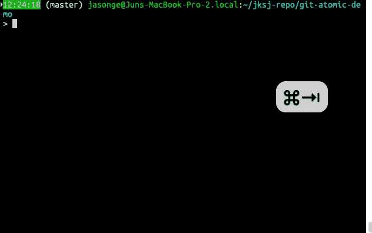

# 29 | 1+1>2，灵活的工具组合及环境让你的工作效率翻倍

 

你好，我是葛俊。今天，我们来聊一聊工具的组合和环境。

在前面几篇文章，我与你介绍了很多工具，有开发工具，也有跟开发不直接相关的工具。毫无疑问，这些工具都很好用。但，如何配置这些工具，才能真正发挥它们的价值，提高我们的研发效能呢？

我们都很清楚，工具的使用离不开具体的工作环境。如果我们在环境中使用的各个工具是割裂开的话，不仅会提高我们的学习成本、记忆成本，还会有工具间交互的衔接问题。所以，用好这些工具，我们还需要做两件事：

1. 尽量把工具无缝集成，解决工具切换不顺畅的问题；
2. 减少并优化常用的工作入口，从而提高工具一致性，降低使用多个工具时的心智负担。

只有这样，我们才能把工具配置成一套好的环境，真正聚焦在产生价值的工作上，发挥工具提升研发效能的作用，实现 1+1>2 的效果。

所以接下来，我会从工具集成和提高工具一致性两个方面，与你介绍如何把多个工具组合成为高效的工具环境。

## 工具的集成

工具的集成，最值得优化的情况包括两种：一是，使用管道（Pipe）对命令行工具进行集成；二是，对集成开发工具环境（IDE）进行配置，让 IDE 和周边工具集成。

### 使用管道（Pipe）对命令行工具进行集成

其实，我在前面的文章中已经使用过管道很多次了，只是使用场景比较简单而已。

比如，在第 24 篇文章中，我使用命令 curl -s <github_url> | vim -，来查看 GitHub 上某个用户的代码仓情况，通过管道把 curl 命令的输出传给 VIM，以方便我在 VIM 中查看较长的输出。

```
> curl -s https://api.github.com/users/jungejason/repos | vim -  
Vim: Reading from stdin...  
  
## 进入 VIM 窗口，显示所有 repo 的 array  
[  
  {  
    "id": 213849635,  
    "node_id": "MDEwOlJlcG9zaXRvcnkyMTM4NDk2MzU=",  
    "name": "counter-redux-sample",  
    "full_name": "jungejason/counter-redux-sample",  
    "private": false,  
    "owner": {  
      "login": "jungejason",  
...
```

这个案例使用了一次管道，比较简单。

而高效使用管道，首先是**使用多个管道灵活地把多个工具连接起来**。一个常见的场景是，grep 和 xargs 命令的组合。比如，ps aux | grep vim | grep -v grep | awk ‘{print $2}’ 可以找到我当前运行的 VIM 程序并将其关闭。

```
ps aux | grep vim | grep -v grep | awk '{print $2}' | xargs kill
```

整个管道链是这样工作的：

1. ps aux 打印所有运行程序，每行打印一个。
2. grep vim 显示包含 vim 的那些行。
3. grep -v grep 表示过滤掉包含 grep 的那一行。这是因为，上面一步 grep vim 命令中包含“vim”字样，所以它也会被 ps aux 显示出来，我们需要将其过滤掉。
4. awk ‘{print $2}’ 表示抽取出输出中的 PID，也就是进程 ID。
5. xargs kill 接收上一步传过来的 PID，组成命令 kill并执行，杀死 vim 进程。

上面管道每一步的执行输出，如下所示：

```
> ps aux  
USER               PID  %CPU %MEM      VSZ    RSS   TT  STAT STARTED      TIME COMMAND  
_windowserver      228  14.9  2.3 13044220 382952   ??  Ss    9Oct19 679:18.68 /System/Library/PrivateFrameworks/SkyLight.framewo  
jasonge          49393  14.4  2.1  5586816 356860   ??  S    Sun12AM 583:37.42 /Applications/XMind.localized/XMind.app/Contents/F  
jasonge          49371   9.7  0.4  4826572  64204   ??  S    Sat11PM 167:30.01 /Applications/XMind.localized/XMind.app/Contents/F  
...  
  
> ps aux | grep vim  
jasonge          31383   0.0  0.0  4310340   4740 s001  S+    9:57AM   0:00.11 vim  
jasonge          32304   0.0  0.0  4268056    704 s004  R+   10:17AM   0:00.00 grep vim  
  
> ps aux | grep vim | grep -v grep  
jasonge          31383   0.0  0.0  4310340   4740 s001  S+    9:57AM   0:00.11 vim  
  
> ps aux | grep vim | grep -v grep | awk '{print $2}'  
31383  
  
> ps aux | grep vim | grep -v grep | awk '{print $2}' | xargs kill
```

这是使用多个管道的一个具体例子。在工作中，你可以根据实际情况，使用管道来封装常用的工具。

**在命令行中高效使用管道的第二个重要方法，是使用模糊查询工具（Fuzzy Finder)。**

常见的模糊查询工具，有 fzf、pick、selecta、ctrlp 和 fzy 等。其中，最有名的应该就是 fzf（你可以再回顾下第 28 篇文章中关于这个工具的介绍）。

在管道中使用模糊查询工具，可以大幅度提高使用体验。

在开发工作中，我们常常需要对文本进行搜索和过滤，一般会使用 grep 来实现。这个操作虽然简单，但频率非常高，很值得优化。比如，上面提到的杀死 vim 进程的操作。我们使用 ps aux 命令列举出所有进程之后，需要使用多个 grep 命令来进行搜索过滤，最终查找到我们需要的那一行。

在这个操作中，grep 过滤命令常常会比较复杂，为了达到正确的过滤效果，我们可能要调试多次才能找到正确的 grep 命令。另外，还可能会出现比较难以使用 grep 过滤的情况，比如有多个 vim 进程同时打开时，使用 grep 选出其中一个就不是很方便。

这时，使用模糊查询工具就很方便了。在我看来，**模糊查询工具的本质，就是交互式的文本过滤工具**。它接收文本，然后提供界面让用户输入查询条件，并在用户输入的同时实时过滤。当用户找到需要的结果回车确认后，输出结果文本，使用起来很自然。

以杀死 vim 进程的操作为例，我可以使用 ps aux | fzf 命令把进程列表发送给 fzf，fzf 首先会列举出所有进程供我搜索过滤。随着我的输入，fzf 进行实时过滤，去除不符合条件的那些行。在我输入了’vim 后，就只剩下几行结果了。这时，我可以使用上下键进行选择，回车之后 fzf 就会把这一行内容输出到 stdout 中。

可以看到，整个过程中我可以实时调整搜索条件，免去了使用 grep 需要多次调整参数的过程，使用起来非常便捷。

当然，除了把过滤结果输出到 stdout 外，也可以通过管道把输出传给其他工具，比如传给 awk 和 kill，来实现杀死 vim 进程的目的，具体的命令是 ps aux | fzf | awk ‘{print $2}’ | xargs kill。



可以看到，这个命令和前面使用 grep 的命令差不多，唯一区别是把之前命令中的两个 grep 替换成了 fzf。但正是这个区别，把中间的非交互文本过滤变成了交互式过滤，效果非常好。

实际上，你还可以更进一步，把这个使用 fzf 的命令保存为一个 shell 脚本，成为一个交互式的 kill 命令。如下所示：

```
#!/bin/bash  
  
ps aux | eval "fzf" | awk '{print $2}' | xargs kill
```

从非交互文本过滤到交互文本过滤的简单转变，着实可以为我们带来意想不到的巨大方便。比如：

1. 在切换工作路径时，可以用 find 命令列举出当前文件夹的所有子文件夹，然后进行交互式的过滤，最后切换路径。
2. 在使用 apt 或者 brew 安装软件包时，可以用来过滤可用软件包，方便软件包的选择。

它甚至可以与一些网站服务对接，比如这个使用fzf 和 caniuse 服务集成的例子，就很酷。此外，fzf 官网上还有很多类似的脚本例子，推荐你去看看。

### IDE 和周边工具集成

我们的目标是能在 IDE 中进行常见的软件研发活动，从而减少工具的切换。

具体来说，基本的 IDE 集成功能包括：

1. 编码；
2. 构建；
3. 实时检查语法错误；
4. 实时检查编码规格；
5. 运行单元测试，并在测试输出中点击文件名进行跳转；
6. 在本地运行服务，并可以设置断点进行单步调试；
7. 连接远程服务进行单步调试。

这些功能比较常见，你可以根据自己使用的 IDE 在网上搜索相关资料，我就不再赘述了。接下来，我会重点与你分享些不是那么传统，但非常有效的集成功能。

**首先，是 IDE 跟命令行工具的集成。**

命令行里有很多的工具，所以 IDE 只要集成了命令行终端，就可以把它们一次性都集成了进来，所以效果非常好。

这里的集成有两个层次：

1. 第一个层次是，终端窗口成了 IDE 应用的一个子窗口，这样使用比独立的终端窗口使用起来更方便。比如，可以使用快捷键方便地打开、关闭集成终端窗口。方便窗口管理。
2. 第二个层次是，终端子窗口和 IDE 其他部分的一些交互。这个层次更深，也更重要，可以让我们更好地在 IDE 中使用命令行工具，是我们要留意的。我**推荐你在你所用的 IDE 文档中，查看有哪些第二个层次的集成**。

以 VS Code 为例，属于第二层次的集成有以下四种。

**第一种**，在 IDE 中拖动文件夹或者文件到集成终端窗口中，文件夹或文件的完整路径名会自动复制到终端里。

第二种，在集成终端中运行当前编辑窗口中打开的文件，也可以在编辑窗口中选中一段文本直接在终端运行。方法是运行命令 Terminal: Run Active File in Active Terminal，或者是 Terminal: Run Selected Text in Active Terminal。

第三种，集成终端中的命令输出，如果包含文件名，可以用 Cmd+ 鼠标点击，直接在编辑器中打开这个文件。这个操作我经常用，比如搜索文件时，因为我对 fd 和 rg 命令很熟悉，所以有时会直接使用 fd + rg 的组合，而不是用 VS Code 的原生文件查找功能了。

第四种，可以安装针对 VS Code 的命令行工具。比如，使用了oh-my-zsh 中的 vscode 插件后，我们可以在集成终端中使用 vscr 在当前 VS Code 中打开文件，用 vscd 进行文件比较等工作，实现了终端和 IDE 的更紧密集成。

**其次，是 IDE 和代码仓的集成，包括 Gist、GitHub Pull、Git Graph。**

在 IDE 中进行代码仓的操作集成，我个人是比较谨慎的态度。我会比较多地使用命令行的 Git，因为我认为目前还没有 GUI 工具能暴露 Git 的全面功能。在 IDE 中，我只选择最适合在图形界面中使用的一些场景。

比如，在 VS Code 中，我只使用了 3 个插件：

1. Gist，方便在编辑器中直接上传文件。
2. GitHub Pull Request，方便管理 GitHub 上的 PR 处理，可以直接在 VSCode 里查看和进行讨论，非常方便。
3. Git Graph，用于查看历史。它可以显示提交历史的图结构，点击提交可以直接查看文件，比命令行工具更快捷。

如果你想使用这几个插件，可以参考它们的官方文档。

以上就是工具集成方面的内容，接下来我们来看看如何提高工具一致性。

## 提高工具一致性

提高工具的一致性，主要方法是减少常用的工作入口，并对这些入口进行优化。

工具太多容易混乱，但如果能控制入口数量，也就是说进行工作时，只从几个有限的入口开始操作，同时对这些入口进行优化，就能提升工具使用体验的一致性，降低使用工具带来的负担。

要减少并优化常用的工作入口，那我们首先需要明确**经常使用的、必要的工作入口**。

在我看来， 命令行、IDE、桌面快捷启动工具（Launcher）和浏览器这 4 个工作入口非常必要，是值得重视并优化的。

### 1. 命令行

我比较喜欢命令行的一个重要原因是，它是一系列工具的共同入口。绝大部分命令行的命令都遵循一定的规律，又有统一的 man 命令查看手册，很容易找到使用方法。

使用命令行减少工作入口还有一个办法，是使用统一的客户端工具进行多种操作。比如，Git 命令带有很多子命令（比如，log、diff、show 等），从而一个 Git 命令行工具可以完成很多工作。

在 Facebook，很多工作都通过 Arcanist（Phabricator 的命令行工具）的各种子命令来完成。这样就实现了命令使用的一致性，降低了学习成本。

在日常工作中，你也可以尝试开发一个命令行工具，对常用工作进行封装。之前我在 Stand 的时候，就使用 Node.js 的commander模块，对日常研发工作进行了封装。

### 2. IDE

上面已经提过，IDE 是一个重要入口，我们应该把较多的开发工作集中到 IDE 中直接进行。

### 3. 桌面快捷启动工具

桌面快捷启动工具，也是一个非常重要的入口，我们可以通过它进行很多工作。以 Mac 上非常有名的 Alfred 来说，你可以用它来启动程序、切换程序、搜索文件、进行网页搜索、管理系统剪贴板历史、进行计算、运行系统命令（比如，重启机器、锁定机器、关闭特定程序、关闭所有程序等）等操作。

用好这个工具，可以大大提高工具使用的一致性。

### 4. 浏览器

现在，我们会大量使用网站应用，那浏览器是必不可少的入口。你可能会觉得，在浏览器中不就是使用 URL 吗，还能怎么提高呢？

这里，我就和你分享几种方法吧。

其实，我们比较熟悉的书签功能，就是对在浏览器中使用网页应用的一个优化。因为它可以记录常用的工具，你不用每次都输入。

此外，还有一种你可能不太熟悉但非常有效的办法，就是自己运行一个搜索引擎，并把它设为浏览器的默认搜索。这样，你就可以在你的搜索引擎中定义规则，并在浏览器的地址栏输入符合规则的操作。

比如，你可以在搜索引擎后端中实现对“t”的解析，用来打开任务系统中序号为 task-id 的任务。当你在浏览器地址栏中输入“t 123"的时候，搜索引擎自动解析出任务 ID 123，然后跳转到这个任务的 URL，比如 http://tasktool/123.html。当然这个任务工具可能是 Trello，也可能是 Jira。

在 Facebook 内部，就有一个这样的公用引擎，支持快捷跳转到公司几乎所有的网站中，同时还可以使用它直接进行各种搜索工作，比如内部网页搜索、wiki 搜索等，极大提高了公司各种网站应用使用时的一致性。Facebook 开源了这个搜索引擎框架，叫作Bunny1。

事实上，这种浏览器使用方式相当于把浏览器的地址栏变成了一个命令行入口。因为搜索引擎后端就是一个通用的后端服务，可以实现各种各样的强大功能，所以你可以自己做一个这样的搜索引擎，在浏览器地址栏里充分发挥想象力。

## 小结

只有把工具放到具体的工作环境中，才能发挥它们的真实价值。

今天，我从两个方面与你介绍了怎样把多个工具配置成为高效的工具环境。一是，如何对工具进行集成，减少工具切换时的不顺畅，提高个人的研发效能。二是，如何减少并优化工具的入口，从而提高工具使用体验的一致性，以降低工具使用成本，提高研发效能。

其实，工具环境的配置，是一个需要不断摸索，去寻找最佳平衡点的过程。比如，在 IDE 中进行集成，应该集成最常用的功能，而不应该尝试把所有的功能都使用插件集成到 IDE 中。否则，IDE 就会变得臃肿不堪，性能下降。

我推荐的办法是采用 80/20 法则。也就是，集中精力对工作中最常用的 20% 的操作，进行集成和优化。从我个人的体验来看，这样的平衡点是比较合适的。

总之，我们时刻要牢记，配置环境的目的是，配置出一个强大而灵活的环境，让一切工作流畅，从而提高生产效率，一定要注意投入产出比。

## 思考题

在浏览器作为工作入口的例子中，如果一个任务描述搜索到的任务不止一条时，我们可以怎么处理呢？

感谢你的收听，欢迎你在评论区给我留言分享你的观点，也欢迎你把这篇文章分享给更多的朋友一起阅读。我们下期再见！
