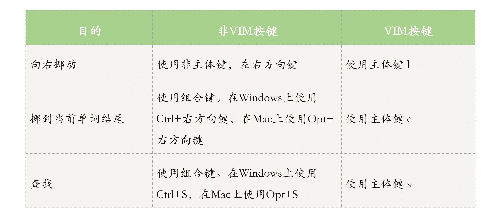
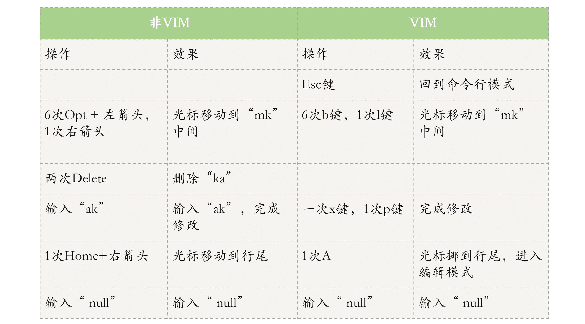
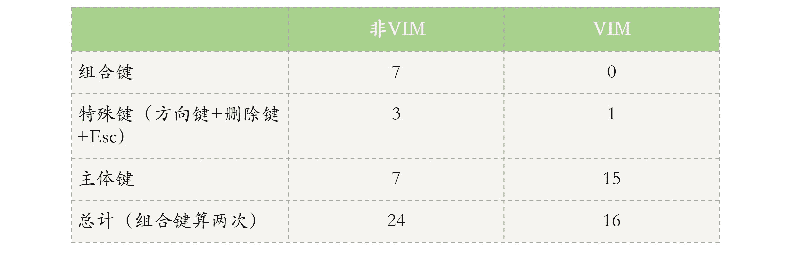

# 特别放送 | 每个开发人员都应该学一些VIM

 

你好，我是葛俊。

在“研发流程”和“工程方法”模块中，我主要是从团队的角度和你分享如何提高研发效能，所以很多同学希望我能分享一些工具的使用，来提高自己的效能。所以今天，我准备了一篇关于 VIM 的文章。在这篇文章中，我会着重带你深入了解 VIM 的两个特点。因为正是基于这两个特点，VIM 可以很好地提高我们的工作效率。至于更多的、具体的 VIM 使用方法和技巧，我会在接下来的“个人效能”模块中，用另一篇文章专门详细与你介绍。

如果你已经是一个 VIM 的使用者了，那我希望文中关于 VIM 原理的讨论，可以帮助你更深入地理解它，进而可以更高效地使用它。而如果你还不是 VIM 的使用者，那我推荐你学习它的基本方法，并寻找适当的场景去使用它。

其实，向开发者们推荐编辑器，尤其是像 VIM 这样一个比较容易引起争议的编辑器，是一件有风险的事儿。但，基于我对 VIM 的了解和它能给开发者带来的巨大好处，我认为这个风险是值得的，相信你也能从中有所收获。

我们下来看看什么是 VIM。

## 什么是 VIM？

VIM 是一个老牌的编辑器，前身是 VI，第 1 个版本发行于 1978 年，距离今天已经有 41 年的历史了。

VIM 是 VI Improved，是提高版的 VI，相对来说比较新，但实际上它的第 1 个版本也早在 1991 年就发布，也已经有 28 年的历史了。

VIM 和我们日常使用的编辑器，比如 VS Code、Notepad++、Sublime Text 等，差别很大，而且上手比较难，新手在使用时常常会手足无措。**一个常见的问题是，打开了 VIM 就不知道怎么退出。**比如，有人就曾在[Stack Overflow](https://stackoverflow.com/questions/11828270/how-do-i-exit-the-vim-editor)上提问怎么退出 VIM，6 年以来的阅读量已经接近 200 万。又比如，我还听到过一个玩笑，问怎样产生一个随机字符串呢，答案是让一个不会使用 VIM 的人打开 VIM 并尝试退出。

虽然如此，但在美国对开发人员进行的最喜欢的编辑器的调研中，VIM 往往能排进前 5 名。我个人的看法是，每一个开发者都应该学一些 VIM，原因有二：

 
1. VIM 基于命令行模式的特色，能**让文本编辑工作更高效**； 
2. VIM 有极高的跨平台性，**可以一次学习然后多处使用，尤其可以作为很多其他 IDE 的插件使用。** 

比如，当前我在进行微信小程序的项目开发，使用 VS Code 作为我主力 IDE。在 VS Code 中，我每天都在使用 VIM 插件，VIM 的命令操作大大提高了我的开发效率。作为开发者，编辑文本是最基本的工作，所以花些时间去了解最基本的 VIM 操作来提高效率和手指健康，是相当值得的。

在我看来，VIM 有两大特点：

 
1. 具有独特的命令行模式； 
2. 跨平台非常棒，更能作为插件在很多其他 IDE 中使用。 

而这两个特点，也正是我推荐你学习 VIM 的最主要原因。

## 特点一：VIM 独特的命令模式使得编辑文档非常高效

非 VI 系列的编辑器一般只有编辑模式这一种模式，也就是说，敲击任何主体键都会直接修改文件内容。比如，敲击键盘上的 e，文件里就添加了 e 这个字符。这里需要注意的是，键盘的**主体键**指的是，能显示在文件里的键，包括 a-z、数字、字符等。

而 VIM 有多种模式，其中最主要的是命令模式和编辑模式。命令模式是 VIM 的默认模式，我们用 VIM 打开一个文件的时候，默认进入的就是这个模式。在命令模式中，敲击主体键的效果不是直接插入字符，而是执行命令。比如：

 
- 敲击字母 e，表示将光标向右移动到当前单词最后一个字符； 
- 敲击符号 *，表示在当前文件搜索光标所在的单词。 

另外，在命令模式中输入“:< 命令 > 回车键”，可以执行一些命令行命令以及进行系统配置。比如：

 
- 输入:q! 表示，不保存文件并退出 VIM； 
- 输入:set hlsearch 表示，打开搜索高亮。 

至于我们在其他非 VIM 编辑器中熟悉的编辑模式，需要在命令模式中敲击某些命令才能进入。比如：

 
- 敲击 i 表示，在当前位置进入编辑模式； 
- 敲击 O 表示，在本行上面添加一个空行并进入编辑模式。 

进入编辑模式之后，使用体验就跟其他非 VIM 的编辑器效果差不多了，也就是说敲击主体键会直接插入字符。完成编辑工作之后，你需要再敲击 Esc 键返回命令模式。

请注意，**在编辑模式时，我们无法退出 VIM**。你只能在命令模式中使用 ZZ、ZQ、:qa! 等命令退出 VIM。如果你不会使用 VIM，然后不小心在命令行窗口中打开了它，没有菜单可以选择，的确很难找到办法退出，所以就有了各种不能退出 VIM 的笑话。

**另外这里需要指出的是**，VIM 实际上有多个模式，它的官方文档列举了一共 7 个基本模式和 7 个附加模式，而我在这篇文章中只做了命令模式和编辑模式两种模式的划分，是一个巨大的简化。事实上，命令模式中包含了常规模式（normal mode）、命令行模式（command-line mode）等，编辑模式则包括了插入模式（insert mode）、替换模式（replace mode）等。我之所以用命令模式和编辑模式的简单区分，一方面可以帮助你快速理解 VIM，另一方面也不会影响你对 VIM 的使用。

总结来说，拥有命令模式是 VIM 系列编辑器与非 VIM 系列编辑器的最大差别。那，VIM 为什么会有这种特性呢？

这是由 VIM 的历史决定的。VIM 的前身是 VI，VI 的前身是 Ex。Ex 是 Unix 诞生时代的编辑器。那个时候因为计算机技术以及计算机系统资源的局限性，编辑器只能使用命令来编辑文件。所以 VIM 就一直保留了命令模式。**这个命令模式是初学者难以适应 VIM 的最主要原因，但同时也是 VIM 能高效编辑文档的关键所在**。

为什么这样说呢？在一个非 VIM 的编辑器中，如果要做一个非编辑操作的时候，你需要敲击一个非主体键，或者组合键才能完成；而在 VIM 的命令模式中，你通常只需要敲击主体键。比如



我们在编辑文件的时候，有大量的非输入操作，比如挪动光标、查找、删除等，所以在非 VIM 的编辑器里，我们要大量使用非主体建和组合键。而在 VIM 中，我们可以大量使用主体键，从而大大减少使用键盘主要部分（也叫工作区）之外的特殊键，同时使用组合键的次数也大大减少了。

所以，综合来讲，虽然 VIM 中的模式切换会带来一些额外按键操作，但次数远远小于它节省的按键次数，总的按键数量明显减少。

接下来，我们通过一个具体的案例对比一下效果吧。我在输入一行代码注释时，希望输入的结果是

```
// This is making sure that userTotalScore is not null
```

但写到“not”的时候，我注意到我前面有一个拼写错误，把“making”写成了“mkaing”了

```
// This is mkaing sure that userTotalScore is not                                                 ^
```

现在，我需要修改这个错误，修改之后再回到行尾，补充“ null”写完这句话。以 Mac 为例，不使用 VIM 和使用 VIM 的操作对比如下表：



  
 统计下总次数，如下表所示：



  
 可以看到，在这个场景中**，使用 VIM 可以明显减少按键次数，包括组合键次数和特殊键次数。**在真实的编辑场景中，我的经验是减少的按键次数会更多，对文本编辑效率的提高非常明显。

另外，组合键和非主体键这两种按键方式非常容易对手腕和手指造成伤害。其实，我之前是 Emacs 的重度使用者，但使用了四年之后，我的左手小拇指开始不舒服，这是因为在 Emacs 中我常常需要用这个手指按住 Ctrl 键来完成组合键操作。比如，使用 Ctrl+f 向右移动光标，使用 Ctrl-x Ctrl-S 保存文件。

为了手指健康，我试着从 Emacs 向 VIM 转移。一个月之后，手指不舒服的症状明显减轻了。于是，我逐渐停止了使用 Emacs，全面转向 VIM。此后，双手再长时间使用键盘工作，也不容易疲劳了。

## 特点二：VIM 是跨平台做得最好的编辑器，没有之一

因为 VIM 的悠久历史，同时一直在持续更新，所以在各大操作系统上都有适用的 VIM 版本，你可以到[VIM 的官网](https://www.vim.org/download.php)上查看详情。所以，你掌握的 VIM 技能**基本可以用在所有的操作系统上**。

具体来说，在 Unix 系统上都有预装 VI。因为 VIM 的命令是向上兼容的，所以你熟悉的 VIM 的基本功能在 VI 上仍然可以使用。Linux 系统自带的基本都是 VIM，比如 Ubuntu18.04 自带的版本就是 VIM8.0。苹果操作系统因为是 Unix 的一个分支，所以预装有 VIM。

Windows 上没有预装 VIM。不过你可以很方便地安装 GVIM，或者直接运行一个免安装的可执行 GVIM 程序。

在移动端操作系统上，VIM 在 iOS 和 Android 端都有移植：

 
- iOS 上面比较好用的叫 iVIM。我在 iPad 中进行一些重量级文本编辑的时候，就会使用 iVIM。具体的使用方法是，将需要编辑的文本拷贝到 VIM 里面，编辑好了之后再拷出来，使用体验也还不错。 
- Android 上的 VIM 移植得比较多，比如 DroidVim 就还不错。 

VIM 跨平台特性的另外一个表现是，**很多其他编辑器及 IDE 都有 VI 模式**，支持最基本的 VIM 操作。

比如，IntelliJ 系列的 IDE 上有[IdeaVim 插件](https://www.jetbrains.com/help/idea/using-product-as-the-vim-editor.html)、VS Code 里有[VSCodeVim 插件](https://marketplace.visualstudio.com/items?itemName=vscodevim.vim)，甚至 VIM 的老对手 Emacs 里也有好几个 VI 插件，最有名的是[Viper Mode](https://www.emacswiki.org/emacs/ViperMode)。

我最近半年使用最多的编辑器 VS Code，所以我以它为例，与你说明如何在其他编辑器中使用 VIM。

VSCodeVim 插件的安装很简单，使用默认的 VS Code 插件安装方法很容易就能搜索到，并一键安装；配置也简单，默认的配置使用体验就非常不错。我在使用 VSCode 一个月后，对 VS Code 比较熟悉了，开始试用 VSCodeVim 插件，之后就再也回不到原生模式了。因为，VIM 带来的效能提升，以及给手指带来的舒适感觉实在是太明显了。

VIM 的跨平台特性甚至超越了编辑器这个范畴，**在一些不是编辑器的软件里面也有 VI 模式**。比如，Chrome 浏览器和 FireFox 浏览器中都有 VI 插件，用户可以使用 VI 的快捷键方式来操作。

在我看来，在浏览器上使用 VI 模式的最大好处是，可以减少鼠标的操作。这一点对我的吸引力不是很大，不过我的另外两个朋友，一直在使用 Chrome 的 VI 模式插件[Vimnium](https://vimium.github.io/)，反馈都是很好用。如果你非常偏好键盘而不是鼠标的话，推荐你也试试看。

在**配置**方面，VIM 的默认配置就基本够用。所以，我一般只在自己的主力开发机上，才会添加一组我的常用配置及插件来提高使用体验，其他不常用机器就保留默认配置。

总的来说，VIM 的跨平台做到了极致，因此我在很多地方都能用到积累的 VIM 经验。VIM 肌肉记忆不断强化，一直在帮助我提高工作效率。

## 小结

在这篇文章中，我着重与你讲述了 VIM 的命令模式与跨平台特性这两大特点。通过对这两个特点的深入探讨，阐述我认为每个开发人员都应该学一些 VIM 的理由。

VIM 编辑器的命令模式，是与其他非 VIM 编辑器的最大区别。也正是因为这个特性，使得其入门比较难，令很多新手望而生畏。但也正是因为命令模式，才使得 VIM 对于个人研发效能的提升帮助非常大。

而跨平台特性，使得我们一旦掌握了 VIM 技能，就基本可以用在所有的操作系统上，甚至是其他 IDE 中通过插件使用，从而最大程度地实现经验复用。

其实，除了命令模式和跨平台特性外，VIM 还有一些其他好处，比如速度快、免费、可扩展性强等。但是，我认为这两点从根本上把 VIM 和其他编辑器区别开来了，它们能让我们非常高效、健康的编辑文本。所以说，付出一些成本去学习 VIM 的基本使用是非常值得的。

有一种说法是，说人的双手在一生中能够按键盘的总次数是一定的，达到这个总次数之后，手指就不能很好地使用键盘工作了。不知道你信不信，反正我信了。

关于 VIM 的话题，我们今天就讨论到这里了。在“个人效能”模块，我还会与你详细分享如何高效地学习 VIM，并分享关于 VIM 的一些使用方法和技巧，帮你学会、用好 VIM 这个工具。

## 思考题

 
1. 除了 Windows，你见过没有预安装 VI 的系统吗？那个系统上自带编辑器是什么呢？在这个系统上，你又是如何完成文本编辑工作的呢？ 
2. 你见过 VIM 教徒和 Emacs 教徒的争吵吗？ 

感谢你的收听，欢迎你在评论区给我留言分享你的观点，也欢迎你把这篇文章分享给更多的朋友一起阅读。我们下期再见！


