# 39 | 线性回归（上）：如何使用高斯消元求解线性方程组？

 

你好，我是黄申。

之前我使用 Boston Housing 的数据，阐述了如何使用多元线性回归。可是，计算机系统究竟是如何根据观测到的数据，来拟合线性回归模型呢？这两节，我就从最简单的线性方程组出发，来说说如何求解线性回归的问题。

在第 29 讲中，我讲过机器学习中两类很重要的方法：回归分析以及线性回归。回归分析属于监督式学习算法，主要研究一个或多个随机变量 y1y1，y2y2，…，yiyi 与另一些变量 x1x1，x2x2，…，xkxk 之间的关系。其中，我们将 y1，y2、…，yiy1，y2、…，yi 称为因变量，x1，x2，…，xkx1，x2，…，xk 称为自变量。按照不同的维度，我们可以把回归分为三种。

 
-  

按照自变量数量，当自变量 xx 的个数大于 1 时就是多元回归。
  
-  

按照因变量数量，当因变量 yy 个数大于 1 时就是多重回归。
  
-  

按照模型种类，如果因变量和自变量为线性关系时，就是线性回归模型；如果因变量和自变量为非线性关系时时，就是非线性回归分析模型。
  

## 高斯消元法

对于回归分析来说，最简单的情形是只有一个自变量和一个因变量，且它们大体上是有线性关系的，这就是一元线性回归。对应的模型很简单，就是 Y=a+bX+εY=a+bX+ε。这里的 XX 是自变量，YY 是因变量，aa 是截距，b 是自变量的系数。前面这些你估计都很熟悉，最后还有个 εε，这表示随机误差，只不过我们通常假定随机误差的均值为 00。进一步来说，如果我们暂时不考虑 a 和ε，把它扩展为多元的形式，那么就可以得到类似下面这种形式的方程：

b1⋅x1+b2⋅x2+…+bn−1⋅xn−1+bn⋅xn=yb1·x1+b2·x2+…+bn−1·xn−1+bn·xn=y

假设我们有多个这样的方程，就能构成线性方程组，我这里列出一个例子。

2x1+x2+x3=02x1+x2+x3=0  
 4x1+2x2+x3=564x1+2x2+x3=56  
 2x1−x2+4x3=42x1−x2+4x3=4

对于上面这个方程组，如果存在至少一组 x1、x2x1、x2 和 x3x3 使得三个方程都成立，那么就叫方程有解；如果没有，那么我们就说方程无解。如果方程有解，那么解可能是唯一，也可能是多个。我们通常关心的是，方程组是不是有解，以及 x1x1 一直到 xnxn 分别是多少。

为了实现这个目的，人们想了很多方法来求解方程组，这些方法看起来多种多样，其实主要就是两大类，直接法和迭代法。

直接法就是通过有限次的算术运算，计算精确解。而迭代法，我们在第 3 讲就提到过，它是一种不断用变量的旧值递推新值的过程。我们可以用迭代法不断地逼近方程的精确解。

这里，我就从上面这个方程组的例子出发，阐述最常见的高斯消元法，以及如何使用矩阵操作来实现它。

高斯消元法主要分为两步，**消元**（Forward Elimination）和**回代**（Back Substitution）。所谓消元，就是要减少某些方程中元的数量。如果某个方程中的元只剩一个了 xmxm 了，那么这个自变量 xmxm 的解就能知道了。所谓的回代，就是把已知的解 xmxm 代入到方程式中，求出其他未知的解。

我们先从消元开始，来看这个方程组。

2x1+x2+x3=02x1+x2+x3=0  
 4x1+2x2+x3=564x1+2x2+x3=56  
 2x1−x2+4x3=42x1−x2+4x3=4

首先保持第一个方程不变，然后消除第二个和第三个方程中的 x1x1。对于第二个方程，方法是让第二个方程式减去第一个方程式的两倍，方程的左侧为：

(4x1+2x2+x3)−2(2x1+x2+x3)=−x3(4x1+2x2+x3)−2(2x1+x2+x3)=−x3

方程的右侧变为：

56−2⋅0=5656−2·0=56

所以第二个方程变为：

−x3=56−x3=56

这样三个方程式就变为：

2x1+x2+x3=02x1+x2+x3=0  
 −x3=56−x3=56  
 2x1−x2+4x3=42x1−x2+4x3=4

对于第三个方程同样如此，我们需要去掉其中的 x1x1。方法是让第三个方程减去第一个方程，之后三个方程式变为：

2x2+x2+x3=02x2+x2+x3=0  
 −x3=56−x3=56  
 −2x2+3x3=4−2x2+3x3=4

至此，我们使用第一个方程式作为参照，消除了第二个和第三个方程式中的 x1x1，我们称这里的第一个方程式为“主元行”。

接下来，我们要把第二个方程式作为“主元行”，来消除第三个方程中的 x2x2。你应该能发现，第二个方程中的 x2x2 已经没有了，失去了参照，这个时候我们需要把第二个方程和第三个方程互换，变为：

2x1+x2+x3=02x1+x2+x3=0  
 −2x1+3x3=4−2x1+3x3=4  
 −x3=56−x3=56

到了这个时候，由于第三个方程以及没有 x2x2 了，所以无需再消元。如果还有 x2x2，那么就需要参照第二个方程式来消除第三个方程中的 x2x2。

观察一下现在的方程组，第一个方程有 3 个自变量，第二个方程有 2 个自变量，第三个方程只有 1 个自变量。这个时候，我们就可以从第三个方程开始，开始回代的过程了。通过第三个方程，显然我们可以得到 x3=−56x3=−56，然后把这个值代入第二个方程，就可以得到 x2=−86x2=−86。最后把 x2x2 和 x3x3 的值代入第一个方程式，我们可以得到 x1=71x1=71。

## 使用矩阵实现高斯消元法

如果方程和元的数量很小，那么高斯消元法并不难理解。可是如果方程和元的数量很多，整个过程就变得比较繁琐了。实际上，我们可以把高斯消元法转为矩阵的操作，便于自己的理解和记忆。

为了进行矩阵操作，首先我们要把方程中的系数 bibi 转成矩阵，我们把这个矩阵记作 BB。对于上面的方程组示例，系数矩阵为：

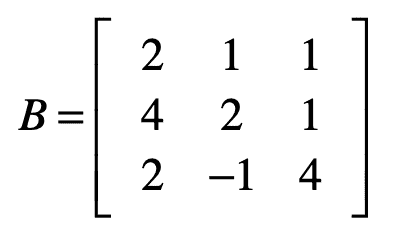

那么，最终我们通过消元，把系数矩阵 B 变为：

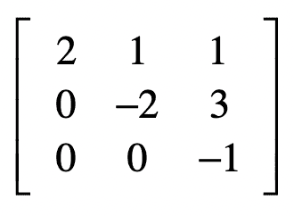

从次可以看出，消元的过程就是把原始的系数矩阵变为上三角矩阵。这里的上三角矩阵表示，矩阵中只有主对角线以及主对角线以上的三角部分里有数字。我们用 UU 表示上三角矩阵。

而回代呢，我们最终得到的结果是：

x1=71x1=71  
 x2=−86x2=−86  
 x3=−56x3=−56

我们可以把这几个结果看作：

1⋅x1+0⋅x2+0⋅x3=711·x1+0·x2+0·x3=71  
 0⋅x1+1⋅x2+0⋅x3=−860·x1+1·x2+0·x3=−86  
 0⋅x1+0⋅x2+1⋅x3=−560·x1+0·x2+1·x3=−56

再把系数写成矩阵的形式，就是：

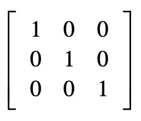

发现没？这其实就是单位矩阵。所以说，回代的过程是把上三角矩阵变为单位矩阵的过程。

为了便于后面的回代计算，我们也可以把方程式等号右边的值加入到系数矩阵，我们称这个新的矩阵为**增广矩阵**，我把这个矩阵记为 AA。

好，现在让我们来观察一下这个增广矩阵 AA。

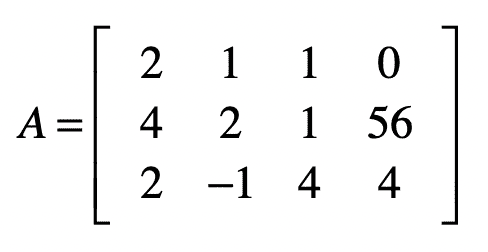

对于这个矩阵，我们的最终目标是，把除了最后一列之外的部分，变成单位矩阵，而此时最后一列中的每个值，就是每个自变量所对应的解了。

之前我已经讲过矩阵相乘在向量空间模型、PageRank 算法和协同过滤推荐中的应用。这里，我们同样可以使用这种操作来进行消元。为了方便你理解，我们可以遵循之前消元的步骤一步步来看。

还记得这个方程组消元的第一步吗？对，首先保持第一个方程不变，然后消除第二个和第三个方程中的 x1x1。这就意味着要把 A2，1A2，1 和 A3A3，11 变为 00。

对于第一个方程式，如果要保持它不变，我们可以让向量 [1,0,0][1,0,0] 左乘 AA。对于第二个方程，具体操作是让第二个方程式减去第一个方程式的两倍，达到消除 x1x1 的目的。我们可以让向量 [−2,1,0][−2,1,0] 左乘 AA。对于第三个方程式，具体操作是让第三个方程式减去第一个方程式，达到消除 x1x1 的目的。我们可以让向量 [−1,0,1][−1,0,1] 左乘 AA。我们使用这三个行向量组成一个矩阵 E1E1。

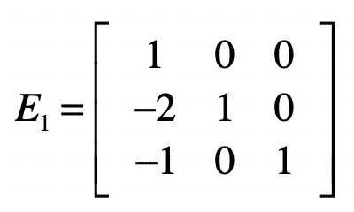

因此，我们可是用下面这个矩阵 E1E1 和 AA 的点乘，来实现消除第二个和第三个方程式中 x1x1 的目的。

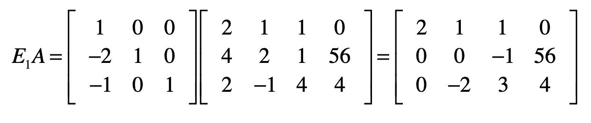

你会发现，由于使用了增广矩阵，矩阵中最右边的一列，也就是方程等号右边的数值也会随之发生改变。

下一步是消除第三个方程中的 x2x2。依照之前的经验，我们要把第二个方程式作为“主元行”，来消除第三个方程中的 x2x2。可是第二个方程中的 x2x2 已经没有了，失去了参照，这个时候我们需要把第二个方程和第三个方程互换。这种互换的操作如何使用矩阵来实现呢？其实不难，例如使用下面这个矩阵 E2E2 左乘增广矩阵 AA。

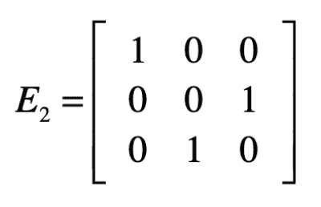

上面这个矩阵第一行 [100][100] 的意思就是我们只取第一行的方程，而第二行 [001][001] 的意思是只取第三个方程，而第三行 [010][010] 表示只取第二个方程。

我们先让 E1E1 左乘 AA，然后再让 E2E2 左乘 E1AE1A 的结果，就能得到消元后的系数矩阵。

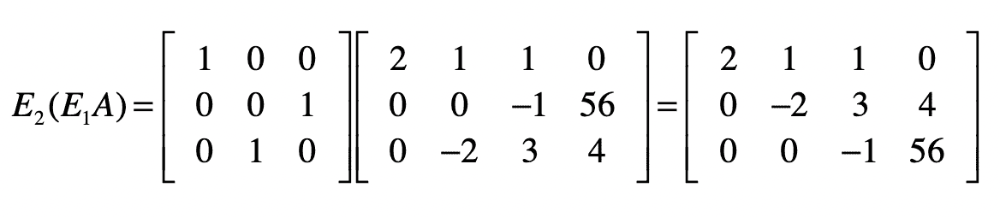

我们把 E1E1 点乘 E2E2 的结果记作 E3E3，并把 E3E3 称为消元矩阵。

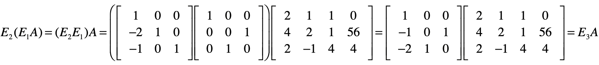

对于目前的结果矩阵来说，除了最后一列，它已经变成了一个上三角矩阵，也就是说消元步骤完成。接下来，我们要使得最后一列之外的部分变成一个单位矩阵，就能得到最终的方程组解。和消元不同的是，我们将从最后一行开始。对于最后一个方程，我们只需要把所有系数取反就行了，所以会使用下面这个矩阵 S1S1 实现。

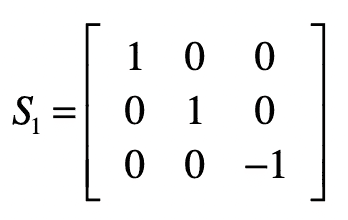

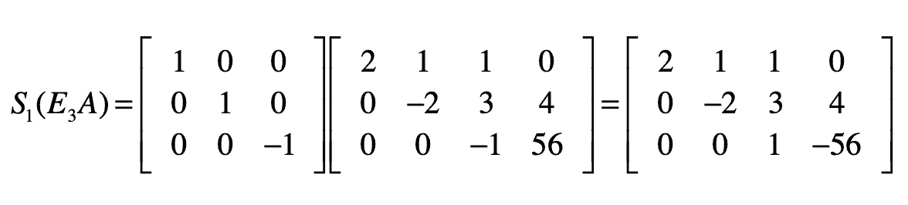

接下来要去掉第二个方程中的 x3x3，我们要把第二个方程减去 3 倍的第三个方程，然后除以 -2。首先是减去 3 倍的第三个方程。

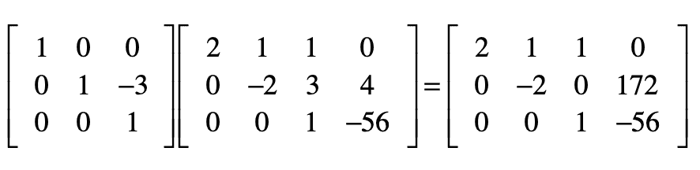

然后把第二个方程除以 -2。

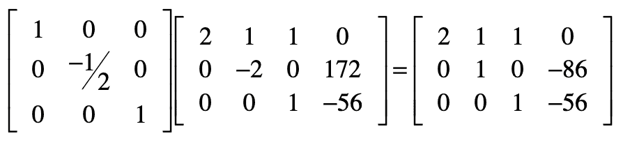

最后，对于第一个方程，我们要把第一个方程减去第二个和第三个方程，最后除以 2，我把这几步合并了，并列在下方。

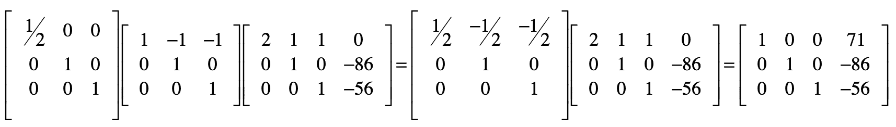

最终，结果矩阵的最后一列就是方程组的解。我们把回代部分的矩阵，都点乘起来。

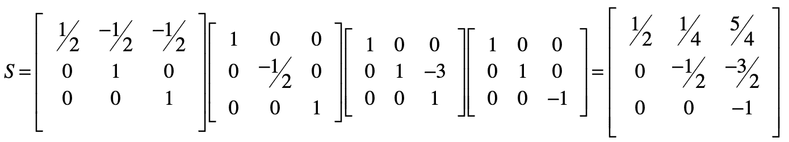

而消元矩阵 E3E3 为：

我们可以让矩阵 SS 左乘矩阵 E3E3，就会得到下面的结果。

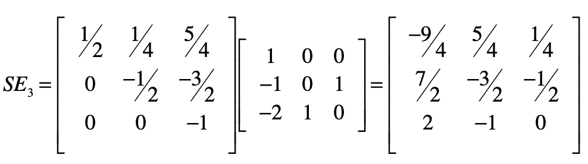

我们把这个矩阵记作 SESE，把乘以最初的系数矩阵 BB，就得到了一个单位矩阵。根据逆矩阵的定义，SESE 就是 BB 的逆矩阵。换个角度来思考，使用消元法进行线性方程组求解的过程，就是在找系数矩阵的逆矩阵的过程。

## 总结

今天我们一起探讨了求解线性方程组最常见的方法之一，高斯消元法。这个方法主要包含了消元和回代两个步骤。这些步骤都可以使用矩阵的操作来进行。从矩阵的角度来说，消元就是把系数矩阵变为上三角矩阵，而回代是把这个上三角矩阵变为单位矩阵。我们可以直接把用于消元和回代的矩阵，用于由系数和因变量值组成的增广矩阵，并获得最终的方程解。

线性方程组的概念，也是线性回归分析的基础。在线性回归时，我们也能获得由很多观测数据值所组成的方程组。但是，在进行线性回归分析时，方程组的处理方式和普通的方程组求解有一些不同。其中有两个最主要的区别。

第一个区别是，在线性回归分析中，样本数据会告诉我们自变量和因变量的值，要求的是系数。而在线性方程组中，我们已知系数和因变量的值，要求的是自变量的值。

第二个区别是，在线性回归分析中，方程的数量要远远大于自变量的数量，而且我们不要求每个方程式都是完全成立。这里，不要求完全成立的意思是，拟合出来的因变量值可以和样本数据给定的因变量值存在差异，也就允许模型拟合存在误差。模型拟合的概念我在上一模块的总结篇中重点讲解了，所以你应该能理解，模型的拟合不可能 100% 完美，这和我们求解线性方程组精确解的概念是不同的。

正是因为这两点差异，我们无法直接使用消元法来求解线性回归。下一节，我会来详细解释，如何使用最小二乘法来解决线性回归的问题。

## 思考题

请分别写出下面这个方程组的消元矩阵和回代矩阵，并求出最终的解。

x1−2x2+x3−4x4=4x1−2x2+x3−4x4=4  
 x2−x3+x4=−3x2−x3+x4=−3  
 x1+3x2+x4=1x1+3x2+x4=1  
 −7x2+3x3+x4=−3−7x2+3x3+x4=−3

欢迎留言和我分享，也欢迎你在留言区写下今天的学习笔记。你可以点击“请朋友读”，把今天的内容分享给你的好友，和他一起精进。

