# 41 | 线性回归（下）：如何使用最小二乘法进行效果验证？

 

你好，我是黄申。

上一节我们已经解释了最小二乘法的核心思想和具体推导过程。今天我们就用实际的数据操练一下，这样你的印象就会更加深刻。我会使用几个具体的例子，演示一下如何使用最小二乘法的结论，通过观测到的自变量和因变量值，来推算系数，并使用这个系数来进行新的预测。

## 基于最小二乘法的求解

假想我们手头上有一个数据集，里面有 3 条数据记录。每条数据记录有 2 维特征，也就是 2 个自变量，和 1 个因变量。

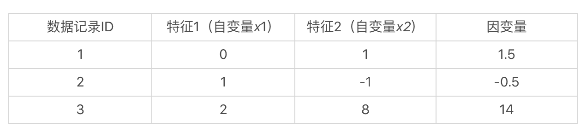

如果我们假设这些自变量和因变量都是线性的关系，那么我们就可以使用如下这种线性方程，来表示数据集中的样本：

b1⋅0+b2⋅1=1.5b1·0+b2·1=1.5  
 b1⋅1−b2⋅1=−0.5b1·1−b2·1=−0.5  
 b1⋅2+b2⋅8=14b1·2+b2·8=14

也就是说，我们通过观察数据已知了自变量 x1x1、x2x2 和因变量 _y_ 的值，而要求解的是 b1b1 和 b2b2 这两个系数。如果我们能求出 b1b1 和 b2b2，那么在处理新数据的时候，就能根据新的自变量 x1x1 和 x2x2 的取值，来预测 yy 的值。

可是我们说过，由实际项目中的数据集所构成的这类方程组，在绝大多数情况下，都没有精确解。所以这个时候我们没法使用之前介绍的高斯消元法，而是要考虑最小二乘法。根据上一节的结论，我们知道对于系数矩阵 BB，有：

B=(X′X)−1X′YB=(X′X)−1X′Y

既然有了这个公式，要求 BB 就不难了，让我们从最基本的几个矩阵开始。

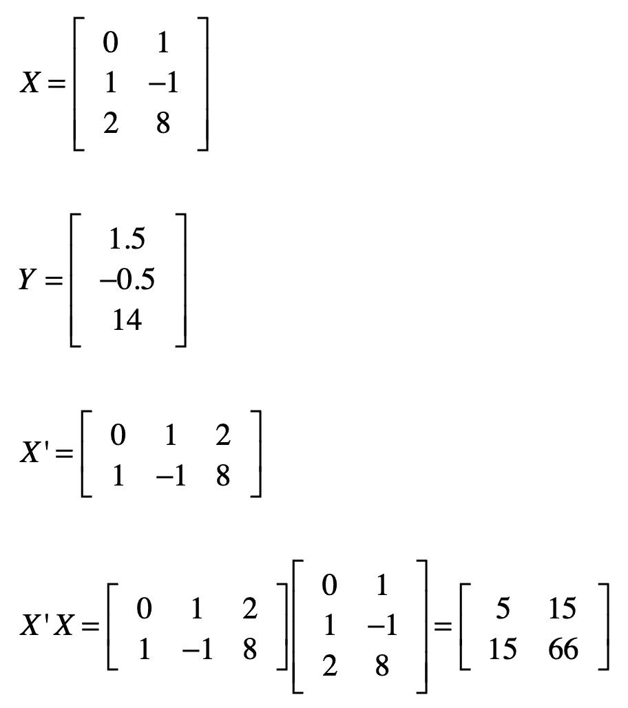

矩阵 (X′X)−1(X′X)−1 的求解稍微繁琐一点。逆矩阵的求法我还没讲解过，之前我们说过线性方程组之中，高斯消元和回代的过程，就是把系数矩阵变为单位矩阵的过程。我们可以利用这点，来求解 X−1X−1。我们把原始的系数矩阵 XX 列在左边，然后把单位矩阵列在右边，像 [X|I][X|I] 这种形式，

其中 II 表示单位矩阵。

然后我们对左侧的矩阵进行高斯消元和回代，把左边矩阵 X 变为单位矩阵。同时，我们也把这个相应的矩阵操作运用在右侧。这样当左侧变为单位矩阵之后，那么右侧的矩阵就是原始矩阵 XX 的逆矩阵 X−1X−1，具体证明如下：

[X|I][X|I]  
 [X−1X|X−1I][X−1X|X−1I]  
 [I|X−1I][I|X−1I]  
 [I|X−1][I|X−1]

好了，给定下面的 X′XX′X 矩阵之后，我们使用上述方法来求 (X′X)−1(X′X)−1 。我把具体的推导过程列在了这里。

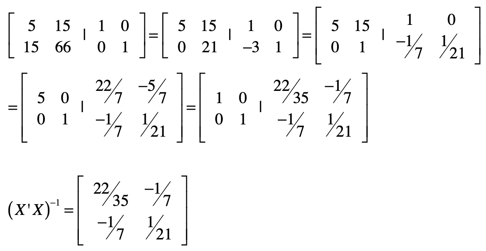

求出 (X′X)−1(X′X)−1 之后，我们就可以使用 B=(X′X)−1X′YB=(X′X)−1X′Y 来计算矩阵 B。

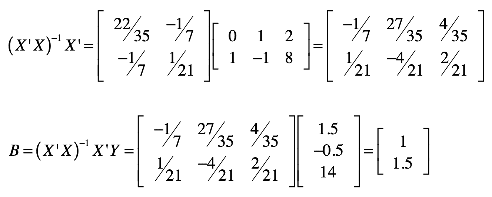

最终，我们求出系数矩阵为 [11.5][11.5]，也就是说 b1=1b1=1, b2=1.5b2=1.5。实际上，这两个数值是精确解。我们用高斯消元也是能获得同样结果的。接下来，让我稍微修改一下 yy 值，让这个方程组没有精确解。

b1⋅0+b2⋅1=1.4b1·0+b2·1=1.4  
 b1⋅1−b2⋅1=−0.48b1·1−b2·1=−0.48  
 b1⋅2+b2⋅8=13.2b1·2+b2·8=13.2

你可以尝试高斯消元法对这个方程组求解，你会发现只要两个方程就能求出解，但是无论是哪两个方程求出的解，都无法满足第三个方程。

那么通过最小二乘法，我们能不能求导一个近似解，保证 _ε_ 足够小呢？下面，让我们遵循之前求解 (X′X)−1X′Y(X′X)−1X′Y 的过程，来计算 BB。

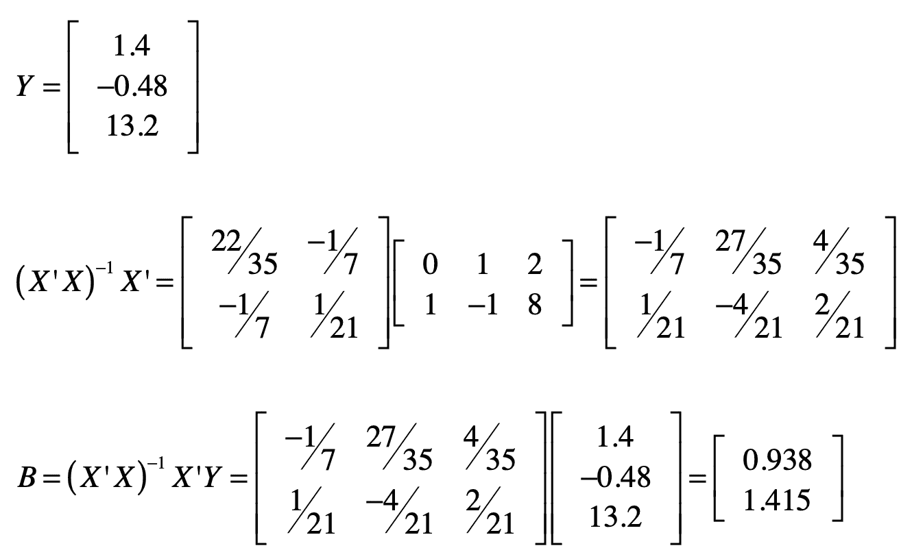

计算完毕之后，你会发现两个系数的值分别变为 b1=0.938,b2=1.415b1=0.938,b2=1.415。由于这不是精确解，所以让我们看看有了这系数矩阵 BB 之后，原有的观测数据中，真实值和预测值的差别。

首先我们通过系数矩阵 BB 和自变量矩阵 XX 计算出来预测值。

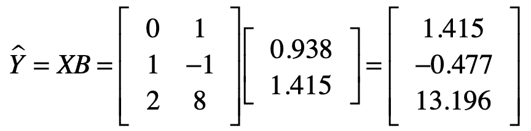

然后是样本数据中的观测值。这里我们假设这些值是真实值。

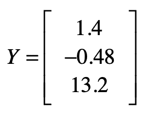

根据误差 εε 的定义，我们可以得到：

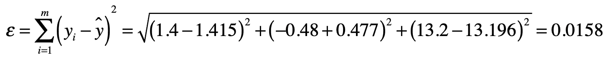

说到这里，你可能会怀疑，通过最小二乘法所求得的系数 b1=0.949b1=0.949 和 b2=1.415b2=1.415，是不是能让 εε 最小呢？这里，我们随机的修改一下这两个系数，变为 b1=0.95b1=0.95 和 b2=1.42b2=1.42，然后我们再次计算预测的 yy 值和 εε。

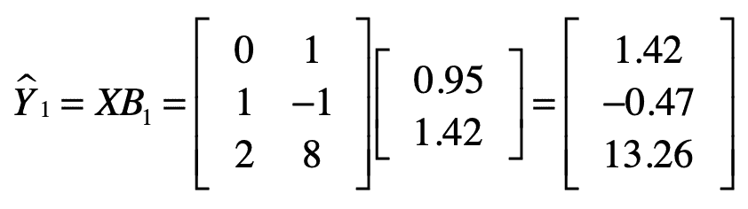

很明显，0.064 是大于之前的 0.0158。

这两次计算预测值 _y_ 的过程，其实也是我们使用线性回归，对新的数据进行预测的过程。简短地总结一下，线性回归模型根据大量的训练样本，推算出系数矩阵 BB，然后根据新数据的自变量 XX 向量或者矩阵，计算出因变量的值，作为新数据的预测。

## Python 代码实现

这一部分，我们使用 Python 的代码，来验证一下之前的推算结果是不是正确，并看看最小二乘法和 Python sklearn 库中的线性回归，这两种结果的对比。

首先，我们使用 Python numpy 库中的矩阵操作来实现最小二乘法。主要的函数操作涉及矩阵的转置、点乘和求逆。具体的代码和注释我列在了下方。

```
from numpy import * x = mat([[0,1],[1,-1],[2,8]])y = mat([[1.4],[-0.48],[13.2]]) # 分别求出矩阵 X'、X'X、(X'X) 的逆# 注意，这里的 I 表示逆矩阵而不是单位矩阵print("X 矩阵的转置 X'：\n", x.transpose())print("\nX'点乘 X：\n", x.transpose().dot(x))print("\nX'X 矩阵的逆\n", (x.transpose().dot(x)).I) print("\nX'X 矩阵的逆点乘 X'\n", (x.transpose().dot(x)).I.dot(x.transpose()))print("\n 系数矩阵 B：\n", (x.transpose().dot(x)).I.dot(x.transpose()).dot(y))
```

通过上述代码，你可以看到每一步的结果，以及最终的矩阵 BB。你可以把输出结果和之前手动推算的结果进行对比，看看是不是一致。

除此之外，我们还可把最小二乘法的线性拟合结果和 sklearn 库中的 LinearRegression().fit() 函数的结果相比较，具体的代码和注释我也放在了这里。

```
import pandas as pdfrom sklearn.linear_model import LinearRegression df = pd.read_csv("/Users/shenhuang/Data/test.csv")df_features = df.drop(['y'], axis=1)     #Dataframe 中除了最后一列，其余列都是特征，或者说自变量df_targets = df['y']                     #Dataframe 最后一列是目标变量，或者说因变量 print(df_features, df_targets)regression = LinearRegression().fit(df_features, df_targets)        # 使用特征和目标数据，拟合线性回归模型print(regression.score(df_features, df_targets))        # 拟合程度的好坏print(regression.intercept_)print(regression.coef_)            # 各个特征所对应的系数
```

其中，test.csv 文件的内容我也列在了这里。

x1,x2,yx1,x2,y  
 0,1,1.40,1,1.4  
 1,−1,−0.481,−1,−0.48  
 2,8,13.22,8,13.2

这样写是为了方便我们使用 pandas 读取 csv 文件并加载为 dataframe。

在最终的结果中，1.0 表示拟合程度非常好，而 -0.014545454545452863 表示一个截距，[0.94909091 1.41454545] 表示系数 b1b1 和 b2b2 的值。这个结果和我们最小二乘法的结果有所差别，主要原因是 LinearRegression().fit() 默认考虑了有线性函数存在截距的情况。那么我们使用最小二乘法是不是也可以考虑有截距的情况呢？答案是肯定的，不过我们首先要略微修改一下方程组和矩阵 XX。如果我们假设有截距存在，那么线性回归方程就要改写为：

b0+b1⋅x1+b2⋅x2+…+bn−1⋅xn−1+bn⋅xn=yb0+b1·x1+b2·x2+…+bn−1·xn−1+bn·xn=y

其中，b0b0 表示截距，而我们这里的方程组用例就要改写为：

b0+b1⋅0+b2⋅1=1.4b0+b1·0+b2·1=1.4  
 b0+b1⋅1−b2⋅1=−0.48b0+b1·1−b2·1=−0.48  
 b0+b1⋅2+b2⋅8=13.2b0+b1·2+b2·8=13.2

而矩阵 XX 要改写为：

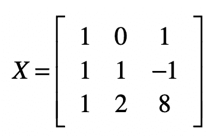

然后我们再执行下面这段代码。

```
from numpy import * x = mat([[1,0,1],[1,1,-1],[1,2,8]])y = mat([[1.4],[-0.48],[13.2]]) print("\n 系数矩阵 B：\n", (x.transpose().dot(x)).I.dot(x.transpose()).dot(y))
```

你就会得到：

```
 系数矩阵 B：     [[-0.01454545]     [ 0.94909091]     [ 1.41454545]] 
```

这个结果和 LinearRegression().fit() 的结果就一致了。

需要注意的是，使用线性回归的时候，我们都有一个前提假设，那就是数据的自变量和因变量之间现线性关系。如果不是线性关系，那么使用线性模型来拟合的效果一定不好。比如，之前在解释欠拟合的时候，我用过下面这个例子。

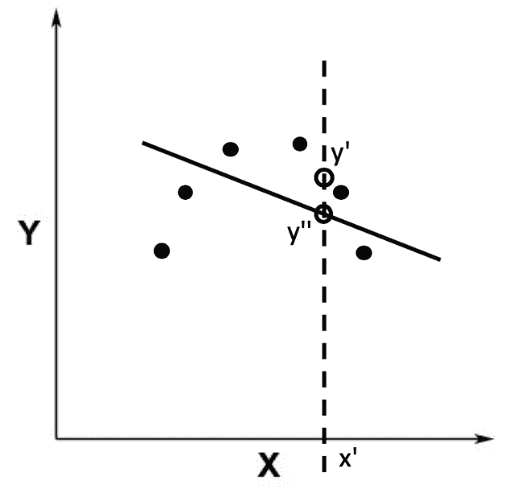

上面这张图的数据分布并没有表达线性关系，所以我们需要对原始的数据进行非线性的变换，或者是使用非线性的模型来拟合。

那么，我们如何判断一个数据集是不是能用线性模型表示呢？在线性回归中，我们可以使用决定系数 R2。这个统计指标使用了回归平方和与总平方和之比，是反映模型拟合度的重要指标。它的取值在 0 到 1 之间，越接近于 1 表示拟合的程度越好、数据分布越接近线性关系。随着自变量个数的增加，R2 将不断增大，因此我们还需要考虑方程所包含的自变量个数对 R2 的影响，这个时候可使用校正的决定系数 Rc2。所以，在使用各种科学计算库进行线性回归时，你需要关注 R2 或者 Rc2，来看看是不是一个好的线性拟合。在之前的代码实践中，我们提到的 regression.score 函数，其实就是返回了线性回归的 R2。

## 总结

今天我们使用了具体的案例来推导最小二乘法的计算过程，并用 Python 代码进行了验证。通过最近 3 节的讲解，相信你对线性方程组求精确解、求近似解、以及如何在线性回归中运用这些方法，有了更加深入的理解。

实际上，从广义上来说，最小二乘法不仅可以用于线性回归，还可以用于非线性的回归。其主要思想还是要确保误差ε最小，但是由于现在的函数是非线性的，所以不能使用求多元方程求解的办法来得到参数估计值，而需要采用迭代的优化算法来求解，比如梯度下降法、随机梯度下降法和牛顿法。

## 思考题

我这里给出一个新的方程组，请通过最小二乘法推算出系数的近似解，并使用你熟悉的语言进行验证。

b1+b2⋅3+b3⋅(−7)=−7.5b1+b2·3+b3·(−7)=−7.5  
 b1⋅2+b2⋅5+b3⋅4=5.2b1·2+b2·5+b3·4=5.2  
 b1⋅(−3)+b2⋅(−7)+b3⋅(−2)=−7.5b1·(−3)+b2·(−7)+b3·(−2)=−7.5  
 b1⋅1+b2⋅4+b3⋅(−12)=−15b1·1+b2·4+b3·(−12)=−15

欢迎留言和我分享，也欢迎你在留言区写下今天的学习笔记。你可以点击“请朋友读”，把今天的内容分享给你的好友，和他一起精进。


