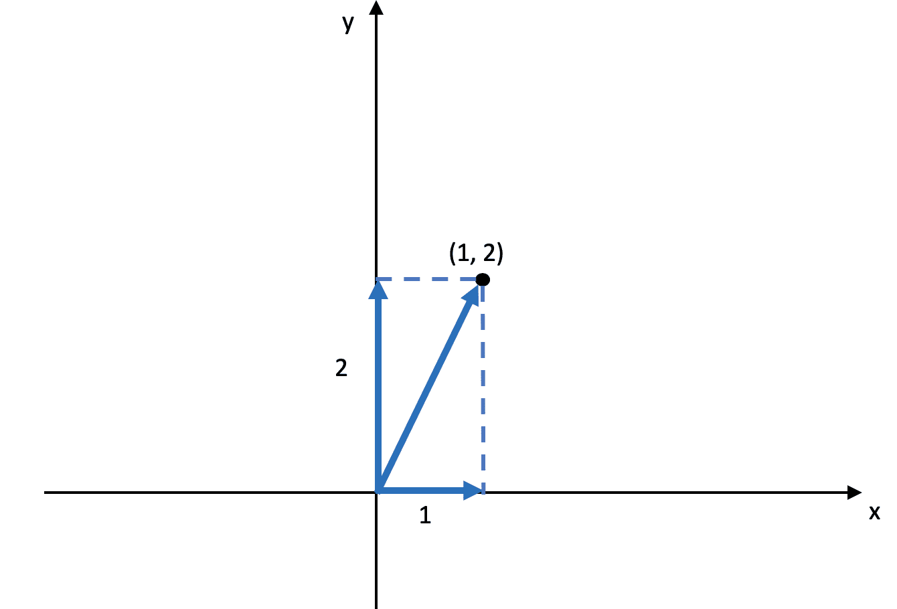
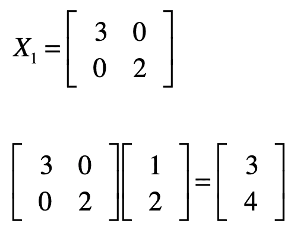
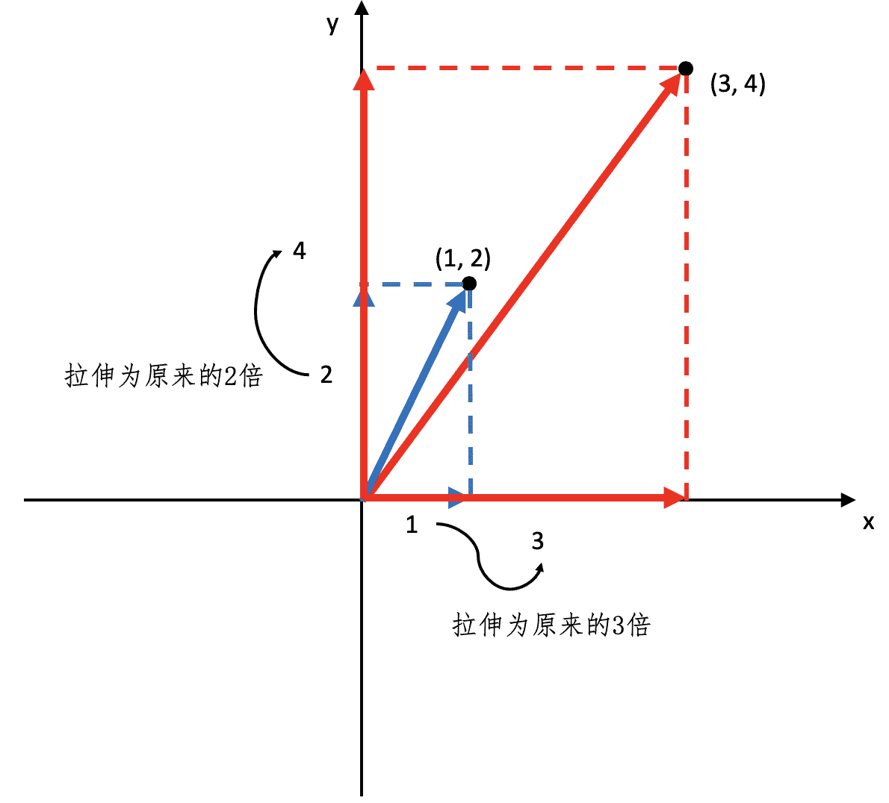
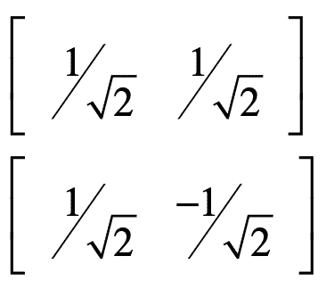
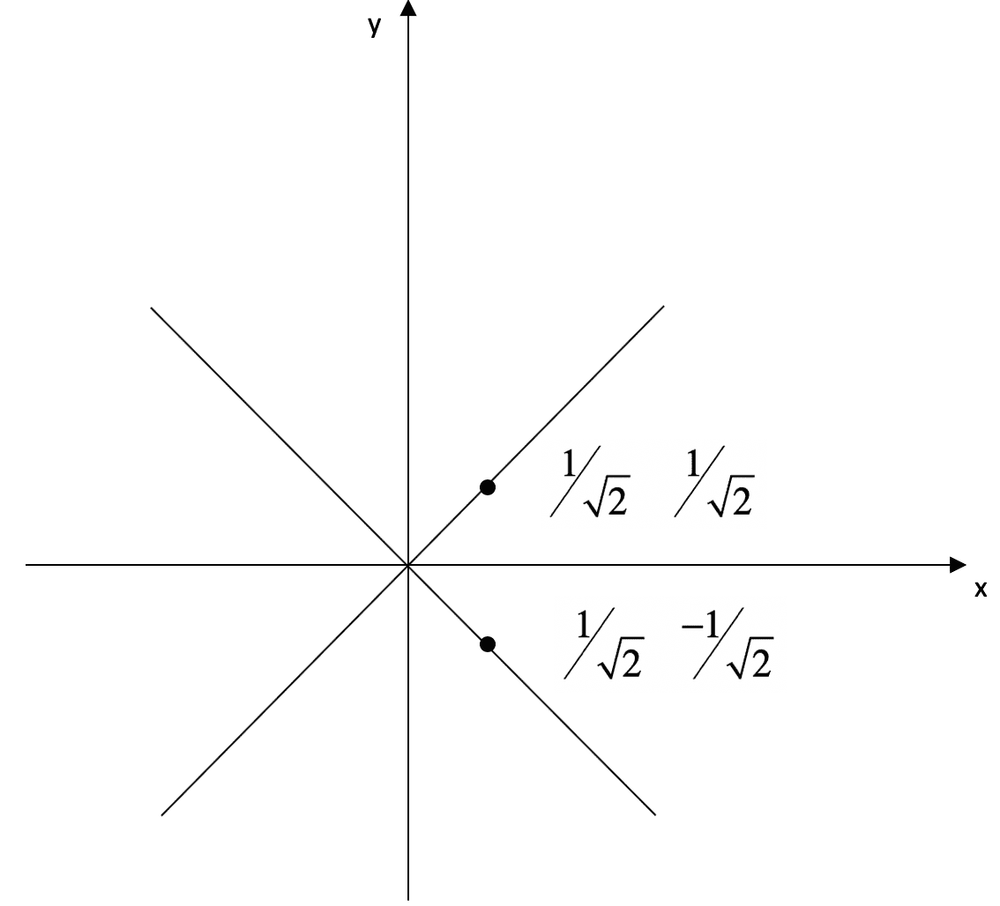
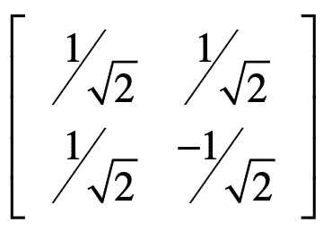
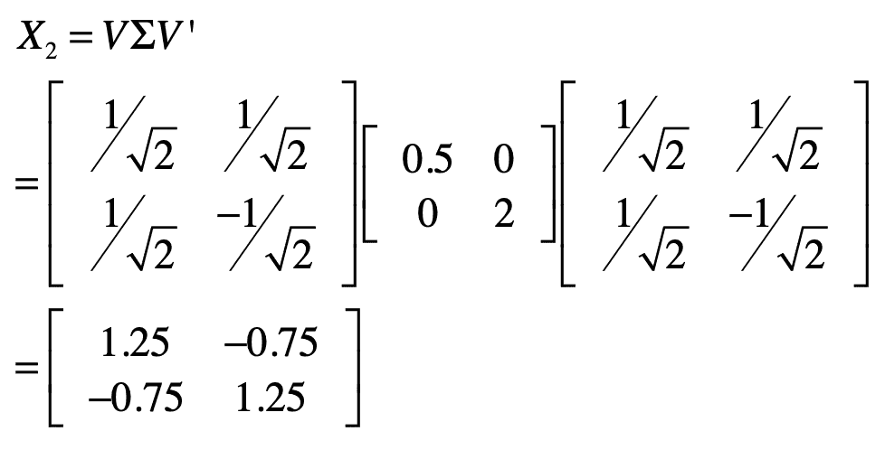
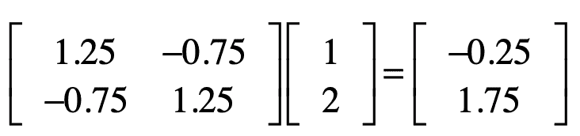
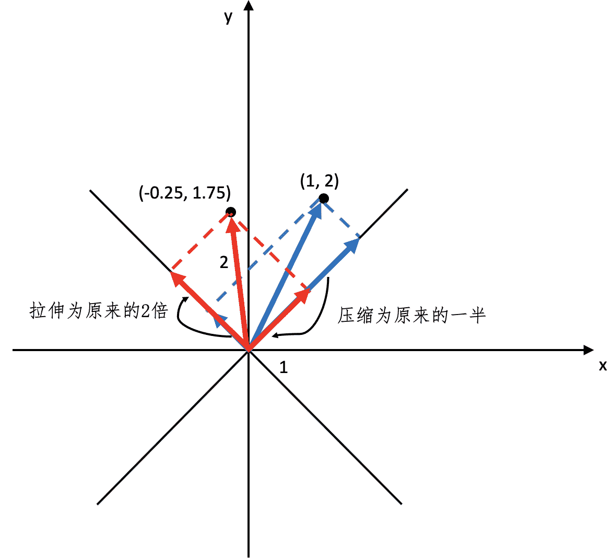

# 45 | 线性代数篇答疑和总结：矩阵乘法的几何意义是什么？

 

你好，我是黄申。今天是线性代数的答疑和总结。

在这个模块中，我们讲了不少向量、矩阵、线性方程相关的内容。看到大家在留言区的问题，今天我重点说说矩阵乘法的几何意义，以及为什么 SVD 中 X′XX′X 的特征向量组成了 VV 矩阵，而 XX′XX′ 的特征向量组成了 UU 矩阵。最后，我会对整个线性代数的模块做一个总结。

## 矩阵乘法的几何意义

首先，我们来说说矩阵乘法所代表的几何意义。

在阐述 PCA 主成分分析的时候，我们聊过为什么这个方法要研究协方差矩阵的特征值和特征向量。其中，我提到对某个向量左乘一个矩阵，实际上是对这个向量进行了一次变换。某个矩阵的特征向量表示了这个矩阵在空间中的变换方向，这些方向都是正交或者趋于正交的，而特征值表示每个方向上伸缩的比例。今天，我会继续深入这个话题，结合实例，给出更详细地解释。

多维的向量空间很难理解，所以我们还是从最简答的二维空间开始。首先，我们需要明白什么是二维空间中的正交向量。正交向量的定义非常简单，只要两个向量的点乘结果为 0，那么它们就是正交的。在酉矩阵之中，矩阵和矩阵的转置相乘为单位矩阵，只有向量自己点乘自己值为 1，而不同向量之间点乘值为 0，所以不同的向量之间是正交的。

理解了正交向量之后，我们来定义一个二维空间，这个空间的横坐标为 xx，纵坐标为 yy，空间中的一个点坐标为 (1,2)(1,2)，对于这个点，我们可以把从原点到它的直线投影到 xx 轴和 yy 轴，这个直线在 xx 轴上投影的长度为 1，在 y 轴上投影的长度为 2。我使用下图来表示。

对于这个点，我们使用一个矩阵 X1X1 左乘这个点的坐标，你可以看看会发生什么。

我们把结果转成坐标系里的点，它的坐标是 (3,4)(3,4)，把从原点到 (1,2)(1,2) 的直线，和从原点到 (3,4)(3,4) 的直线进行比较，你会发现直线发生了旋转，而且长度也发生了变化，这就是矩阵左乘所对应的几何意义。我们还可以对这个矩阵 X1X1 分析一下，看看它到底表示了什么含义，以及为什么它会导致直线的旋转和长度发生变化。

之前我讲过，要看一个矩阵的特征，需要分析它的特征向量和特征值。由于矩阵 X1X1 是一个对角矩阵，所以特征值很容易求解，分别是 3 和 2。而对应的特征向量是 [1,0][1,0] 和 [0,1][0,1]。在二维坐标中，坐标 [1, 0] 实际上表示的是 xx 轴的方向，而 [0, 1] 实际上表示的是 yy 轴的方向。特征值 3 对应特征向量 [1, 0] 就表明在 xx 轴方向拉伸为原来的 3 倍，特征值 2 对应特征向量 [0, 1] 就表明在 yy 轴方向拉伸 2 倍。所以，矩阵 X1X1 的左乘，就表示把原有向量在 xx 轴上拉伸为原来的 3 倍，而在 yy 轴上拉伸为原来的 2 倍。我用下面这张图来展示。

我们还可以从另一个角度来验证这点，把从原点到 (3,4)(3,4) 的直线进行分解，我们会发现这个直线在 xx 轴上投影的长度为 3，为原来的 3 倍，而在 yy 轴上投影的长度为 4，为原来的 2 倍。

当然，矩阵的特征向量不一定是 xx 轴和 yy 轴，它们可以是二维空间中任何相互正交的向量。下面，我们再来看一个稍微复杂一点的例子。这次我们从两个正交的向量开始。

我使用下面这张图展示了这两个向量在空间的方向。

然后我用这两个向量构建一个矩阵 VV。

之所以使用这样一个例子，是因为 VV 是一个酉矩阵，也就是说 VV′=IVV′=I，所以我们可以使用它，外加一个特征值组成的对角矩阵 ΣΣ，来构建另一个用于测试的矩阵 X2X2。我在 SVD 的那一讲，介绍过对称方阵可以进行特征值分解，所以我们可以通过 VV 和 ΣΣ，获得一个对称方阵 X2=VΣV′X2=VΣV′。

我们假设两个特征值分别是 0.5 和 2，所以有：

根据我们之间的解释，如果让这个矩阵 X2X2 左乘任何一个向量，就是让向量沿 [12√12√][1212] 方向压缩一半，而在 [12√−12√][12−12] 方向增加两倍。为了验证这一点，我们让 X2X2 左乘向量 (1,2)(1,2)，获得新向量：

把这个新的坐标 (−0.25,1.75)(−0.25,1.75) 和原坐标 (1,2)(1,2) 都放到二维坐标系中，并让它们分别在 [12√12√][1212] 和 [12√−12√][12−12] 这两个方向进行投影，然后比较一下投影的长度，你就会发现伸缩的变化了。我使用下面这张图来帮你理解。

弄清楚了矩阵左乘向量的几何意义，那么矩阵左乘矩阵的几何意义也就不难理解了。假设我们让矩阵 XX 左乘矩阵 YY，那么可以把右矩阵 YY 看作一堆列向量的集合，而左乘矩阵 XX 就是对每个 YY 中的列向量进行变换。另外，如果二维空间理解了，那么三维、四维直到 nn 维空间就可以以此类推了。

## SVD 分解中的 UU 和 VV 矩阵

在讲解 SVD 奇异值分解的时候，我们解释了 X′XX′X 的特征向量组成了 SVD 中的 VV 矩阵，而 XX′XX′ 的特征向量组成了 SVD 中的 UU 矩阵。不过，我们还没有证明这两点。今天我来说说如何证明它们。首先，我们来看看 VV 矩阵的证明。

X=UΣV′X=UΣV′  
 X=UΣ′V′X=UΣ′V′  
 X′X=(VΣ′U)(UΣV′)=VΣ′(U′U)Σ′V′=VΣ2V′)X′X=(VΣ′U)(UΣV′)=VΣ′(U′U)Σ′V′=VΣ2V′)

其中，(UΣV′)′=VΣ′U′(UΣV′)′=VΣ′U′ 的证明，我们在最小二乘法的讲解过程中证明过。另外，UU 是酉矩阵，所以 U′U=IU′U=I。ΣΣ 是对角矩阵，所以 Σ′Σ=Σ2Σ′Σ=Σ2，而且 Σ2Σ2 仍然是对角矩阵。

由于 Σ2Σ2 是对角矩阵，所以通过 X′X=VΣ2V′X′X=VΣ2V′，我们可以看出 VV 中的向量就是 X′XX′X 的特征向量，而特征值是 Σ2Σ2 对角线上的值。

同理，我们也可以证明 UU 中的向量就是 XX′XX′ 的特征向量。

X=UΣV′X=UΣV′  
 X′=UΣ′V′X′=UΣ′V′  
 XX′=(UΣV′)(VΣ′U′)=UΣ(V′V)Σ′U′=UΣ2U′)XX′=(UΣV′)(VΣ′U′)=UΣ(V′V)Σ′U′=UΣ2U′)

从这个证明的过程，我们也发现了，XX’或者 X’X 特征值矩阵等于奇异值矩阵的平方，也就是说我们可以通过求出 X’X 特征值的平方根来求奇异值。

## 总结

回答完两个问题之后，我来总结一下线性代数这个模块。

线性代数最基本的概念包括了向量、矩阵以及对应的操作。向量表示了一组数的概念，非常适合表示一个对象的多维特征，因此被广泛的运用在信息检索和机器学习的领域中。而矩阵又包含了多个向量，所以适合表示多个数据对象的集合。同时，矩阵也可以用于表达二维关系，例如网页的邻接矩阵，用户对物品的喜好程度，关键词在文档中的 tf-idf 等等。

由于向量和矩阵的特性，我们可以把它们运用在很多算法和模型之中。向量空间模型定义了向量之间的距离或者余弦夹角，我们可以利用这些指标来衡量数据对象之间的相似程度，并把这种相似程度用于定义查询和文档之间的相关性，或者是文档聚类时的归属关系。矩阵的运算体现了对多个向量同时进行的操作，比如最常见的左乘，就可以用在计算 PageRank 值，协同过滤中的用户或者物品相似度等等。

当然，矩阵的运用还不止计算数据对象之间的关系。最小二乘法的实现、PCA 主成分的分析、SVD 奇异值的分解也可以基于矩阵的运算。这些都可以帮助我们发现不同维度特征之间的关系，并利用这些关系找到哪些特征更为重要，选择或者创建更为重要的特征。

有的时候，线性代数涉及的公式和推导比较繁琐。在思考的过程中，我们可以把矩阵的操作简化为向量之间的操作，而把向量之间的操作简化为多个变量之间的运算。另外，我们可以多结合实际的案例，结合几何空间、动手推算，甚至可以编程实现某些关键的模块，这些都有利于理解和记忆。

## 思考题

我想听你说说，学习完了编程领域中常用的线性代数知识，你有哪些收获和心得？

欢迎留言和我分享，也欢迎你在留言区写下今天的学习笔记。你可以点击“请朋友读”，把今天的内容分享给你的好友，和他一起精进。

