# 16 | HTTP/2是怎样提升性能的？

 

你好，我是陶辉。

上一讲我们从多个角度优化 HTTP/1 的性能，但获得的收益都较为有限，而直接将其升级到兼容 HTTP/1 的 HTTP/2 协议，性能会获得非常大的提升。

HTTP/2 协议既降低了传输时延也提升了并发性，已经被主流站点广泛使用。多数 HTTP 头部都可以被压缩 90% 以上的体积，这节约了带宽也提升了用户体验，像 Google 的高性能协议 gRPC 也是基于 HTTP/2 协议实现的。

目前常用的 Web 中间件都已支持 HTTP/2 协议，然而如果你不清楚它的原理，对于 Nginx、Tomcat 等中间件新增的流、推送、消息优先级等 HTTP/2 配置项，你就不知是否需要调整。

同时，许多新协议都会参考 HTTP/2 优秀的设计，如果你不清楚 HTTP/2 的性能究竟高在哪里，也就很难对当下其他应用层协议触类旁通。而且，HTTP/2 协议也并不是毫无缺点，到 2020 年 3 月时它的替代协议HTTP/3 已经经历了27 个草案，推出在即。HTTP/3 的目标是优化传输层协议，它会保留 HTTP/2 协议在应用层上的优秀设计。如果你不懂 HTTP/2，也就很难学会未来的 HTTP/3 协议。

所以，这一讲我们就将介绍 HTTP/2 对 HTTP/1.1 协议都做了哪些改进，从消息的编码、传输等角度说清楚性能提升点，这样，你就能理解支持 HTTP/2 的中间件为什么会提供那些参数，以及如何权衡 HTTP/2 带来的收益与付出的升级成本。

## 静态表编码能节约多少带宽？

HTTP/1.1 协议最为人诟病的是 ASCII 头部编码效率太低，浪费了大量带宽。HTTP/2 使用了静态表、动态表两种编码技术（合称为 HPACK），极大地降低了 HTTP 头部的体积，搞清楚编码流程，你自然就会清楚服务器提供的 http2_max_requests 等配置参数的意义。

我们以一个具体的例子来观察编码流程。每一个 HTTP/1.1 请求都会有 Host 头部，它指示了站点的域名，比如：

```
Host: test.taohui.tech\r\n
```

算上冒号空格以及结尾的\r\n，它占用了 24 字节。**使用静态表及 Huffman 编码，可以将它压缩为 13 字节，也就是节约了 46% 的带宽！**这是如何做到的呢？

我用 Chrome 访问站点 test.taohui.tech，并用 Wireshark 工具抓包（关于如何用 Wireshark 抓 HTTP/2 协议的报文，如果你还不太清楚，可参见《Web 协议详解与抓包实战》第 51 课）后，下图高亮的头部就是第 1 个请求的 Host 头部，其中每 8 个蓝色的二进制位是 1 个字节，报文中用了 13 个字节表示 Host 头部。

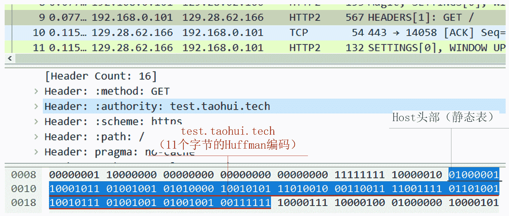

HTTP/2 能够用 13 个字节编码原先的 24 个字节，是依赖下面这 3 个技术。

首先基于二进制编码，就不需要冒号、空格和\r\n 作为分隔符，转而用表示长度的 1 个字节来分隔即可。比如，上图中的 01000001 就表示 Host，而 10001011 及随后的 11 个字节表示域名。

其次，使用静态表来描述 Host 头部。什么是静态表呢？HTTP/2 将 61 个高频出现的头部，比如描述浏览器的 User-Agent、GET 或 POST 方法、返回的 200 SUCCESS 响应等，分别对应 1 个数字再构造出 1 张表，并写入 HTTP/2 客户端与服务器的代码中。由于它不会变化，所以也称为静态表。

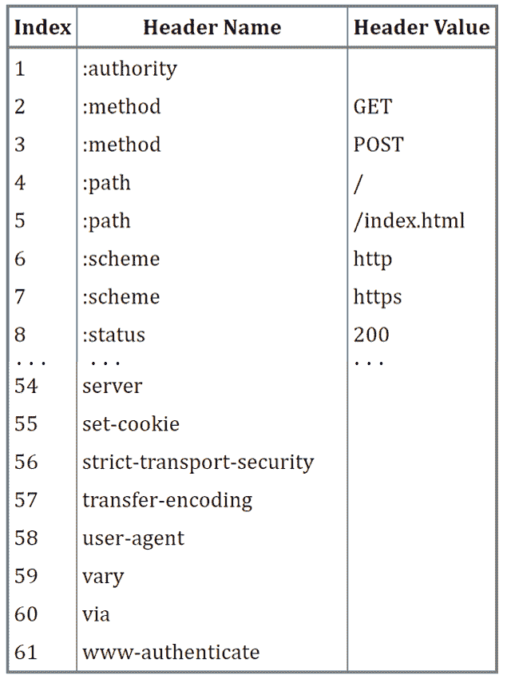

这样收到 01000001 时，根据RFC7541 规范，前 2 位为 01 时，表示这是不包含 Value 的静态表头部：

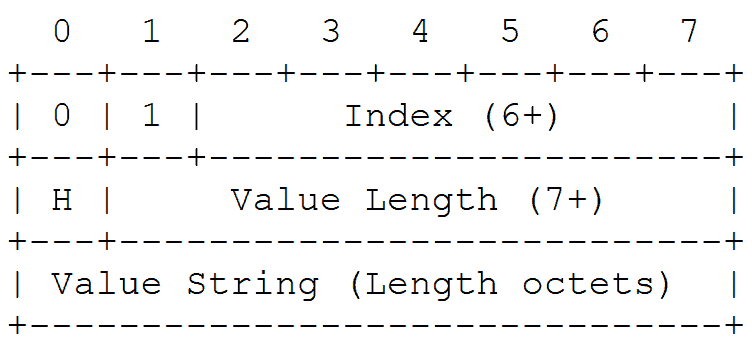

再根据索引 000001 查到 authority 头部（Host 头部在 HTTP/2 协议中被改名为 authority）。紧跟的字节表示域名，其中首个比特位表示域名是否经过 Huffman 编码，而后 7 位表示了域名的长度。在本例中，10001011 表示域名共有 11 个字节（8+2+1=11），且使用了 Huffman 编码。

最后，使用静态 Huffman 编码，可以将 16 个字节的 test.taohui.tech 压缩为 11 个字节，这是怎么做到的呢？根据信息论，高频出现的信息用较短的编码表示后，可以压缩体积。因此，在统计互联网上传输的大量 HTTP 头部后，HTTP/2 依据统计频率将 ASCII 码重新编码为一张表，参见这里。test.taohui.tech 域名用到了 10 个字符，我把这 10 个字符的编码列在下表中。

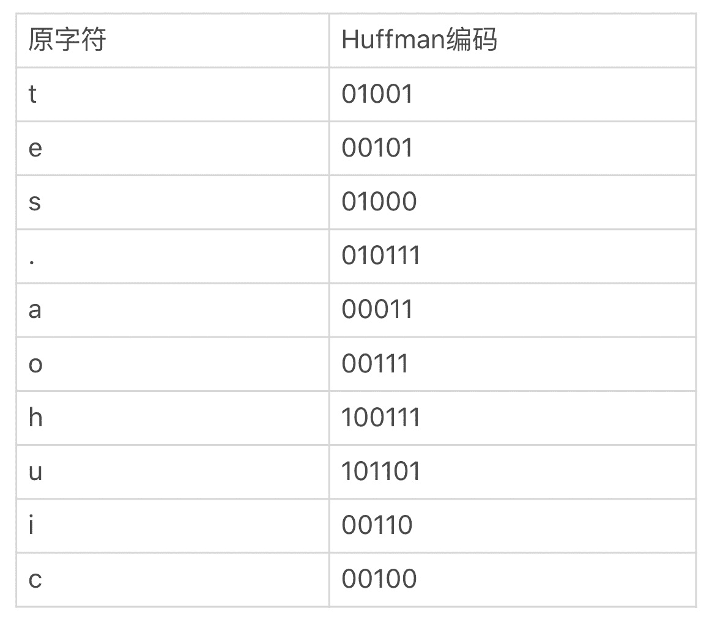

这样，接收端在收到下面这串比特位（最后 3 位填 1 补位）后，通过查表（请注意每个字符的颜色与比特位是一一对应的）就可以快速解码为：

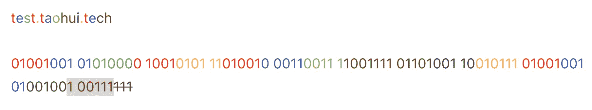

由于 8 位的 ASCII 码最小压缩为 5 位，所以静态 Huffman 的最大压缩比只有 5/8。关于 Huffman 编码是如何构造的，你可以参见每日一课《HTTP/2 能带来哪些性能提升？》。

## 动态表编码能节约多少带宽？

虽然静态表已经将 24 字节的 Host 头部压缩到 13 字节，**但动态表可以将它压缩到仅 1 字节，这就能节省 96% 的带宽！**那动态表是怎么做到的呢？

你可能注意到，当下许多页面含有上百个对象，而 REST 架构的无状态特性，要求下载每个对象时都得携带完整的 HTTP 头部。如果 HTTP/2 能在一个连接上传输所有对象，那么只要客户端与服务器按照同样的规则，对首次出现的 HTTP 头部用一个数字标识，随后再传输它时只传递数字即可，这就可以实现几十倍的压缩率。所有被缓存的头部及其标识数字会构成一张表，它与已经传输过的请求有关，是动态变化的，因此被称为动态表。

静态表有 61 项，所以动态表的索引会从 62 起步。比如下图中的报文中，访问 test.taohui.tech 的第 1 个请求有 13 个头部需要加入动态表。其中，Host: test.taohui.tech 被分配到的动态表索引是 74（索引号是倒着分配的）。

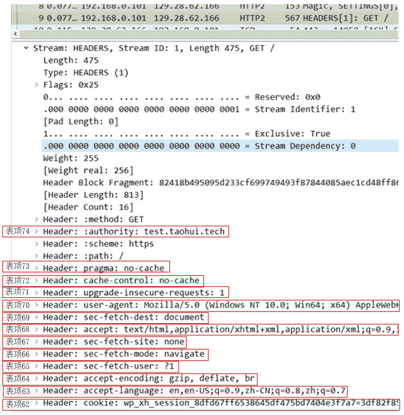

这样，后续请求使用到 Host 头部时，只需传输 1 个字节 11001010 即可。其中，首位 1 表示它在动态表中，而后 7 位 1001010 值为 64+8+2=74，指向服务器缓存的动态表第 74 项：

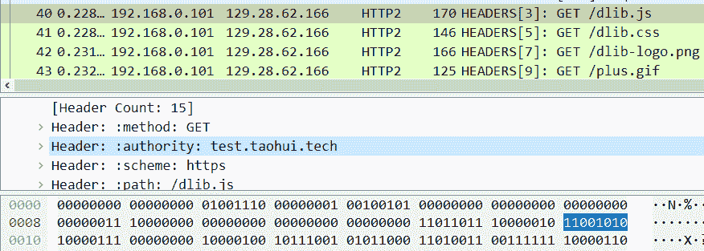

静态表、Huffman 编码、动态表共同完成了 HTTP/2 头部的编码，其中，前两者可以将体积压缩近一半，而后者可以将反复传输的头部压缩 95% 以上的体积！

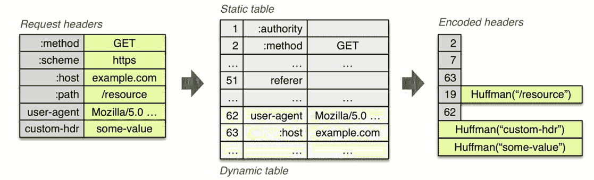

那么，是否要让一条连接传输尽量多的请求呢？并不是这样。动态表会占用很多内存，影响进程的并发能力，所以服务器都会提供类似 http2_max_requests 这样的配置，限制一个连接上能够传输的请求数量，通过关闭 HTTP/2 连接来释放内存。**因此，http2_max_requests 并不是越大越好，通常我们应当根据用户浏览页面时访问的对象数量来设定这个值。**

## 如何并发传输请求？

HTTP/1.1 中的 KeepAlive 长连接虽然可以传输很多请求，但它的吞吐量很低，因为在发出请求等待响应的那段时间里，这个长连接不能做任何事！而 HTTP/2 通过 Stream 这一设计，允许请求并发传输。因此，HTTP/1.1 时代 Chrome 通过 6 个连接访问页面的速度，远远比不上 HTTP/2 单连接的速度，具体测试结果你可以参考这个页面。

为了理解 HTTP/2 的并发是怎样实现的，你需要了解 Stream、Message、Frame 这 3 个概念。HTTP 请求和响应都被称为 Message 消息，它由 HTTP 头部和包体构成，承载这二者的叫做 Frame 帧，它是 HTTP/2 中的最小实体。Frame 的长度是受限的，比如 Nginx 中默认限制为 8K（http2_chunk_size 配置），因此我们可以得出 2 个结论：HTTP 消息可以由多个 Frame 构成，以及 1 个 Frame 可以由多个 TCP 报文构成（TCP MSS 通常小于 1.5K）。

再来看 Stream 流，它与 HTTP/1.1 中的 TCP 连接非常相似，当 Stream 作为短连接时，传输完一个请求和响应后就会关闭；当它作为长连接存在时，多个请求之间必须串行传输。在 HTTP/2 连接上，理论上可以同时运行无数个 Stream，这就是 HTTP/2 的多路复用能力，它通过 Stream 实现了请求的并发传输。

[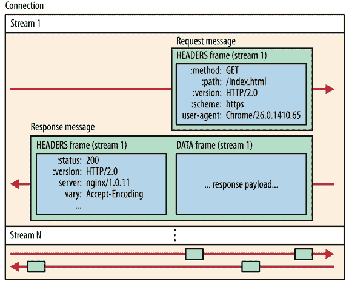](https://developers.google.com/web/fundamentals/performance/http2)
图片来源：https://developers.google.com/web/fundamentals/performance/http2

虽然 RFC 规范并没有限制并发 Stream 的数量，但服务器通常都会作出限制，比如 Nginx 就默认限制并发 Stream 为 128 个（http2_max_concurrent_streams 配置），以防止并发 Stream 消耗过多的内存，影响了服务器处理其他连接的能力。

HTTP/2 的并发性能比 HTTP/1.1 通过 TCP 连接实现并发要高。这是因为，**当 HTTP/2 实现 100 个并发 Stream 时，只经历 1 次 TCP 握手、1 次 TCP 慢启动以及 1 次 TLS 握手，但 100 个 TCP 连接会把上述 3 个过程都放大 100 倍！**

HTTP/2 还可以为每个 Stream 配置 1 到 256 的权重，权重越高服务器就会为 Stream 分配更多的内存、流量，这样按照资源渲染的优先级为并发 Stream 设置权重后，就可以让用户获得更好的体验。而且，Stream 间还可以有依赖关系，比如若资源 A、B 依赖资源 C，那么设置传输 A、B 的 Stream 依赖传输 C 的 Stream 即可，如下图所示：

[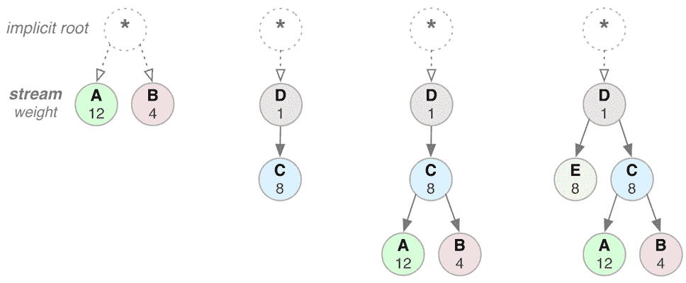](https://developers.google.com/web/fundamentals/performance/http2)
图片来源：https://developers.google.com/web/fundamentals/performance/http2

## 服务器如何主动推送资源？

HTTP/1.1 不支持服务器主动推送消息，因此当客户端需要获取通知时，只能通过定时器不断地拉取消息。HTTP/2 的消息推送结束了无效率的定时拉取，节约了大量带宽和服务器资源。

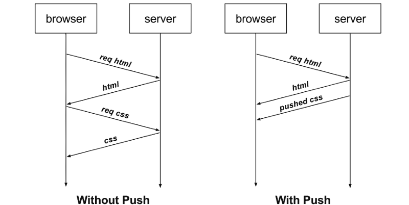

HTTP/2 的推送是这么实现的。首先，所有客户端发起的请求，必须使用单号 Stream 承载；其次，所有服务器进行的推送，必须使用双号 Stream 承载；最后，服务器推送消息时，会通过 PUSH_PROMISE 帧传输 HTTP 头部，并通过 Promised Stream ID 告知客户端，接下来会在哪个双号 Stream 中发送包体。

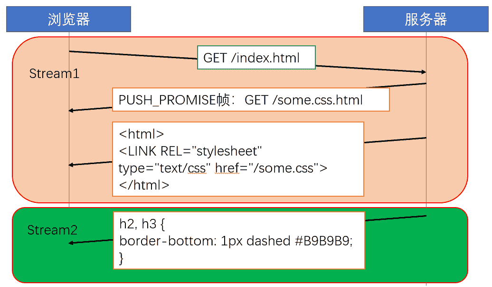

在 SDK 中调用相应的 API 即可推送消息，而在 Web 资源服务器中可以通过配置文件做简单的资源推送。比如在 Nginx 中，如果你希望客户端访问 /a.js 时，服务器直接推送 /b.js，那么可以这么配置：

```
location /a.js {   
  http2_push /b.js;   
}
```

服务器同样也会控制并发推送的 Stream 数量（如 http2_max_concurrent_pushes 配置），以减少动态表对内存的占用。

## 小结

这一讲我们介绍了 HTTP/2 的高性能是如何实现的。

静态表和 Huffman 编码可以将 HTTP 头部压缩近一半的体积，但这只是连接上第 1 个请求的压缩比。后续请求头部通过动态表可以压缩 90% 以上，这大大提升了编码效率。当然，动态表也会导致内存占用过大，影响服务器的总体并发能力，因此服务器会限制 HTTP/2 连接的使用时长。

HTTP/2 的另一个优势是实现了 Stream 并发，这节约了 TCP 和 TLS 协议的握手时间，并减少了 TCP 的慢启动阶段对流量的影响。同时，Stream 之间可以用 Weight 权重调节优先级，还可以直接设置 Stream 间的依赖关系，这样接收端就可以获得更优秀的体验。

HTTP/2 支持消息推送，从 HTTP/1.1 的拉模式到推模式，信息传输效率有了巨大的提升。HTTP/2 推消息时，会使用 PUSH_PROMISE 帧传输头部，并用双号的 Stream 来传递包体，了解这一点对定位复杂的网络问题很有帮助。

HTTP/2 的最大问题来自于它下层的 TCP 协议。由于 TCP 是字符流协议，在前 1 字符未到达时，后接收到的字符只能存放在内核的缓冲区里，即使它们是并发的 Stream，应用层的 HTTP/2 协议也无法收到失序的报文，这就叫做队头阻塞问题。解决方案是放弃 TCP 协议，转而使用 UDP 协议作为传输层协议，这就是 HTTP/3 协议的由来。

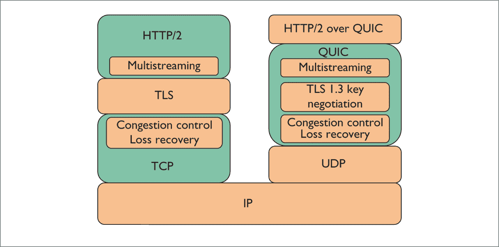

## 思考题

最后，留给你一道思考题。为什么 HTTP/2 要用静态 Huffman 查表法对字符串编码，基于连接上的历史数据统计信息做动态 Huffman 编码不是更有效率吗？欢迎你在留言区与我一起探讨。

感谢阅读，如果你觉得这节课对你有一些启发，也欢迎把它分享给你的朋友。
