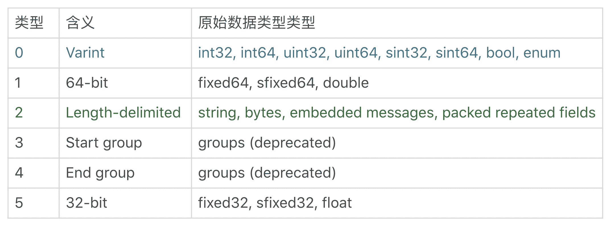
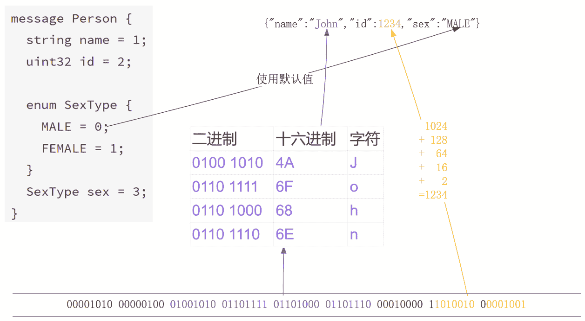
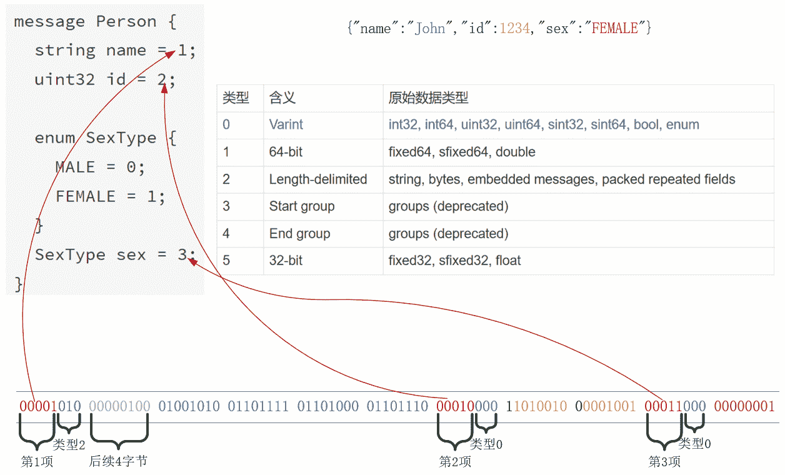
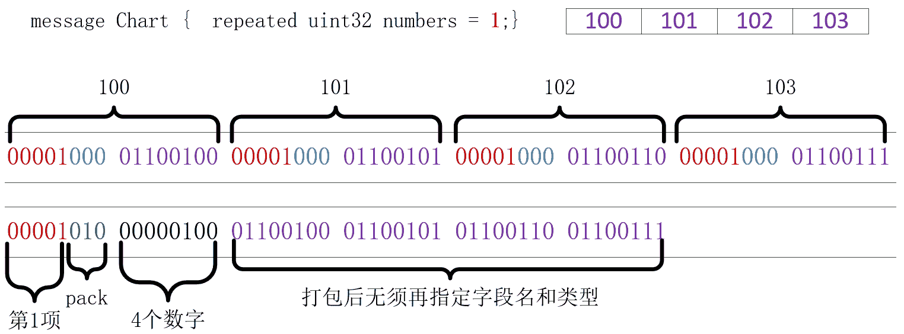

# 17 | Protobuf是如何进一步提高编码效率的？

 

你好，我是陶辉。

上一讲介绍的 HTTP/2 协议在编码上拥有非常高的空间利用率，这一讲我们看看，相比其中的 HPACK 编码技术，Protobuf 又是通过哪些新招式进一步提升编码效率的。

Google 在 2008 年推出的 Protobuf，是一个针对具体编程语言的编解码工具。它面向 Windows、Linux 等多种平台，也支持 Java、Python、Golang、C++、Javascript 等多种面向对象编程语言。使用 Protobuf 编码消息速度很快，消耗的 CPU 计算力也不多，而且编码后的字符流体积远远小于 JSON 等格式，能够大量节约昂贵的带宽，因此 gRPC 也把 Protobuf 作为底层的编解码协议。

然而，很多同学并不清楚 Protobuf 到底是怎样做到这一点的。这样，当你希望通过更换通讯协议这个高成本手段，提升整个分布式系统的性能时，面对可供选择的众多通讯协议，仅凭第三方的性能测试报告，你仍将难以作出抉择。

而且，面对分布式系统中的疑难杂症，往往需要通过分析抓取到的网络报文，确定到底是哪个组件出现了问题。可是由于 Protobuf 编码太过紧凑，即使对照着 Proto 消息格式文件，在不清楚编码逻辑时，你也很难解析出消息内容。

下面，我们将基于上一讲介绍过的 HPACK 编码技术，看看 Protobuf 是怎样进一步缩减编码体积的。

## 怎样用最少的空间编码字段名？

消息由多个名、值对组成，比如 HTTP 请求中，头部 Host: www.taohui.pub 就是一个名值对，其中，Host 是字段名称，而 www.taohui.pub 是字段值。我们先来看 Protobuf 如何编码字段名。

对于多达几十字节的 HTTP 头部，HTTP/2 静态表仅用一个数字来表示，其中，映射数字与字符串对应关系的表格，被写死在 HTTP/2 实现框架中。这样的编码效率非常高，**但通用的 HTTP/2 框架只能将 61 个最常用的 HTTP 头部映射为数字，它能发挥出的作用很有限。**

动态表可以让更多的 HTTP 头部编码为数字，在上一讲的例子中，动态表将 Host 头部减少了 96% 的体积，效果惊人。但动态表生效得有一个前提：必须在一个会话连接上反复传输完全相同的 HTTP 头部。**如果消息字段在 1 个连接上只发送了 1 次，或者反复传输时字段总是略有变动，动态表就无能为力了。**

有没有办法既使用静态表的预定义映射关系，又享受到动态表的灵活多变呢？**其实只要把由 HTTP/2 框架实现的字段名映射关系，交由应用程序自行完成即可。**而 Protobuf 就是这么做的。比如下面这段 39 字节的 JSON 消息，虽然一目了然，但字段名 name、id、sex 其实都是多余的，因为客户端与服务器的处理代码都清楚字段的含义。

```
{"name":"John","id":1234,"sex":"MALE"}
```

Protobuf 将这 3 个字段名预分配了 3 个数字，定义在 proto 文件中：

```
message Person {  
  string name = 1;  
  uint32 id = 2;    
  
  enum SexType {  
    MALE = 0;  
    FEMALE = 1;  
  }  
  SexType sex = 3;  
}
```

接着，通过 protoc 程序便可以针对不同平台、编程语言，将它生成编解码类，最后通过类中自动生成的 SerializeToString 方法将消息序列化，编码后的信息仅有 11 个字节。其中，报文与字段的对应关系我放在下面这张图中。


从图中可以看出，Protobuf 是按照字段名、值类型、字段值的顺序来编码的，由于编码极为紧凑，所以分析时必须基于二进制比特位进行。比如红色的 00001、00010、00011 等前 5 个比特位，就分别代表着 name、id、sex 字段。

图中字段值的编码方式我们后面再解释，这里想必大家会有疑问，如果只有 5 个比特位表示字段名的值，那不是限制消息最多只有 31 个（25 - 1）字段吗？当然不是，字段名的序号可以从 1 到 536870911（即 229 - 1），可是，多数消息不过只有几个字段，这意味着可以用很小的序号表示它们。因此，对于小于 16 的序号，Protobuf 仅有 5 个比特位表示，这样加上 3 位值类型，只需要 1 个字节表示字段名。对于大于 16 小于 2027 的序号，也只需要 2 个字节表示。

Protobuf 可以用 1 到 5 个字节来表示一个字段名，因此，每个字节的第 1 个比特位保留，它为 0 时表示这是字段名的最后一个字节。下表列出了几种典型序号的编码值（请把黑色的二进制位，从右至左排列，比如 2049 应为 000100000000001，即 2048+1）。


说完字段名，我们再来看字段值是如何编码的。

## 怎样高效地编码字段值？

Protobuf 对不同类型的值，采用 6 种不同的编码方式，如下表所示：



字符串用 Length-delimited 方式编码，顾名思义，在值长度后顺序添加 ASCII 字节码即可。比如上文例子中的 John，对应的 ASCII 码如下表所示：


这样，"John"需要 5 个字节进行编码，如下图所示（绿色表示长度，紫色表示 ASCII 码）：



这里需要注意，字符串长度的编码逻辑与字段名相同，当长度小于 128（27）时，1 个字节就可以表示长度。若长度从 128 到 16384（214），则需要 2 个字节，以此类推。

由于字符串编码时未做压缩，所以并不会节约空间，但胜在速度快。**如果你的消息中含有大量字符串，那么使用 Huffman 等算法压缩后再编码效果更好。**

我们再来看 id：1234 这个数字是如何编码的。其实 Protobuf 中所有数字的编码规则是一致的，字节中第 1 个比特位仅用于指示由哪些字节编码 1 个数字。例如图中的 1234，将由 14 个比特位 00010011010010 表示（1024+128+64+16+2，正好是 1234）。

**由于消息中的大量数字都很小，这种编码方式可以带来很高的空间利用率！**当然，如果你确定数字很大，这种编码方式不但不能节约空间，而且会导致原先 4 个字节的大整数需要用 5 个字节来表示时，你也可以使用 fixed32、fixed64 等类型定义数字。

Protobuf 还可以通过 enum 枚举类型压缩空间。回到第 1 幅图，sex: FEMALE 仅用 2 个字节就编码完成，正是枚举值 FEMALE 使用数字 1 表示所达到的效果。



而且，由于 Protobuf 定义了每个字段的默认值，因此，当消息使用字段的默认值时，Protobuf 编码时会略过该字段。以 sex: MALE 为例，由于 MALE=0 是 sex 的默认值，因此在第 2 幅示例图中，这 2 个字节都省去了。

另外，当使用 repeated 语法将多个数字组成列表时，还可以通过打包功能提升编码效率。比如下图中，对 numbers 字段添加 101、102、103、104 这 4 个值后，如果不使用打包功能，共需要 8 个字节编码，其中每个数字前都需要添加字段名。而使用打包功能后，仅用 6 个字节就能完成编码，显然列表越庞大，节约的空间越多。



在 Protobuf2 版本中，需要显式设置 [packed=True] 才能使用打包功能，而在 Protobuf3 版本中这是默认功能。

最后，从这里可以查看 Protobuf 的编解码性能测试报告，你能看到，在保持高空间利用率的前提下，Protobuf 仍然拥有飞快的速度！

## 小结

这一讲我们介绍了 Protobuf 的编码原理。

通过在 proto 文件中为每个字段预分配 1 个数字，编码时就省去了完整字段名占用的空间。而且，数字越小编码时用掉的空间也越小，实际网络中大量传输的是小数字，这带来了很高的空间利用率。Protobuf 的枚举类型也通过类似的原理，用数字代替字符串，可以节约许多空间。

对于字符串 Protobuf 没有做压缩，因此如果消息中的字符串比重很大时，建议你先压缩后再使用 Protobuf 编码。对于拥有默认值的字段，Protobuf 编码时会略过它。对于 repeated 列表，使用打包功能可以仅用 1 个字段前缀描述所有数值，它在列表较大时能带来可观的空间收益。

## 思考题

下一讲我将介绍 gRPC 协议，它结合了 HTTP/2 与 Protobuf 的优点，在应用层提供方便而高效的 RPC 远程调用协议。你也可以提前思考下，既然 Protobuf 的空间效率远甚过 HPACK 技术，为什么 gRPC 还要使用 HTTP/2 协议呢？

在 Protobuf 的性能测试报告中，C++ 语言还拥有 arenas 功能，你可以通过 option cc_enable_arenas = true 语句打开它。请结合[第 2 讲] 的内容，谈谈 arenas 为什么能提升消息的解码性能？欢迎你在留言区与我一起探讨。

感谢阅读，如果你觉得这节课对你有一些启发，也欢迎把它分享给你的朋友。
