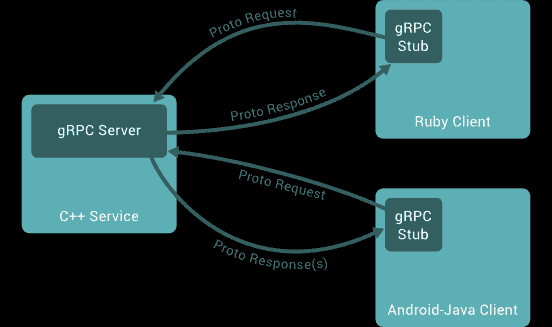
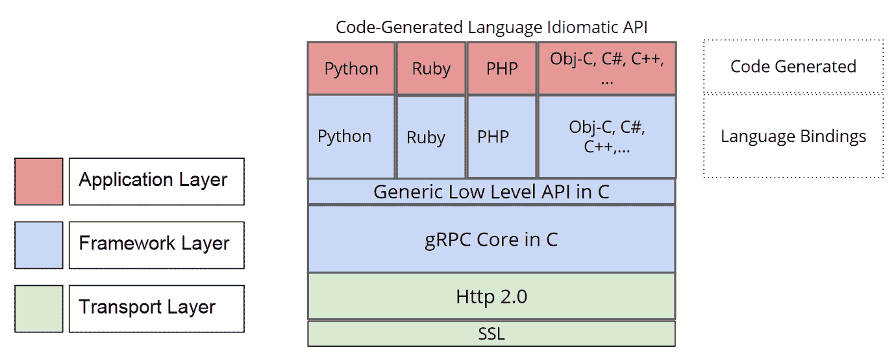
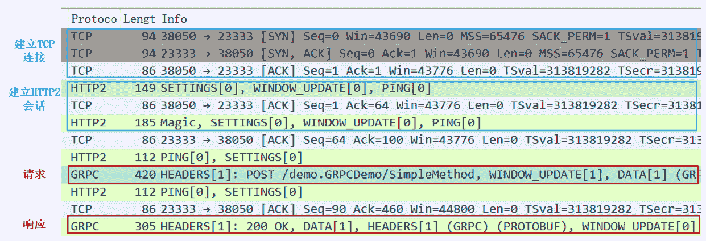
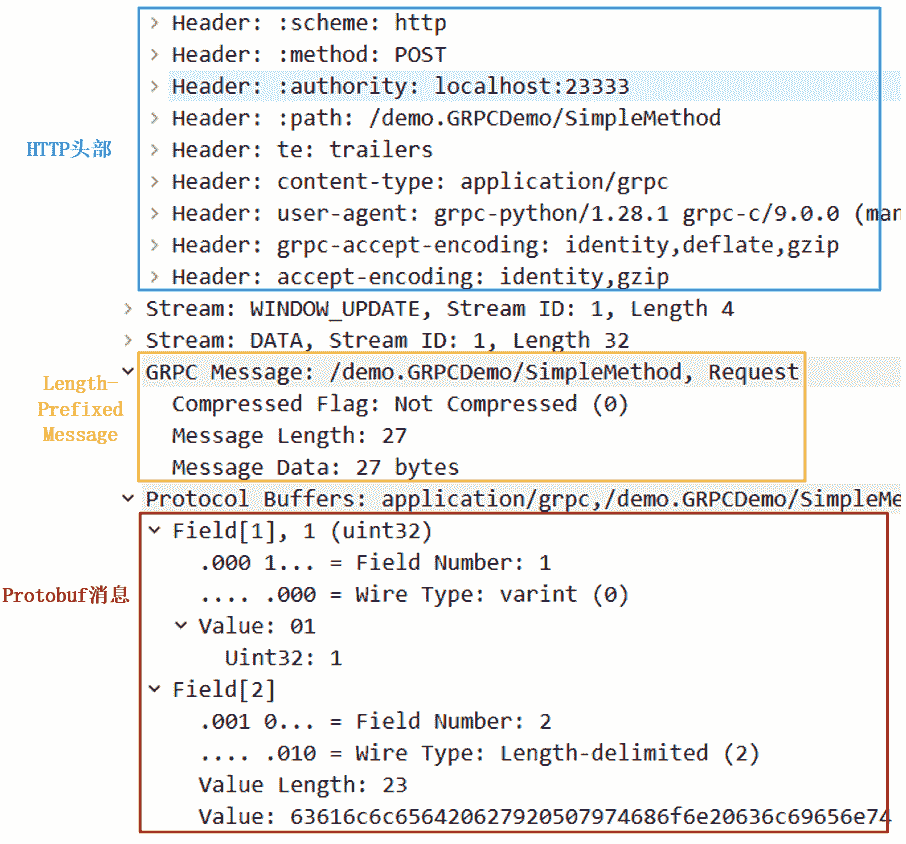
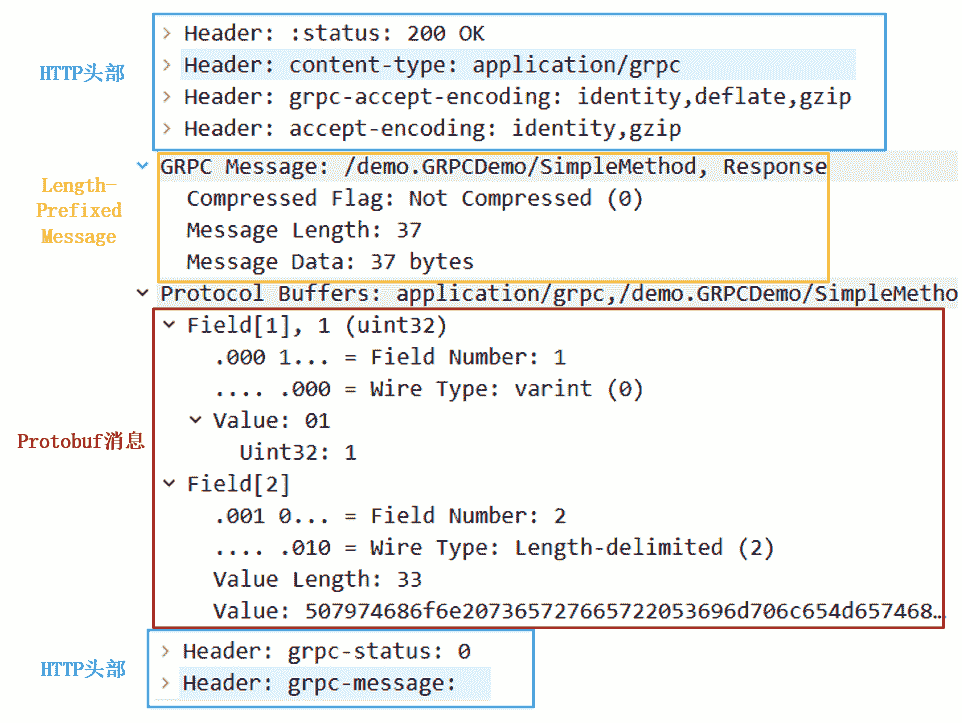
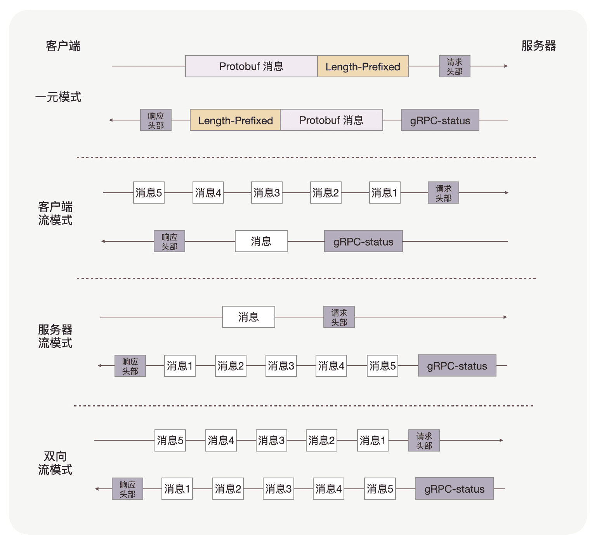

# 18 | 如何通过gRPC实现高效远程过程调用？

 

你好，我是陶辉。

这一讲我们将以一个实战案例，基于前两讲提到的 HTTP/2 和 ProtoBuf 协议，看看 gRPC 如何将结构化消息编码为网络报文。

直接操作网络协议编程，容易让业务开发过程陷入复杂的网络处理细节。RPC 框架以编程语言中的本地函数调用形式，向应用开发者提供网络访问能力，这既封装了消息的编解码，也通过线程模型封装了多路复用，对业务开发很友好。

其中，Google 推出的 gRPC 是性能最好的 RPC 框架之一，它支持 Java、Javascript、Python、GoLang、C++、Object-C、Android、Ruby 等多种编程语言，还支持安全验证等特性，得到了广泛的应用，比如微服务中的 Envoy、分布式机器学习中的 Tensorflow，甚至华为去年推出重构互联网的 New IP 技术，都使用了 gRPC 框架。

然而，网络上教你使用 gRPC 框架的教程很多，却很少去谈 gRPC 是如何编码消息的。这样，一旦在大型分布式系统中出现疑难杂症，需要通过网络报文去定位问题发生在哪个系统、主机、进程中时，你就会毫无头绪。即使我们掌握了 HTTP/2 和 Protobuf 协议，但若不清楚 gRPC 的编码规则，还是无法分析抓取到的 gRPC 报文。而且，gRPC 支持单向、双向的流式 RPC 调用，编程相对复杂一些，定位流式 RPC 调用引发的 bug 时，更需要我们掌握 gRPC 的编码原理。

这一讲，我就将以 gRPC 官方提供的 example：data_transmisstion 为例，介绍 gRPC 的编码流程。在这一过程中，会顺带回顾 HTTP/2 和 Protobuf 协议，加深你对它们的理解。虽然这个示例使用的是 Python 语言，但基于 gRPC 框架，你可以轻松地将它们转换为其他编程语言。

## 如何使用 gRPC 框架实现远程调用？

我们先来简单地看下 gRPC 框架到底是什么。RPC 的全称是 Remote Procedure Call，即远程过程调用，它通过本地函数调用，封装了跨网络、跨平台、跨语言的服务访问，大大简化了应用层编程。其中，函数的入参是请求，而函数的返回值则是响应。

gRPC 就是一种 RPC 框架，在你定义好消息格式后，针对你选择的编程语言，gRPC 为客户端生成发起 RPC 请求的 Stub 类，以及为服务器生成处理 RPC 请求的 Service 类（服务器只需要继承、实现类中处理请求的函数即可）。如下图所示，很明显，gRPC 主要服务于面向对象的编程语言。

[](https://grpc.io/)
图片来源：https://grpc.io/

gRPC 支持 QUIC、HTTP/1 等多种协议，但鉴于 HTTP/2 协议性能好，应用场景又广泛，因此 HTTP/2 是 gRPC 的默认传输协议。gRPC 也支持 JSON 编码格式，但在忽略编码细节的 RPC 调用中，高效的 Protobuf 才是最佳选择！因此，这一讲仅基于 HTTP/2 和 Protobuf，介绍 gRPC 的用法。

gRPC 可以简单地分为三层，包括底层的数据传输层，中间的框架层（框架层又包括 C 语言实现的核心功能，以及上层的编程语言框架），以及最上层由框架层自动生成的 Stub 和 Service 类，如下图所示：

[](https://platformlab.stanford.edu/Seminar%20Talks/gRPC.pdf)
图片来源：https://platformlab.stanford.edu/Seminar%20Talks/gRPC.pdf

接下来我们以官网上的data_transmisstion 为例，先看看如何使用 gRPC。

构建 Python 语言的 gRPC 环境很简单，你可以参考官网上的QuickStart。

使用 gRPC 前，先要根据 Protobuf 语法，编写定义消息格式的 proto 文件。在这个例子中只有 1 种请求和 1 种响应，且它们很相似，各含有 1 个整型数字和 1 个字符串，如下所示：

```
package demo;  
  
message Request {  
    int64 client_id = 1;  
    string request_data = 2;  
}   
  
message Response {  
    int64 server_id = 1;  
    string response_data = 2;  
}
```

请注意，这里的包名 demo 以及字段序号 1、2，都与后续的 gRPC 报文分析相关。

接着定义 service，所有的 RPC 方法都要放置在 service 中，这里将它取名为 GRPCDemo。GRPCDemo 中有 4 个方法，后面 3 个流式访问的例子我们呆会再谈，先来看简单的一元访问模式 SimpleMethod 方法，它定义了 1 个请求对应 1 个响应的访问形式。其中，SimpleMethod 的参数 Request 是请求，返回值 Response 是响应。注意，分析报文时会用到这里的类名 GRPCDemo 以及方法名 SimpleMethod。

```
service GRPCDemo {  
    rpc SimpleMethod (Request) returns (Response);  
}
```

用 grpc_tools 中的 protoc 命令，就可以针对刚刚定义的 service，生成含有 GRPCDemoStub 类和 GRPCDemoServicer 类的 demo_pb2_grpc.py 文件（实际上还包括完成 Protobuf 编解码的 demo_pb2.py），应用层将使用这两个类完成 RPC 访问。我简化了官网上的 Python 客户端代码，如下所示：

```
with grpc.insecure_channel("localhost:23333") as channel:  
    stub = demo_pb2_grpc.GRPCDemoStub(channel)  
    request = demo_pb2.Request(client_id=1,  
            request_data="called by Python client")  
    response = stub.SimpleMethod(request)
```

示例中客户端与服务器都在同一台机器上，通过 23333 端口访问。客户端通过 stub 对象的 SimpleMethod 方法完成了 RPC 访问。而服务器端的实现也很简单，只需要实现 GRPCDemoServicer 父类的 SimpleMethod 方法，返回 response 响应即可：

```
class DemoServer(demo_pb2_grpc.GRPCDemoServicer):  
    def SimpleMethod(self, request, context):  
        response = demo_pb2.Response(  
            server_id=1,  
            response_data="Python server SimpleMethod Ok!!!!")  
        return response
```

可见，gRPC 的开发效率非常高！接下来我们分析这次 RPC 调用中，消息是怎样编码的。

## gRPC 消息是如何编码的？

**定位复杂的网络问题，都需要抓取、分析网络报文。**如果你在 Windows 上抓取网络报文，可以使用 Wireshark 工具（可参考《Web 协议详解与抓包实战》第 37 课），如果在 Linux 上抓包可以使用 tcpdump 工具（可参考第 87 课）。当然，你也可以从这里下载我抓取好的网络报文，用 Wireshark 打开它。需要注意，23333 不是 HTTP 常用的 80 或者 443 端口，所以 Wireshark 默认不会把它解析为 HTTP/2 协议。你需要鼠标右键点击报文，选择“解码为”（Decode as），将 23333 端口的报文设置为 HTTP/2 解码器，如下图所示：



图中蓝色方框中，TCP 连接的建立过程请参见[第 9 讲]，而 HTTP/2 会话的建立可参见《Web 协议详解与抓包实战》第 52 课（还是比较简单的，如果你都清楚就可以直接略过）。我们重点看红色方框中的 gRPC 请求与响应，点开请求，可以看到下图中的信息：



先来分析蓝色方框中的 HTTP/2 头部。请求中有 2 个关键的 HTTP 头部，path 和 content-type，它们决定了 RPC 方法和具体的消息编码格式。path 的值为“/demo.GRPCDemo/SimpleMethod”，通过“/ 包名. 服务名 / 方法名”的形式确定了 RPC 方法。content-type 的值为“application/grpc”，确定消息编码使用 Protobuf 格式。如果你对其他头部的含义感兴趣，可以看下这个文档，注意这里使用了 ABNF 元数据定义语言（如果你还不了解 ABNF，可以看下《Web 协议详解与抓包实战》第 4 课）。

HTTP/2 包体并不会直接存放 Protobuf 消息，而是先要添加 5 个字节的 Length-Prefixed Message 头部，其中用 4 个字节明确 Protobuf 消息的长度（1 个字节表示消息是否做过压缩），即上图中的桔色方框。为什么要多此一举呢？这是因为，gRPC 支持流式消息，即在 HTTP/2 的 1 条 Stream 中，通过 DATA 帧发送多个 gRPC 消息，而 Length-Prefixed Message 就可以将不同的消息分离开。关于流式消息，我们在介绍完一元模式后，再加以分析。

最后分析 Protobuf 消息，这里仅以 client_id 字段为例，对上一讲的内容做个回顾。在 proto 文件中 client_id 字段的序号为 1，因此首字节 00001000 中前 5 位表示序号为 1 的 client_id 字段，后 3 位表示字段的值类型是 varint 格式的数字，因此随后的字节 00000001 表示字段值为 1。序号为 2 的 request_data 字段请你结合上一讲的内容，试着做一下解析，看看字符串“called by Python client”是怎样编码的。

再来看服务器发回的响应，点开 Wireshark 中的响应报文后如下图所示：



其中 DATA 帧同样包括 Length-Prefixed Message 和 Protobuf，与 RPC 请求如出一辙，这里就不再赘述了，我们重点看下 HTTP/2 头部。你可能留意到，响应头部被拆成了 2 个部分，其中 grpc-status 和 grpc-message 是在 DATA 帧后发送的，这样就允许服务器在发送完消息后再给出错误码。关于 gRPC 的官方错误码以及 message 描述信息是如何取值的，你可以参考这个文档。

这种将部分 HTTP 头部放在包体后发送的技术叫做 Trailer，RFC7230 文档对此有详细的介绍。其中，RPC 请求中的 TE: trailers 头部，就说明客户端支持 Trailer 头部。在 RPC 响应中，grpc-status 头部都会放在最后发送，因此它的帧 flags 的 EndStream 标志位为 1。

可以看到，gRPC 中的 HTTP 头部与普通的 HTTP 请求完全一致，因此，它兼容当下互联网中各种七层负载均衡，这使得 gRPC 可以轻松地跨越公网使用。

## gRPC 流模式的协议编码

说完一元模式，我们再来看流模式 RPC 调用的编码方式。

所谓流模式，是指 RPC 通讯的一方可以在 1 次 RPC 调用中，持续不断地发送消息，这对订阅、推送等场景很有用。流模式共有 3 种类型，包括客户端流模式、服务器端流模式，以及两端双向流模式。在data_transmisstion 官方示例中，对这 3 种流模式都定义了 RPC 方法，如下所示：

```
service GRPCDemo {  
    rpc ClientStreamingMethod (stream Request) returns Response);  
      
    rpc ServerStreamingMethod (Request) returns (stream Response);  
  
    rpc BidirectionalStreamingMethod (stream Request) returns (stream Response);  
}
```

不同的编程语言处理流模式的代码很不一样，这里就不一一列举了，但通讯层的流模式消息编码是一样的，而且很简单。这是因为，HTTP/2 协议中每个 Stream 就是天然的 1 次 RPC 请求，每个 RPC 消息又已经通过 Length-Prefixed Message 头部确立了边界，这样，在 Stream 中连续地发送多个 DATA 帧，就可以实现流模式 RPC。我画了一张示意图，你可以对照它理解抓取到的流模式报文。



## 小结

这一讲介绍了 gRPC 怎样使用 HTTP/2 和 Protobuf 协议编码消息。

在定义好消息格式，以及 service 类中的 RPC 方法后，gRPC 框架可以为编程语言生成 Stub 和 Service 类，而类中的方法就封装了网络调用，其中方法的参数是请求，而方法的返回值则是响应。

发起 RPC 调用后，我们可以这么分析抓取到的网络报文。首先，分析应用层最外层的 HTTP/2 帧，根据 Stream ID 找出一次 RPC 调用。客户端 HTTP 头部的 path 字段指明了 service 和 RPC 方法名，而 content-type 则指明了消息的编码格式。服务器端的 HTTP 头部被分成 2 次发送，其中 DATA 帧发送完毕后，才会发送 grpc-status 头部，这样可以明确最终的错误码。

其次，分析包体时，可以通过 Stream 中 Length-Prefixed Message 头部，确认 DATA 帧中含有多少个消息，因此可以确定这是一元模式还是流式调用。在 Length-Prefixed Message 头部后，则是 Protobuf 消息，按照上一讲的内容进行分析即可。

## 思考题

最后，留给你一道练习题。gRPC 默认并不会压缩字符串，你可以通过在获取 channel 对象时加入 grpc.default_compression_algorithm 参数的形式，要求 gRPC 压缩消息，此时 Length-Prefixed Message 中 1 个字节的压缩位将会由 0 变为 1。你可以观察下执行压缩后的 gRPC 消息有何不同，欢迎你在留言区与大家一起探讨。

感谢阅读，如果你觉得这节课对你有一些启发，也欢迎把它分享给你的朋友。
