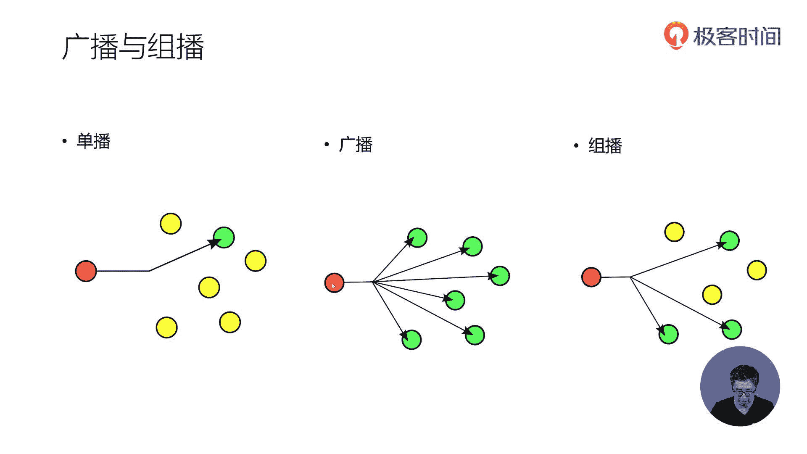
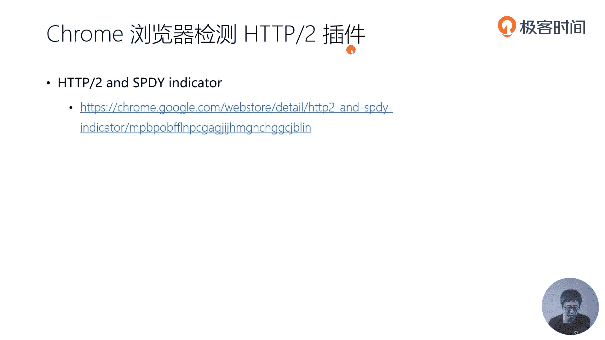
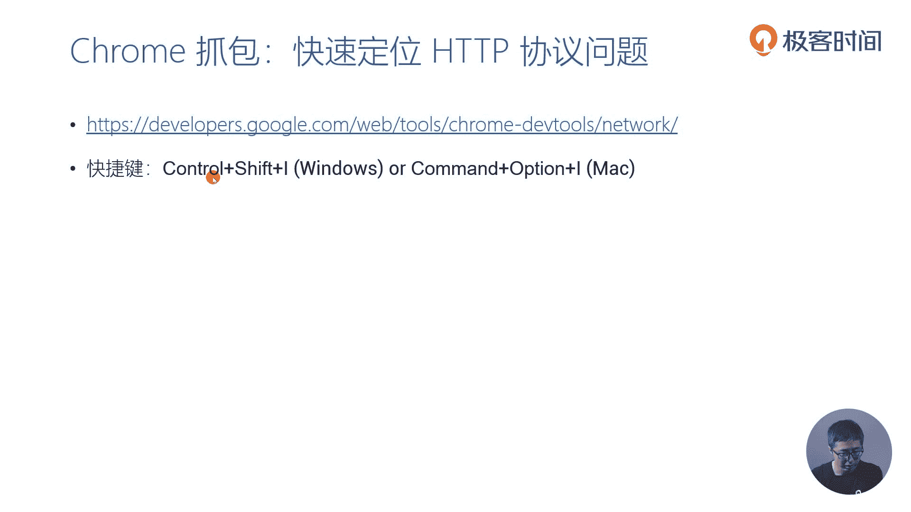

# 加餐1｜特别福利：陶辉视频课精选

 

你好，我是陶辉。

不知道你的期中考试成绩如何呢？是否发现了一些新的问题？成绩好的同学请继续努力了，咱们还有一半的课程未学，希望你能一如既往地跟着我深挖系统性能，这门课的内容设计是由浅入深的，第三、四模块会重点往集群方向转了，内容相对会更加烧脑。成绩略差的同学也不要气馁，就像我上节课说的，问题驱动是一种很好的学习方式，查漏补缺才是这场期中考试的目的。

聊完考试，我就来兑现承诺了，精选 3 节我的视频课作为福利送给你，它们来自《Web 协议详解与抓包实战》，这 3 节课都是与咱们专栏有强关联的。

我还记得在开篇词中有位同学问我，学习咱们专栏需要哪些基础？我是这么回复的：

1. 对操作系统的原理有简单的了解，比如，文件是怎么读取的，HTTP 请求是怎么发送和接收的；
2. 对网络协议要有所了解，毕竟分布式系统就是靠网络将操作系统上的进程连接在一起。这块《Web 协议详解与抓包实战》可以先学下。
3. 大致知道什么是分布式系统，这块网上的文章有很多。

其中第 1 点和第 3 点，我想还是很容易的，所以我就在第 2 点上为你加码了。以下就是 3 节视频课，你可以直接点击观看。

## 第 1 节

与第 7 课有联系的《Web 协议详解与抓包实战》第 117 课。我在第 7 课讲解组播时，有推荐你如果想要进一步了解组播的细节，可以观看以下视频课。
 Sorry, your browser doesn't support embedded videos.  

     00:00 / 00:00   

## 第 2 节

与第 14 课有联系的《Web 协议详解与抓包实战》第 51 课。我在第 14 课讲解用 Chrome 浏览器配合 Wireshark 解密消息，可以帮助你分析 TLS 协议的细节时，具体的操作方法有推荐你观看以下视频课。
 Sorry, your browser doesn't support embedded videos.  

     00:00 / 00:00   

## 第 3 节

与第 15 课有联系的《Web 协议详解与抓包实战》第 9 课。第 15 课我们介绍了 Chrome 浏览器开发者工具的 Network 面板，通过它可以快速判断各站点使用了哪些 HTTP 性能优化技术，有关 Network 面板的详细用法，我推荐你观看以下视频课。
 Sorry, your browser doesn't support embedded videos.  

     00:00 / 20:52   

今天的特别福利就到这里，这 3 节视频课对于你学习咱们专栏有一定的辅助作用，希望你能把它作为拓展认真学完。如果你有更多想要了解的内容和期待的学习资料，欢迎在留言区中提出。
