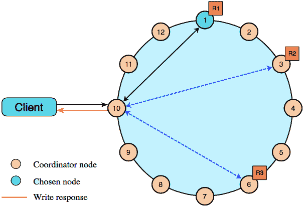
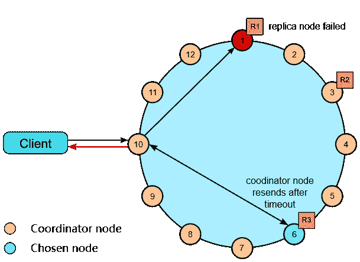
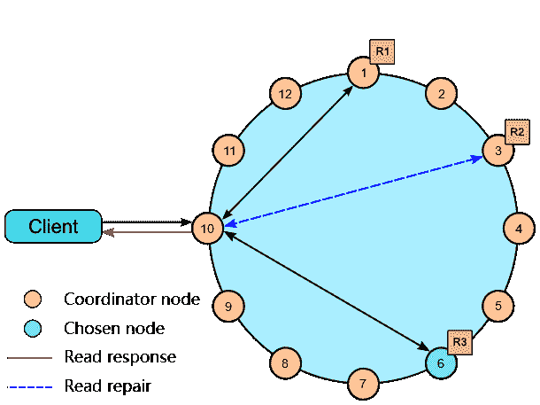
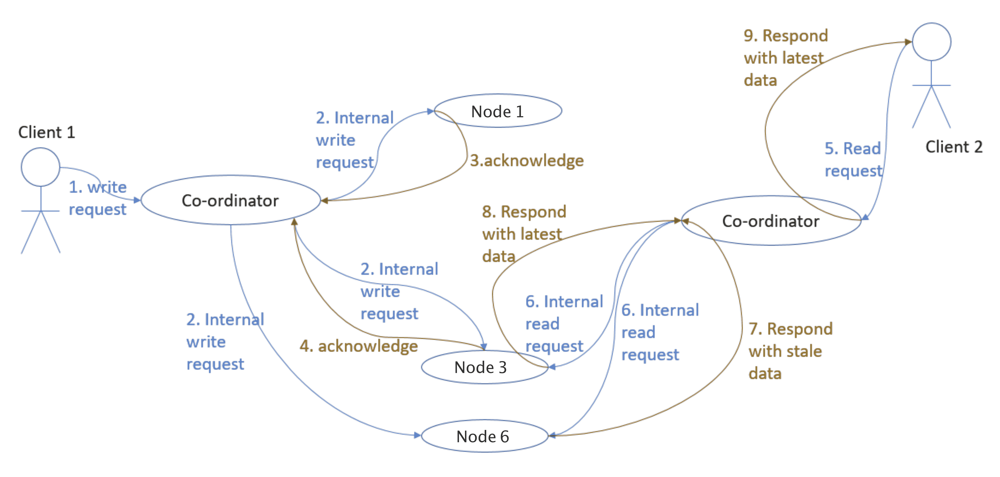
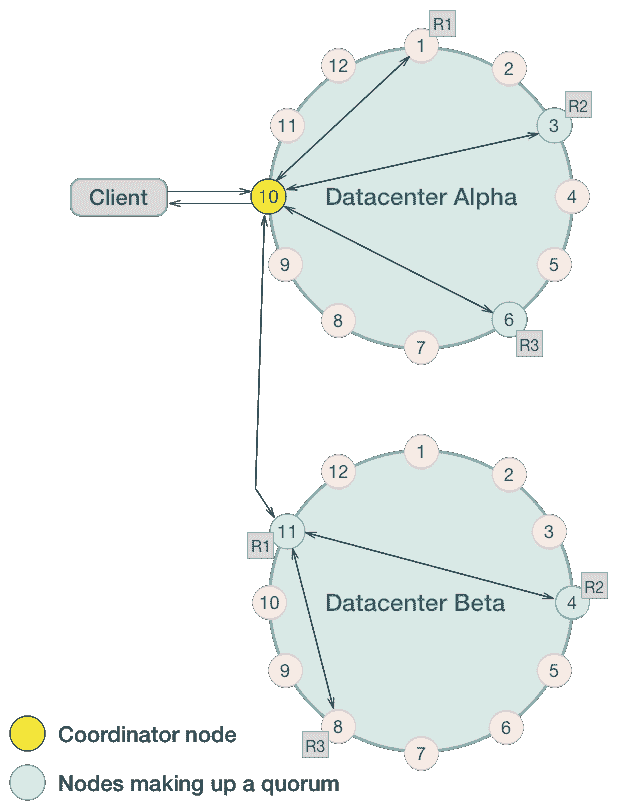
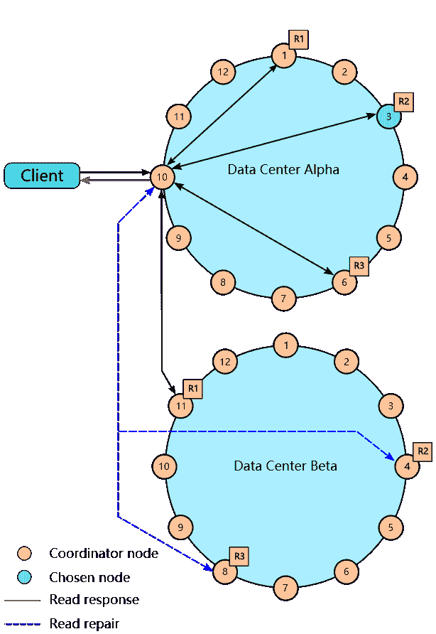

# 22 | NWR算法：如何修改读写模型以提升性能？

 

你好，我是陶辉。

前两讲我们介绍数据库的扩展时，写请求仍然在操作中心化的 Master 单点，这在很多业务场景下都是不可接受的。这一讲我将介绍对于无单点的去中心化系统非常有用的 NWR 算法，它可以灵活地平衡一致性与性能。

最初我们仅在单机上部署数据库，一旦性能到达瓶颈，我们可以基于 AKF Y 轴将读写分离，这样多个 Slave 从库将读操作分流后，写操作就可以独享 Master 主库的全部性能。然而主库作为中心化的单点，一旦宕机，未及时同步到从库的数据就有可能丢失。而且，这一架构下，主库的故障还会导致整个系统瘫痪。

去中心化系统中没有“Master 主库”这一概念，数据存放在多个 Replication 冗余节点上，且这些节点间地位均等，所以没有单点问题。为了保持强一致性，系统可以要求修改数据时，必须同时写入所有冗余节点，才能向客户端返回成功。但这样系统的可用性一定很成问题，毕竟大规模分布式系统中，出现故障是常态，写入全部节点的操作根本无法容错，任何 1 个节点宕机都会造成写操作失败。而且，同步节点过多也会导致写操作性能低下。

NWR 算法提供了一个很棒的读写模型，可以解决上述问题。这里的“NWR”，是指在去中心化系统中将 1 份数据存放在 N 个节点上，每次操作时，写 W 个节点、读 R 个节点，只要调整 W、R 与 N 的关系，就能动态地平衡一致性与性能。NWR 在 NoSQL 数据库中有很广泛的应用，比如 Amazon 的 Dynamo 和开源的 Cassandra，这些数据库往往跨越多个 IDC 数据中心，包含成千上万个物理机节点，适用于海量数据的存储与处理。

这一讲，我们将介绍 NWR 算法的原理，包括它是怎样调整读写模型来提升性能的，以及 Cassandra 数据库是如何使用 NWR 算法的。

## 从鸽巢原理到 NWR 算法

NWR 算法是由鸽巢原理得来的：如果 10 只鸽子放入 9 个鸽巢，那么有 1 个鸽巢内至少有 2 只鸽子，这就是鸽巢原理，如下图所示：

[](https://zh.wikipedia.org/wiki/%E9%B4%BF%E5%B7%A2%E5%8E%9F%E7%90%86)
图片来源：https://zh.wikipedia.org/wiki/%E9%B4%BF%E5%B7%A2%E5%8E%9F%E7%90%86

你可以用反证法证明它。鸽巢原理虽然简单，但它有许多很有用的推论。比如[第 3 课] 介绍了很多解决哈希表冲突的方案，那么，哈希表有没有可能完全不出现冲突呢？**鸽巢原理告诉我们，只要哈希函数输入主键的值范围大于输出索引，出现冲突的概率就一定大于 0；只要存放元素的数量超过哈希桶的数量，就必然会发生冲突。**

基于鸽巢原理，David K. Gifford 在 1979 年首次提出了Quorum 算法（参见《Weighted Voting for Replicated Data》论文），解决去中心化系统冗余数据的一致性问题。而 Quorum 算法提出，如果冗余数据存放在 N 个节点上，且每次写操作成功写入 W 个节点（其他 N - W 个节点将异步地同步数据），而读操作则从 R 个节点中选择并读出正确的数据，只要确保 W + R > N，同 1 条数据的读、写操作就不能并发执行，这样客户端就总能读到最新写入的数据。特别是当 W > N/2 时，同 1 条数据的修改必然是顺序执行的。这样，分布式系统就具备了强一致性，这也是 NWR 算法的由来。

比如，若 N 为 3，那么设置 W 和 R 为 2 时，在保障系统强一致性的同时，还允许 3 个节点中 1 个节点宕机后，系统仍然可以提供读、写服务，这样的系统具备了很高的可用性。当然，R 和 W 的数值并不需要一致，如何调整它们，取决于读、写请求数量的比例。比如当 N 为 5 时，如果系统读多写少时，可以将 W 设为 4，而 R 设为 2，这样读操作的性能会更好。

NWR 算法最早应用在 Amazon 推出的Dynamo 数据库中，你可以参见 2007 年 Amazon 发表的《Dynamo: Amazon’s Highly Available Key-value Store》论文。2008 年 Dynamo 的作者 Avinash Lakshman 跳槽到 FaceBook，开发了 Dynamo 的开源版数据库Cassandra，它是目前最流行的 NoSQL 数据库之一，在 Apple、Netflix、360 等公司得到了广泛的应用。想必你对 NWR 算法的很多细节并不清楚，那么接下来我们以 Cassandra 为例，看看 NWR 是如何应用在实际工程中的。

## Cassandra 数据库是如何使用 NWR 算法的？

1 个 Cassandra 分布式系统可以由多个 IDC 数据中心、数万个服务器节点构成，这些节点间使用 RPC 框架通信，由于 Cassandra 推出时 gRPC（参见[第 18 课]）还没有诞生，因此它使用的是性能相对较低的 Thrift RPC 框架（Thrift 的优点是支持的开发语言更多）。同时，Cassandra 虽然使用宽列存储模型（每行最多可以包含20 亿列数据），但**数据的分布是基于行 Key 进行的**，它和 Dynamo 一样使用了一致性哈希算法，将 Key 对应的数据存储在多个节点中。关于一致性哈希算法，我们会在 [第 24 课] 再详细介绍。

Cassandra 对客户端提供一种类 SQL 的CQL 语言，你可以使用下面这行 CQL 语句设定数据存储的冗余节点个数，也就是 NWR 算法中的 N（也称为 Replication Factor）：

```
CREATE KEYSPACE excalibur  
  WITH REPLICATION = {'class' : 'NetworkTopologyStrategy', 'dc1' : 3};
```

上面这行 CQL 语句设置了每行数据在数据中心 DC1 中存储 3 份冗余，即 N = 3，接下来我们通过下面的 CQL 语句，将读 R、写 W 的节点数都设置为 1：

```
cqlsh> CONSISTENCY ONE  
Consistency level set to ONE.  
cqlsh> CONSISTENCY  
Current consistency level is ONE.
```

**此时，Cassandra 的性能最高，但达成最终一致性的耗时最长，丢数据风险也最大。**如果业务上对丢失少量数据不太在意，可以采用这种模型。此时修改数据时，客户端会并发地向 3 个存储节点写入数据，但只要 1 个节点返回成功，Cassandra 就会向客户端返回写入成功，如下图所示：

[](https://docs.datastax.com/en/cassandra-oss/3.x/cassandra/dml)
该图片及以下图片来源：https://docs.datastax.com/en/cassandra-oss/3.x/cassandra/dml

上图中的系统由 12 个主机节点构成，由于数据采用一致性哈希算法分片，故构成了一个节点环。其中，本次写入的数据被分布到 1、3、6 这 3 个节点中存储。客户端可以随机连接到系统中的任何一个节点访问 Cassandra，此时该节点被称为 Coordinator Node，由它根据 NWR 的值来选择一致性模型，访问存储节点。

再来看读取数据的流程。下图中，作为 Coordinator Node 的节点 10 首先试图读取节点 1 中的数据，但发现节点 1 已经宕机，于是改选节点 6 并获取到数据，由于 R = 1 于是立刻向客户端返回成功。



如果我们将 R、W 都设置成 2，这就满足了 R + W > N(3) 的场景，此时系统具备了强一致性。客户端读写数据时，必须有 2 个节点返回，才算操作成功。比如下图中读取数据时，只有接收到节点 1、节点 6 的返回，操作才算成功。



上图中的蓝色线叫做 Read repair，如果节点 3 上的数据不一致，那么本次读操作可以将它修复为正确的数据。说完正常场景，我们再来看当一个节点出现异常时，NWR 是如何保持强一致性的。

下图中，客户端 1 在第 2 步，同时向 3 个存储节点写入了数据，由于节点 1、3 返回成功，所以写入操作实际已经完成了，但是节点 6 由于网络故障，却一直没有收到 Coordinator Node 发来的写入操作。在强一致性的约束下，客户端 2 在第 5 步发起的读请求，必须能获取到第 2 步写入的数据。然而，客户端 2 连接的 Coordinator Node 与客户端 1 不同，它选择了节点 3 和节点 6，这两个节点上的数据并不一致。**根据不同的 timestamp 时间戳，Coordinator Node 发现节点 3 上的数据才是最后写入的数据，因此选择其上的数据返回客户端。这也叫 Last-Write-Win 策略。**

[](https://blog.scottlogic.com/2017/10/06/cassandra-eventual-consistency.html)
图片来源：https://blog.scottlogic.com/2017/10/06/cassandra-eventual-consistency.html

Cassandra 提供了一个简单的方法，用于设置读写节点数量都过半，满足强一致性的要求，如下所示：

```
cqlsh> CONSISTENCY QUORUM  
Consistency level set to QUORUM.  
cqlsh> CONSISTENCY  
Current consistency level is QUORUM.
```

最后我们再来看看多数据中心的部署方式。下图中 2 个数据中心各设置 N = 3，其中 R、W 则采用 QUORUM 一致性模型。当客户端发起写请求到达节点 10 这个 Coordinator Node 后，它选择本 IDC Alpha 的 1、3、6 节点存储数据，其中节点 3、6 返回成功后，IDC Alpha 便更新成功。同时找到另一 IDC Beta 的节点 11 存储数据，并由节点 11 将数据同步给节点 4 和节点 8。其中，只要节点 4 返回成功，IDC Beta 也就成功更新了数据，此时 Coordinator Node 会向客户端返回写入成功。



读取数据时，这 2 个 IDC 内必须由 4 个存储节点返回数据，才满足 QUORUM 一致性的要求。下图中，Coordinator Node 获取到了 IDC Alpha 中节点 1、3、6 的返回，以及 IDC Beta 中节点 11 的返回，就可以基于 timestamp 时间戳选择最新的数据返回客户端。而且 Coordinator Node 会并发地发起 Read repair，试图修复 IDC Beta 中可能存在不一致的节点 4 和 8。



Cassandra 还有许多一致性模型，比如 LOCAL_QUORUM 只要求本地 IDC 内有多数节点响应即可，而 EACH_QUORUM 则要求每个 IDC 内都必须有多数节点返回成功（注意，这与上图中 IDC Alpha 中有 3 个节点返回，而 IDC Beta 则只有 1 个节点返回的 QUORUM 是不同的）。你可以从这个页面找到 Cassandra 支持的所有一致性模型，但无论如何变化，都只是在引入数据中心、机架等概念后，局部性地调节 NWR 而已。

## 小结

这一讲我们介绍了鸽巢原理，以及由此推导出的 NWR 算法，并以流行的 NoSQL 数据库 Cassandra 为例，介绍了 NWR 在分布式系统中的实践。

当鸽子的数量超过了鸽巢后，就要注定某一个鸽巢内一定含有两只以上的鸽子，同样的道理，只要读、写操作涉及的节点超过半数，就注定读写操作总包含一个含有正确数据的节点。NWR 算法将这一原理一般化为：只要读节点数 R + 写节点数 W > 存储节点数 N，特别是 W > N/2 时，就能使去中心的分布式系统获得强一致性。

支持上万节点的 Cassandra 数据库，就使用了 NWR 算法来保持一致性。当然，Cassandra 支持多种一致性模型，当你需要更强劲的性能时，你可以令 R + W < N，当业务变化导致需要增强系统的一致性时，你可以实时地修改 R、W。Cassandra 也支持跨数据中心部署，此时的一致性模型更为复杂，但仍然将 NWR 算法作为实现基础。

## 思考题

最后给你留一道讨论题。你还知道哪些有状态服务使用了 NWR 算法吗？它与 NWR 在 Cassandra 中的应用有何不同？欢迎你在留言区中分享，也期待你能从大家的留言中总结出更一般化的规律。

感谢你的阅读，如果你觉得这节课对你有一些启发，也欢迎把它分享给你的朋友。
