# 加餐3｜百万并发下Nginx的优化之道

 

你好，我是专栏编辑冬青。今天的课程有点特别，作为一期加餐，我为你带来了陶辉老师在 GOPS 2018 · 上海站的分享，以文字讲解 + PPT 的形式向你呈现。今天的内容主要集中在 Nginx 的性能方面，希望能给你带来一些系统化的思考，帮助你更有效地去做 Nginx。

## 优化方法论

今天的分享重点会看这样两个问题：

1. 第一，如何有效使用每个连接分配的内存，以此实现高并发。
2. 第二，在高并发的同时，怎样提高 QPS。

当然，实现这两个目标，既可以从单机中的应用、框架、内核优化入手，也可以使用类似 F5 这样的硬件设备，或者通过 DNS 等方案实现分布式集群。

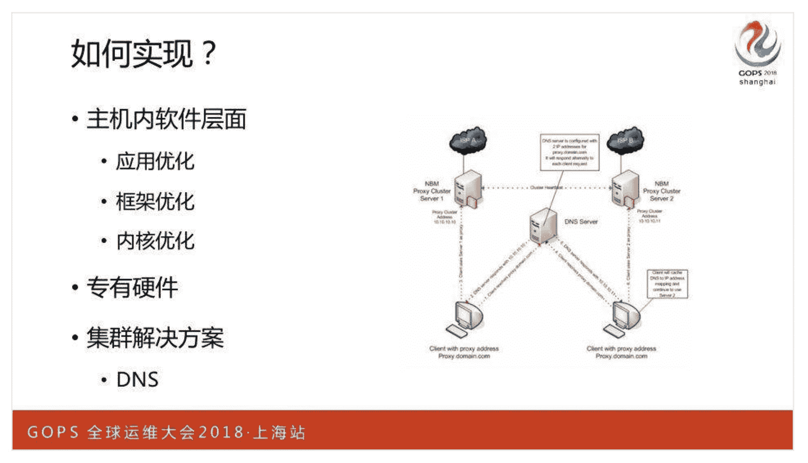

而 Nginx 最大的限制是网络，所以将网卡升级到万兆，比如 10G 或者 40G 吞吐量就会有很大提升。作为静态资源、缓存服务时，磁盘也是重点关注对象，比如固态硬盘的 IOPS 或者 BPS，要比不超过 1 万转每秒的机械磁盘高出许多。

这里我们重点看下 CPU，如果由操作系统切换进程实现并发，代价太大，毕竟每次都有 5 微秒左右的切换成本。Nginx 将其改到进程内部，由 epoll 切换 ngx_connection_t 连接的处理，成本会非常低。OpenResty 切换 Lua 协程，也是基于同样的方式。这样，CPU 的计算力会更多地用在业务处理上。

从整体上看，只有充分、高效地使用各类 IT 资源，才能减少 RTT 时延、提升并发连接。

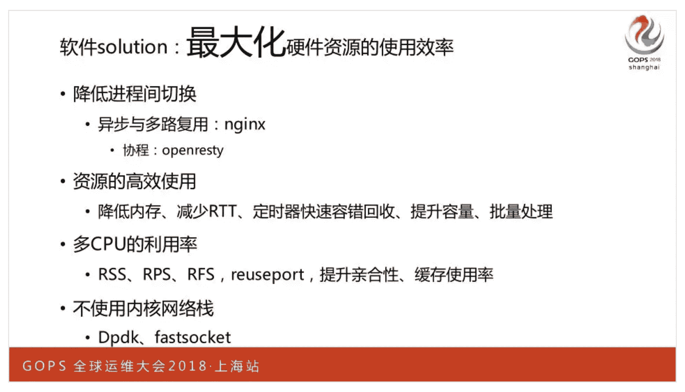

## 请求的“一生”

只有熟悉 Nginx 处理 HTTP 请求的流程，优化时才能做到有的放矢。

首先，我们要搞清楚 Nginx 的模块架构。Nginx 是一个极其开放的生态，它允许第三方编写的 C 模块与框架协作，共同处理 1 个 HTTP 请求。比如，所有的请求处理模块会构成一个链表，以 PipeAndFilter 这种架构依次处理请求。再比如，生成 HTTP 响应后，所有过滤模块也会依次加工。

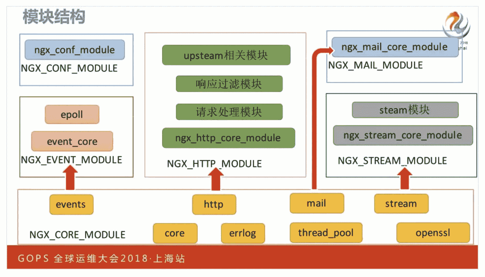

### 1. 请求到来

试想一下，当用户请求到来时，服务器到底会做哪些事呢？首先，操作系统内核会将完成三次握手的连接 socket，放入 1 个 ACCEPT 队列（如果打开了 reuseport，内核会选择某个 worker 进程对应的队列），某个 Nginx Worker 进程事件模块中的代码，需要调用 accept 函数取出 socket。

建立好连接并分配 ngx_connection_t 对象后，Nginx 会为它分配 1 个内存池，它的默认大小是 512 字节（可以由 connection_pool_size 指令修改），只有这个连接关闭的时候才会去释放。

接下来 Nginx 会为这个连接添加一个默认 60 秒（client_header_timeout 指令可以配置）的定时器，其中，需要将内核的 socket 读缓冲区里的 TCP 报文，拷贝到用户态内存中。所以，此时会将连接内存池扩展到 1KB（client_header_buffer_size 指令可以配置）来拷贝消息内容，如果在这段时间之内没有接收完请求，则返回失败并关闭连接。

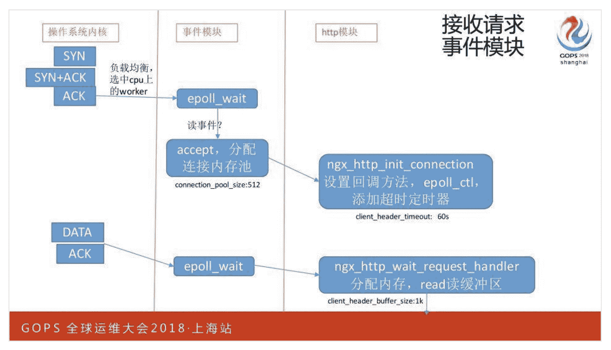

### 2. 处理请求

当接收完 HTTP 请求行和 HEADER 后，就清楚了这是一个什么样的请求，此时会再分配另一个默认为 4KB（request_pool_size 指令可以修改，这里请你思考为什么这个请求内存池比连接内存池的初始字节数多了 8 倍？）的内存池。

Nginx 会通过协议状态机解析接收到的字符流，如果 1KB 内存还没有接收到完整的 HTTP 头部，就会再从请求内存池上分配出 32KB，继续接收字符流。其中，这 32KB 默认是分成 4 次分配，每次分配 8KB（可以通过 large_client_header_buffers 指令修改），这样可以避免为少量的请求浪费过大的内存。

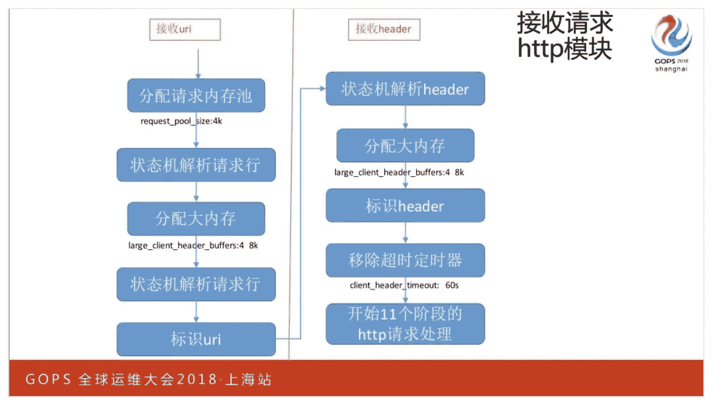

接下来，各类 HTTP 处理模块登场。当然，它们并不是简单构成 1 个链表，而是通过 11 个阶段构成了一个二维链表。其中，第 1 维长度是与 Web 业务场景相关的 11 个阶段，第 2 维的长度与每个阶段中注册的 HTTP 模块有关。

这 11 个阶段不用刻意死记，你只要掌握 3 个关键词，就能够轻松地把他们分解开。首先是 5 个阶段的预处理，包括 post_read，以及与 rewrite 重写 URL 相关的 3 个阶段，以及 URL 与 location 相匹配的 find_config 阶段。

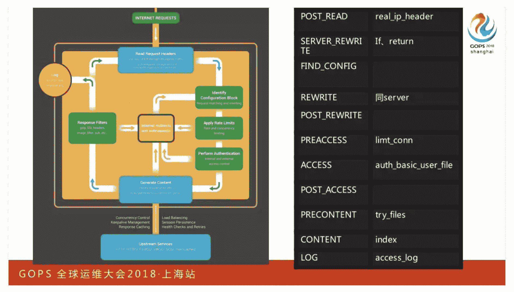

其次是访问控制，包括限流限速的 preaccess 阶段、控制 IP 访问范围的 access 阶段和做完访问控制后的 post_access 阶段。

最后则是内容处理，比如执行镜象分流的 precontent 阶段、生成响应的 content 阶段、记录处理结果的 log 阶段。

每个阶段中的 HTTP 模块，会在 configure 脚本执行时就构成链表，顺序地处理 HTTP 请求。其中，HTTP 框架允许某个模块跳过其后链接的本阶段模块，直接进入下一个阶段的第 1 个模块。

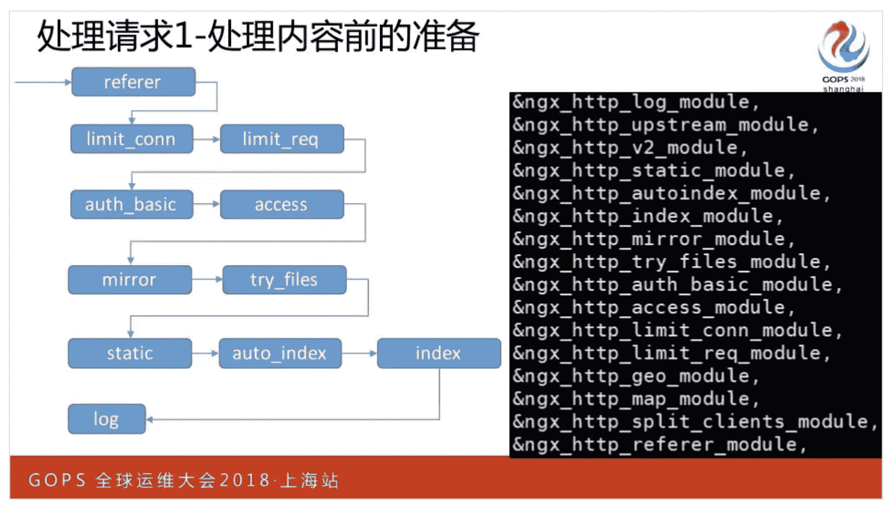

content 阶段会生成 HTTP 响应。当然，其他阶段也有可能生成 HTTP 响应返回给客户端，它们通常都是非 200 的错误响应。接下来，会由 HTTP 过滤模块加工这些响应的内容，并由 write_filter 过滤模块最终发送到网络中。

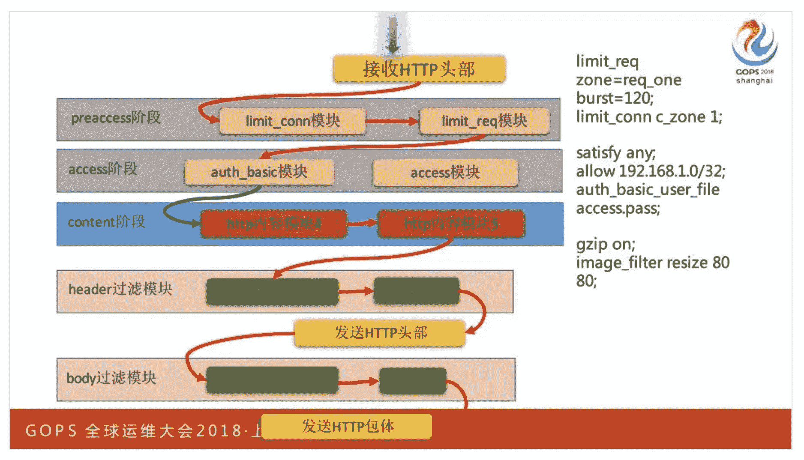

### 3. 请求的反向代理

Nginx 由于性能高，常用来做分布式集群的负载均衡服务。由于 Nginx 下游通常是公网，网络带宽小、延迟大、抖动大，而上游的企业内网则带宽大、延迟小、非常稳定，因此 Nginx 需要区别对待这两端的网络，以求尽可能地减轻上游应用的负载。

比如，当你配置 proxy_request_buffering on 指令（默认就是打开的）后，Nginx 会先试图将完整的 HTTP BODY 接收完，当内存不够（默认是 16KB，你可以通过 client_body_buffer_size 指令修改）时还会保存到磁盘中。这样，在公网上漫长的接收 BODY 流程中，上游应用都不会有任何流量压力。

接收完请求后，会向上游应用建立连接。当然，Nginx 也会通过定时器来保护自己，比如建立连接的最长超时时间是 60 秒（可以通过 proxy_connect_timeout 指令修改）。

当上游生成 HTTP 响应后，考虑到不同的网络特点，如果你打开了 proxy_buffering on（该功能也是默认打开的）功能，Nginx 会优先将内网传来的上游响应接收完毕（包括存储到磁盘上），这样就可以关闭与上游之间的 TCP 连接，减轻上游应用的并发压力。最后再通过缓慢的公网将响应发送给客户端。当然，针对下游客户端与上游应用，还可以通过 proxy_limit_rate 与 limit_rate 指令限制传输速度。如果设置 proxy_buffering off，Nginx 会从上游接收到一点响应，就立刻往下游发一些。

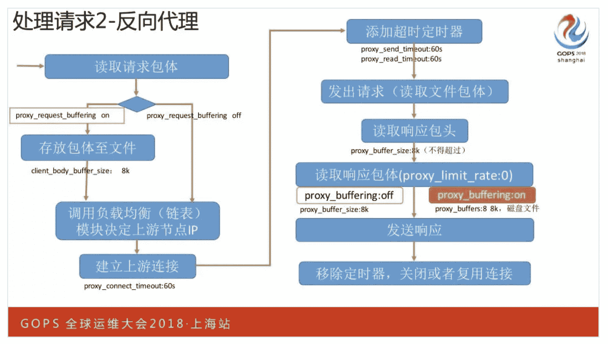

### 4. 返回响应

当生成 HTTP 响应后，会由注册为 HTTP 响应的模块依次加工响应。同样，这些模块的顺序也是由 configure 脚本决定的。由于 HTTP 响应分为 HEADER（包括响应行和头部两部分）、BODY，所以每个过滤模块也可以决定是仅处理 HEADER，还是同时处理 HEADER 和 BODY。

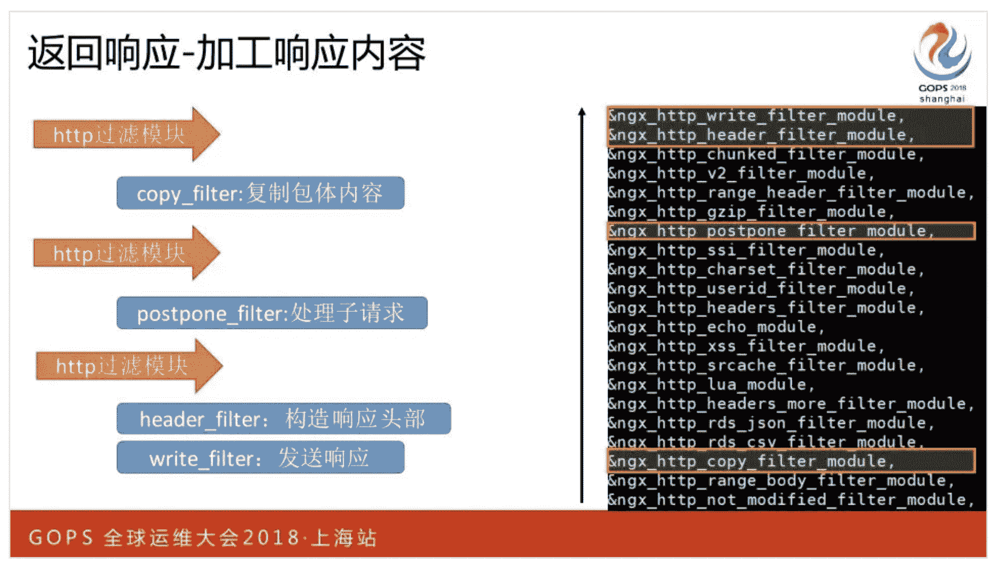

因此，OpenResty 中会提供有 header_filter_by_lua 和 body_filter_by_lua 这两个指令。

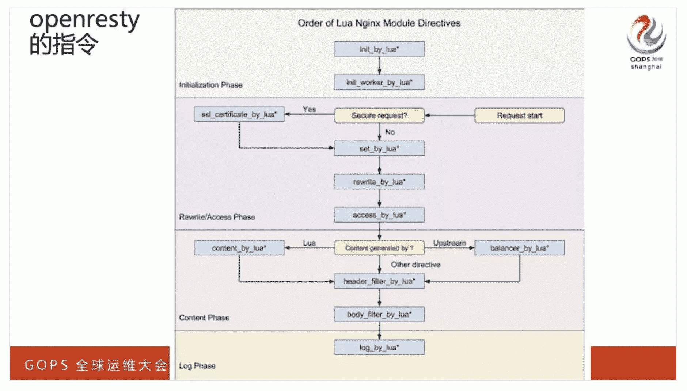

## 应用层优化

### 1. 协议

应用层协议的优化可以带来非常大的收益。比如 HTTP/1 HEADER 的编码方式低效，REST 架构又放大了这一点，改为 HTTP/2 协议后就大有改善。Nginx 对 HTTP/2 有良好的支持，包括上游、下游，以及基于 HTTP/2 的 gRPC 协议。

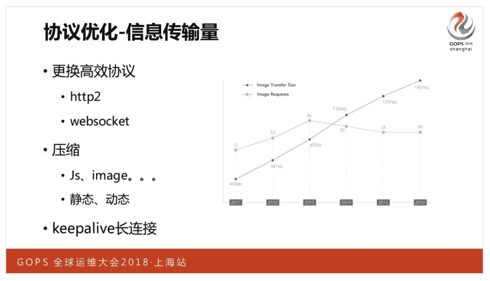

### 2. 压缩

对于无损压缩，信息熵越大，压缩效果就越好。对于文本文件的压缩来说，Google 的 Brotli 就比 Gzip 效果好，你可以通过https://github.com/google/ngx_brotli 模块，让 Nginx 支持 Brotli 压缩算法。

对于静态图片通常会采用有损压缩，这里不同压缩算法的效果差距更大。目前 Webp 的压缩效果要比 jpeg 好不少。对于音频、视频则可以基于关键帧，做动态增量压缩。当然，只要是在 Nginx 中做实时压缩，就会大幅降低性能。除了每次压缩对 CPU 的消耗外，也不能使用 sendfile 零拷贝技术，因为从磁盘中读出资源后，copy_filter 过滤模块必须将其拷贝到内存中做压缩，这增加了上下文切换的次数。更好的做法是提前在磁盘中压缩好，然后通过 add_header 等指令在响应头部中告诉客户端该如何解压。

### 3. 提高内存使用率

只在需要时分配恰当的内存，可以提高内存效率。所以下图中 Nginx 提供的这些内存相关的指令，需要我们根据业务场景谨慎配置。当然，Nginx 的内存池已经将内存碎片、小内存分配次数过多等问题解决了。必要时，通过 TcMalloc 可以进一步提升 Nginx 申请系统内存的效率。

同样，提升 CPU 缓存命中率，也可以提升内存的读取速度。基于 cpu cache line 来设置哈希表的桶大小，就可以提高多核 CPU 下的缓存命中率。

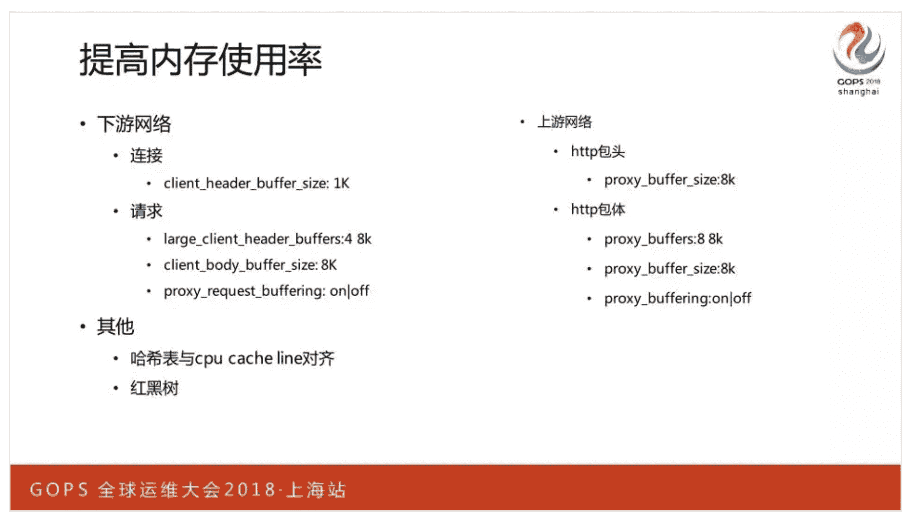

### 4. 限速

作为负载均衡，Nginx 可以通过各类模块提供丰富的限速功能。比如 limit_conn 可以限制并发连接，而 limit_req 可以基于 leacky bucket 漏斗原理限速。对于向客户端发送 HTTP 响应，可以通过 limit_rate 指令限速，而对于 HTTP 上游应用，可以使用 proxy_limit_rate 限制发送响应的速度，对于 TCP 上游应用，则可以分别使用 proxy_upload_rate 和 proxy_download_rate 指令限制上行、下行速度。

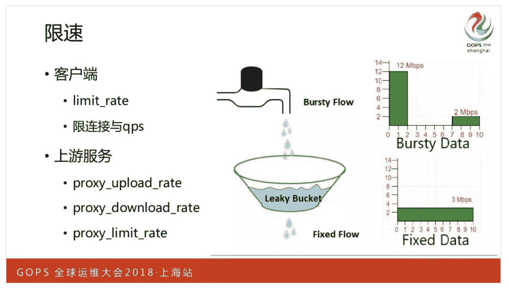

### 5. Worker 间负载均衡

当 Worker 进程通过 epoll_wait 的读事件获取新连接时，就由内核挑选 1 个 Worker 进程处理新连接。早期 Linux 内核的挑选算法很糟糕，特别是 1 个新连接建立完成时，内核会唤醒所有阻塞在 epoll_wait 函数上的 Worker 进程，然而，只有 1 个 Worker 进程，可以通过 accept 函数获取到新连接，其他进程获取失败后重新休眠，这就是曾经广为人知的“惊群”现象。同时，这也很容易造成 Worker 进程间负载不均衡，由于每个 Worker 进程绑定 1 个 CPU 核心，当部分 Worker 进程中的并发 TCP 连接过少时，意味着 CPU 的计算力被闲置了，所以这也降低了系统的吞吐量。

Nginx 早期解决这一问题，是通过应用层 accept_mutex 锁完成的，在 1.11.3 版本前它是默认开启的：accept_mutex on;

其中负载均衡功能，是在连接数达到 worker_connections 的八分之七后，进行次数限制实现的。

我们还可以通过 accept_mutex_delay 配置控制负载均衡的执行频率，它的默认值是 500 毫秒，也就是最多 500 毫秒后，并发连接数较少的 Worker 进程会尝试处理新连接：accept_mutex_delay 500ms;

当然，在 1.11.3 版本后，Nginx 默认关闭了 accept_mutex 锁，这是因为操作系统提供了 reuseport（Linux3.9 版本后才提供这一功能）这个更好的解决方案。

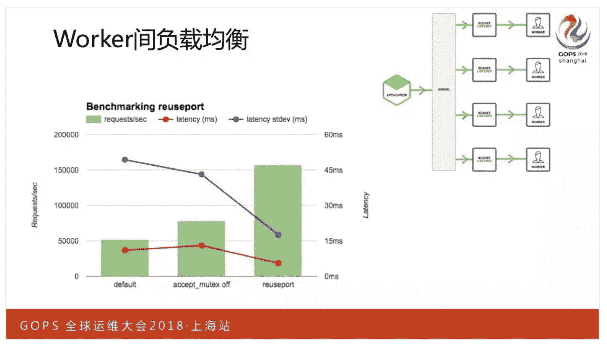

图中，横轴中的 default 项开启了 accept_mutex 锁。我们可以看到，使用 reuseport 后，QPS 吞吐量有了 3 倍的提高，同时处理时延有明显的下降，特别是时延的波动（蓝色的标准差线）有大幅度的下降。

### 6. 超时

Nginx 通过红黑树高效地管理着定时器，这里既有面对 TCP 报文层面的配置指令，比如面对下游的 send_timeout 指令，也有面对 UDP 报文层面的配置指令，比如 proxy_responses，还有面对业务层面的配置指令，比如面对下游 HTTP 协议的 client_header_timeout。

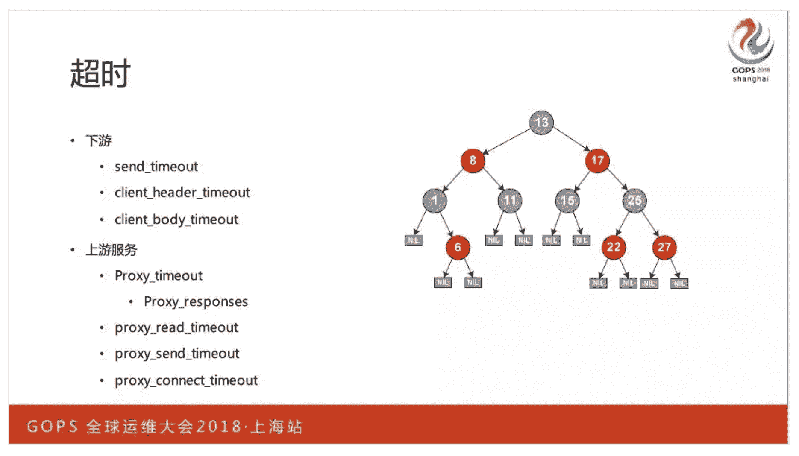

### 7. 缓存

只要想提升性能必须要在缓存上下工夫。Nginx 对于七层负载均衡，提供各种 HTTP 缓存，比如 http_proxy 模块、uwsgi_proxy 模块、fastcgi_proxy 模块、scgi_proxy 模块等等。由于 Nginx 中可以通过变量来命名日志文件，因此 Nginx 很有可能会并行打开上百个文件，此时通过 open_file_cache，Nginx 可以将文件句柄、统计信息等写入缓存中，提升性能。

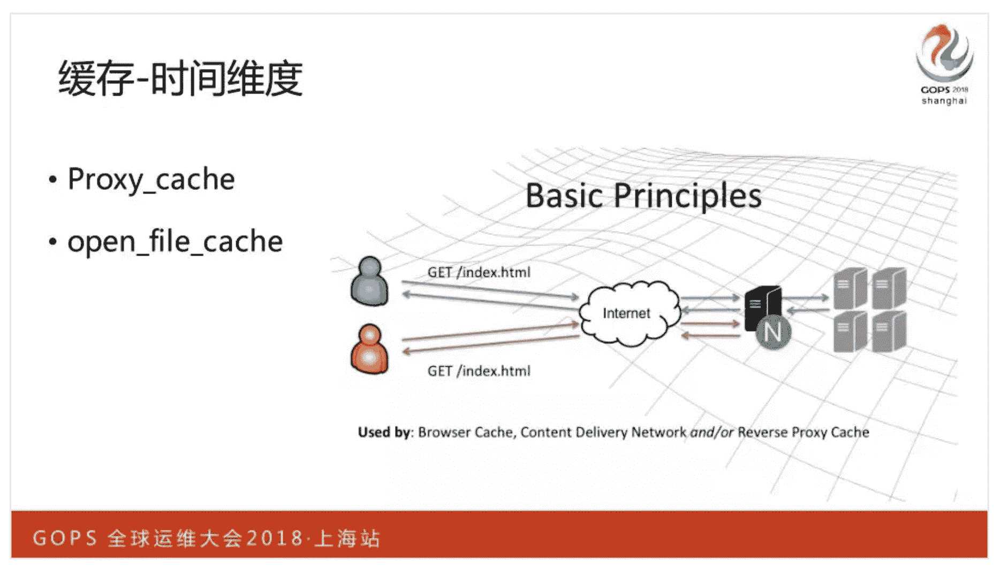

### 8. 减少磁盘 IO

Nginx 虽然读写磁盘远没有数据库等服务要多，但由于它对性能的极致追求，仍然提供了许多优化策略。比如为方便统计和定位错误，每条 HTTP 请求的执行结果都会写入 access.log 日志文件。为了减少 access.log 日志对写磁盘造成的压力，Nginx 提供了批量写入、实时压缩后写入等功能，甚至你可以在另一个服务器上搭建 rsyslog 服务，然后配置 Nginx 通过 UDP 协议，将 access.log 日志文件从网络写入到 rsyslog 中，这完全移除了日志磁盘 IO。

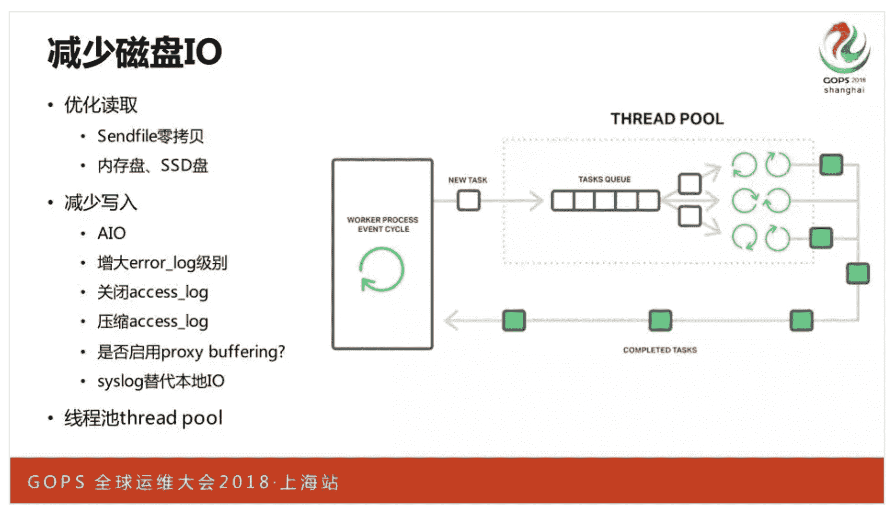

## 系统优化

最后，我们来看看针对操作系统内核的优化。

首先是为由内核实现的 OSI 网络层（IP 协议）、传输层（TCP 与 UDP 协议）修改影响并发性的配置。毕竟操作系统并不知道自己会作为高并发服务，所以很多配置都需要进一步调整。

其次，优化 CPU 缓存的亲和性，对于 Numa 架构的服务器，如果 Nginx 只使用一半以下的 CPU 核心，那么就让 Worker 进程只绑定一颗 CPU 上的核心。

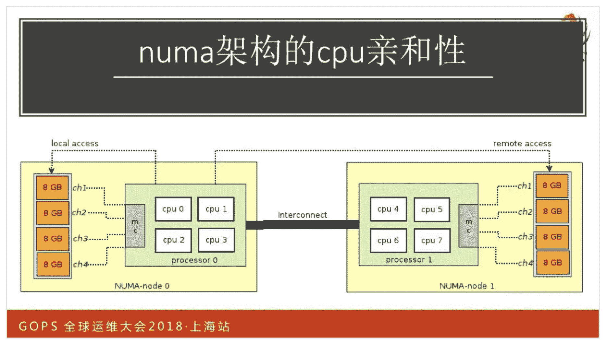

再次，调整默认的 TCP 网络选项，更快速地发现错误、重试、释放资源。

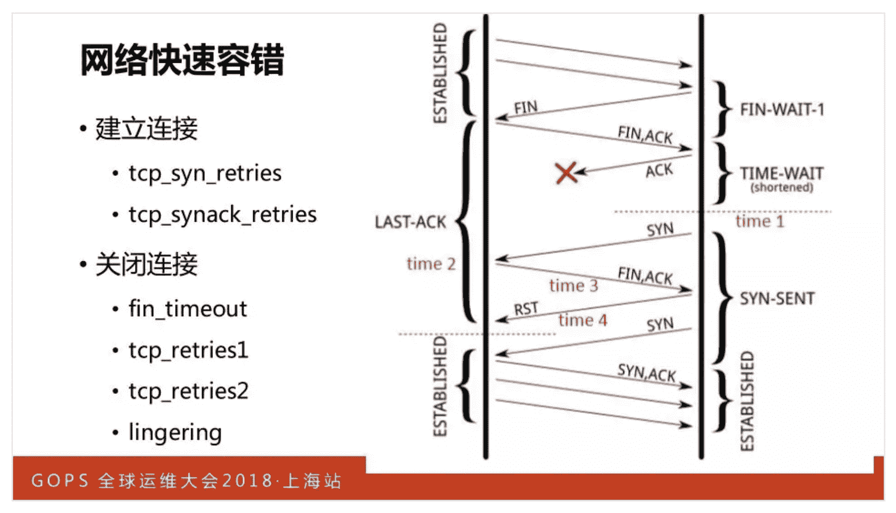

还可以减少 TCP 报文的往返次数。比如 FastOpen 技术可以减少三次握手中 1 个 RTT 的时延，而增大初始拥塞窗口可以更快地达到带宽峰值。

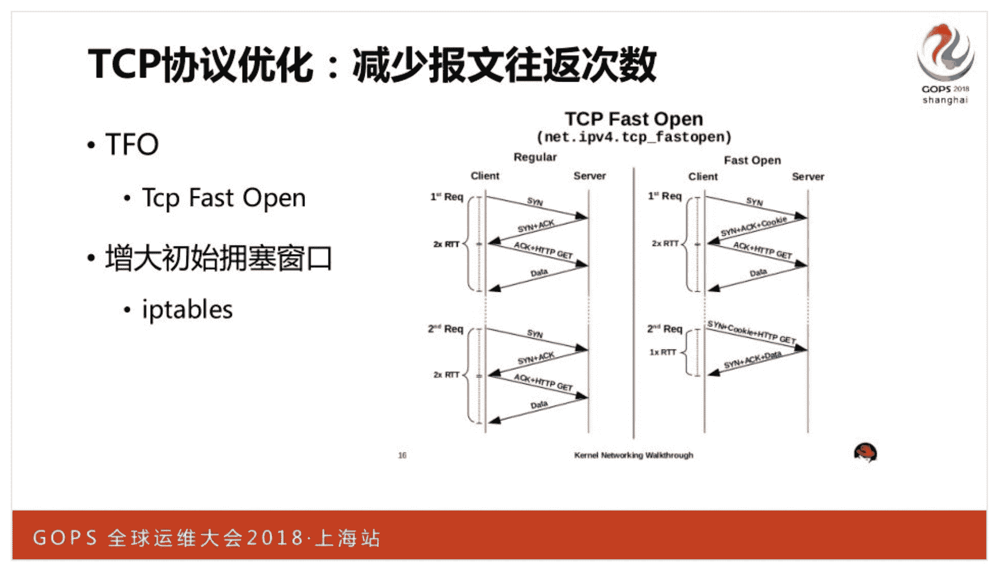

还可以提高硬件资源的利用效率，比如当你在 listen 指令后加入 defer 选项后，就使用了 TCP_DEFER_ACCEPT 功能，这样 epoll_wait 并不会返回仅完成三次握手的连接，只有连接上接收到的 TCP 数据报文后，它才会返回 socket，这样 Worker 进程就将原本 2 次切换就降为 1 次了，虽然会牺牲一些即时性，但提高了 CPU 的效率。

Linux 为 TCP 内存提供了动态调整功能，这样高负载下我们更强调并发性，而低负载下则可以更强调高传输速度。

我们还可以将小报文合并后批量发送，通过减少 IP 与 TCP 头部的占比，提高网络效率。在 nginx.conf 文件中打开 tcp_nopush、tcp_nodelay 功能后，都可以实现这些目的。

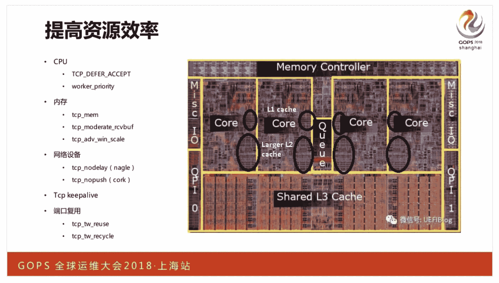

为了防止处理系统层网络栈的 CPU 过载，还可以通过多队列网卡，将负载分担到多个 CPU 中。

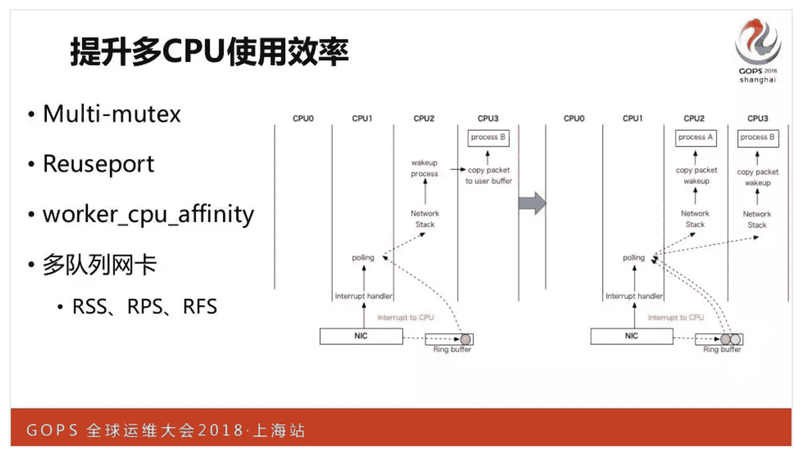

为了提高内存、带宽的利用率，我们必须更精确地计算出 BDP，也就是通过带宽与 ping 时延算出的带宽时延积，决定 socket 读写缓冲区（影响滑动窗口大小）。

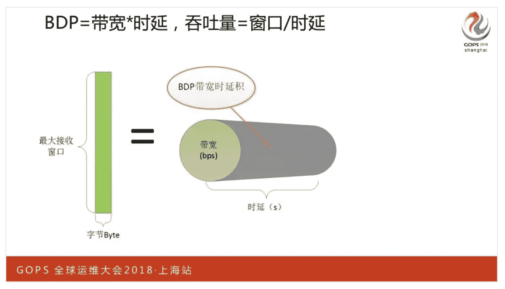

Nginx 上多使用小于 256KB 的小内存，而且我们通常会按照 CPU 核数开启 Worker 进程，这样一种场景下，TCMalloc 的性能要远高于 Linux 默认的 PTMalloc2 内存池。

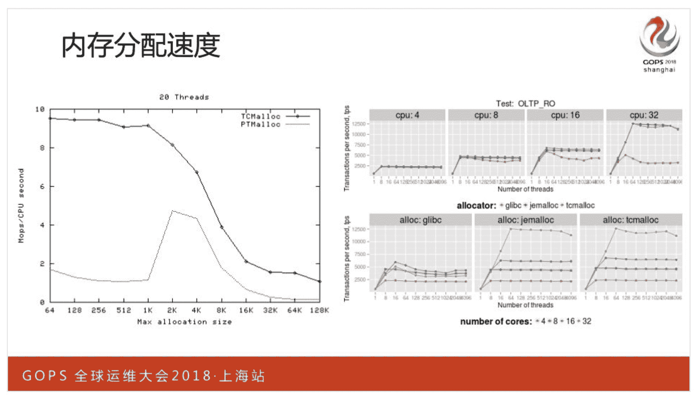

作为 Web 服务器，Nginx 必须重写 URL 以应对网址变化，或者应用的维护，这需要正则表达式的支持。做复杂的 URL 或者域名匹配时，也会用到正则表达式。优秀的正则表达式库，可以提供更好的执行性能。

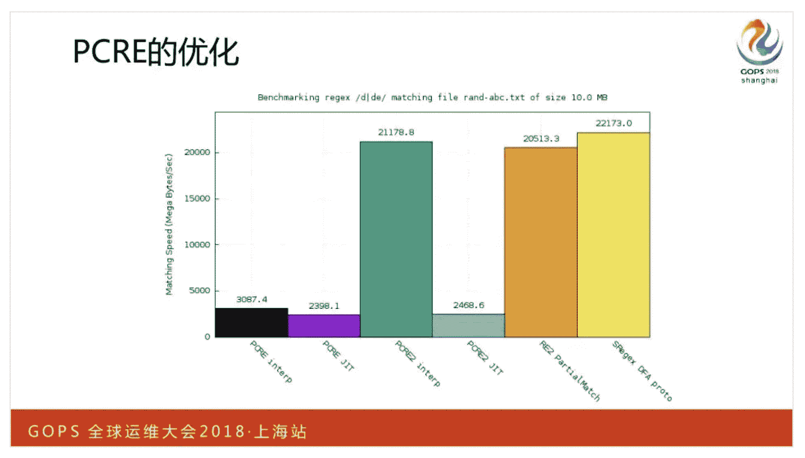

以上就是今天的加餐分享，有任何问题欢迎在留言区中提出。
