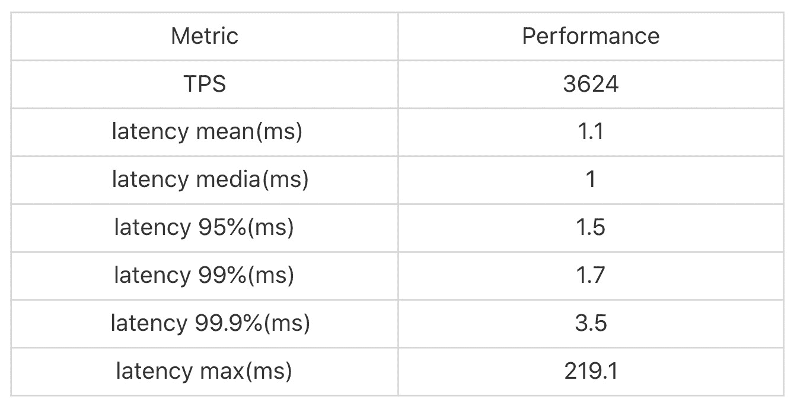

# 大咖助场｜傅健：那些年，影响我们达到性能巅峰的常见绊脚石（上）

 

你好，我是傅健。这里有部分同学可能认识我，我在极客时间开设了一门视频课《Netty 源码剖析与实战》，很荣幸受邀来到陶辉老师的专栏做一些分享。今天我会围绕这门课程的主题——系统性能调优，结合我自身的工作经历补充一些内容，期待能给你一些新思路。

其实说起性能调优，我们往往有很多理论依据可以参考，例如针对分布式系统的 NWR、CAP 等，也有很多实践的“套路”，如绘制火焰图、监控调用链等。当然，这些内容多多少少陶辉老师都有讲到。实际上，不管方式、方法有多少，我们的终极目标都是一致的，那就是在固定的资源条件下，将系统的响应速度调整到极致。

但是在严谨地评价一个系统性能时，我们很少粗略地使用这种表述：在压力 A（如 1000 TPS）下，基于软硬件配置 B，我们应用的 C 操作响应时间是 D 毫秒。而是加上一个百分位，例如：在压力 A（如 1000 TPS）下，基于软硬件配置 B，我们应用的 C 操作响应时间 **99%** 已经达到 D 毫秒。或者当需要提供更为详细的性能报告时，我们提供的往往是类似于下面表格形式的数据来反映性能：不仅包括常见的百分比（95%、99% 等或者常见的四分位），也包括平均数、中位数、最大值等。



那为什么要如此“严谨”？不可以直接说达到了某某水平吗？究其原因，还是我们的系统很难达到一个完美的极致，总有一些请求的处理时间超出了我们的“预期”，让我们的系统不够平滑（即常说的系统有“毛刺”）。所以在追求极致的路上，我们的工作重心已经不再是“大刀阔斧”地进行主动性能调优以满足 99% 的需求，而是着重观察、分析那掉队的 1% 请求，找出这些“绊脚石”，再各个击破，从而提高我们系统性能的“百分比”。例如，从 2 个 9（99%）再进一步提高到 3 个 9（99.9%）。而实际上，我们不难发现，这些所谓的绊脚石其实都是类似的，所以这期分享我就带你看看究竟有哪些绊脚石，我们结合具体场景总结应对策略。

## 场景 1：重试、重定向

### 案例

当我们使用下游服务的 API 接口时，偶尔会出现延时较大的情况，而这些延时较大的调用最后也能成功，且没有任何明显的时间规律。例如响应延时正常时，API 调用性能度量数据如下：

```
{  
 "stepName": "CallRemoteService"  
 "values": {  
    "componentType": "RemoteService",  
    "startTime": "2020-07-06T10:50:41.102Z",  
    "totalDurationInMS": 2,  
    "success": true  
 }  
}
```

而响应延时超出预期时，度量数据如下：

```
{  
 "stepName": "CallRemoteService"  
 "values": {  
    "componentType": "RemoteService",  
    "startTime": "2020-07-06T04:31:55.805Z",  
    "totalDurationInMS": 2005,  
    "success": true  
 }  
}

### 解析

这种情况可以说非常典型了，单从以上度量数据来看，没有什么参考意义，因为所有的性能问题都是这样的特征，即延时增大了。这里面可能的原因也有许多，例如 GC 影响、网络抖动等等，但是除了这些原因之外，其实最常见、最简单的原因往往都是“重试”。重试成功前的访问往往都是很慢的，因为可能遇到了各种需要重试的错误，同时重试本身也会增加响应时间。那作为第一个绊脚石，我们现在就对它进行一个简单的分析。
```

以这个案例为例，经过查询后你会发现：虽然最终是成功的，但是我们中途进行了重试，具体而言就是我们在使用 HttpClient 访问下游服务时，自定义了重试的策略：当遇到 ConnectTimeoutException、SocketTimeoutException 等错误时直接进行重试。

```
//构建http client  
CloseableHttpClient httpClient = HttpClients.custom().  
      setConnectionTimeToLive(3, TimeUnit.MINUTES).  
      //省略其它非关键代码  
      setServiceUnavailableRetryStrategy(new DefaultServiceUnavailableRetryStrategy(1, 50)).  
      //设置了一个自定义的重试规则  
      setRetryHandler(new CustomizedHttpRequestRetryHandler()).  
            build();  
    
//自定义的重试规则  
@Immutable  
public class CustomizedHttpRequestRetryHandler implements HttpRequestRetryHandler {  
  
   private final static int RETRY_COUNT = 1;  
  
   CustomizedHttpRequestRetryHandler() {}  
  
   @Override  
   public boolean retryRequest(final IOException exception, final int executionCount, final HttpContext context) {  
      //控制重试次数  
      if (executionCount > RETRY_COUNT) {  
         return false;  
      }  
      //遇到下面这些异常情况时，进行重试  
      if (exception instanceof ConnectTimeoutException || exception instanceof NoHttpResponseException || exception instanceof SocketTimeoutException) {  
        return true;  
      }  
        
      //省略其它非关键代码  
      return false;  
   }  
}
```

如果查询日志的话（由 org.apache.http.impl.execchain.RetryExec#execute 输出），我们确实发现了重试的痕迹，且可以完全匹配上我们的请求和时间：

```
[07/06/2020 04:31:57.808][threadpool-0]INFO  RetryExec-I/O exception (org.apache.http.conn.ConnectTimeoutException) caught when processing request to {}->http://10.224.86.130:8080: Connect to 10.224.86.130:8080 [/10.224.86.130] failed: connect timed out  
  
[07/06/2020 04:31:57.808][threadpool-0]INFO  RetryExec-Retrying request to {}->http://10.224.86.130:8080
```

另外除了针对异常的重试外，我们有时候也需要对于服务的短暂不可用（返回 503：SC_SERVICE_UNAVAILABLE）进行重试，正如上文贴出的代码中我们设置了 DefaultServiceUnavailableRetryStrategy。

### 小结

这个案例极其简单且常见，但是这里我需要额外补充下：假设遇到这种问题，又没有明确给出重试的痕迹（日志等）时，我们应该怎么去判断是不是重试“捣鬼”的呢？

一般而言，我们可以直接通过下游服务的调用次数数据来核对是否发生了重试。但是如果下游也没有记录，在排除完其它可能原因后，我们仍然不能排除掉重试的原因，因为重试的痕迹可能由于某种原因被隐藏起来了，例如使用的开源组件压根没有打印日志，或者是打印了但是我们应用层的日志框架没有输出。这个时候，我们也没有更好的方法，只能翻阅源码查找线索。

另外除了直接的重试导致延时增加外，还有一种类似情况也经常发生，即“重定向”，而比较坑的是，对于重定向行为，很多都被“内置”起来了：即不输出 INFO 日志。例如 Apache HttpClient 对响应码 3XX 的处理（参考 org.apache.http.impl.client.DefaultRedirectStrategy）只打印了 Debug 日志：

```
final String location = locationHeader.getValue();  
if (this.log.isDebugEnabled()) {  
    this.log.debug("Redirect requested to location '" + location + "'");  
}
```

再如，当我们使用 Jedis 访问 Redis 集群中的结点时，如果数据不在当前的节点了，也会发生“重定向”，而它并没有打印出日志让我们知道这件事的发生（参考 redis.clients.jedis.JedisClusterCommand）：

```
  private T runWithRetries(final int slot, int attempts, boolean tryRandomNode, JedisRedirectionException redirect) {  
     //省略非关键代码  
    } catch (JedisRedirectionException jre) {  
      // if MOVED redirection occurred,  
      if (jre instanceof JedisMovedDataException) {  
        //此处没有输入任何日志指明接下来的执行会“跳转”了。  
        // it rebuilds cluster's slot cache recommended by Redis cluster specification  
        this.connectionHandler.renewSlotCache(connection);  
      }  
  
      //省略非关键代码  
      return runWithRetries(slot, attempts - 1, false, jre);  
    } finally {  
      releaseConnection(connection);  
    }
```

综上，重试是最普通的，也是最简单的导致延时增加的“绊脚石”，而重试问题的界定难度取决于自身和下游服务是否有明显的痕迹指明。而对于这种绊脚石的消除，一方面我们应该主动出击，尽量减少引发重试的因素。另一方面，我们一定要控制好重试，例如：

1. 控制好重试的次数；
2. 错峰重试的时间；
3. 尽可能准确识别出重试的成功率，以减少不必要的重试，例如我们可以通过“熔断”“快速失败”等机制来实现。

## 场景 2：失败引发轮询

### 案例

在使用 Apache HttpClient 发送 HTTP 请求时，稍有经验的程序员都知道去控制下超时时间，这样，在连接不上服务器或者服务器无响应时，响应延时都会得到有效的控制，例如我们会使用下面的代码来配置 HttpClient：

```
RequestConfig requestConfig = RequestConfig.custom().  
            setConnectTimeout(2 * 1000). //控制连接建立时间  
            setConnectionRequestTimeout(1 * 1000).//控制获取连接时间  
            setSocketTimeout(3 * 1000).//控制“读取”数据等待时间  
            build();
```

以上面的代码为例，你能估算出响应时间最大是多少么？上面的代码实际设置了三个参数，是否直接相加就能计算出最大延时时间？即所有请求 100% 控制在 6 秒。

先不说结论，通过实际的生产线观察，我们确实发现大多符合我们的预期：可以说 99.9% 的响应都控制在 6 秒以内，但是总有一些“某年某月某天”，发现有一些零星的请求甚至超过了 10 秒，这又是为什么？

### 解析

经过问题跟踪，我们发现我们访问的 URL 是一个下游服务的域名（大多如此，并不稀奇），而这个域名本身有点特殊，由于负载均衡等因素的考虑，我们将它绑定到了多个 IP 地址。所以假设这些 IP 地址中，一些 IP 地址指向的服务临时不服务时，则会引发轮询，即轮询其它 IP 地址直到最终成功或失败，而每一次轮询中的失败都会额外增加一倍 ConnectTimeout，所以我们发现超过 6 秒甚至 10 秒的请求也不稀奇了。我们可以通过 HttpClient 的源码来验证下这个逻辑（参考 org.apache.http.impl.conn.DefaultHttpClientConnectionOperator.connect 方法）：

```
public void connect(  
        final ManagedHttpClientConnection conn,  
        final HttpHost host,  
        final InetSocketAddress localAddress,  
        final int connectTimeout,  
        final SocketConfig socketConfig,  
        final HttpContext context) throws IOException {  
    final Lookup<ConnectionSocketFactory> registry = getSocketFactoryRegistry(context);  
    final ConnectionSocketFactory sf = registry.lookup(host.getSchemeName());  
    //域名解析，可能解析出多个地址  
    final InetAddress[] addresses = host.getAddress() != null ?  
            new InetAddress[] { host.getAddress() } : this.dnsResolver.resolve(host.getHostName());  
    final int port = this.schemePortResolver.resolve(host);  
      
    //对于解析出的地址，进行连接，如果中途有失败，尝试下一个  
    for (int i = 0; i < addresses.length; i++) {  
        final InetAddress address = addresses[i];  
        final boolean last = i == addresses.length - 1;  
  
        Socket sock = sf.createSocket(context);  
        conn.bind(sock);  
  
        final InetSocketAddress remoteAddress = new InetSocketAddress(address, port);  
        if (this.log.isDebugEnabled()) {  
            this.log.debug("Connecting to " + remoteAddress);  
        }  
        try {  
            //使用解析出的地址执行连接  
            sock = sf.connectSocket(  
                    connectTimeout, sock, host, remoteAddress, localAddress, context);  
            conn.bind(sock);  
            if (this.log.isDebugEnabled()) {  
                this.log.debug("Connection established " + conn);  
            }  
            //如果连接成功，则直接退出，不继续尝试其它地址  
            return;   
        } catch (final SocketTimeoutException ex) {  
            if (last) {  
                throw new ConnectTimeoutException(ex, host, addresses);  
            }  
        } catch (final ConnectException ex) {  
            if (last) { //如果连接到最后一个地址，还是失败，则抛出异常。如果不是最后一个，则轮询下一个地址进行连接。  
                final String msg = ex.getMessage();  
                if ("Connection timed out".equals(msg)) {  
                    throw new ConnectTimeoutException(ex, host, addresses);  
                } else {  
                    throw new HttpHostConnectException(ex, host, addresses);  
                }  
            }  
        }   
        if (this.log.isDebugEnabled()) {  
            this.log.debug("Connect to " + remoteAddress + " timed out. " +  
                    "Connection will be retried using another IP address");  
        }  
    }  
}
```

通过以上代码，我们可以清晰地看出：在一个域名能解析出多个 IP 地址的场景下，如果其中部分 IP 指向的服务不可达时，延时就可能会增加。这里不妨再举个例子，对于 Redis 集群，我们会在客户端配置多个连接节点（例如在 SpringBoot 中配置 spring.redis.cluster.nodes=10.224.56.101:8001,10.224.56.102:8001），通过连接节点来获取整个集群的信息（其它所有节点）。正常情况下，我们都会连接成功，所以我们没有看到长延时情况，但是假设刚初始化时，连接的部分节点不服务了，那这个时候就会连接其它配置的节点，从而导致延时倍增。

### 小结

这部分我们主要看了失败引发轮询造成的长延时案例，细心的同学可能会觉得这不就是上一部分介绍的重试么？但是实际上，你仔细体会，两者虽然都旨在提供系统可靠性，但却略有区别：重试一般指的是针对同一个目标进行的再次尝试，而轮询则更侧重对同类目标的遍历。

另外，除了以上介绍的开源组件（Apache HttpClient 和 RedisClient）案例外，还有其它一些常见组件都可能因为轮询而造成延时超过预期。例如对于 Oracle 连接，我们采用下面的这种配置时，也可能会出现轮询的情况：

```
DBURL=jdbc:oracle:thin:@(DESCRIPTION=(load_balance=off)(failover=on)(ADDRESS=(PROTOCOL=TCP)(HOST=10.224.11.91)(PORT=1804))(ADDRESS=(PROTOCOL=TCP)(HOST=10.224.11.92)(PORT=1804))(ADDRESS=(PROTOCOL=TCP)(HOST= 10.224.11.93)(PORT=1804))(CONNECT_DATA=(SERVICE_NAME=xx.yy.com)(FAILOVER_MODE=(TYPE=SELECT)(METHOD=BASIC)(RETRIES=6)(DELAY=5))))  
DBUserName=admin  
DBPassword=password
```

其实通过对以上三个案例的观察，我们不难得出一个小规律：**假设我们配置了多个同种资源，那么就很有可能存在轮询情况，这种轮询会让延时远超出我们的预期。**只是幸运的是，在大多情况下，轮询第一次就成功了，所以我们很难观察到长延时的情况。针对这种情况造成的延时，我们除了在根源上消除外因，还要特别注意控制好超时时间，假设我们不知道这种情况，我们乐观地设置了一个很大的时间，则实际发生轮询时，这个时间会被放大很多倍。

这里再回到最开始的案例啰嗦几句，对于 HttpClient 的访问，是否加上最大轮询时间就是最大的延时时间呢？其实仍然不是，至少我们还忽略了一个时间，即 DNS 解析花费的时间。这里就不再展开讲了。

## 场景 3：GC 的“STW”停顿

### 案例

系统之间调用是服务最常见的方式，但这也是最容易发生“掐架”的斗争之地。例如对于组件 A，运维或者测试工程师反映某接口偶然性能稍差，而对于这个接口而言，实际逻辑“简单至极”，直接调用组件 B 的接口，而对于这个接口的调用，平时确实都是接近 1ms 的：

```
[07/04/2020 07:18:16.495 pid=3160 tid=3078502112] Info:[ComponentA] Send to Component B:  
[07/04/2020 07:18:16.496 pid=3160 tid=3078502112] Info:[ComponentA] Receive response from B
```

而反映的性能掉队不经常发生，而且发生时，也没有没有特别的信息，例如下面这段日志，延时达到了 400ms：

```
[07/04/2020 07:16:27.222 pid=4725 tid=3078407904] Info: [ComponentA]  Send to Component B:  
[07/04/2020 07:16:27.669 pid=4725 tid=3078407904] Info: [ComponentA]  Receive response from B
```

同时，对比下，我们也发现这 2 次请求其实很近，只有 2 分钟的差距。那么这又是什么导致的呢？

### 解析

对于这种情况，很明显，A 组件往往会直接“甩锅”给 B 组件。于是，B 组件工程师查询了日志：

```
 [07/04/2020 07:16:27.669][nioEventLoopGroup-4-1]INFO [ComponentB] Received request from Component A  
 [07/04/2020 07:16:27.669][nioEventLoopGroup-4-1]INFO [ComponentB] Response to Component B
```

然后 B 组件也开始甩锅：鉴于我们双方组件传输层都是可靠的，且 N 年没有改动，那这次的慢肯定是网络抖动造成的了。貌似双方也都得到了理想的理由，但是问题还是没有解决，这种类似的情况还是时而发生，那问题到底还有别的什么原因么？

鉴于我之前的经验，其实我们早先就知道 Java 的 STW（Stop The World）现象，可以说 Java 最省心的地方也是最容易让人诟病的地方。即不管怎么优化，或采用更先进的垃圾回收算法，都避免不了 GC，而 GC 会引发停顿。其实上面这个案例，真实的原因确实就是 B 组件的 GC 导致了它的处理停顿，从而没有及时接受到 A 发出的信息，何以见得呢？

早先在设计 B 组件时，我们就考虑到未来某天可能会发生类似的事情，所以加了一个 GC 的跟踪日志，我们先来看看日志：

```
{  
  "metricName": "java_gc",  
  "componentType": "B",  
  "componentAddress": "10.224.3.10",  
  "componentVer": "1.0",  
  "poolName": "test001",  
  "trackingID": "269",  
  "metricType": "innerApi",  
  "timestamp": "2020-07-04T07:16:27.219Z",  
  "values": {  
    "steps": [       
    ],  
    "totalDurationInMS": 428  
  }  
}
```

在 07:16:27.219 时，发生了 GC，且一直持续了 428ms，所以最悲观的停顿时间是从 219ms 到 647ms，而我们观察下 A 组件的请求发送时间 222 是落在这个区域的，再核对 B 组件接收这个请求的时间是 669，是 GC 结束后的时间。所以很明显，排除其它原因以后，这明显是受了 GC 的影响。

### 小结

假设某天我们看到零星请求有“掉队”，且没有什么规律，但是又持续发生，我们往往都会怀疑是网络抖动，但是假设我们的组件是部署在同一个网络内，实际上，不大可能是网络原因导致的，而更可能是 GC 的原因。当然，跟踪 GC 有 N 多方法，这里我只是额外贴上了组件 B 使用的跟踪代码：

```
List<GarbageCollectorMXBean> gcbeans = ManagementFactory.getGarbageCollectorMXBeans();  
for (GarbageCollectorMXBean gcbean : gcbeans) {  
      LOGGER.info("GC bean: " + gcbean);  
   if (!(gcbean instanceof NotificationEmitter))  
      continue;  
  
   NotificationEmitter emitter = (NotificationEmitter) gcbean;  
     
   //注册一个GC(垃圾回收)的通知回调  
   emitter.addNotificationListener(new NotificationListenerImplementation(), notification -> {  
            return GarbageCollectionNotificationInfo.GARBAGE_COLLECTION_NOTIFICATION  
         .equals(notification.getType());  
      }, null);  
  
}  
  
public final static class NotificationListenerImplementation implements NotificationListener {  
     
   @Override  
   public void handleNotification(Notification notification, Object handback) {  
      GarbageCollectionNotificationInfo info = GarbageCollectionNotificationInfo  
               .from((CompositeData) notification.getUserData());  
      String gctype = info.getGcAction().replace("end of ", "");  
      //此处只获取major gc的相关信息  
      if(gctype.toLowerCase().contains("major")){  
          long id = info.getGcInfo().getId();  
          long startTime = info.getGcInfo().getStartTime();  
          long duration = info.getGcInfo().getDuration();  
          //省略非关键代码，记录GC相关信息，如耗费多久、开始时间点等。  
      }  
   }  
}
```

另外同样是停顿，发生的时机不同，呈现的效果也不完全相同，具体问题还得具体分析。至于应对这个问题的策略，就是我们写 Java 程序一直努力的方向：减少 GC 引发的 STW 时间。

以上是我总结的 3 种常见“绊脚石”，那其实类似这样的问题还有很多，下一期分享我会再总结出 4 个场景化的问题，和你一起探讨应对策略。
