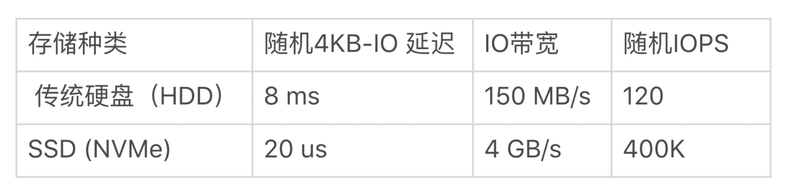
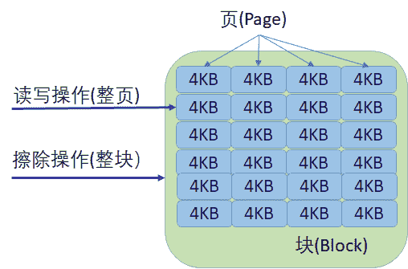
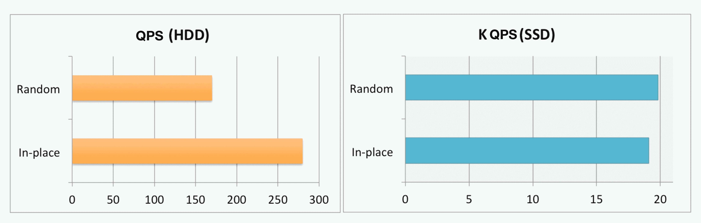

# 大咖助场｜庄振运：与程序员相关的SSD性能知识

 

你好，我是庄振运。我是《性能工程高手课》的专栏作者，很荣幸受邀来到陶辉老师的专栏做一期分享。今天我们来讲一点 SSD 相关的性能知识。SSD（Solid State Drive）是硬盘的一种，有时候也叫 Flash 或者固态硬盘。

最近几年，SSD 的发展和演化非常迅速。随着市场规模的增大和技术的进步，SSD 的价格也大幅度降低了。在很多实时的后台系统中，SSD 几乎已经成了标准配置了。所以了解它的机制和性能，对你的工作会很有益处的。

相对于传统硬盘 HDD（Hard Disk Drive），SSD 有完全不同的内部工作原理和全新的特性。有些机制不太容易理解，而且根据你工作的领域，需要理解的深度也不一样。所以，我把这节课的内容按照由浅入深的原则分成了三个层次。

第一个层次是关注 SSD 的外部性能指标；第二个层次是了解它的内部工作机制；第三个层次是设计对 SSD 友好的应用程序。

## 比 HDD 更快的硬盘

很多人对传统硬盘了解较多，毕竟这种硬盘在业界用了好几十年了，很多教科书里面都讲述过。所以，对 SSD 的性能，我先用对比的方式带你看看它们的外部性能指标和特性。

一个硬盘的性能最主要体现在这三个指标：IOPS，带宽 / 吞吐率和访问延迟。**IOPS** (Input/Output Per Second) ，即每秒钟系统能处理的读写请求数量。**访问延迟**，指的是从发起 IO 请求到存储系统把 IO 处理完成的时间间隔。**吞吐率**（Throughput）或者带宽（Bandwidth），衡量的是实际数据传输速率。

对于传统硬盘我们应该比较熟悉它的内部是如何操作的，简单来说，当应用程序发出硬盘 IO 请求后，这个请求会进入硬盘的 IO 队列。当轮到这个 IO 来存取数据时，磁头需要机械运动到数据存放的位置，这就需要磁头寻址到相应的磁道和旋转到相应的扇区，然后才是数据的传输。对于一块普通硬盘而言，随机 IO 读写延迟就是 8 毫秒左右，IO 带宽大约每秒 100MB，而随机 IOPS 一般是 100 左右。

SSD 的种类很多，按照技术来说有单层和多层。按照质量和性能来分，有企业级和普通级。根据安装的接口和协议来分，有 SAS, SATA, PCIe 和 NVMe 等。

我用一张表格来对比一下 HDD 和 SSD 的三大性能指标的差异。这里考虑比较流行的 NVMe 协议的 SSD。你可以看到，SSD 的随机 IO 延迟比传统硬盘快百倍以上，一般在微妙级别；IO 带宽也高很多倍，可以达到每秒几个 GB；随机 IOPS 更是快了上千倍，可以达到几十万。

## SSD 的性能特性和机制

SSD 的内部工作方式和 HDD 大相径庭，我们先了解几个概念。

**单元（Cell）**、**页面（Page）**、**块（Block）**。当今的主流 SSD 是基于 NAND 的，它将数字位存储在单元中。每个 SSD 单元可以存储一位或多位。对单元的每次擦除都会降低单元的寿命，所以单元只能承受一定数量的擦除。单元存储的位数越多，制造成本就越少，SSD 的容量也就越大，但是耐久性（擦除次数）也会降低。

一个页面包括很多单元，典型的页面大小是 4KB，页面也是要读写的最小存储单元。SSD 上没有“重写”操作，不像 HDD 可以直接对任何字节重写覆盖。一个页面一旦写入内容后就不能进行部分重写，必须和其它相邻页面一起被整体擦除重置。

多个页面组合成块。一个块的典型大小为 512KB 或 1MB，也就是大约 128 或 256 页。块是擦除的基本单位，每次擦除都是整个块内的所有页面都被重置。

了解完以上几个基础概念，我们重点看看 **IO 和垃圾回收 (Garbage Collection)** 。对 SSD 的 IO 共有三种类型：读取、写入和擦除。读取和写入以页为单位。IO 写入的延迟具体取决于磁盘的历史状态，因为如果 SSD 已经存储了许多数据，那么对页的写入就经常需要移动已有的数据。一般的读写延迟都很低，在微秒级别，远远低于 HDD。擦除是以块为单位的。擦除速度相对很慢，通常为几毫秒。所以对同步的 IO，发出 IO 的应用程序可能会因为块的擦除，而经历很大的写入延迟。为了尽量地减少这样的场景，保持空闲块的阈值对于快速的写响应是很有必要的。SSD 的垃圾回收（GC）的目的就在于此。GC 可以回收用过的块，这样可以确保以后的页写入可以快速分配到一个全新的页。

**写入放大（Write Amplification, or WA)。** 这是 SSD 相对于 HDD 的一个缺点，即实际写入 SSD 的物理数据量，有可能是应用层写入数据量的多倍。一方面，页级别的写入需要移动已有的数据来腾空页面。另一方面，GC 的操作也会移动用户数据来进行块级别的擦除。所以对 SSD 真正的写操作的数据可能比实际写的数据量大，这就是写入放大。一块 SSD 只能进行有限的擦除次数，也称为编程 / 擦除（P/E）周期，所以写入放大效用会缩短 SSD 的寿命。

**耗损平衡 (Wear Leveling) 。**对每一个块而言，一旦达到最大数量，该块就会死亡。对于 SLC 块，P/E 周期的典型数目是十万次；对于 MLC 块，P/E 周期的数目是一万；而对于 TLC 块，则可能是几千。为了确保 SSD 的容量和性能，我们需要在擦除次数上保持平衡，SSD 控制器具有这种“耗损平衡”机制可以实现这一目标。在损耗平衡期间，数据在各个块之间移动，以实现均衡的损耗，这种机制也会对前面讲的写入放大推波助澜。

## 设计对 SSD 友好的程序

SSD 的 IO 性能相对于 HDD 来说，IOPS 和访问延迟提升了上千倍，吞吐率也是几十倍，但是 SSD 的缺点也很明显，有三个：贵、容量小、易损耗。随着技术的发展，这三个缺点近几年在弱化。

现在越来越多的系统采用 SSD 来减轻应用程序的 IO 性能瓶颈。许多部署的结果显示，与 HDD 相比，SSD 带来了极大的应用程序的性能提升。但是，在大多数部署方案中，SSD 仅被视为“更快的 HDD”，SSD 的潜力并未得到充分利用。尽管使用 SSD 作为存储时应用程序可以获得更好的性能，但是这些收益主要归因于 SSD 提供的更高的 IOPS 和带宽。

进一步讲，如果应用程序的设计充分考虑了 SSD 的内部机制，从而设计为对 SSD 友好，则可以更大程度地优化 SSD，从而进一步提高应用程序性能，也可以延长 SSD 的寿命而降低运用成本。接下来我们就看看如何在应用程序层进行一系列 SSD 友好的设计更改。

### 为什么要设计 SSD 友好的软件和应用程序？

SSD 友好的程序可以获得三种好处：

1. 提升应用程序性能；
2. 提高 SSD 的 IO 效率；
3. 延长 SSD 的寿命。

我分别说明一下。

**更好的应用程序性能。**尽管从 HDD 迁移到 SSD 通常意味着更好的应用程序性能，这主要是得益于 SSD 的 IO 性能更好，但在不更改应用程序设计的情况下简单地采用 SSD 可能无法获得最佳性能。我们曾经有一个应用程序就是如此。该应用程序需要不断写入文件以保存数据，主要性能瓶颈就是硬盘 IO。使用 HDD 时，最大应用程序吞吐量为每秒 142 个查询（QPS）。无论对应用程序设计进行各种更改还是调优，这都是可以获得的最好性能。

当迁移到具有相同应用程序的 SSD 时，吞吐量提高到 2 万 QPS，速度提高了 140 倍。这主要来自 SSD 提供的更高 IOPS。在对应用程序设计进行进一步优化使其对 SSD 友好之后，吞吐量提高到 10 万 QPS，与原来的简单设计相比，提高了 4 倍。

这其中的秘密就是使用多个并发线程来执行 IO，这就利用了 SSD 的内部并行性。记住，多个 IO 线程对 HDD 毫无益处，因为 HDD 只有一个磁头。

**更高效的存储 IO。** SSD 上的最小内部 IO 单元是一页，比如 4KB 大小。因此对 SSD 的单字节读 / 写必须在页面级进行。应用程序对 SSD 的写操作可能会导致对 SSD 上的物理写操作变大，这就是“写放大（WA）”。因为有这个特性，如果应用程序的数据结构或 IO 对 SSD 不友好，就会让写放大效果无谓的更大，导致 SSD 的 IO 不能被充分利用。

**更长的使用寿命。**SSD 会磨损，因为每个存储单元只能维持有限数量的写入擦除周期。实际上，SSD 的寿命取决于四个因素：SSD 大小、最大擦除周期数、写入放大系数和应用程序写入速率。例如，假设有一个 1TB 大小的 SSD，一个写入速度为 100MB 每秒的应用程序和一个擦除周期数为 1 万的 SSD。当写入放大倍数为 4 时，SSD 仅可持续 10 个月。具有 3 千个擦除周期和写入放大系数为 10 的 SSD 只能使用一个月。鉴于 SSD 相对较高的成本，我们很希望这些应用程序对 SSD 友好，从而延长 SSD 的使用寿命。

### SSD 友好的设计原则

在设计程序的时候，我们可以把程序设计成对 SSD 友好，以获得前面提到的三种好处。那有哪些对 SSD 友好的程序设计呢？我这里总结了四个原则，大体上分为两类：数据结构和 IO 处理。

**1. 数据结构：避免就地更新的优化**

传统 HDD 的寻址延迟很大，因此，使用 HDD 的应用程序通常经过优化，以执行不需要寻址的就地更新（比如只在一个文件后面写入）。如下图所示，执行随机更新时，吞吐量一般只能达到约 170QPS；而对于同一个 HDD，就地更新可以达到 280QPS，远高于随机更新（如下左图所示）。

在设计与 SSD 配合使用的应用程序时，这些考虑就不再有效了。对 SSD 而言，随机读写和顺序读写性能类似，就地更新不会获得任何 IOPS 优势。此外，就地更新实际上会导致 SSD 性能下降。原因是包含数据的 SSD 页面无法直接重写，因此在更新存储的数据时，必须先将相应的 SSD 页面读入 SSD 缓冲区，然后将数据写入干净页面。 SSD 中的“读取 - 修改 - 写入”过程与 HDD 上的直接“仅写入”行为形成鲜明对比。相比之下，SSD 上的随机更新就不会引起读取和修改步骤（即仅仅“写入”），因此速度更快。使用 SSD，以上相同的应用程序可以通过随机更新或就地更新来达到大约 2 万 QPS（如上右图所示）。

**2. 数据结构：将热数据与冷数据分开**

对于几乎所有处理存储的应用程序，磁盘上存储的数据的访问概率均不相同。我们考虑这样一个需要跟踪用户活动的社交网络应用程序，对于用户数据存储，简单的解决方案是基于用户属性（例如注册时间）将所有用户压缩在同一位置（例如某个 SSD 上的文件），以后需要更新热门用户的活动时，SSD 需要在页面级别进行访问（即读取 / 修改 / 写入）。因此，如果用户的数据大小小于一页，则附近的用户数据也将一起访问。如果应用程序其实并不需要附近用户的数据，则额外的数据不仅会浪费 IO 带宽，而且会不必要地磨损 SSD。

为了缓解这种性能问题，在将 SSD 用作存储设备时，应将热数据与冷数据分开。以不同级别或不同方式来进行分隔，例如，存到不同的文件，文件的不同部分或不同的表。

**3. IO 处理：避免长而繁重的写入**

SSD 通常具有 GC 机制，不断地回收存储块以供以后使用。 GC 可以后台或前台方式工作。

SSD 控制器通常保持一个空闲块的阈值。每当可用块数下降到阈值以下时，后台 GC 就会启动。由于后台 GC 是异步发生的（即非阻塞），因此它不会影响应用程序的 IO 延迟，但是，如果块的请求速率超过了 GC 速率，并且后台 GC 无法跟上，则将触发前台 GC。

在前台 GC 期间，必须即时擦除（即阻塞）每个块以供应用程序使用，这时发出写操作的应用程序所经历的写延迟会受到影响。具体来说，释放块的前台 GC 操作可能会花费数毫秒以上的时间，从而导致较大的应用程序 IO 延迟。出于这个原因，最好避免进行长时间的大量写入操作，以免永远不使用前台 GC。

**4. IO 处理：避免 SSD 存储太满**

SSD 磁盘存储太满会影响写入放大系数和 GC 导致的写入性能。在 GC 期间，需要擦除块以创建空闲块。擦除块前需要移动并保留有效数据才能获得空闲块。有时为了获得一个空闲块，我们需要压缩好几个存储块。每个空闲块的生产需要压缩的块数取决于磁盘的空间使用率。

假设磁盘满百分比平均为 A％，要释放一块，则需要压缩 1 /（1-A％）块。显然，SSD 的空间使用率越高，将需要移动更多的块以释放一个块，这将占用更多的资源并导致更长的 IO 等待时间。例如，如果 A=80％，则大约移动五个数据块以释放一个块；当 A=95％时，将移动约 20 个块。

## 总结

各种存储系统的基础是传统硬盘或者固态硬盘，固态硬盘 SSD 的 IO 性能比传统硬盘高很多。如果系统对 IOPS 或者延迟要求很高，一般都采用 SSD。

现在已经有很多专门针对 SSD 来设计的文件系统、数据库系统和数据基础架构，它们的性能比使用 HDD 的系统都有了很大的提升。

SSD 有不同于 HDD 工作原理，所以在进行应用程序设计的时候，如果可以做到对 SSD 友好，那么就可以充分发挥 SSD 的全部性能潜能，应用程序的性能会进一步提高。你可以参考我们今天总结的四个设计原则进行实践。

## 思考题

最后给你留几道思考题。你们公司里面，有哪些后台服务和应用是使用 SSD 作为存储的？而对这些使用 SSD 的系统，有没有充分考虑 SSD 的特性，做深层的优化呢（比如降低损耗）？

感谢阅读，如果今天的内容让你有所收获，欢迎把它分享给你的朋友。
