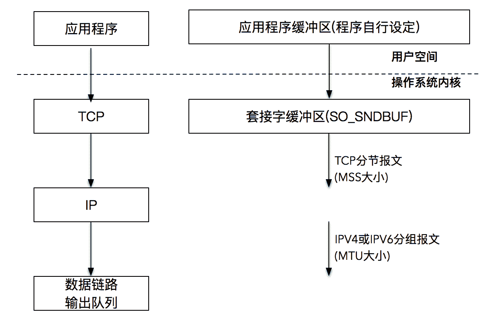
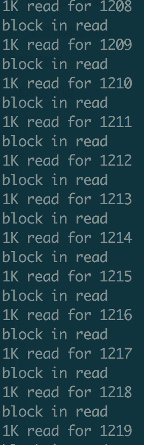

# 05 | 使用套接字进行读写：开始交流吧

 

你好，我是盛延敏，这里是网络编程实战第 5 讲，欢迎回来。

在前面的章节中，我们讲述了套接字相关的知识，包括套接字的格式，套接字的创建以及 TCP 连接的建立等。在这一讲里，我来讲一下如何使用创建的套接字收发数据。

连接建立的根本目的是为了数据的收发。拿我们常用的网购场景举例子，我们在浏览商品或者购买货品的时候，并不会察觉到网络连接的存在，但是我们可以真切感觉到数据在客户端和服务器端有效的传送， 比如浏览商品时商品信息的不断刷新，购买货品时显示购买成功的消息等。

首先我们先来看一下发送数据。

## 发送数据

发送数据时常用的有三个函数，分别是 write、send 和 sendmsg。

```
ssize_t write (int socketfd, const void *buffer, size_t size)ssize_t send (int socketfd, const void *buffer, size_t size, int flags)ssize_t sendmsg(int sockfd, const struct msghdr *msg, int flags)
```

每个函数都是单独使用的，使用的场景略有不同：

第一个函数是常见的文件写函数，如果把 socketfd 换成文件描述符，就是普通的文件写入。

如果想指定选项，发送带外数据，就需要使用第二个带 flag 的函数。所谓带外数据，是一种基于 TCP 协议的紧急数据，用于客户端 - 服务器在特定场景下的紧急处理。

如果想指定多重缓冲区传输数据，就需要使用第三个函数，以结构体 msghdr 的方式发送数据。

你看到这里可能会问，既然套接字描述符是一种特殊的描述符，那么在套接字描述符上调用 write 函数，应该和在普通文件描述符上调用 write 函数的行为是一致的，都是通过描述符句柄写入指定的数据。

乍一看，两者的表现形式是一样，内在的区别还是很不一样的。

对于普通文件描述符而言，一个文件描述符代表了打开的一个文件句柄，通过调用 write 函数，操作系统内核帮我们不断地往文件系统中写入字节流。注意，写入的字节流大小通常和输入参数 size 的值是相同的，否则表示出错。

对于套接字描述符而言，它代表了一个双向连接，在套接字描述符上调用 write 写入的字节数**有可能**比请求的数量少，这在普通文件描述符情况下是不正常的。

产生这个现象的原因在于操作系统内核为读取和发送数据做了很多我们表面上看不到的工作。接下来我拿 write 函数举例，重点阐述发送缓冲区的概念。

### 发送缓冲区

你一定要建立一个概念，当 TCP 三次握手成功，TCP 连接成功建立后，操作系统内核会为每一个连接创建配套的基础设施，比如**发送缓冲区**。

发送缓冲区的大小可以通过套接字选项来改变，当我们的应用程序调用 write 函数时，实际所做的事情是把数据**从应用程序中拷贝到操作系统内核的发送缓冲区中**，并不一定是把数据通过套接字写出去。

这里有几种情况：

第一种情况很简单，操作系统内核的发送缓冲区足够大，可以直接容纳这份数据，那么皆大欢喜，我们的程序从 write 调用中退出，返回写入的字节数就是应用程序的数据大小。

第二种情况是，操作系统内核的发送缓冲区是够大了，不过还有数据没有发送完，或者数据发送完了，但是操作系统内核的发送缓冲区不足以容纳应用程序数据，在这种情况下，你预料的结果是什么呢？报错？还是直接返回？

操作系统内核并不会返回，也不会报错，而是应用程序被阻塞，也就是说应用程序在 write 函数调用处停留，不直接返回。术语“挂起”也表达了相同的意思，不过“挂起”是从操作系统内核角度来说的。

那么什么时候才会返回呢？

实际上，每个操作系统内核的处理是不同的。大部分 UNIX 系统的做法是一直等到可以把应用程序数据完全放到操作系统内核的发送缓冲区中，再从系统调用中返回。怎么理解呢？

别忘了，我们的操作系统内核是很聪明的，当 TCP 连接建立之后，它就开始运作起来。你可以把发送缓冲区想象成一条包裹流水线，有个聪明且忙碌的工人不断地从流水线上取出包裹（数据），这个工人会按照 TCP/IP 的语义，将取出的包裹（数据）封装成 TCP 的 MSS 包，以及 IP 的 MTU 包，最后走数据链路层将数据发送出去。这样我们的发送缓冲区就又空了一部分，于是又可以继续从应用程序搬一部分数据到发送缓冲区里，这样一直进行下去，到某一个时刻，应用程序的数据可以完全放置到发送缓冲区里。在这个时候，write 阻塞调用返回。注意返回的时刻，应用程序数据并没有全部被发送出去，发送缓冲区里还有部分数据，这部分数据会在稍后由操作系统内核通过网络发送出去。



## 读取数据

我们可以注意到，套接字描述本身和本地文件描述符并无区别，**在 UNIX 的世界里万物都是文件**，这就意味着可以将套接字描述符传递给那些原先为处理本地文件而设计的函数。这些函数包括 read 和 write 交换数据的函数。

### read 函数

让我们先从最简单的 read 函数开始看起，这个函数的原型如下：

```
ssize_t read (int socketfd, void *buffer, size_t size)
```

read 函数要求操作系统内核从套接字描述字 socketfd**读取最多多少个字节（size），并将结果存储到 buffer 中。返回值告诉我们实际读取的字节数目，也有一些特殊情况，如果返回值为 0，表示 EOF（end-of-file），这在网络中表示对端发送了 FIN 包，要处理断连的情况**；如果返回值为 -1，表示出错。当然，如果是非阻塞 I/O，情况会略有不同，在后面的提高篇中我们会重点讲述非阻塞 I/O 的特点。

注意这里是最多读取 size 个字节。如果我们想让应用程序每次都读到 size 个字节，就需要编写下面的函数，不断地循环读取。

```
/* 从 socketfd 描述字中读取 "size" 个字节. */ssize_t readn(int fd, void *vptr, size_t size){    size_t  nleft;    ssize_t nread;    char    *ptr;     ptr = vptr;    nleft = size;        while (nleft > 0) {        if ( (nread = read(fd, ptr, nleft)) < 0) {            if (errno == EINTR)                nread = 0;      /* 这里需要再次调用 read */            else                return(-1);        } else if (nread == 0)            break;              /* EOF(End of File) 表示套接字关闭 */          nleft -= nread;        ptr   += nread;    }    return(n - nleft);      /* 返回的是实际读取的字节数 */}
```

对这个程序稍微解释下：

 
- 11-25 行的循环条件表示的是，在没读满 size 个字节之前，一直都要循环下去。 
- 13-14 行表示的是非阻塞 I/O 的情况下，没有数据可以读，需要继续调用 read。 
- 17-18 行表示读到对方发出的 FIN 包，表现形式是 EOF，此时需要关闭套接字。 
- 21-22 行，需要读取的字符数减少，缓存指针往下移动。 
- 24 行是在读取 EOF 跳出循环后，返回实际读取的字符数。 

## 缓冲区实验

我们用一个客户端 - 服务器的例子来解释一下读取缓冲区和发送缓冲区的概念。在这个例子中客户端不断地发送数据，服务器端每读取一段数据之后进行休眠，以模拟实际业务处理所需要的时间。

### 服务器端读取数据程序

下面是服务器端读取数据的程序：

```
int main(int argc, char **argv){    int                 listenfd, connfd;    socklen_t           clilen;    struct sockaddr_in  cliaddr, servaddr;     listenfd = socket(AF_INET, SOCK_STREAM, 0);     bzero(&servaddr, sizeof(servaddr));    servaddr.sin_family      = AF_INET;    servaddr.sin_addr.s_addr = htonl(INADDR_ANY);    servaddr.sin_port        = htons(12345);     /* bind 到本地地址，端口为 12345 */     bind(listenfd, (SA *) &servaddr, sizeof(servaddr));    /* listen 的 backlog 为 1024 */    listen(listenfd, 1024);     /* 循环处理用户请求 */    for ( ; ; ) {        clilen = sizeof(cliaddr);        connfd = accept(listenfd, (SA *) &cliaddr, &clilen);        read_data(connfd);   /* 读取数据 */        close(connfd);          /* 关闭连接套接字，注意不是监听套接字 */    }} void read_data(int sockfd){    ssize_t  n;    char buf[1024];     int time = 0;    for ( ; ; ) {        fprintf(stdout, "block in read\n");        if ( (n = Readn(sockfd, buf, 1024)) == 0)            return;     /* connection closed by other end */         time ++;        fprintf(stdout, "1K read for %d \n", time);        usleep(1000);    }}
```

对服务器端程序解释如下：

 
- 6-17 行先后创建了 socket 套接字，bind 到对应地址和端口，并开始调用 listen 接口监听。 
- 20-25 行循环等待连接，通过 accept 获取实际的连接，并开始读取数据。 
- 28-42 行实际每次读取 1K 数据，之后休眠 1 秒，用来模拟服务器端处理时延。 

### 客户端发送数据程序

下面是客户端发送数据的程序：

```
int main(int argc, char **argv){    int                 sockfd;    struct sockaddr_in  servaddr;     if (argc != 2)        err_quit("usage: tcpclient <IPaddress>");     sockfd = socket(AF_INET, SOCK_STREAM, 0);     bzero(&servaddr, sizeof(servaddr));    servaddr.sin_family = AF_INET;    servaddr.sin_port = htons(SERV_PORT);    inet_pton(AF_INET, argv[1], &servaddr.sin_addr);    connect(sockfd, (SA *) &servaddr, sizeof(servaddr));    send_data(stdin, sockfd);    exit(0);} # define MESSAGE_SIZE 10240000void send_data(FILE *fp, int sockfd){    char * query;    query = malloc(MESSAGE_SIZE+1);    for(int i=0; i< MESSAGE_SIZE; i++){        query[i] = 'a';    }    query[MESSAGE_SIZE] = '\0';     const char *cp;    cp = query;    remaining = strlen(query);    while (remaining) {      n_written = send(sockfd, cp, remaining, 0);      fprintf(stdout, "send into buffer %ld \n", n_written);      if (n_written <= 0) {        perror("send");        return;      }      remaining -= n_written;      cp += n_written;    }     return;}
```

对客户端程序解释如下：

 
- 9-15 行先后创建了 socket 套接字，调用 connect 向对应服务器端发起连接请求。 
- 16 行在连接建立成功后，调用 send_data 发送数据。 
- 23-28 行初始化了一个长度为 MESSAGE_SIZE 的字符串流。 
- 33-42 行调用 send 函数将 MESSAGE_SIZE 长度的字符串流发送出去。 

### 实验一: 观察客户端数据发送行为

客户端程序发送了一个很大的字节流，程序运行起来之后，我们会看到服务端不断地在屏幕上打印出读取字节流的过程：



  
 而客户端直到最后所有的字节流发送完毕才打印出下面的一句话，说明在此之前 send 函数一直都是阻塞的，也就是说**阻塞式套接字最终发送返回的实际写入字节数和请求字节数是相等的。**

而关于非阻塞套接字的操作，我会在后面的文章中讲解。

### 实验二: 服务端处理变慢

如果我们把服务端的休眠时间稍微调大，把客户端发送的字节数从从 10240000 调整为 1024000，再次运行刚才的例子，我们会发现，客户端很快打印出一句话：


  
 但与此同时，服务端读取程序还在屏幕上不断打印读取数据的进度，显示出服务端读取程序还在辛苦地从缓冲区中读取数据。

通过这个例子我想再次强调一下：

**发送成功仅仅表示的是数据被拷贝到了发送缓冲区中，并不意味着连接对端已经收到所有的数据。至于什么时候发送到对端的接收缓冲区，或者更进一步说，什么时候被对方应用程序缓冲所接收，对我们而言完全都是透明的。**

## 总结

这一讲重点讲述了通过 send 和 read 来收发数据包，你需要牢记以下两点：

 
- 对于 send 来说，返回成功仅仅表示数据写到发送缓冲区成功，并不表示对端已经成功收到。 
- 对于 read 来说，需要循环读取数据，并且需要考虑 EOF 等异常条件。 

## 思考题

最后你不妨思考一下，既然缓冲区如此重要，我们可不可以把缓冲区搞得大大的，这样不就可以提高应用程序的吞吐量了么？你可以想一想这个方法可行吗？另外你可以自己总结一下，一段数据流从应用程序发送端，一直到应用程序接收端，总共经过了多少次拷贝？

欢迎你在评论区与我分享你的答案，如果你理解了套接字读写的过程，也欢迎把这篇文章分享给你的朋友或者同事。


