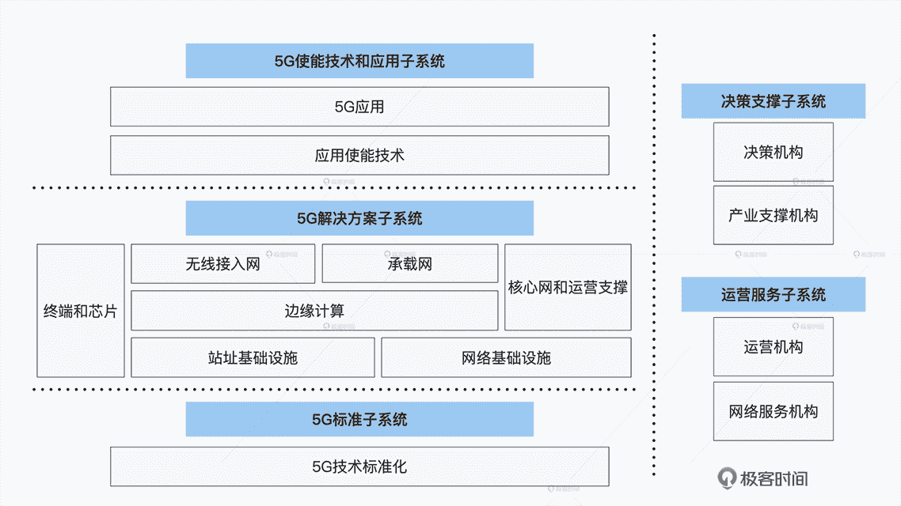
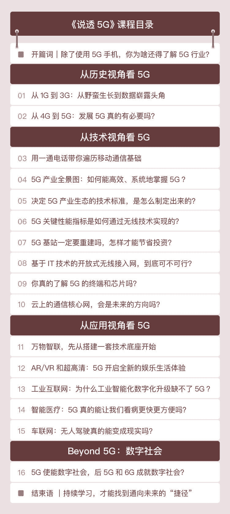

# 开篇词｜除了使用5G手机，你为什么还得了解5G行业？

 

你好，我是杨四昌。欢迎你来和我一起学习 5G。

说起 5G，你或者你身边的小伙伴，应该已经有使用 5G 手机、5G 上网套餐的人了。但是，具体 5G 是怎么回事呢？平时听到、看到的，诸如“5G 手机为啥这么贵，我一直用 4G 手机行不行”“4G 挺好用的啊，现在谈 5G 是不是为时过早”“5G 的应用场景都有哪些，和我有啥关系”等问题，我们又该怎么去理解呢？

别急，我这个从业 20 多年的通信老兵，会在这门课中一一为你解答。

在我从业的 20 多年里，我服务过包括信通院、爱立信、华为、中兴在内的大型通信企事业单位。可以说，我见证了通信技术的一路飞奔，从 2G、3G、4G 发展到了今天的 5G，我也有幸追随着这个浪潮从事了很多不同性质的岗位。

这些年，我参与过大型通信网络的规划设计，以及大型通信项目的交付，也负责过 3G/4G/4.5G/SDN/NFV 的端到端综合解决方案规划、整合和推广；甚至，我也从事过产业分析和商业模式研究，以及国内外重点市场拓展和大型项目的营销策划。这些工作涉及移动通信产业的各个重要环节。

从 2016 年开始，我专注于 5G 相关的工作，包括 5G 的技术标准和解决方案的研究、5G 产业链上下游研究分析等等。

正是因为我的这些经历，我的脑海里已经形成了一张 5G 的全景图，我也希望能通过这门课把它传递给你，帮你拨开纷繁复杂的技术体系和舆论迷雾。

## 5G，与你我息息相关

说起学习 5G，咱们还是得先解决第一个问题：作为**一个普通人，我会用 5G 手机享受 5G 的网速，不就好了吗，有必要学习 5G 吗？**

对于这个问题，我可以从产业格局、国家政策和行业发展这 3 个维度，和你分享一下我的答案。

**从产业格局上看，5G 已经成为全球产业竞争的制高点和焦点**。当前，全球两个最大的经济体，也就是中国和美国，围绕着 5G 展开了跌宕起伏的竞争，我国顶尖 5G 相关企业被打压。同时，5G 引发了芯片行业的“军备竞赛”，7 纳米和 5 纳米 5G 芯片相继推出；5G 在车联网和工业互联网等行业，也是过得风生水起等等。

**从国家政策的角度看，国家给了 5G 产业很多支持**。近几年，多份国家重磅政策文件都明确提出支持 5G 发展，例如“十四五规划和 2035 年远景目标”、2021 年 4 月底工信部公开发布的《5G 应用“扬帆”行动计划（2021-2023 年）（征求意见稿）》等等。

**从行业发展的维度看，5G 与行业的深度融合发展潜力无限**。5G 是万物智能接的时代，其带来的发展空间和潜力将远大于 4G。也因此，5G 时代一批企业会受益并发展壮大，很有可能会引领时代。

你看，5G 已经成为社会发展的必然趋势。而在未来，5G 随时可能颠覆你所在的行业，无论是你是否身处技术领域。

我举两个最典型的例子吧。

比如，你是一名前端工程师，未来 5G 时代，App 上需要承载更多更酷炫的效果，或许 3D、全息、AR/VR 直接变革了目前的前端开发模式，你需要了解更多的前沿技术，紧跟趋势总是没错。

再比如，你是一名创业者，4G 之后的移动互联网时代，成就了类似拼多多、字节跳动、美团这样的公司，那这次 5G 迎来的工业互联网时代，将会成就怎么样的企业？你需要思考、研究。咱们做事情，总得顺应些什么趋势才能做成吧。

一句话总结就是，5G，与你我的未来息息相关。对于一个趋势，最好的尊重就是在“评头论足”之前，你先去了解它。

但是，5G 涉及领域那么多、辐射面那么广，又涉及多产品、多技术融合，还包括各种应用、标准、基础设施、服务、利益相关方等等相关知识。我们该从何学起呢？

## 学习 5G，你得有好用的方法论和系统的框架

刚开始接触 5G 的时候，我也很迷茫：

1. 为什么有不少声音唱衰 5G，5G 究竟能不能成功？
2. 5G 涉及芯片、无线、传输、核心网、边缘计算等诸多技术，我应该从哪里入手呢？
3. 据说美国要单搞一套 5G 标准，5G 技术真的会分裂成两套标准吗？
4. 我国 5G 相关企业被打压，5G 还有能发展起来吗？
5. 5G 有杀手级应用吗？何时能找到杀手应用？

在后来的摸爬滚打中，我发现，其实掌握 5G 最快捷的方法，就是从 5G 产业的角度去全面认识 5G。只有当你在脑海里有了一幅全面的 5G 图，你才能很好地把握住 5G 的发展脉络，才能对 5G 的发展前景有更准确的判断，才能结合自身的优势在 5G 发展中找准定位。

在这门课里，我会把基于自己多年的学习研究和工作实践，总结提炼出的 5G 学习方法论，以及配套的系统框架，分享给你。在这个方法论指导下，只要你沿着系统框架和脉络逐步细化、逐步深入学习，系统掌握 5G 知识肯定不在话下。

这个方法论是怎样的呢？

1. 首先，我们要建立一个 5G 产业的全局观，通过这个 5G 的系统框架图，弄清楚 5G 的宏观层面包括哪些模块内容。
2. 接下来，我们对每一个系统框架图包含的各个子模块内容进行拆解，弄清楚它们都包括什么，有什么用。
3. 最后，我们从几个不同的子系统开始学习：包括 5G 标准子系统、5G 解决方案子系统、5G 使能技术和应用子系统、决策支撑子系统，以及运营服务子系统。

基于这个方法论，我们就可以把庞杂的 5G 知识梳理清楚了，也就是下面的 5G 系统框架：

5G系统框架图

这个框架包括 5 个系统、14 个模块。

1. **5G 标准子系统**：也就是 5G 的技术标准进展情况，包括 5G 技术标准化这 1 个模块。
2. **5G 解决方案子系统**：这个子系统构成了一个端到端的 5G 网络，包括终端和芯片模块、无线接入网模块、承载网模块、核心网和运营支撑模块、基站基础设施模块、核心网基础设施模块，以及边缘计算模块等 7 个模块。
3. **5G 使能技术和应用子系统**：包括 5G 和人工智能、物联网、云计算、大数据深入结合产生的智能底层技术，以及这些技术如何与行业结合产生多种 5G 应用，这个子系统包括应用使能技术和 5G 应用这 2 个模块。
4. **决策支撑子系统**：这部分主要是国家的 5G 政策、5G 与不同产业组织之间的协同，这个子系统包括决策机构和产业支撑机构 2 个模块。
5. **运营商服务子系统**：这个子系统涉及 5G 的运营投资、网络建设和网络运维等方面的内容，这些内容支撑着 5G 运营服务。这个子系统，包括运营机构、网络服务机构这 2 个模块。

就这样，通过这 **1** 个系统框架图、**5** 个子系统、**14** 个主要功能模块的系统架构，你就可以把零散的 5G 的知识变得更加系统化和模块化了。当然了，你不需要记住这张图的所有细节，只要你在脑子中形成一个大概的印象，需要时按图索骥就可以了。

## 这门课是如何设计的？

具体到这门课里面，我希望我能站在产业全局的宏观层面，告诉你如何看待并分析当前 5G 的一些问题，也能让你明白微观层面上的标准、技术的细节到底是怎样一回事，最后再落地和你一起讨论技术标准与具体的产品、解决方案的结合。

所以，我把这门课分成了“从历史视角看 5G”“从技术视角看 5G”“从场景和应用视角看 5G”和“Beyond 5G”共 4 个模块。

**从历史视角看 5G**：通过移动通信技术的内在发展规律，判断 5G 的发展阶段和前景。

我会带你先回溯 1G~4G 的发展历史，提炼出移动通信技术遵循的内在发展规律，总结出前提要素、产业要素、前景要素和商业模式 4 个判断准则，来帮助你看清 5G。当然，你也可以用这个规律，来判断任何一项技术的前景和发展阶段。

**从技术视角看 5G**：通过标准和解决方案两条主线，了解 5G 标准的进展，掌握 5G 解决方案涉及的主要产品、技术。

基于标准和解决方案这两个主线，我会给你讲解 5G 的技术标准运作机制和标准进展情况，以及 5G 的整体方案涉及到的芯片终端、基站、承载网、云化核心网这些主要产品。

当然，你也会深入了解到这些产品所涉及的无线技术、承载网技术、核心网技术、终端芯片技术等等。同时，我也会穿插介绍运营商现有的 5G 频谱资源等内容。

**从场景和应用视角看 5G**：进一步理解应用使能技术平台和 5G 应用之间的相互关系。

了解了 5G 相关的底层技术后，我们这部分要讲应用层，你会学到 5G 和物联网、人工智能、大数据、云计算和边缘智能的深度融合，以及这种融合催生的智能底层使能技术平台是怎么一回事。我还会给你讲解几个 5G 的典型应用场景，来进一步说明这个智能底层使能技术平台对各行业的赋能情况。

**Beyond 5G**：理解 5G 到底是如何改变社会的。

当你对 5G 的技术和应用都有了大致的了解之后，这部分我将和你聊聊 5G 和后 5G 时代的技术如何加速推动数字社会的全面到来，以及 5G 与后 5G 技术如何与 6G 技术协同发展。

最后，我想说，5G 正处于不断的发展变化之中，技术标准还在完善、产品和方案不断推陈出新、应用场景也正如雨后春笋般涌现，我自己也还在不断地学习提升。基于过去的经验和知识积累，我设计了这门课程，希望能带你从既定的方向中探寻未来的潮头趋势。

聪明的人总与时代联系到一起，欢迎你来到这里和我一起学习，一起深度思考，一起把握 5G 赋予我们的时代机遇。我是杨四昌，我们正式课程见。
