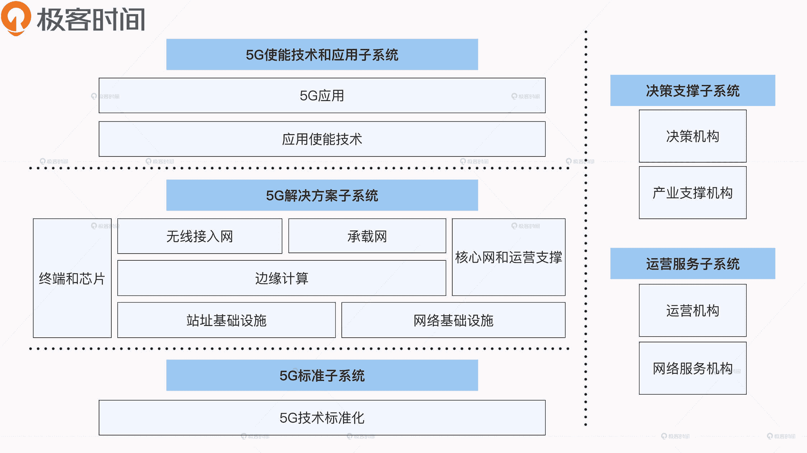
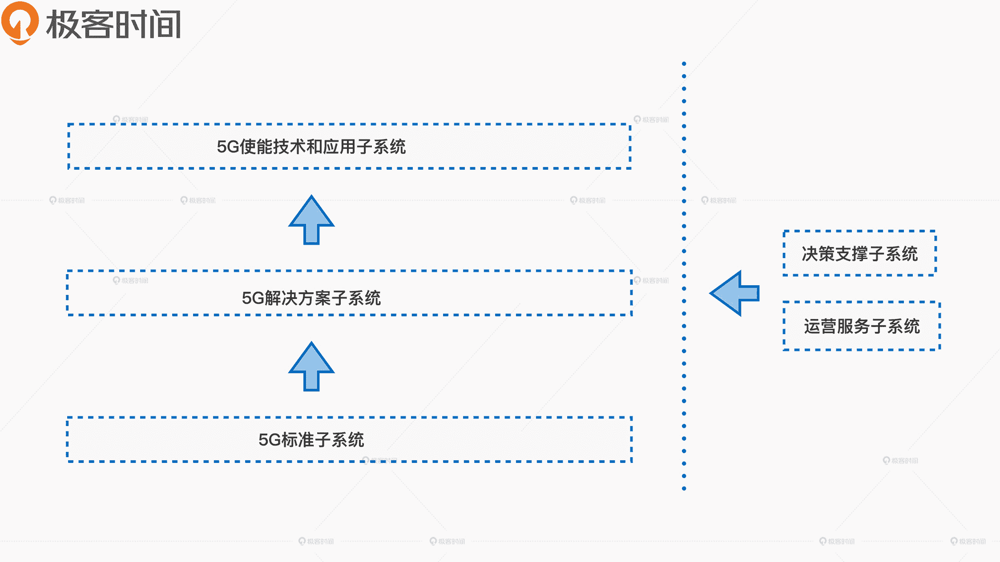
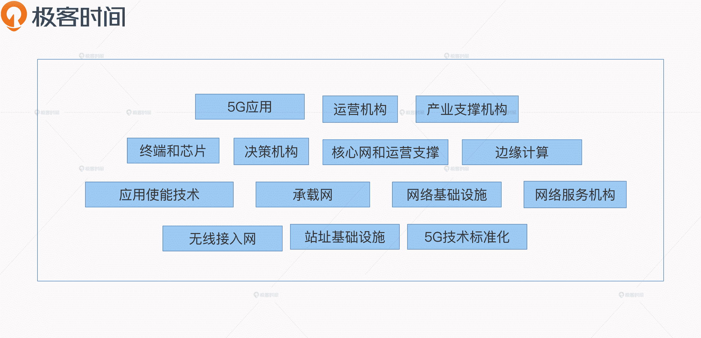
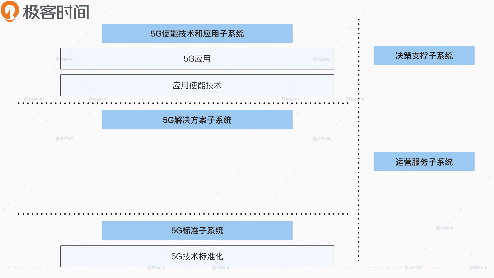
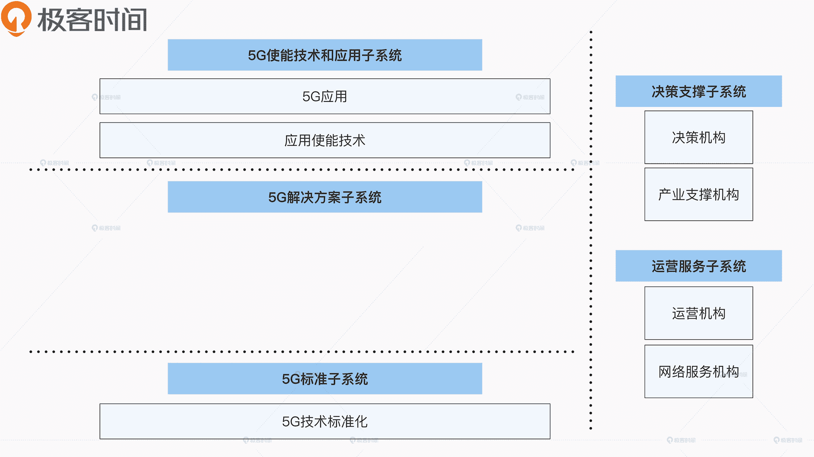
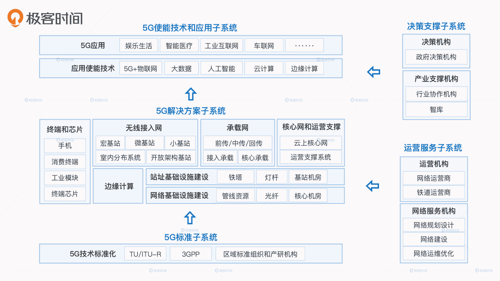

# 04｜5G产业全景图：如何能高效、系统地掌握5G？

 

你好，我是杨四昌。

关于 5G，我们已经在前面的学习中多多少少了解了一些：我们知道了 5G 手机、5G 基站，还知道 5G 的标准有 R15、R16 等多个版本；我们也知道 5G 能与人工智能、云计算等技术结合，还有 5G+ 车联网、5G+ 工业互联网等各种应用。

可以看出来，5G 涉及的领域非常多，不同领域之间的跨度很大，知识点范围也很宽泛，同时 5G 还在不断发展中，新标准、新产品、新方案和新应用不断涌现。你可能会问：**怎样才能高效、系统地掌握 5G 呢？**

## 5G 学习方法论

想必你还记得我在开篇词中简单介绍过一个学习方法，也分享了这样的一张图：

你可能在当时只是有了个印象，并不是很理解，我在这里再详细解释一下，后面我也会通过对这张图的拆解带你全面了解 5G。为了能高效快速、系统全面地掌握 5G，我们需要从 5G 产业的角度作为切入点循序渐进地学习：

1. 第一步，通过价值相互依存关系分析，找出 5G 各类利益相关方的关系，在这里把每一类利益相关方归纳为一个子系统，给出 **5G 子系统价值关系图**。
2. 第二步，把 5G 产业涉及的内容按不同的功能进行归纳，得到不同的功能模块，并把这些功能模块分别归纳整合到第一步中得出的子系统中，这样我们就可以得到 **5G 系统框架图**。
3. 第三步，对每个模块进行分析，把各个模块划分成不同的功能实体，最终我们可以得出一幅完整的 **5G 产业全景图**，了解到 5G 产业的全貌。

首先，我们开始认识 5G 的第一步：通过价值相互依存关系分析来确定 5G 各子系统的价值关系图。

## 5G 子系统价值关系图

这该怎么理解呢？这里我用高速公路举例，和你说明 5G 各个利益体之间的价值关系。

我们先来梳理一下修高速公路大致要走什么流程：

1. 参考相关的交通标准来确定高速公路如何修，比如需要容纳多少车流量、服务区怎么设置等等；
2. 根据标准把高速公路建好；
3. 建好后让各种车都可以在这条高速公路上顺畅地行驶。

这样就结束了吗？

不是的，建好这样一条高速公路，我们还需要其他相关部门的协作与支持。

比如，修建高速公路前，需要了解国家交通部门的政策和规划，还要和国土部门沟通好，和城市的发展协同；修建时，也需要交投集团出钱投资和负责运营，需要相关服务公司负责设计和建成后的维护服务。

你能看到，这几个步骤和流程之间是存在着价值依存关系的，其实我们 5G 各子系统也是这样。

**5G 产业涉及到 5 个利益体，也就是 5 个子系统，分别是标准子系统、解决方案子系统、使能技术和应用子系统、决策支撑子系统，以及运营服务子系统。**

5G子系统价值关系图

那这 5 个子系统之间的相互关系是怎么样的呢？我们可以参考刚刚提到的修公路的例子来理解。

正如修公路前要提前确定好修建标准才能动工一样，5G 的标准也是整个 5G 产业发展的基础。因此，在 5G 产业框架中，我们把 5G 的标准子系统放在 5G 产业框架的最底部，来体现它的基础和支撑作用。

明确了标准之后，我们才能发展解决方案子系统涉及到的各种技术，整个解决方案子系统都要依托于标准子系统。于是，在 5G 产业框架中，5G 解决方案子系统要位于 5G 标准系统之上。

然后，5G 的使能技术应用子系统需要在解决方案子系统搭建的端到端大管道里跑，它们就如同在高速公路上奔驰的各类汽车，整个使能技术和应用子系统都是依托于 5G 网络而存在的，没有 5G 网络也就没有 5G 的使能技术应用了。

所以呢，在 5G 产业框架中，我们把 5G 使能技术和应用子系统放在 5G 网络解决方案子系统的上面。我再啰嗦一句，5G 使能技术和应用子系统也是 5G 的利润来源，是把 5G 影响力辐射到各个行业的重要载体。

最后，就像高速公路需要各种支撑和协作一样，5G 产业的发展也离不开决策和运营服务的支持，决策支撑子系统和运营服务子系统是 5G 产业发展的重要支撑，因此，在 5G 产业框架中，我们把它单独地放在整张图的右侧，表示它们的支撑作用。

## 确定 5G 系统框架

接下来我们对价值关系图进一步分析，给出 5G 系统框架。

在给出具体的框架之前，我们在这里先把 5G 产业的范围明确一下。5G 产业一共包括下图中 14 个模块的内容：

5G产业涉及的内容

接下来我们依据不同的功能，把这 14 个功能模块归纳整合到不同的子系统之中，这就跟玩乐高或拼拼图一样，要把每一个模块都放到属于它们自己的位置上。

我们先来看第一块拼图，这个跟“标准子系统”这个名字如出一辙的 5G 技术标准化模块，它就归属于 **5G 标准子系统**。前面我们提到，5G 标准是 5G 产业的重要基础，5G 之所以是 5G 而不是其它，就是因为有一系列的技术标准在背后支撑着。换句话说，没有 5G 技术标准，也就没有 5G 技术和 5G 产业。

第二块，5G 应用和应用使能技术，这两个模块一起组成了 **5G 使能技术和应用子系统**。在这个子系统中，5G 和人工智能、物联网、大数据、云计算、边缘技术等几个技术相结合，成为使能技术平台，然后再与各个行业的应用场景结合，形成各种各样的 5G 应用。

第三块，决策机构和产业支撑机构，我们可以把这两个模块归入 **5G 决策支撑子系统**中。这个子系统起到一个决策支撑的作用，主要包括了国家关于 5G 的政策制定、5G 和其他行业组织之间的协作，以及 5G 智库方面的内容。

第四块拼图，运营机构、网络服务机构模块，它们也有对应的子系统，就是 **5G 运营服务子系统**。这部分主要包括运营投资和网络建设、网络运维等方面的内容，起到运营服务支撑的作用。

好了，到现在你肯定会发现这张拼图还有一大处空白，这部分是 **5G 解决方案子系统**的内容。

5G 解决方案子系统非常重要，它构成了一个端到端的 5G 网络，5G 所有的数据流量都承载在 5G 网络上，通过 5G 网络这个大管道输送，没有 5G 网络也就没有 5G 产业。因此，我们可以认为 5G 解决方案子系统是 5G 主动脉。

其中，终端和芯片、无线接入网、承载网、核心网和运营支撑，以及边缘计算构成 5G 的网络大通道，是解决方案子系统的主要模块；而站址基础设施和网络基础设施是整个 5G 解决方案的配套设施。

我们归纳一下上面讲述的内容，得到了这个 5G 的系统框架，一共包括 5 个子系统和 14 个功能模块，这也就是开头我们给出的那张图。

5G系统框架图

由于解决方案子系统涉及的内容比较多，为了方便你后面在“从技术视角看 5G”板块的学习，我还要和你解释下解决方案子系统的这几个主要模块和关注点。

1. ** 5G 终端和芯片**：5G 的应用都是基于各种各样的 5G 终端产生的，没有 5G 终端也就没有 5G 的各种应用；而 5G 芯片又是 5G 终端的核心，没有 5G 芯片就没法制造出 5G 终端。
2. **无线接入网**：无线接入网主要由各种 5G 基站组成，由于基站是整合各种 5G 无线技术而研发出来的设备，是 5G 特色技术的主要代表，而且 5G 基站也是 5G 网络投资的主体，在 5G 网络总投资约占 60% 的份额，因此我们 5G 基站的部署部分需要考虑怎样才能节省投资。
3. **承载网**：5G 承载网包括基站所需的前传、中传和回传，以及无线接入网线路侧承载和核心网承载。它需要满足 5G 所需的带宽，以及时延上的需求。
4. **边缘计算**：边缘计算需要尽量靠近数据源或者最终用户，这样业务数据流在边缘计算上能直接分流和路由到应用服务器，可以降低终端到应用服务器的总时延，以及降低回传到核心网的 5G 流量。
5. **核心网和运营支撑**：5G 的核心网是基于云上的核心网，运营支撑系统也部署在云上，一般安装在运营商的数据中心。

了解了这些之后，接下来，我们把 5G 系统框架中的 14 个功能模块，细化为不同的功能实体，就可以看到 5G 产业的全貌了。

## 5G 产业全景图

细分后的 5G 产业全景图是这个样子的，你可以花一两分钟仔细看下。

5G产业全景图

由于每个功能模块的内容都不同，因此我们细化到功能实体的原则也各不相同，**我们的总体原则就是把功能模块按性能、构成、应用场景等，细分成不同类别的功能实体**。我在这里举两个例子来带你了解一下。

首先我们来看解决方案子系统里的无线网接入网模块的细分原则。5G 的无线接入网主要是由基站构成，而基站有不同的类型，目前对于基站的划分主要是根据发射功率 (总发射功率或者每通道发射功率)、每个基站覆盖的面积、基站的部署场景，以及是否支持通用硬件和虚拟化这 4 个方面来进行的。

所以我们可以把 5G 无线接入网分成不同类型的基站，分别是宏基站、微基站、小基站、室内分布系统，以及开放架构基站，这样我们的功能实体就细分出来了。

接着来看使能技术和应用子系统里的 5G 应用模块。我们知道 5G 应用有成百上千种，但是每一种具体的 5G 应用都是在一定的应用场景中发生的，而这个具体的应用场景和具体的行业是密切相关的，每个行业的应用场景都有这个行业的烙印，所以在这里我们就可以把 5G 应用按行业来进行分类，我们就细分出了娱乐生活、智能医疗、工业互联网、车联网等等功能实体。

其余的模块，你也可以按照我给出的总体细分原则自己尝试着细分一下。

到这里，我们已经可以从结构上来认识 5G 了，我在这节课中给出了１张 5G 产业全景图、５个子系统和 14 个模块，这里的每个模块都细化到了功能实体或者产品形态的程度，这样能方便你系统和全面地了解目前 5G 整个产业的情况。

你也不必每一个都记下来，因为这里面的大部分内容我都会在后续的课程中逐步为你展开介绍。它已经足够系统和全面，你完全可以通过这张图先对 5G 建立一个整体认识和思维架构，这样日后无论是在学习还是生活中遇到相关的疑问都可以按图索骥，寻找到对应的模块和解决思路。

## 总结

好了，这节课到这里就结束了，我们再来回顾一下所学内容。

这节课，我们从 5G 产业角度出发，逐步深入、逐步细化，依次了解了 5 个子系统之间的价值关系、子系统内部的 14 个功能模块构成，以及 1 张全面的 5G 全景图，并对每个涉及的子系统、功能模块和功能实体都进行了大致介绍，这里我再给你归纳复习一下。

1. **5G 标准子系统**：是 5G 产业的重要基础，只有标准化这一个模块；
2. **5G 解决方案子系统**：5G 主动脉，包括终端和芯片、无线接入网、承载网、核心网和运营支撑、边缘计算这 5 个主要模块，以及站址基础设施和网络基础设施这两个配套设施；
3. **5G 使能技术和应用子系统：**5G 的利润来源和 5G 影响力的重要载体，包括 5G 应用和应用使能技术；
4. **5G 决策支撑子系统**和 **5G 运营服务子系统：**这是两个支撑，分别起到决策支撑和运营服务的作用。

通过这样系统化模块化的方式，我们可以对 5G 产业有一个全面的认识，在以后的学习中也能更高效、更聚焦。下节课，我们将会学习 5G 技术标准制定相关的内容。

## 课后思考题

最后，我给你留了两个思考题，我想请你结合本节课所学的内容，试一下把 5G 手机进行高清视频业务所涉及的模块，或者 5G 手机进行银行面部识别所涉及的模块列出来。

欢迎你和我一起学习，如果你身边的朋友也对 5G 学习相关的内容感兴趣，也欢迎你把这节课分享给他。我是杨四昌，我们下节课见。
