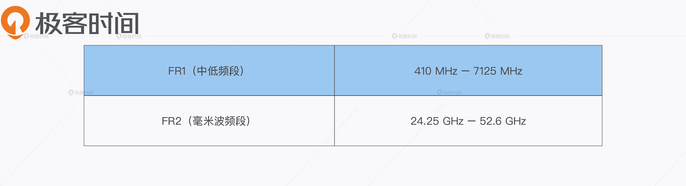
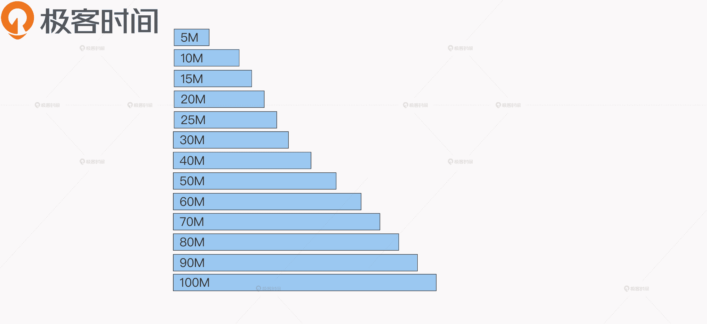
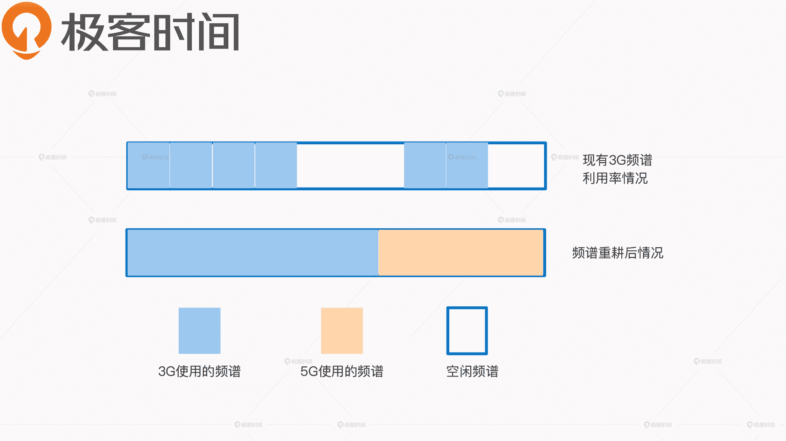
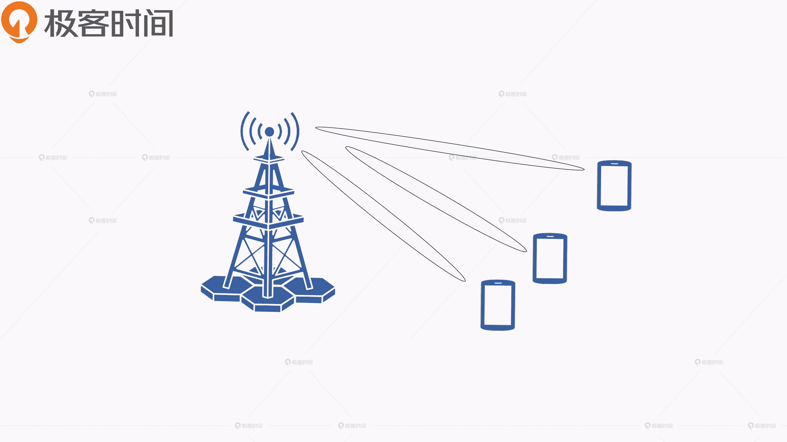
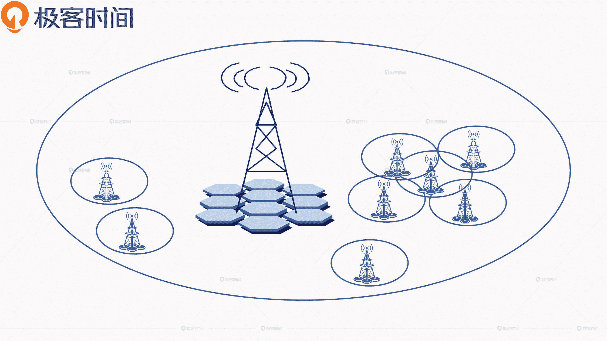
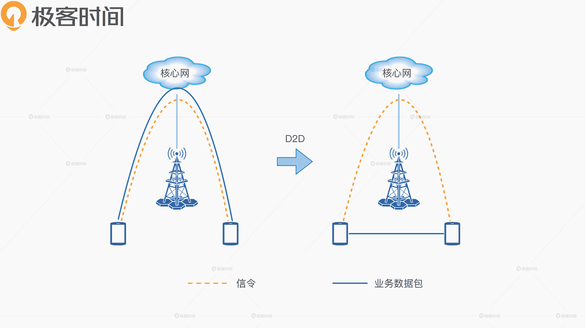
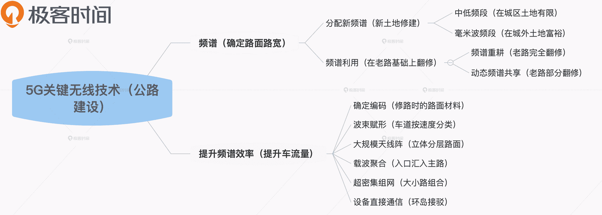

# 06 | 5G关键性能指标是如何通过无线技术来实现的？

 

你好，我是杨四昌。

通过上节课的学习，我们已经知道了 5G 有三大应用场景，而这三大应用场景的特性是通过 8 个关键性能指标来衡量的。

那问题就来了，5G 的这些关键性能指标到底是怎么实现的呢？其实，它们都依赖于一系列的 5G 无线技术。今天我们就来一起看看**无线技术是怎么助力 5G 关键性能指标的实现的**。

作为普通用户，我们日常接触最多的 5G 应用场景是 To C（面向个人用户）类场景，也就是增强型移动宽带（eMBB）。在这节课里，我们就以增强型移动宽带为例来分析，同时我也会和04 讲一样，把建设 5G 类比为新建一条公路，帮助你理解这节课的内容。

不知道你还记不记得，我们在05 讲中讲到，增强型移动宽带场景可以提供大范围的连续覆盖，同时还能提供更多的流量，满足大容量、高速率的传输需求。因此，**对于这类场景来说，增加系统容量是主要的技术目标**。

这就相当于我们在建设公路时需要明确的总目标：让公路尽可能多地容纳和保障车辆的通行。而这个目标进一步拆解，就是两关键点：

1. 提高单位时间内通过公路的车辆数，也就是车流量；
2. 提高高峰时段的最大车流量。

那具体怎么实现呢？

其实很简单！首先，我们要想办法增加这条公路的可用路面，你想想可用的路面多了，车流量自然就大了。对于 5G 建设也是一样，5G 频谱就如同公路的路面，我们首先要想办法增加 5G 的频谱资源，频谱资源多了，5G 能容纳的流量也就更多了。

可是，可用路面毕竟是有限的，我们要考虑采用其他手段来提升单位时间内的车流量。5G 也是如此，我们还要想办法通过各种无线技术来提升频谱效率。

上述这两个方法都用完了，如果我们还想继续增加车流量怎么办呢？那就只能采用提升车流量密度的方式了。对于 5G 来说，我们要做的就是增加 5G 的流量密度。

讲到这里，我们归纳一下，对于增强型移动宽带来说，要想提高系统容量，我们需要解决下列三个问题：

1. 如何增加频谱资源；
2. 如何提高频谱效率；
3. 如何增加流量密度，也就是流量通行的效率。

了解了这些之后，我相信你已经知道 5G 关键无线技术背后的建设逻辑了，接下来我们就进入正篇，看增强型移动宽带中 5G 关键性能指标是怎么实现的。

首先我们来看看 5G 怎么解决频谱的问题。

## 如何增加 5G 频谱？

前面已经讲过，频谱就如同我们修公路时的路面，我们可以如何增加可用路面呢？很简单，要么征收新土地拓宽路面，要么把之前不用的旧路面翻新，为我所用。

具体到 5G 频谱的增加，我们可以通过寻找新频谱（包括中低频、毫米波）和增加现有频谱利用（频谱重耕和动态频谱共享）的方式来解决这个问题。

我们先来看怎么寻找 5G 新频谱。

### 寻找 5G 新频谱

要寻找 5G 新频谱，我们要把目光看向**中低频段**和**毫米波**。

为什么呢？我们知道，频谱是稀缺资源。为了能最大限度地利用频谱资源，国际电信联盟下属的无线电通信部门会负责协调各个频谱的分配问题。经过国际间协商，目前明确给 5G 分配的频谱资源包括 FR1 和 FR2 两个频段，这两个频段的频率范围如下表所示：

#### 中低频段

之前的 04 讲我们讲过频谱，对中低频段的范围也很清楚了，这里再重温一下。

中低频是指 7GHz 以下的频谱。目前我们对中低频段的开发使用已经比较充分了，中低频段有各种大量无线技术在占用不同的无线频谱资源，这其中有各种广播电台、物联网、2G/3G/4G、气象监测、蓝牙、WiFi、ZigBee、卫星、射电天文、微波、电力 / 公安 / 紧急救援 / 城市应急调度等各行业的专用系统、北斗和 GPS 定位系统等等。

可以说，目前全球范围内 7GHz 以下频段的大部分频谱资源都已经被使用了，可用的空闲频段比较少，分布较散，也比较零碎。所以，3GPP 在制定 5G 标准时就采用了灵活的分配方式，详细情况是这样的：

FR1（中低频段）可使用频谱带宽

对于 FR1（7GHz）以下的频段，5G 的分配方案是最小带宽为 5MHz 连续频谱，最大带宽为 100MHz 连续频谱。

就中低频段而言，华为和爱立信等公司的研究表明，为了能最大限度地发挥 5G 技术的优势，推荐的分配方案是 100MHz 的连续频谱，如果没法满足连续 100MHz，退而求其次也至少得是 50MHz 连续频谱。所以你也能看出来，5G 在中低频段可用的频谱资源真的很少。

为了能达到 5G 的大带宽、高速率等关键性能指标，我们需要找到更多的频谱资源。这就好比我们修公路，既然老地方的土地不够用了，我们自然要去其他地方找新的土地资源了。

这个时候就要考虑毫米波了。

#### 毫米波

毫米波位于高频段，可用的频谱资源比较丰富，而且我们对毫米波的研究比较多，在技术上有足够的支撑。

那 5G 分配到了哪些毫米波频段呢？

目前 5G 已经分配的频段是 24GHz~58GHz，3GPP 在制定标准时，采用的是大块连续的频谱分配方式，具体的频谱带宽是这样：

FR2（毫米波）可使用频谱带宽

也就是说，在毫米波频段，5G 分配到的是最小带宽为 50MHz 连续频谱和最大带宽为 400MHz 连续频谱。

相较于中低频段，毫米波又有什么优缺点呢？

毫米波的优点和缺点都很明显。优点是它的可用频谱资源比较丰富，所以我们在毫米波频段部署 5G 系统能达到更高的速率，时延也比较低，也能把设备做得更小。

但毫米波也有一些缺点，它在传播过程中的路径损耗非常严重，容易被物体遮挡，不仅会被人体遮挡，在室外传播时遇到雨天或者空气质量差的情况也会被遮挡，比如在通信过程中稍微转一下身或移动下手机就可能导致信号变差或者速度明显变慢。

目前针对毫米波的这特点，一个可行的解决办法就是在室外热点地区采用中低频段和毫米波混合组网的形式，这样在室外，我们可以通过中低频段来规避毫米波信号被遮挡的问题，同时在室内场景的毫米波产品也还在研发中。

总的来说，由于频谱资源有限，5G 新频谱的开拓主要在中低频段和毫米波上，可是这些新的可用频谱对于 5G 要承载的应用来说，还是远远不够的。所以，我们还要想办法得到更多的频谱资源，其中一种方式就是对现有的频谱进行重耕。

### 现有频谱重耕

频谱重耕（Refarming），是指一些在用的系统（如 2G/3G）由于用户减少，频谱使用率较低，用通过频谱重耕的方式腾出一部分频谱资源来部署 5G。

我们以 3G 的频谱重耕为例，你可以从图中看到，现有的 3G 频谱利用率并不高，有许多零碎的空闲频谱。通过频谱重耕的方式，我们可以把 3G 在用的频谱整合在一起继续为 3G 服务，从而把空闲的频谱整合成一段连续的频谱用于部署 5G。

3G频谱重耕

目前我国频谱重耕的情况大致是这样的：我国广电网络和中国移动合建 5G 所使用的 700MHz 频段就是模拟电视退网之后空闲出来的频谱；现在工信部也已经批复同意，中国电信和中国联通可以通过频谱重耕的方式，在他们的 3G 系统目前使用的 1800MHz 和 2100MHz 频段腾出部分频谱，来部署 5G。

可是，很多时候并没有那么多完全不用的频谱给我们重耕，这时候还有另一个类似的方法：动态频谱共享。

### 动态频谱共享

动态频谱共享指的是，5G 网络和现有的系统（比如说 4G）共用分配给现有系统（4G）的一段频谱。

怎么去理解呢？它就跟我们平时见到的潮汐车道很像，在有些地方，早晚交通高峰时段私家车不能占用这个公交专用车道，而在非高峰时段，私家车可以在这个公交专用道上行驶。

动态频谱共享也是这样，在 4G 网络有空闲的情况下，我们通过软件动态的方式把 4G 剩余的部分频谱资源分配给 5G 使用；在 4G 网络繁忙的时候，再把分配给 5G 的频谱资源释放出来供 4G 使用。通过这样动态的方式，同一段频谱资源能够分别分配给 4G 系统和 5G 系统使用，这样也能增加总体的数据流量。

目前动态频谱共享成为了各大 5G 基站厂商重点宣传的一个特色功能，它跟频谱重耕的区别就在于，频谱重耕像老路的完全翻修，但动态频谱共享，只能说是部分翻修。

**到这里我们已经完成了增强型移动宽带（eMBB）中实现关键性能指标的第一步：增加频谱资源。现在我们进入第二步：提升频谱效率。**

## 如何提升频谱效率？

频谱效率是指单位频谱资源能够承载或传输的数据量。

在频谱资源确定的情况下，提升每单位频谱资源能承载或传输的数据量，也就是提升这段频谱能够承载或者传输的数据总量。因此频谱效率越高，能承载或传输的总数据量就越大，也就意味着系统容量越大。

那我们能用哪些技术来提升频谱的效率呢？有下面这么几个方法。

1. **无线空口编码**：如同修路时的路面材料，通过提升数据传输的可靠性来提高编码效率，提升单位频谱承载的数据量；
2. **大规模天线阵**：如同立体化的分层路面，通过大规模天线阵来增加传输通道数量，传输通道数越多，意味着传输的数据量越大，相应的频谱效率也越高；
3. **波束赋形**：如同设置不同车速的车道，用波束赋形来精准地区分每个用户，增加系统可以服务的总用户数，从而提升系统的总容量，提升频谱效率；
4. **载波聚合**：把零碎的频谱资源利用起来，通过提升频谱资源利用率来提升频谱效率。

### 无线空口编码：提升编码效率

之前我们在04 讲中有提到，空口指的就是手机和基站天线之间发射和接收电磁波信号这个通道。

5G 全新的无线空口技术是 5G 系统区别于 1G 到 4G 的关键和核心特征之一。它指的是在 5G 手机 / 终端和 5G 基站之间双向通信所采用的一系列技术，而编码是其中最重要的一个技术，它就好比我们修路时的路面材料，好的材料能够提升路面平整度，让车辆更快、更安全地通过。

下面我会和你重点介绍 5G 编码方案是如何通过提升数据传输可靠性，来提升频谱效率的。

编码，简单理解就是按照一定的规律来传播信息，保证信息传播过程中的完整性和安全性，就像影视剧里的电台都需要一个密码本来收发电报一样。

5G 采用的编码方案有 Polar 码和 LDPC 码两种，采用 Polar 和 LDPC 码是综合考虑能实现的系统容量、编码效率、实现复杂度和难易程度后决定的，如果你对详细的编码实现方案感兴趣的话可以在课后去了解一下。

Polar 码是华为公司为首主推的编码方案，LDPC 是高通公司为首主推的编码方案，目前都已经被 3GPP 接纳作为 5G 标准编码方案。

LDPC 在较大的数据块传输上有一定优势，峰值速率更高，解码速度更快，功耗更低，适合比较高的数据速率需求；Polar 码在小数据块的情况下性能更优越，计算复杂度低，时延低。5G 采用 LDPC 和 Polar，能够降低误码率，从而提升了系统性能。

由于编码方案是 5G 的基石，我国企业主推的 Polar 码能成为 5G 的标准编码方案之一，也意味着我国在 5G 标准上话语权的提升。

除了确定空口编码，我们还可以继续通过增加传输通道数来提升频谱效率，这需要通过大规模天线阵来完成。

### 大规模天线阵：增加传输通道数量

大规模天线阵（massive MIMO），顾名思义就是使用多根天线，由于 5G 采用的频段比较高，所以 5G 天线的尺寸比较小，天线之间的距离也比较窄，因此 5G 系统可以使用多天线来提升系统性能。

那具体来说 5G 如何通过多天线来提升频谱效率的呢？

我们可以用城市里的立体交通来举个例子，大城市为了保证对车流的容纳量会在道路上方建高架桥，在道路下方打隧道，形成立体分层的道路，这样可以在不增加道路占地的情况下，充分利用空间搭建多条道路。

这样做可以达到两个目的：对于每一辆车而言，可以选择的道路多了，单辆车通过的速度也就提升了；对于整个道路系统而言，道路增加了，可通行的车流量自然也就提升了。

5G 大规模天线阵的原理也是类似，也就是通过增加天线数量，来充分利用空间资源搭建多条传输通道。对于手机而言，同时有多条通道可以使用，手机的数据数率自然就提升了，频谱资源又是一定的，也就意味着手机的频谱效率也提升了；对于 5G 基站来说，由于增加了传输通道，5G 基站同时能服务的手机数量增加了，传输的总数据流量也增加了，在频谱资源不变的情况下，也就意味着频谱的效率提升了。

目前，5G 系统的大规模天线阵列，在 7GHz 以下频段的天线数可以达 64X64MIMO，也就是说 64 根天线负责发射，64 根天线负责接收，或者 32X32MIMO。MIMO 就是多输入多输出的意思，输入就是指接收，输出指发射。

现在我们讲完了采用大规模天线增强传输通道数来提高系统效率的方法，接下来，我们还有一个更细化的方式可以来继续提升频谱效率，就是波束赋形。

### 波束赋形：控制波形精准服务每个用户

波束赋形（Beam Forming）这个词看起来很难，其实很好理解。

我给你举个例子，在一个漆黑的夜晚，你要看清楚 5 米外的某个位置，有两种方式：一种是点亮一个灯泡，但由于灯泡光线向四周发散，实际对准目标的光线不多（大部分都浪费掉了），为了能看清目标，需要很大瓦数（比如 100 瓦）；第二种方法是用一个手电筒，由于手电筒光线聚焦，不需要很大的瓦数就能看清目标，可能 20 瓦就够了。

波束赋形就相当于跟着物体走的手电筒光，就是把向四周发散的电磁波聚集起来，通过调整天线的相位，电磁波的波束能一直指向它所提供服务的手机，随着手机的移动而移动，这样可以精准的控制每一个手机的波形所需的能量（功率）。

波束赋形的各个波束之间不会干扰，因此基站能同时为更多的终端服务，每一个终端传输的数据流量也相应增加，可以提升基站的性能和总容量。

波束赋形示意图

所以我们说，波束赋形的方式就是更精准地为每个用户服务，通过提升每个用户的数据速率，增加服务的用户数量，来达到提升频谱效率的目的。接下来，还有最后一个提升频谱效率的方式：采用聚合频谱资源的方式来继续提升频谱效率。

### 载波聚合：聚合零散或分离的频谱资源

这个又怎么理解呢？还是拿路上的例子来说，平时我们开车也一样，你会发现辅路一般都比较狭窄，车在辅路上行驶速度慢，辅路可通行的车流量也比较小；但是，一旦辅路汇入主道路之后，道路变宽，车速变快，可通行的车流量自然也就变大了。

载波聚合就是这样的原理，我们把位于不同频段上零碎的频谱资源集中在一起供 5G 使用，由于集中后的总的频谱资源增加，5G 系统的数据流量也随之增加了。

目前载波聚合的应用主要有两个方面：

1. 把两个 100MHz 在的 7GHz 以下的频谱合成一个 200MHz 的大频谱，或者把两个 400MHz 的毫米波频谱合成一个 800MHz 的超大频谱，这样可以提升 5G 系统的总数据流量和峰值速率；
2. 还有一个是中国电信和中国联通的做法，把 3.5GHz 和 1.8GHz 合成一个频谱，通过这种方式提升 5G 的覆盖范围。

这一部分，我们介绍了提升频谱效率的 4 种技术手段，接下来我们来介绍通过提升流量密度来达到提升系统容量的方式。

## 如何提升流量密度？

现在，我们终于到了增强型移动宽带（eMBB）中实现关键性能指标的最后一步：提升流量密度。怎么提升呢？方法有两个：**超密集组网**和**设备间直接通信**。

### 超密集组网：提升热点地区的流量密度

移动通信的一个显著特点就是，热点地区的数据流量很大，这个特点在 5G 时代只会更突出。

据估计，在 5G 时代，热点地区的数据流量会增加 100 倍~1000 倍。为了满足热点地区的数据需求，除了采用我们前面所说的的各种技术外，我们还可以通过在宏基站覆盖区域内，部署微基站和小基站的方式来增加基站密度。

这样可以达到提升热点地区流量密度的目的，最终可以令热点地区的系统容量获得几十倍甚至几百倍的提升，这种大量采用微基站和小基站来增加基站密度的方式就是超密集组网（UDN）。

超密集组网示意图

但是，超密集组网一般 5G 网络发展的中后期才会部署，目前 5G 网络发展还在初期，5G 的业务量还没发展起来，需求没有那么大，所以超密集组网暂时还没有部署。

除了这个方法之外，我们还可以通过设备间直接通信的方式来提升流量密度，从而达到提升系统容量的目的。

### 设备间直接通信：降低网络负担，减少通信延时

在目前的移动通信网络中，即使两个手机用户面对面，相距很近，他们拨打对方手机或者通过手机发视频，这个电话信号或者视频信号都要先从基站到核心网，再从核心网到基站这样绕一大圈返回来，这样的操作既增加了网络的负担，也增加了通信时延。

而在 5G 时代，这种情况可能因为设备之间的直接通信技术（D2D）而改变。D2D 技术可以让同一基站下的两个手机直接建立通信连接，这时候它们之间的数据将不再通过基站转发，而是直接从手机到手机。通过这种方式，既降低网络资源的占用，也减少了手机之间的通信时延。

降低了网络网络资源的占用，也就意味着网络有空闲为其它终端服务了，而直接通信的两个设备由于时延降低，他们之间可传递的数据流量也就相应增加了。从系统上看，总的流量密度增加了，服务的总终端数增加了，随之总的数据流量也增加了。

设备间直接通信（D2D）示意图

## 总结

好了，这节课到这里就结束了，我们一起回顾一下这节课的要点。这一讲我们以移动增强宽带场景为例，给出了提升系统容量的三个重要方面，分别是增加频谱资源、提升频谱效率和提升流量密度。

并且，我还借用了修公路的例子，带你了解了实现这三个方面的具体无线技术，我总结了一张图，你可以再看看。

修建公路和5G无线技术类比

通过这三个方面的分析，你也知道了无线技术在 5G 技术中占据非常重要的位置，它直接助力着 5G 的增强型移动宽带这个场景的关键性能指标的实现。

其实，对于 5G 其它两个场景——超可靠低时延和大规模机器类通信来说，它们的关键性能指标也是通过无线技术来实现的，具体的技术细节和增强型移动宽带有共同之处，但也有一些差异，如果你感兴趣可以去了解一下。

除了这些之外，我们还了解了设计一个系统的主要思路：

1. 明确要达到的总体目标或指标（如：5G 性能指标）；
2. 找出达到目标的关键因素（频谱、频谱效率、流量密度）；
3. 设计一个实现总体目标的框架（如何组合每个关键因素）；
4. 设计出每个关键因素所需的各种技术，从而达到设计的性能目标。

这样一个设计思路已经在技术复杂度很高的 5G 系统中获得应用，这也充分验证了这个设计思路的合理性，你也可以借鉴下这样的系统设计思路，应用在日常的学习工作之中。

下一讲我会和你介绍 5G 基站一定要重建吗，怎样才能节省投资这个话题。

## 思考题

最后，我照例给你留了思考题：

1、请你说一说中国移动、中国电信、中国联通使用的 5G 频段是多少？

2、你能不能和我分享一个 5G 中设备间直接通信（D2D）的应用案例？

欢迎在留言区留言，和我一起讨论。也感谢你和我一起学习，如果你身边也有朋友对 5G 无线技术感兴趣，欢迎你把这节课分享给他。我是杨四昌，我们下节课见。
