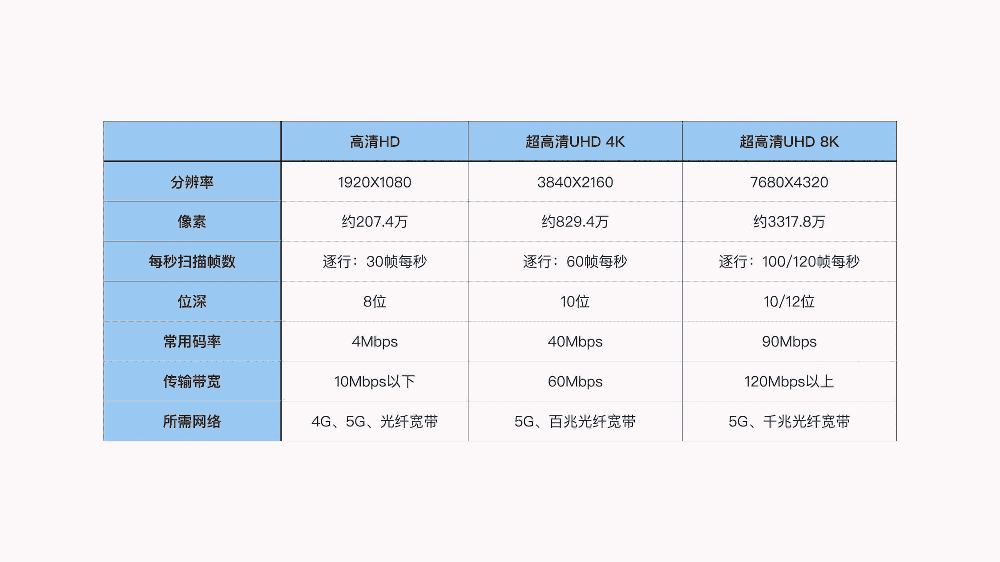
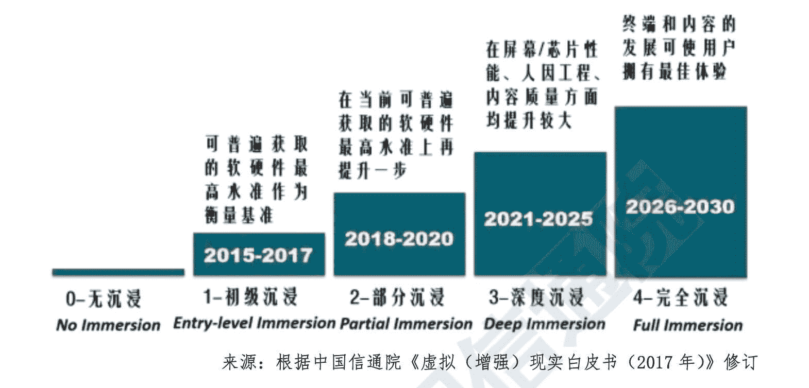
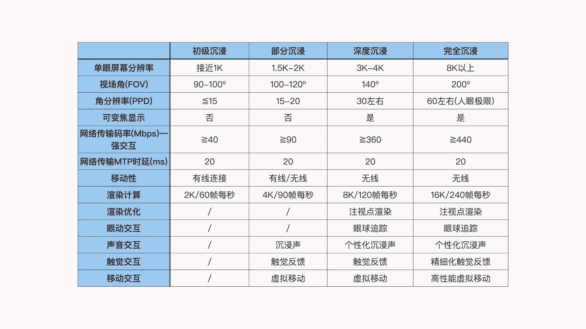

# 12｜AR/VR/超高清：开启全新的娱乐生活体验

 

你好，我是杨四昌。

今天这节课，我想跟你聊一聊 AR/VR 和超高清视频。

不知道你是不是和我一样，怎么都玩不来 VR 游戏，戴上 VR 眼镜转几下头就开始晕。前几年 VR 这个概念爆火的时候，我还想买个 VR 眼镜来玩玩，结果直接就被这眩晕感给劝退了。不知道是不是也有这难以克服的眩晕感的原因，VR 火了一阵后声音又小了些。

接着 AR 的呼声又起来了，这几年我看到天猫把 AR 和口红试色结合了起来，推出了“在线试色”，宜家也做出了让用户用 AR 进行家居搭配的尝试，更别说还有市面上层出不穷的 AR/VR 对战游戏了。

你有没有过这样的疑惑？都说 AR/VR 能改变我们的生活，也能看到它们在各领域都有不少的应用，但总觉着也没怎么改变我们个人的生活，最多只是锦上添花罢了。

**其实呢，除去硬件和内容创作上的原因，造成这个现象的一部分原因也跟我们的网络，也就是通信技术的瓶颈息息相关。**以 4G 的带宽和时延，是远远无法满足 AR/VR 沉浸式体验的高要求的。更何况，我们现在普遍的视频清晰度还停留在普清、高清阶段，与人眼直接看到的世界还差距甚远，大脑都无法相信这就是现实，自然就更谈不上真正的沉浸式体验了。

那你可能就会问了，既然 4G 的瓶颈是 AR/VR 发展不起来的一部分原因，5G 的到来能改善这个局面吗？

答案是肯定的，5G 的新技术和新特性能很好地为 AR/VR，包括超高清视频的发展提供助益，开启全新的娱乐生活体验。具体这是怎么做到的呢？

在回答这个问题之前，我们还要弄明白，AR/VR 和超高清技术对 5G 有什么需求，这点要从它们的业务特点入手。

## AR/VR/ 超高清为什么需要 5G?

刚才也说了，网络的限制其实是阻碍 AR/VR 发展和普及的一个重要原因。对于目前的 AR/VR 来说，更多的应用还是与视听体验相关，特别是 VR，在内容创作上，更多与视频和游戏结合到了一起。所以，谈 AR/VR 其实是绕不开对画面清晰度的讨论的。近几年，4K/8K 等超高清视频也逐渐成为了热门话题。

### 高清和超高清

高清和超高清是未来视频业务的基本能力。但目前，主流的视频最高分辨率还是以高清（1080P）为主，所以这里我们也把高清加进来一起讨论。

高清，英文是 High Definition，简称 HD，超高清也就是 Ultra High Definition 简称 UHD。这里我对高清和超高清的业务特点做一个归纳，你可以简单了解下目前高清 / 超高清视频的一些技术特点和要求。

这里我们重点关注高清 / 超高清的传输带宽和网络要求。我们回顾一下05 讲中我们对 4G 和 5G 关键性能指标的介绍，在人口密集的城区，4G 的保证网络速率为 10Mbps，5G 的保证速率是 100Mbps，这个保证速率你可以认为是平均速率。

一般来说，在网络质量比较好的密集城区，对于 4G 来说，从基站到终端方向的速率一般小于 50Mbps，而从终端到基站的方向，一般小于 20Mbps。而对于 5G 来说，基站到终端方向能达到 500Mbps~1Gbps，终端到基站的方向通过载波聚合和时隙配比等技术手段最高可以达到 300Mbps~500Mbps。所以对于 4K 和 8K 的超高清视频而言，4G 提供的速率是远远不能够支持它们的流畅播放的。

这种情况下，我们可以求助光纤宽带和 5G 网络。当然光纤宽带是一个很好的选择，网络时延是最低的，但光纤宽带不能移动位置，部署位置都是固定的。**而 5G 有高带宽，能在 500 公里 / 小时的移动速度下正常运转，引入的端到端网络时延也比较小，还能通过切片提供专用网络资源保障传输质量，完全可以满足高清和超高清的需要，尤其是在没有光纤宽带或者是需要灵活拍摄的场景。**

为了帮助你理解，这里我们来较一下真。想象一下，如果我们坚持拿 4G 网络来做超高清直播会怎么样？例如，现在某节目要在某一线城市的某个广场做活动直播，碍于场地不适合拉光纤，决定用 4G 网络来做节目的实时回传。

我们的节目组精益求精，一定要用 8K 做最好品质的直播，现场一切顺利，但台里的演播室打电话过来了：“你们怎么回事！信号丢包太严重了，没法播！”节目组只好改用 4K，但演播室还是不满意，虽然丢包率低了一些，还是不太流畅。没办法，最后只能采用普通高清凑合了。

过了一会，现场围观的人多了起来，还纷纷拿起手机做起了现场直播。结果可热闹了，由于 4G 用户太多，网络扛不住，节目的回传直接断线了。

如果换成 5G 网络呢？这些问题都将迎刃而解。5G 能轻松支持 4K 和 8K 直播，回传时延很小，演播室那边很满意。虽然突然有了大量围观人群用 5G 手机做直播，但由于节目组提前开通了节目组专用的 5G 网络切片，节目组独享 5G+4K/8K 的专网，播出效果也很好。

总的来说，高清和超高清不仅仅是一种应用产品，也是 AR/VR 业务必须具备的显示要求。就像我们前面提到的，AR/VR 本身就需要支持高清或者超高清来彻底实现它们的优势和特性。

那 AR 和 VR 的业务特点又是怎么样呢？

### AR 和 VR

VR，全称是 Virtual Reality，也叫虚拟现实；而 AR 是 Augmented Reality，也叫增强现实。

它俩的最大区别在于**与现实世界的联系**。简单来说，虚拟现实（VR）看到的场景和人物全是假的，是把你的意识代入一个虚拟的世界，通过用户的沉浸达到仿真的效果。而增强现实（AR），是通过环境感知和信息交互，将虚拟信息叠加到现实世界中，帮助人们更好的认识现实世界，因此人们通过 AR 看到的场景和人物一部分是真，一部分是假。

随着 VR 和 AR 的发展，VR 和 AR 相互融合，产生混合现实 MR，当然这是更高阶的发展了。

目前 AR/VR 正在快速发展中，总体上来说，VR 在娱乐生活方面（视频、游戏、文旅、社交、医疗、教育）应用比较广泛，而 AR 在生产力方面（工业、医疗、教育、导航）应用比较多。

为了促进 AR/VR 的发展，工信部信息通信研究院联合业界，对 AR/VR 的发展阶段进行了系统的分析研究，在中国信息通信研究院的虚拟 (增强) 现实白皮书（2018 年）中，对 AR/VR 的发展阶段作出这样的划分：

来源：中国信息通信研究院《虚拟(增强)现实白皮书（2018年）》

信通院根据沉浸体验的程度不同将 AR/VR 分成了 5 个不同的阶段，还给出对应的时间段。同时，信通院还根据这些阶段的不同特点进行了归纳，你可以先看看下面这张图。

来源：中国信息通信研究院《虚拟(增强)现实白皮书(2018年)》

你可以看到，AR/VR 对时延要求很高，要求时延在 20 毫秒之内，同时对网络传输码率最低要求是 40Mbps，换算成网络传输速率就是最低要求为 60Mbps，目前 4G 网络没法达到这个要求。

因此，在 2015-2017 年的初级沉浸发展阶段，我们一般都是用线来连接，没有移动性，这阶段的 AR/VR 应用场景非常受限，一般在演示厅、展厅进行孤岛式的应用。VR 刷新频率以 30/60 帧每秒居多，加上硬件处理能力限制，画面还有延时感和卡顿现象。

从 2018 年部分沉浸体验阶段开始，我们 AR/VR 设备可以通过有线和无线方式进行连接，受限于软硬件技术 (包括光学可变焦显示技术，眼动交互和眼球追踪技术等的成熟度），以及 4G 的瓶颈，这阶段的业务体验场景有限，加上时延导致的眩晕感，沉浸式体验感还有待提高。（以上三段文字观点来源：中国信息通信研究院《虚拟 (增强) 现实白皮书 (2018 年)》）

这其实很好理解，当你戴上 AR 和 VR 设备，是需要转动头来获得更广阔的观看视野的，打游戏时也需要移动位置，如果连根线，就总会担心线不够长或者缠到身上，还有啥沉浸体验感可言呢？但是要彻底摆脱线缆，还得到深度沉浸和完全沉浸阶段用上 5G 之后。

另外，目前主要的渲染能力在 VR 和 AR 设备上进行，这导致设备价格比较贵，设备比较笨重，佩戴时间久了有不适感，分辨率也跟不上，颗粒感明显。

**总的来说，如果你要真正进入到沉浸的高级阶段——深度沉浸，甚至是完全沉浸，需要同时满足移动性、传输速率、时延这些要求，5G 技术就成为了一个首选。**

随着 5G 技术的发展，AR/VR 将得到巨大的发展，能有效提升用户体验，也能进一步扩大应用场景，对我们的生活产生更大的影响。

比如总是被诟病的 VR 游戏时延，在 5G 技术 + 边缘计算 + 云计算的加持下，可以进一步降低时延要求，大大提升游戏体验；我们还可以将渲染放在云端来减轻 AR/VR 设备本身的计算量，从而降低 AR/VR 设备本身的成本、功耗和重量，提升佩戴的舒适度，进而推动 AR/VR 设备的快速普及。

另外，你可以发现，在中国信息通信研究院提出的深度沉浸和完全沉浸阶段，需要我们结合人工智能技术实现眼球追踪和关注点渲染，还有声音交互和触觉交互的要求。这都需要 5G 结合人工智能、云计算、边缘计算的充分支持，来提升业务体验。

总的来说，在 AR/VR 逐步从浅度沉浸体验向深度沉浸，甚至完全沉浸的方向发展的过程中，5G 成为一个必备的技术条件，5G 通过和高速率、低时延、边缘计算、云计算实现云端渲染这几个技术的结合，能很好地支持 AR/VR 的沉浸式体验。

分析完了超高清和 AR/VR 的业务特点和技术需求，下面我们一起来看看 5G 和 4K、8K 的超高清视频，以及 5G 和 AR/VR 的结合，能给我们未来的娱乐和生活带来什么新的变化和体验吧。

## 5G+ 超高清：视觉新体验

5G+ 超高清的组合能够全面地优化我们的视听体验。特别是直播这种需要从终端到网络方向支持高带宽的业务，我们需要提前很长时间部署导播设备、传输专线、部署转播车或者导播间保证它的高清分辨率。当然了，现场设备也不能随意摆放，因此我们的机位总是有限，观众无法看到任意角度的画面。

所以，现在你要央视放弃线缆，完全通过 4G 网络来直播欧洲杯，肯定是不切合实际的，但在 5G 时代，你可以……

如果央视采用 5G+ 超高清来对欧洲杯进行直播，你从任意视角欣赏到高清 / 超高清的直播画面，弥补了赛场机位的分布局限，或者说，至少也是对现场已部署机位的重要补充。你甚至可以根据你的需求，定制化地让主播调整直播位置。

比赛结束后，记者通过 5G+ 一个专业的采访背包，就可以随时随地轻松捕捉赛场外的各种热点事件，或者对某个球星进行人物专访，高清的视频能通过 5G 网络实时传回演播室，让你能够最快地了解赛场内外的新鲜事。

这些通过 5G 网络的实时回传视频画面，结合人工智能等剪辑手段，大幅降低视频的制作成本。即使你并不太了解视频剪辑技术，也能在人工智能的帮助下剪下你喜爱的球星的精彩瞬间，剪下绿茵场上的感人片刻，与 B 站的专业 UP 主们一较高下。

对于投入了巨额赞助的广告商们来说，他们也不用再担心广告会因为直播分辨率的原因，出现显示和传播效果不好的问题了，放大后的广告细节也能十分清晰。

你看，5G 结合超高清，让直播、实时采访、高清视频观看等变得非常方便，大大丰富了人们的娱乐生活。

那 5G 和 AR/VR 结合在一起能带给我们哪些全新的业务体验，碰撞出怎样的火花呢？

## 5G+AR/VR：沉浸式的新体验

正如我们前面讲到的，其实 AR/VR 对我们现在娱乐生活的最根本的改变，就在于沉浸感上。在 5G 的加持下，这个沉浸感会越来越趋向真实，也就是信通院给出的完全沉浸。

有了足够真实的沉浸感，作为一个生活在真实世界中的人，你也能拥有更多在虚拟空间“一展拳脚”的机会和可能。

比如，作为一个天天“996”的年轻上班族，你可能都很少拥有自己的个人时间，更别提平时能挤出时间出门旅游了。未来，在 5G 和 VR 的支持下，你只需要一台 VR 眼镜，连上 5G 网络，躺在家里柔软的沙发上就可以“闪现”到 NBA 的赛场，“闪现”到周杰伦的演唱会，“闪现”到任何你想去的城市和景点。你不用再跟现在一样担心带宽跟不上、卡顿、延迟，也不用担心画面的颗粒感和眩晕感，更不用担心 VR 的价格，它会越来越小，价格也会更加亲民。

如果你看腻了刺激的比赛和演唱会，想提升一下自己的文化素养，你还可以通过 VR 眼镜参观虚拟化的故宫，这可比实地参观的体验还要好，不仅省去了排队的时间，还能更近、更细节地观赏藏在故宫库房、从不拿出来展览的珍贵文物。如果你坚持要实地参观，那也不错，毕竟我们还可以通过 AR，细细研究那些藏在玻璃窗内的文物细节。

如果你还是一个游戏爱好者，那真的是太好了。你还记得电影《头号玩家》中那逼真、低延时、几乎做到完全沉浸的游戏体验吗？5G 的低时延、高带宽结合 VR，能够让我们的游戏体验进一步向这方面靠近。

VR 游戏的形态也会进一步增加，毕竟 5G 通过云计算渲染，可以降低了游戏 VR 设备的硬件配置需求，再加上云端渲染，游戏内容可以存储在云端，能大大降低 VR 游戏的门槛。

进入 5G 时代，你可以和知己好友进入一个逼真的游戏世界，不仅仅是视觉和听觉上的逼真，触碰感和打击感也会变得非常地真实。你能够完全摆脱现在 VR 游戏线缆的束缚，彻底地感受游戏的快乐。你还可以通过 VR 在游戏中社交，甚至你还能够在模拟真实线下社交场景的 VR 社交中认识更多有趣的朋友，随时随地进行虚拟见面。比如立足于 PC VR 的虚拟现实（VR）应用 Rec Room 就是这样一个专门的 VR 社交平台。

我说的没错吧？你看，5G 结合 AR/VR，能给人们的娱乐生活带来的全新的、真正的沉浸式体验，能极大地丰富你的娱乐生活。当然，这都是目前我基于技术发展的想象，未来 AR/VR 带给我们的改变可能远不止这些。

## 总结

好了，这节课到这里就结束了，让我们来总结回顾一下吧。

这节课我们讨论的是每个人都不陌生的 AR/VR 和超高清视频，就这几项技术 / 应用目前的发展水平来说，我们每个人或多或少都还有些怨言，比如总是卡顿、玩游戏时延大、眩晕感明显等。但是经过分析，我们也能了解到，其实 5G 的发展能够有效地帮助解决这些问题。

为了搞清楚 5G 能为 AR/VR 和超高清视频赋能什么，我带你分析了这几项技术的特点和对 5G 网络的需求，也知道 4K/8K 的超高清视频、深度沉浸以及完全沉浸的 AR/VR 是未来的发展方向，而 5G 的高带宽、低时延、边缘计算和云计算带来的云端渲染，能够有力解决目前 VR/AR 面临的卡顿、时延和眩晕问题，推动超高清和沉浸式 AR/VR 业务的普及和发展。

后面，我又通过一场欧洲杯的直播，还有对未来 AR/VR 加持下的全新娱乐生活的想象，带你理解了 5G+ 超高清、5G+AR/VR 在未来能真正给我们带来什么。它们会从直播、购物、社交、游戏等诸多方面，带来全面的、真正的沉浸式体验，为我们开启全新的娱乐生活体验，这样的全新娱乐生活也将进一步推动 5G 的发展和普及。

## 思考题

今天的思考题，我想请你分别找一个 5G 的和超高清结合、5G 和 AR/VR 结合的应用场景，再分析一下这个场景的市场前景，以及这样的应用会对 5G 提出什么样的性能需求。我在留言区等你。

感谢你和我一起学习。如果你也有朋友对超高清视频、AR/VR 未来的发展感兴趣，欢迎你把这节课分享给他。我是杨四昌，我们下节课见。
