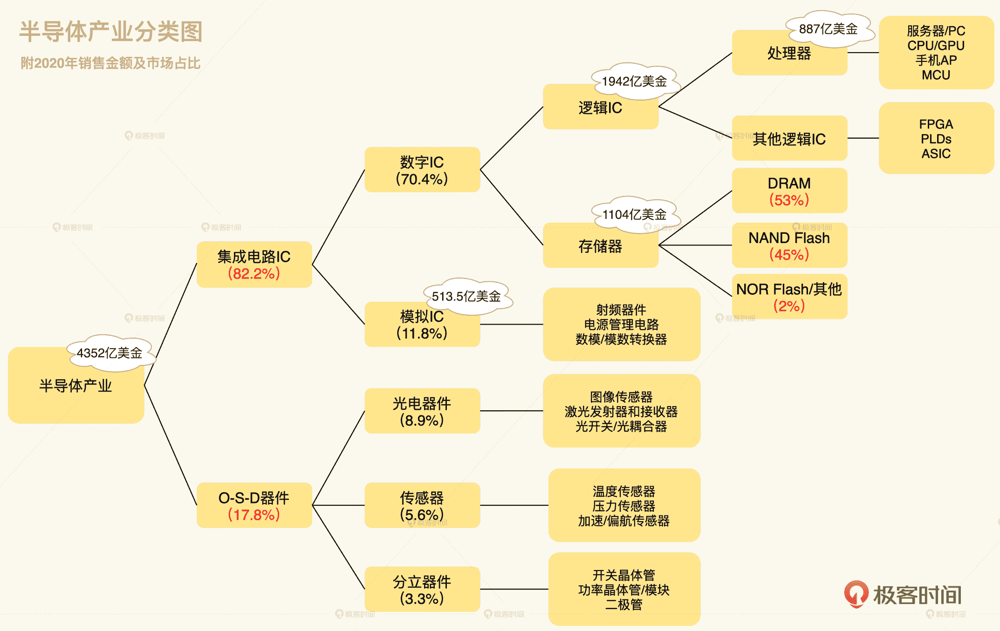
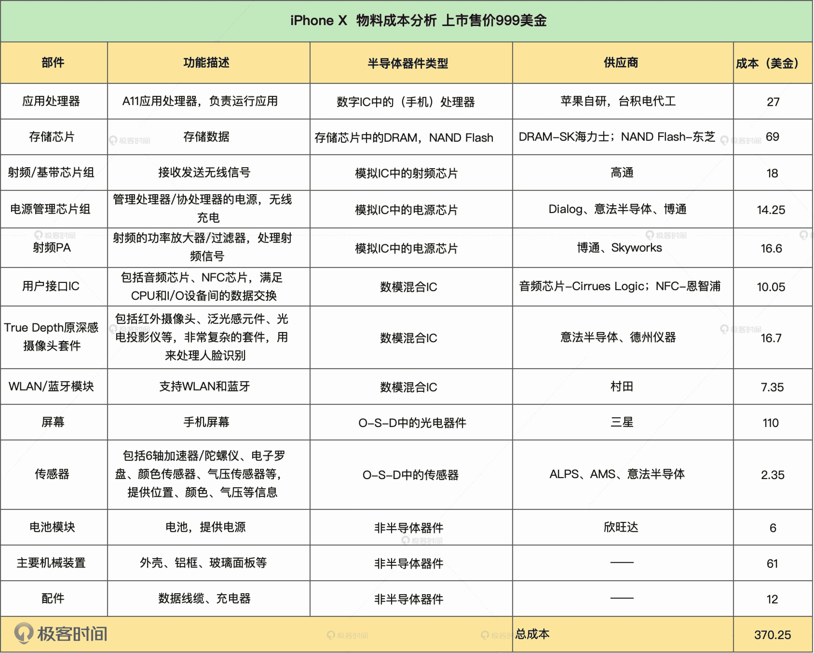
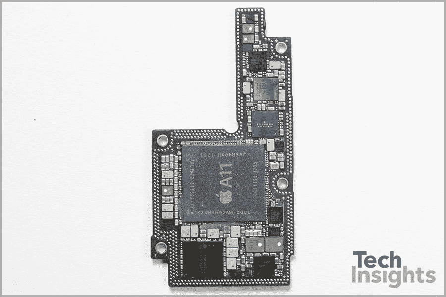
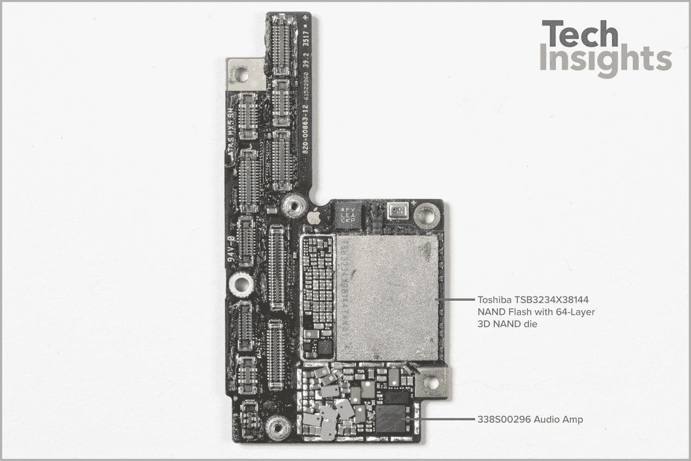
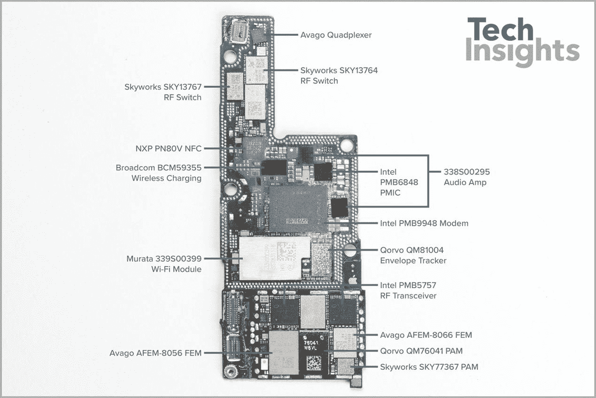
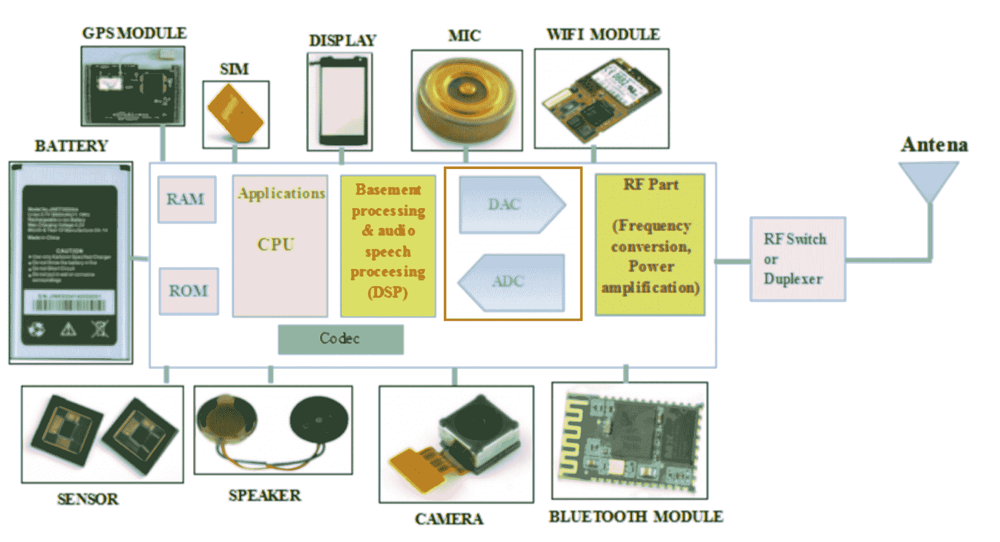

# 02 | 从一部iPhone手机看芯片的分类

 

你好，我是邵巍。在上一讲中，我给你介绍了三个半导体行业的基本概念，让你知道晶体管和集成电路是支撑半导体行业发展的两个基础发明，摩尔定律是丈量行业进步的重要尺子。

这一讲，我想和你聊聊半导体，也就是芯片的分类，来看看芯片可不只是你脑袋里想象的小硅片，它的类型非常多。

在正式开始这一讲之前，我想要问你个问题，“你知道芯片和集成电路是什么关系吗？有人说，芯片和集成电路就是一回事，只是两个不同的名字罢了，你认同吗？”

这个问题很重要，我建议你先停下来花一分钟想想你的答案。

过去几年里，总是会有同事、朋友问我这个问题。不信你随便一搜，网上怎么说的都有。放心，今天，我给你的答案，绝对是最准确和客观的。

首先，我可以负责任地告诉你，**芯片肯定不全是集成电路**。芯片里面，大约只有 80% 属于集成电路，其余的都是光电器件、传感器和分立器件，行业内把这些器件称为 O-S-D（Optoelectronic, Sensor, Discrete）。

集成电路你已经学过了，它是由大量晶体管组成的。那光电器件、传感器、分立器件又是什么呢？一下子整出来这么多概念，是不是很晕。

哈哈，别急，下面会讲到。做这节课的时候，编辑就和我说了，老师，咱们可别孤零零地讲概念，用户没办法记住。我们讨论之后，决定拿你最熟悉的手机来举例子，以帮助你建立直观的认识。

所以，今天这节课，我会通过“拆解”一部你熟悉的 iPhone 手机，来和你聊聊芯片的分类。学完这节课，你就可以对半导体行业的主要产品品类有基本概念，同时也会对一部 iPhone 都用了哪些芯片产品有一个初步的印象。

为了方便你理解，我按照半导体行业的专业分类方式，做了下面这张行业分类图。图里的数据都来自半导体行业权威的市场研究机构 IC Insights 的最新市场统计。能把这张图和别人讲清楚，我觉得你至少是一个半导体行业初级市场研究人员的水平了。

有这张图还不够，我另外整理了一张 iPhone X 物料表，在正中间那一列，我标明了每个物料所属的半导体种类。而且这张表的顺序，跟前面的分类图，基本上可以一一对应起来。考虑到公开信息的准确性，这张表我参考了知名市场研究机构 IHS Markit 的 iPhone X 拆解报告。

表格的第二列，也就是功能描述部分，我对部件做了解释，你一定要花 2 分钟时间整体对照理解下。

对照完两张图，从宏观看，有两个信息你需要关注：

1. 第一，一部手机 80% 都是集成电路。所以，苹果是半导体产品全球排名第一的买家，这个就不难理解了吧？
2. 第二，一部 iPhone 几乎把前面分类图中的重要品类都用到了。你看，手机一点都不简单吧？

现在，有了一张半导体产品分类图，一张充满半导体元器件的物料表，下面我们就顺着这两个线索，逐一地讲解一部 iPhone X 所用到的半导体产品。

## iPhone X 手机处理器：A11

我不知道你还记得吗？2017 年秋天苹果发布 iPhone X 的时候，亮点之一就是这款手机搭载了 6 核心 64 位的 A11 处理器。当时，苹果公司高级副总裁评价说，这是一款智能手机到目前为止所能拥有的最强劲、最智能的芯片。

上面这张图是 iPhone X 的主板，顾名思义，就是有主处理器的板子。在主板上，带着苹果 Logo 的那个部件就是苹果自研的应用处理器 A11。它在分类之中，属于集成电路 IC-> 数字 IC-> 逻辑 IC-> 处理器 -> 应用处理器。

这里注意，我们在说应用处理器的时候，也常用它的英文缩写 AP（Application Processor）。

在物料成本表里，你可以看到，因为是苹果自己开发，找台积电代工，成本只有 27 美金。那如果不找台积电代工，而是全部采用高通旗舰芯片的话，同等性能配置下，成本大约都在 80 美金以上。算一算，苹果一年卖 2 亿部手机，一部手机省 50 美金，一年就能省 100 亿美金。

这么一算，你应该能明白苹果为啥要自己设计手机 AP 了吧？

从技术上，再看一下 A11 这颗处理器的细节，它集成了 6 颗 ARMv8 的 CPU 核，2 大 4 小；3 颗 GPU 核，一个神经网络处理器 NPU 用来加速人工智能算法，一个（照相机）图像信号处理器 ISP。这是一颗高度集成的 SoC (系统级芯片，System-on-Chip)。

高度集成也是手机芯片的特点，像在 PC 或者服务器上，CPU、GPU、NPU 往往是三颗独立的芯片。对于 iPhone 手机来说，整个 iOS 系统都是跑在应用处理器上的，可以说手机中最重要的一颗芯片就是应用处理器了，系统是否顺滑，游戏是否顺畅，全看应用处理器的芯片。这也是苹果、华为、三星都要自研应用处理器的原因。

## iPhone X 的两大存储芯片

在 A11 下面其实还压着一个存储芯片 DRAM（动态随机存取存储器，Dynamic Random Access Memory）。存储芯片，顾名思义，就是存储数据的芯片，也叫存储器。手机中的全部信息，包括输入的原始数据、应用程序、中间运行结果和最终运行结果都保存在存储器中。除此之外，iPhone X 还有一块重要的存储芯片，就是在下图中最大的一块芯片，东芝的 NAND Flash。

DRAM 和 NAND Flash 的区别很好理解，我类比下。在 PC 机上，我们俗称的内存条，其实就是 DRAM，固态硬盘（SSD）就是 NAND Flash。

在分类之中，属于集成电路 IC-> 数字 IC-> 存储 IC->DRAM & NAND Flash。

存储的分类，如果按技术类型，我可以给你列一个长长的单子。但是，我们可以偷巧地只看用量最大的两个主要品类 DRAM 和 NAND Flash。那些技术名词留给行业人员自己 battle 用吧。

为什么只看 DRAM 和 NAND Flash 就可以？再回到第一张分类图，我们可以看到从存储芯片的产值构成来看，DRAM 约占这个存储芯片市场的 53%，NAND Flash 占比 45%，NOR Flash 与其余占比约 2%，完全可以忽略。

DRAM 存取速度快，因此手机运行时的数据，都存放在 DRAM 中，方便应用处理器随时存取。这也是 iPhone X 的应用处理器和 DRAM 紧密贴在一起的缘故。而在最新一代的苹果应用处理器中，采取先进封装技术，干脆把 DRAM 和 AP 封装在一起，更加紧密了。

NAND Flash 存储容量较大，而且掉电之后数据也不丢失。因此手机里的照片、记事本，都装在 NAND Flash 里。iPhone X 配的是 4GB DRAM、64G/256G NAND Flash。

介绍完 iPhone X 的应用处理器和存储芯片，再回去看一眼第一张分类图，你会发现，你已经大概理解其中占比 70% 的数字集成电路了。在开始讲剩下的 30% 之前，我想从专业的视角，把数字 IC、各类处理器和存储芯片等相关概念再解释一下，以帮助你更好的理解。

### 数字 IC

集成电路的英文是 Integrated Circuit，数字 IC 就是数字集成电路。回到专业视角，如果从用途上分类，数字集成电路可以简洁地分为，做计算控制的逻辑芯片和保存数据的存储芯片。不过业界习惯，把标准程度非常高的 CPU、GPU、MCU 合并为 MPU 微处理器来单独统计，把应用相关度高的 ASIC（下文会解释）和 SoC 算作逻辑芯片。

### CPU：计算设备的运算核心和控制核心

CPU（Central Processing Unit）是计算设备的运算核心和控制核心。它的功能主要是解释计算机指令以及处理计算机软件中的数据。CPU 的标准性很高，是最能体现摩尔定律的产品。

苹果的手机应用处理器，永远使用的是最顶级的工艺。iPhone X 的 A11，在 2017 年上市的时候，就用了当时最先进的 10nm 工艺。到了 2020 年，苹果的应用处理器都已经用上 5nm 的工艺制程，桌面和服务器端才跟进到了 7nm。

### GPU：图形处理器

GPU（Graphics Processing Unit）也叫图形处理器，主要用来满足图像计算要求。相对来说 CPU 擅长逻辑判断和串行数据运算，而一个图片的每一个像素都需要相同的计算处理，GPU 就擅长图形计算这种并行的任务。因为 GPU 这种并行度高的特征，在品类上还衍生出弱化图像能力，专注于计算的通用 GPU。一般来说，通用 GPU 的数据处理性能是 CPU 的 10 倍、20 倍，甚至更高。

作为加速器存在的 GPU，比 CPU 还要激进。摩尔定律中处理器性能每隔两年翻 1 倍，而英伟达的 CEO，Jason Huang，归纳说 GPU 将推动 AI 性能实现每年翻 1 倍，这个规律还被业界称为黄氏定律。

### ASIC：为解决特定应用问题而定制设计的集成电路

为解决特定应用问题而定制设计的集成电路，就是 ASIC（Application Specific IC）。当 ASIC 规模够大，逐渐通用起来，某类 ASIC 就会有一个专有名称，成为一个品类。例如现在用来解决人工智能问题的神经网络处理器。

标准的 CPU 芯片，往往要配上不同的外围芯片，比如 Intel 管理外设的芯片组 Chipset，加速图形的 GPU，这样才能构成系统。而随着工艺制程的不断演进，我们有能力把越来越多的外围芯片集成进 CPU 芯片中，于是就有了 SoC。SoC 因其高集成度、高效率的特点，是目前 IC 设计的主流。SoC 也算是 ASIC 的一种。

相较于我们常见的 CPU、GPU 等通用型芯片，ASIC 芯片的计算能力和计算效率都可以根据特定的需要进行定制，定制么，肯定体积小、功耗低、计算效率高，在这些方面有优势。但是缺点就是入门门槛高，这里的门槛，包括资金、技术，还有时间。

### 存储芯片：DRAM 和 NAND Flash

前面有介绍，数字 IC 中 2/3 是逻辑芯片，1/3 就是存储芯片。存储芯片就两个主要品类 DRAM 和 NAND Flash，占了 98% 的比例，其余可以忽略不计。

存储芯片在设计方面跟前面的 CPU、GPU、ASIC 这类逻辑芯片有很大不同。CPU、GPU、ASIC 重在功能设计、逻辑设计。而存储芯片的设计比较简单，基本都是重复单元，但是对时序和布局布线有挑战性。

好了，专业概念到这里就告一段落，让我们再回到 iPhone X 的物料表，讲一讲剩下 30% 的事情。存储芯片之后我列了三行模拟芯片，有射频芯片、电源芯片。那么为什么它们会被归类到模拟芯片，什么是模拟芯片呢？

## iPhone X 中的模拟 IC

上面我提到数字 IC 的时候没有展开讲概念，这里你可以跟模拟 IC 对比来看：处理数字信号的就是数字 IC，处理模拟信号的就是模拟 IC。它们两个是相对的。其实如果要逻辑严密，集成电路的分类应该还列上数模混合 IC 共三种，而实际上你可以理解为，以数字电路为主的归类到数字 IC，以模拟电路为主的归类到模拟 IC，两大类方便你记忆。

数字 IC 基本上是一个追逐摩尔定律的品类，尽量采用最新工艺，利用新工艺制程带来的晶体管密度的提升，来提高性能同时降低成本。

相对来说，模拟 IC 则更多的追求电路速度、分辨率、功耗等参数方面的提升，强调的是高信噪比、低失真、低耗电和高稳定性，因而产品一旦达到设计目标就具备长久的生命力，生命周期可长达 10 年以上。行业里有“一年数字，十年模拟”的说法。

那么，数字信号和模拟信号又是什么？

简单来说，0 和 1，就是数字信号。而声音、光、气压、无线电信号（Radio Frequency，也被翻译成射频，射频信号），这些现实中的信号，基本上都是连续的信号，而不是简单的用“有 -1”，“无 -0”来表示，它们都是模拟信号。

数字 IC 这块，你好歹在日常中有见过、听过，甚至买过。而对于模拟 IC，你可能就不熟悉了。但手机其实就是一个大量使用模拟 IC 的电子设备。如果按照整个半导体行业的出货量来看，模拟 IC 的数量是超过数字 IC 的，但是单价不高，因此在销售收入上占比也不高。

看下图，Quadplexer 四路复用器芯片，实现手机芯片频段载波聚合功能，载波聚合，是一种增加传输带宽的手段，把几个分散的频段通道整合成为一个更宽的数据通道；RF Switch 射频开关芯片，处理无线信号通道转换；NFC 芯片，用来处理近距无线通讯信号的；Wireless Charging 芯片，这个你熟悉，支持无线充电；还有 Audio Amp 音频放大器芯片等等，这些就都是在 iPhone X 中的模拟 IC。

总的来说，射频器件、电源管理装置和数模 / 模数转换器是模拟 IC 的三大主要产品。

1. **射频器件**是处理无线电信号的核心器件，包括 5G 信号、蓝牙、WIFI、NFC 等，凡是需要无线连接的地方必备射频器件，手机是射频器件的一个重要应用场景。
2. 任何电子设备都需要**电源管理装置**。电源管理芯片的任务就是完成电能的变换、分配、检测及其它电能管理。电源管理芯片占模拟芯片销售份额接近三成。射频芯片和电源管理芯片在手机里非常重要，你可以对着物料表，找一找。
3. **模数和数模转换器**是模拟信号与数字信号之间起桥梁作用的电路。A/D 是模拟量到数字量的转换， D/A 是数字量到模拟量的转换，它们的道理是完全一样的，只是转换方向不同。例如我们要播放一首歌曲，歌曲是以数字形式存储的，手机经过一系列的数模转换，把数字信号变成连续的声音信号，通过麦克风播放出来，这就是一个 DAC(Digital to Aanalog Controller, 数模转换器) 数模转换过程。

一个小知识点，模拟 IC 的设计涉及了更加复杂的信号环节，并且其设计的自动化程度远不及数字 IC，通常需要大量的人工干预决定取舍。相对于数字 IC，模拟 IC 的设计对工程师的经验，权衡矛盾等方面的能力要求更为严格。所以，模拟 IC 设计被称为一门艺术。

好，到这里，你已经了解了集成电路的分类，包括数字 IC 和模拟 IC，关于半导体 80% 的内容我就讲完了。剩下的近 20% 就是我们开头提过的 O-S-D 器件。

## iPhone X 的光电器件、传感器和分立器件

回顾一下，在开篇我就介绍了，半导体产品超过 80% 是集成电路芯片，其余的是光电器件、分立器件和传感器，行业内称为 O-S-D。

集成电路，就是数字 IC 和模拟 IC。用一个手机来理解，数字 IC 就是手机处理器，模拟 IC 就处理那些射频信号的芯片。那么光电器件、传感器、分立器件又是什么呢？

1. iPhone X 用的三星产的 AMOLED 手机屏，就是光电器件。
2. 手机里的 6 轴加速器 / 陀螺仪、电子罗盘、颜色传感器、气压传感器等都属于传感器。
3. 分立器件，其实就是单独包装的晶体管。多个晶体管集成起来，就是集成电路，而仍然单独封装的晶体管，就是分立器件。我看过一份资料，在 2004 年，手机上有 300 多个分立器件，现在么，这个确切的数字已经查不到了，能集成在一起的都尽量集成起来了。

到这里我用一部 iPhone X 举例，把半导体产业的几大产品品类：CPU、GPU、ASIC、SoC， DRAM、NAND Flash、射频 IC、电源 IC、数模 / 模数转换 IC，以及光电器件、传感器等，串讲了一下，希望你对整个行业能有个初步的认识。

## 总结

学习完这一讲，我们来复习几个重点：

1. 在半导体行业中，超过 80% 的产品是集成电路芯片，因此我们在日常中常把芯片、半导体、集成电路三者混用。但其实，集成电路之外，半导体产品还有光电器件、传感器和分立器件，行业内称为 O-S-D；
2. 集成电路芯片主要分为数字 IC 和模拟 IC，数字 IC 强调运算速度，模拟 IC 强调高信噪比、低失真、低耗电和高稳定性，生命周期更长；论销售额，数字芯片有绝对优势，但是如果论出货量，模拟芯片量大过数字芯片。
3. 数字 IC 中主要就是 CPU 处理器和存储器。CPU 是重中之重，行业明珠的地位。无论是 Intel，还是苹果，都是靠 CPU 站在行业第一的位置的。
4. 一部 iPhone 手机，基本上用到了半导体产品的全部种类。一部小小的手机，是整个行业的缩影。选车要看发动机，我希望你在选择下一部手机的时候，也能看看它的芯片。

最后，我希望你能记住最开始的那张图，那是业内最权威的分类方式了，我为本次课程特别制作，独此一家，别无分店。

另外附上 **TechInsights** 的 iPhone X 拆解原文链接。原文非常详尽，我的重点在于讲解半导体的分类。有所省略。

## 思考题

在手机行业中，有两个公司掌握了真实的每个手机厂商的出货数字，你能猜出来是哪两个公司么？欢迎你在评论区与我交流。如果你觉得这一讲不错的话，也欢迎分享给更多的朋友一起阅读。
