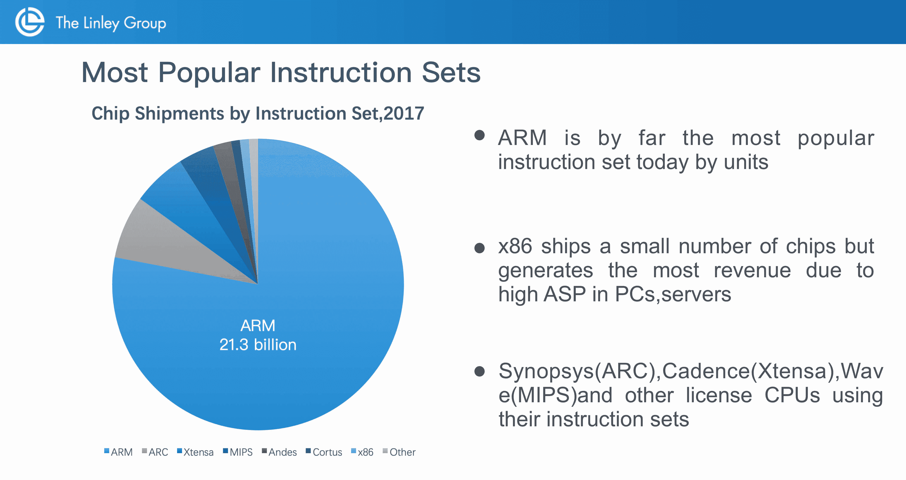
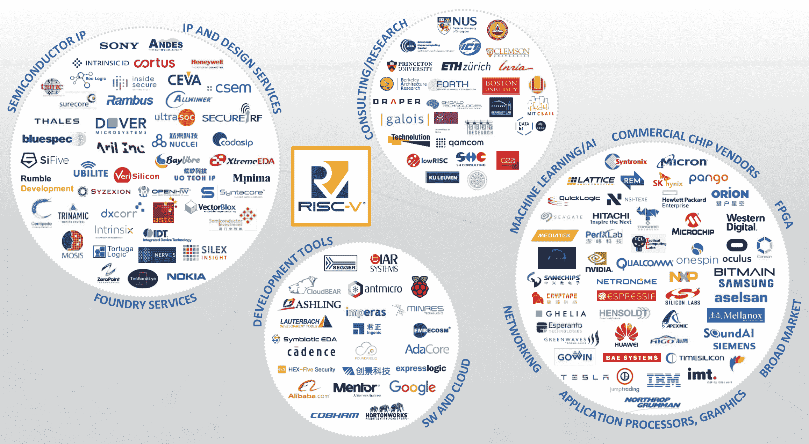
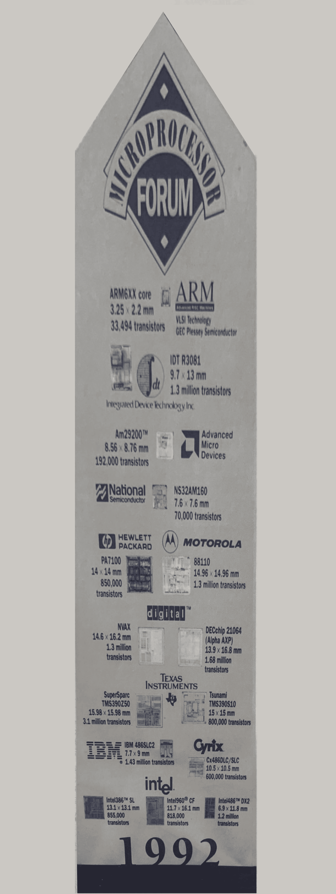

# 17｜拓展阅读：聊聊 ARM 与 RISC-V

 

你好，我是邵巍。

我们在正式开始这一讲之前，先回顾一下前面的课程，为什么 Intel 会做行业第一？因为它有掌握成本结构的 IDM 模式，有符合摩尔定律的 Tick-Tock 策略，这些都对。但除此之外，还有一个非常重要的因素，那就是 Intel 掌握了 x86 指令集。

想想为什么 AMD 能与 Intel 常年竞争？AMD 甚至在濒临破产的边缘，连总部大楼都卖了还能起死回生，重新来个 AMD YES？就是因为 AMD 和 Intel 分享了 x86 的指令集。

我们前面讲硬件的内容偏多，这一讲，我们就聊聊指令集。其实如果要把指令集讲清楚，估计能开设一个新的专栏，这里我把它作为拓展阅读，就简单聊聊 ARM 和 RISC-V 这两个在业内比较有话题性的指令集吧。

先来说说定义，什么叫指令集呢？业界泰斗、ACM 和 IEEE 两院院士、2017 年图灵奖得主、RISC-V 基金会的董事会副主席 David Patterson 给了非常通俗易懂的定义：**软件通过一个专业词汇上称为指令集的东西和硬件讲话**。换句话说，指令集是软硬件之间沟通的桥梁。如果在晶体管、集成电路和摩尔定律之外，再给一个重点概念，那就是指令集了。

可能你平时看新闻，看到 ISA、架构、指令集这些词都混在一起用，觉得有些疑惑，其实 ISA= 指令集 = 架构，都是一个意思。而实现了一个指令集的 CPU 叫微架构。

我给你举个例子，ARMv8，这是一个指令集，也是一个架构版本。ARM 的 Cortex-A72 处理器，就是一个实现了 ARMv8 指令集的具体 CPU，是一个微架构。ARM 的 Cortex-A72 是一个支持 ARMv8 指令集的 CPU IP，就是一堆 RTL 代码。瑞芯微的 RK3399 芯片就是一个集成了 2 个 Cortex- A72 之后的芯片，是一个物理体，这个芯片支持 ARMv8 指令集。凡是支持 ARMv8 的软件，都可以在 RK3399 上运行。

当我们说 ARM 的时候，我们不太关注这个拥有 6000 员工，总部在英国但被软银收购后已经成为一家日本公司的企业故事，或者是在网上可以公开看到的那本 5000 多页的 ARMv8 指令集手册。我们更多提到的是硬件侧高通的骁龙、联发科的天玑、华为的麒麟、三星的 Galaxy、AWS 的 Graviton、苹果的全家桶，和软件侧的 Android、iOS、Red Hat、Ubuntu、SUSE、麒麟 OS，等等，它们都在 ARM 的生态系统里。 我们关注的是整个 ARM 生态系统。

类似的，我们在说 x86 的时候，也不仅仅指的是 Intel 和 AMD，还有在 x86 生态系统里的微软、Linux、Oracle、SAP 等等。但是 x86，并不是一个公开授权的指令集，虽然并不仅仅有 Intel 和 AMD 两家，但是**对于新入****局****者来说，做 x86 指令集的机会几乎微乎其微**。相对来说，**ARM 和 RISC-V 都是开放授权的指令集**。ARM 是商业授权指令集，RISC-V 是开源的指令集。至于 CPU 核，也就是微架构，两家都是商业授权模式，就是要付费的。

2017 年，以微处理器分析闻名的行业分析公司 Linley Group 在一次 RISC-V 会议上做开场主题演讲时展示过一页最受欢迎的指令集，如果按照支持不同指令集的 CPU 个数来看，ARM 是最多的，从饼图上看，这是压倒性的优势。但是如果按照营收来算，x86 因为高单价（ASP，平均销售价格）是最赚钱的指令集。也就是说目前这两个最流行的指令集，一个赚了钱场，一个赚了人场。

当年 Intel 推出 x86 指令集的时候，已是万人大厂，还拿下了 PC 这个关键市场，而彼时微软才刚刚创立，不足 10 人，因此这是一个先建硬件再建软件的历程。而 ARM 是靠着自己的灵活授权模式，搭着当年德州仪器的大船杀入到手机市场，并在功能机年代拿下手机这个关键市场的。然后先有诺基亚的手机操作系统塞班，然后再有的 Android。

在移动互联网时代，ARM 也是运气好，Intel 没有答应苹果的定制要求，因此苹果就选了 ARM 这个现成的 CPU IP，也采用了既有的指令集，再搭建 iOS 系统。因此 ARM 赶上的是硬件统一，软件分裂，然后对齐到硬件上的过程。

那么开始于 2010 年的 RISC-V 呢？我推荐你读一下中国科学院计算技术研究所包云岗老师的解读和介绍。包老师团队翻译了 RISC-V 手册，副标题是“一本开源指令集的指南 ”。

在这里我就简单从我的角度聊聊 RISC-V。

RISC-V 诞生于美国 UC Berkeley 大学，最初是个开放为教学服务的指令集。但 RISC-V 因为有着精简、高效、低能耗、模块化、可拓展、免费开放、无历史负累低效指令等优势，很快就出圈了，因此 RISC-V 团队在认识到它的价值之后，就决定将之推出市场进行商业化探索。

RISC-V 架构秉承简单的设计哲学，完全抛弃历史包袱，从轻上路，借助计算机体系结构，经过多年的发展已经成为比较成熟的技术。RISC-V 基础指令集则只有 40 多条，加上其他的模块化扩展指令总共几十条指令。RISC-V 的规范文档仅有 145 页，而“特权架构文档”这样重要的内容，篇幅也仅为 91 页。

如果说 ARM 借助 IP 授权的商业模式，降低了 CPU 设计难度，让信息技术世界进入泛处理器时代，那么 RISC-V 就是以免费开放的开源指令集模式，降低了 CPU IP 的设计门槛，让芯片行业进入到一个满是 CPU IP 的时代。RISC-V 目前已经有 200 多家成员，你可以看这张大厂 logo 云集图片，这张图来自 RISC-V 基金会。

不过所有的技术或者商业模式优势，最终还是要转化成商业成功。目前所有参与 RISC-V 的企业，其实还是小公司居多，或者是大公司的小项目有涉及，还没有特别赚钱的。那什么算是商业成功呢？依据我的经验以及总结 ARM 成功的历史，我列了三条 RISC-V 作为指令集的成功标志：

1. 最新工艺的 SoC 量产
2. 有软件支持的里程碑
3. 支持杀手级应用或者说核心市场的 25% 市场份额

我觉得达到任意一个即可，当然最终肯定都会有，但是成功的起点是拿下其中之一。

学习到这里，你如果对 RISC-V 仍然感兴趣，我建议你去读一下 John Hennessy 和 David Patterson 这两位图灵奖获得者，在 2019 年发表的文章《计算机架构的新黄金时代》（中文版可以看这里），你可能会对 RISC-V 有一个全新的认识。如果把它当通用 CPU，它生得晚了，可是如果把它当作领域专用架构 DSA（Domain Specific Architecture），这种模块化的设计，非常有价值，而且它是先立标准、开源开放，这样碎片化的生态累积起来更灵活更高效，反而更有机会做大。

但是我想说生态始终还是要统一的，要有人掌握灵活和标准之间的平衡，否则软件投资无法得到保障，最终还是一盘散沙。

最后，我用一张 1992 年微处理器论坛的老照片作为结尾。指令集并不算一个特别有技术难度的项目，1960 年代，IBM 的每台计算机都有自己的指令集和工具。1992 年，那张图上也是有满满的指令集。都说我们芯片这行做公司容易死，但其实图里的公司，还是剩下了大半，而指令集就剩下两个了。

计算机指令集的发展，是“长坡滚雪球”，要有核心，不能碎，或者说生态不能分裂，还要持续稳定地不停地滚动，即保持演进，与时俱进。当然还要这个“坡”够长够大，才有后期的如雪山压顶之势，拿到容量够大的核心市场。

最后，我还想聊聊一些题外话，我不知道你在看网上一些信息的时候会不会完全相信别人说的，我是不会。我们现在看到的一些文章，有相当一部分是某些公司宣传部门写的通稿，并不能直接代表真实情况。因此，一般我在阅读的时候，是会先看一下文章来源和作者背景的。我也是普通人，在一些理解上也会加我自己的想法，因此你可以再从开篇词里了解一下我，再确定给我加什么样的纠偏系数。

关于指令集，你可以畅所欲言，聊聊你知道的内容，欢迎在评论区和我交流。
