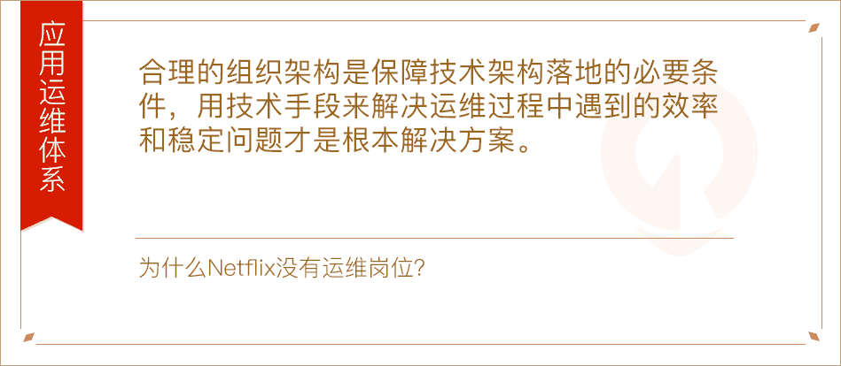
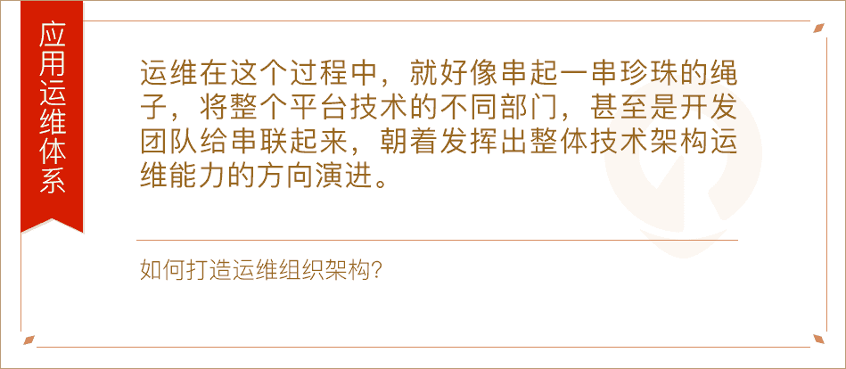

# 划重点：赵成的运维体系管理课精华（一）

 

我们的专栏原计划共 36 期，在三个多月的时间里，收到了你的很多反馈，我也对应做了一些补充，所以我们的运维体系管理课算是拖堂了，一直更新了 42 期，至此告一段落。
 

从今天开始，我们按照专栏的四大模块，分三次来整体梳理一下。我从每一篇文章里选出一句最想告诉你的话，制作成知识卡，帮助你回顾文章内容，点击就可以**一键直达原文**。
 

我们专栏的四大模块分别是：
 
 
- 应用运维体系建设 
- 效率和稳定性最佳实践 
- 云计算时代的运维实践 
- 个人成长 
 

**愿你已拥有不一样的运维思考！**
 

## 应用运维体系

 

 

 

 

  

 

 

 

 

 

 

 

