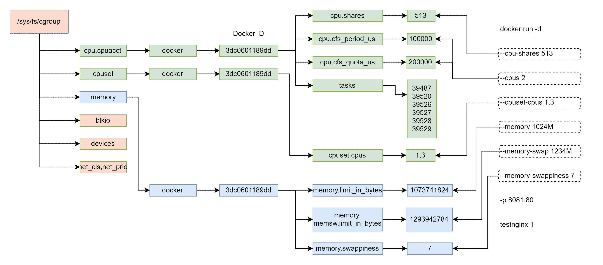
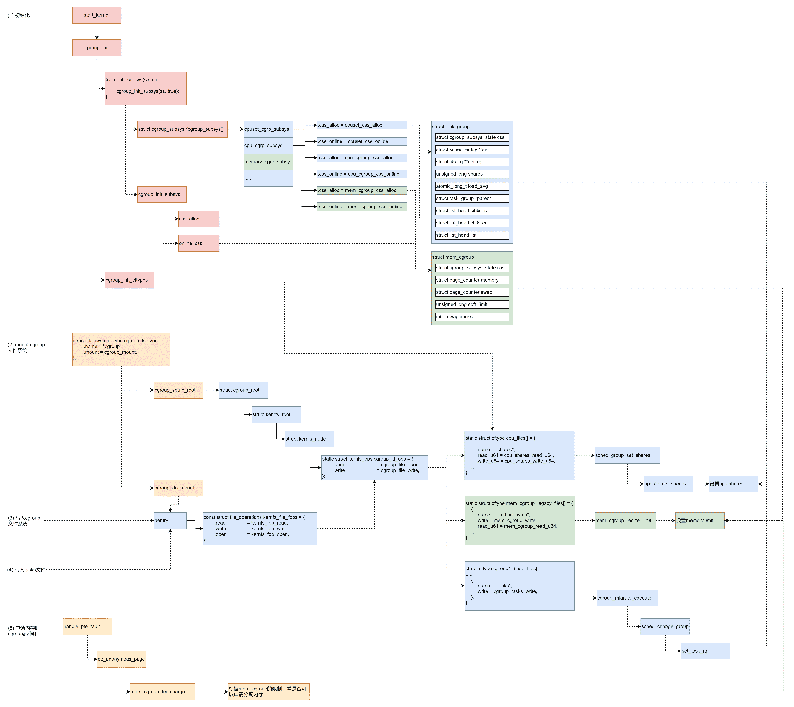

# 58 | CGroup技术：内部创业公司应该独立核算成本

 

我们前面说了，容器实现封闭的环境主要要靠两种技术，一种是“看起来是隔离”的技术 Namespace，另一种是用起来是隔离的技术 CGroup。

上一节我们讲了“看起来隔离“的技术 Namespace，这一节我们就来看一下“用起来隔离“的技术 CGroup。

CGroup 全称是 Control Group，顾名思义，它是用来做“控制”的。控制什么东西呢？当然是资源的使用了。那它都能控制哪些资源的使用呢？我们一起来看一看。

首先，cgroups 定义了下面的一系列子系统，每个子系统用于控制某一类资源。

 
- cpu 子系统，主要限制进程的 cpu 使用率。 
- cpuacct 子系统，可以统计 cgroups 中的进程的 cpu 使用报告。 
- cpuset 子系统，可以为 cgroups 中的进程分配单独的 cpu 节点或者内存节点。 
- memory 子系统，可以限制进程的 memory 使用量。 
- blkio 子系统，可以限制进程的块设备 io。 
- devices 子系统，可以控制进程能够访问某些设备。 
- net_cls 子系统，可以标记 cgroups 中进程的网络数据包，然后可以使用 tc 模块（traffic control）对数据包进行控制。 
- freezer 子系统，可以挂起或者恢复 cgroups 中的进程。 

这么多子系统，你可能要说了，那我们不用都掌握吧？没错，这里面最常用的是对于 CPU 和内存的控制，所以下面我们详细来说它。

在容器这一章的第一节，我们讲了，Docker 有一些参数能够限制 CPU 和内存的使用，如果把它落地到 Cgroup 里面会如何限制呢？

为了验证 Docker 的参数与 Cgroup 的映射关系，我们运行一个命令特殊的 docker run 命令，这个命令比较长，里面的参数都会映射为 cgroup 的某项配置，然后我们运行 docker ps，可以看到，这个容器的 id 为 3dc0601189dd。

```
docker run -d --cpu-shares 513 --cpus 2 --cpuset-cpus 1,3 --memory 1024M --memory-swap 1234M --memory-swappiness 7 -p 8081:80 testnginx:1 # docker psCONTAINER ID        IMAGE               COMMAND                  CREATED              STATUS              PORTS                  NAMES3dc0601189dd        testnginx:1         "/bin/sh -c 'nginx -…"   About a minute ago   Up About a minute   0.0.0.0:8081->80/tcp   boring_cohen
```

在 Linux 上，为了操作 Cgroup，有一个专门的 Cgroup 文件系统，我们运行 mount 命令可以查看。

```
# mount -t cgroupcgroup on /sys/fs/cgroup/systemd type cgroup (rw,nosuid,nodev,noexec,relatime,xattr,release_agent=/usr/lib/systemd/systemd-cgroups-agent,name=systemd)cgroup on /sys/fs/cgroup/net_cls,net_prio type cgroup (rw,nosuid,nodev,noexec,relatime,net_prio,net_cls)cgroup on /sys/fs/cgroup/perf_event type cgroup (rw,nosuid,nodev,noexec,relatime,perf_event)cgroup on /sys/fs/cgroup/devices type cgroup (rw,nosuid,nodev,noexec,relatime,devices)cgroup on /sys/fs/cgroup/blkio type cgroup (rw,nosuid,nodev,noexec,relatime,blkio)cgroup on /sys/fs/cgroup/cpu,cpuacct type cgroup (rw,nosuid,nodev,noexec,relatime,cpuacct,cpu)cgroup on /sys/fs/cgroup/memory type cgroup (rw,nosuid,nodev,noexec,relatime,memory)cgroup on /sys/fs/cgroup/cpuset type cgroup (rw,nosuid,nodev,noexec,relatime,cpuset)cgroup on /sys/fs/cgroup/hugetlb type cgroup (rw,nosuid,nodev,noexec,relatime,hugetlb)cgroup on /sys/fs/cgroup/freezer type cgroup (rw,nosuid,nodev,noexec,relatime,freezer)cgroup on /sys/fs/cgroup/pids type cgroup (rw,nosuid,nodev,noexec,relatime,pids)
```

cgroup 文件系统多挂载到 /sys/fs/cgroup 下，通过上面的命令行，我们可以看到我们可以用 cgroup 控制哪些资源。

对于 CPU 的控制，我在这一章的第一节讲过，Docker 可以控制 cpu-shares、cpus 和 cpuset。

我们在 /sys/fs/cgroup/ 下面能看到下面的目录结构。

```
drwxr-xr-x 5 root root  0 May 30 17:00 blkiolrwxrwxrwx 1 root root 11 May 30 17:00 cpu -> cpu,cpuacctlrwxrwxrwx 1 root root 11 May 30 17:00 cpuacct -> cpu,cpuacctdrwxr-xr-x 5 root root  0 May 30 17:00 cpu,cpuacctdrwxr-xr-x 3 root root  0 May 30 17:00 cpusetdrwxr-xr-x 5 root root  0 May 30 17:00 devicesdrwxr-xr-x 3 root root  0 May 30 17:00 freezerdrwxr-xr-x 3 root root  0 May 30 17:00 hugetlbdrwxr-xr-x 5 root root  0 May 30 17:00 memorylrwxrwxrwx 1 root root 16 May 30 17:00 net_cls -> net_cls,net_priodrwxr-xr-x 3 root root  0 May 30 17:00 net_cls,net_priolrwxrwxrwx 1 root root 16 May 30 17:00 net_prio -> net_cls,net_priodrwxr-xr-x 3 root root  0 May 30 17:00 perf_eventdrwxr-xr-x 5 root root  0 May 30 17:00 pidsdrwxr-xr-x 5 root root  0 May 30 17:00 systemd
```

我们可以想象，CPU 的资源控制的配置文件，应该在 cpu,cpuacct 这个文件夹下面。

```
# lscgroup.clone_children  cpu.cfs_period_us  notify_on_releasecgroup.event_control   cpu.cfs_quota_us   release_agentcgroup.procs           cpu.rt_period_us   system.slicecgroup.sane_behavior   cpu.rt_runtime_us  taskscpuacct.stat           cpu.shares         user.slicecpuacct.usage          cpu.statcpuacct.usage_percpu   docker
```

果真，这下面是对 cpu 的相关控制，里面还有一个路径叫 docker。我们进入这个路径。

```
]# lscgroup.clone_childrencgroup.event_controlcgroup.procscpuacct.statcpuacct.usagecpuacct.usage_percpucpu.cfs_period_uscpu.cfs_quota_uscpu.rt_period_uscpu.rt_runtime_uscpu.sharescpu.stat3dc0601189dd218898f31f9526a6cfae83913763a4da59f95ec789c6e030ecfdnotify_on_releasetasks
```

这里面有个很长的 id，是我们创建的 docker 的 id。

```
[3dc0601189dd218898f31f9526a6cfae83913763a4da59f95ec789c6e030ecfd]# lscgroup.clone_children  cpuacct.usage_percpu  cpu.sharescgroup.event_control   cpu.cfs_period_us     cpu.statcgroup.procs           cpu.cfs_quota_us      notify_on_releasecpuacct.stat           cpu.rt_period_us      taskscpuacct.usage          cpu.rt_runtime_us
```

在这里，我们能看到 cpu.shares，还有一个重要的文件 tasks。这里面是这个容器里所有进程的进程号，也即所有这些进程都被这些 cpu 策略控制。

```
[3dc0601189dd218898f31f9526a6cfae83913763a4da59f95ec789c6e030ecfd]# cat tasks 394873952039526395273952839529
```

如果我们查看 cpu.shares，里面就是我们设置的 513。

```
[3dc0601189dd218898f31f9526a6cfae83913763a4da59f95ec789c6e030ecfd]# cat cpu.shares513
```

另外，我们还配置了 cpus，这个值其实是由 cpu.cfs_period_us 和 cpu.cfs_quota_us 共同决定的。cpu.cfs_period_us 是运行周期，cpu.cfs_quota_us 是在周期内这些进程占用多少时间。我们设置了 cpus 为 2，代表的意思是，在周期 100000 毫秒的运行周期内，这些进程要占用 200000 毫秒的时间，也即需要两个 CPU 同时运行一个整整的周期。

```
[3dc0601189dd218898f31f9526a6cfae83913763a4da59f95ec789c6e030ecfd]# cat cpu.cfs_period_us100000[3dc0601189dd218898f31f9526a6cfae83913763a4da59f95ec789c6e030ecfd]# cat cpu.cfs_quota_us200000
```

对于 cpuset，也即 cpu 绑核的参数，在另外一个文件夹里面 /sys/fs/cgroup/cpuset，这里面同样有一个 docker 文件夹，下面同样有 docker id 也即 3dc0601189dd218898f31f9526a6cfae83913763a4da59f95ec789c6e030ecfd 文件夹，这里面的 cpuset.cpus 就是配置的绑定到 1、3 两个核。

```
[3dc0601189dd218898f31f9526a6cfae83913763a4da59f95ec789c6e030ecfd]# cat cpuset.cpus1,3
```

这一章的第一节我们还讲了 Docker 可以限制内存的使用量，例如 memory、memory-swap、memory-swappiness。这些在哪里控制呢？

/sys/fs/cgroup/ 下面还有一个 memory 路径，控制策略就是在这里面定义的。

```
[root@deployer memory]# lscgroup.clone_children               memory.memsw.failcntcgroup.event_control                memory.memsw.limit_in_bytescgroup.procs                        memory.memsw.max_usage_in_bytescgroup.sane_behavior                memory.memsw.usage_in_bytesdocker                              memory.move_charge_at_immigratememory.failcnt                      memory.numa_statmemory.force_empty                  memory.oom_controlmemory.kmem.failcnt                 memory.pressure_levelmemory.kmem.limit_in_bytes          memory.soft_limit_in_bytesmemory.kmem.max_usage_in_bytes      memory.statmemory.kmem.slabinfo                memory.swappinessmemory.kmem.tcp.failcnt             memory.usage_in_bytesmemory.kmem.tcp.limit_in_bytes      memory.use_hierarchymemory.kmem.tcp.max_usage_in_bytes  notify_on_releasememory.kmem.tcp.usage_in_bytes      release_agentmemory.kmem.usage_in_bytes          system.slicememory.limit_in_bytes               tasksmemory.max_usage_in_bytes           user.slice
```

这里面全是对于 memory 的控制参数，在这里面我们可看到了 docker，里面还有容器的 id 作为文件夹。

```
[docker]# ls3dc0601189dd218898f31f9526a6cfae83913763a4da59f95ec789c6e030ecfdcgroup.clone_childrencgroup.event_controlcgroup.procsmemory.failcntmemory.force_emptymemory.kmem.failcntmemory.kmem.limit_in_bytesmemory.kmem.max_usage_in_bytesmemory.kmem.slabinfomemory.kmem.tcp.failcntmemory.kmem.tcp.limit_in_bytesmemory.kmem.tcp.max_usage_in_bytesmemory.kmem.tcp.usage_in_bytesmemory.kmem.usage_in_bytesmemory.limit_in_bytesmemory.max_usage_in_bytesmemory.memsw.failcntmemory.memsw.limit_in_bytesmemory.memsw.max_usage_in_bytesmemory.memsw.usage_in_bytesmemory.move_charge_at_immigratememory.numa_statmemory.oom_controlmemory.pressure_levelmemory.soft_limit_in_bytesmemory.statmemory.swappinessmemory.usage_in_bytesmemory.use_hierarchynotify_on_releasetasks [3dc0601189dd218898f31f9526a6cfae83913763a4da59f95ec789c6e030ecfd]# lscgroup.clone_children               memory.memsw.failcntcgroup.event_control                memory.memsw.limit_in_bytescgroup.procs                        memory.memsw.max_usage_in_bytesmemory.failcnt                      memory.memsw.usage_in_bytesmemory.force_empty                  memory.move_charge_at_immigratememory.kmem.failcnt                 memory.numa_statmemory.kmem.limit_in_bytes          memory.oom_controlmemory.kmem.max_usage_in_bytes      memory.pressure_levelmemory.kmem.slabinfo                memory.soft_limit_in_bytesmemory.kmem.tcp.failcnt             memory.statmemory.kmem.tcp.limit_in_bytes      memory.swappinessmemory.kmem.tcp.max_usage_in_bytes  memory.usage_in_bytesmemory.kmem.tcp.usage_in_bytes      memory.use_hierarchymemory.kmem.usage_in_bytes          notify_on_releasememory.limit_in_bytes               tasksmemory.max_usage_in_bytes
```

在 docker id 的文件夹下面，有一个 memory.limit_in_bytes，里面配置的就是 memory。

```
[3dc0601189dd218898f31f9526a6cfae83913763a4da59f95ec789c6e030ecfd]# cat memory.limit_in_bytes1073741824
```

还有 memory.swappiness，里面配置的就是 memory-swappiness。

```
[3dc0601189dd218898f31f9526a6cfae83913763a4da59f95ec789c6e030ecfd]# cat memory.swappiness7
```

还有就是 memory.memsw.limit_in_bytes，里面配置的是 memory-swap。

```
[3dc0601189dd218898f31f9526a6cfae83913763a4da59f95ec789c6e030ecfd]# cat memory.memsw.limit_in_bytes1293942784
```

我们还可以看一下 tasks 文件的内容，tasks 里面是容器里面所有进程的进程号。

```
[3dc0601189dd218898f31f9526a6cfae83913763a4da59f95ec789c6e030ecfd]# cat tasks 394873952039526395273952839529
```

至此，我们看到了 cgroup 对于 Docker 资源的控制，在用户态是如何表现的。我画了一张图总结一下。



在内核中，cgroup 是如何实现的呢？

首先，在系统初始化的时候，cgroup 也会进行初始化，在 start_kernel 中，cgroup_init_early 和 cgroup_init 都会进行初始化。

```
asmlinkage __visible void __init start_kernel(void){......  cgroup_init_early();......  cgroup_init();......}
```

在 cgroup_init_early 和 cgroup_init 中，会有下面的循环。

```
for_each_subsys(ss, i) {	ss->id = i;	ss->name = cgroup_subsys_name[i];......	cgroup_init_subsys(ss, true);} #define for_each_subsys(ss, ssid)					\	for ((ssid) = 0; (ssid) < CGROUP_SUBSYS_COUNT &&		\	     (((ss) = cgroup_subsys[ssid]) || true); (ssid)++)
```

for_each_subsys 会在 cgroup_subsys 数组中进行循环。这个 cgroup_subsys 数组是如何形成的呢？

```
#define SUBSYS(_x) [_x ## _cgrp_id] = &_x ## _cgrp_subsys,struct cgroup_subsys *cgroup_subsys[] = {#include <linux/cgroup_subsys.h>};#undef SUBSYS
```

SUBSYS 这个宏定义了这个 cgroup_subsys 数组，数组中的项定义在 cgroup_subsys.h 头文件中。例如，对于 CPU 和内存有下面的定义。

```
//cgroup_subsys.h #if IS_ENABLED(CONFIG_CPUSETS)SUBSYS(cpuset)#endif #if IS_ENABLED(CONFIG_CGROUP_SCHED)SUBSYS(cpu)#endif #if IS_ENABLED(CONFIG_CGROUP_CPUACCT)SUBSYS(cpuacct)#endif #if IS_ENABLED(CONFIG_MEMCG)SUBSYS(memory)#endif
```

根据 SUBSYS 的定义，SUBSYS(cpu) 其实是 [cpu_cgrp_id] = &cpu_cgrp_subsys，而 SUBSYS(memory) 其实是 [memory_cgrp_id] = &memory_cgrp_subsys。

我们能够找到 cpu_cgrp_subsys 和 memory_cgrp_subsys 的定义。

```
cpuset_cgrp_subsysstruct cgroup_subsys cpuset_cgrp_subsys = {	.css_alloc	= cpuset_css_alloc,	.css_online	= cpuset_css_online,	.css_offline	= cpuset_css_offline,	.css_free	= cpuset_css_free,	.can_attach	= cpuset_can_attach,	.cancel_attach	= cpuset_cancel_attach,	.attach		= cpuset_attach,	.post_attach	= cpuset_post_attach,	.bind		= cpuset_bind,	.fork		= cpuset_fork,	.legacy_cftypes	= files,	.early_init	= true,}; cpu_cgrp_subsysstruct cgroup_subsys cpu_cgrp_subsys = {	.css_alloc	= cpu_cgroup_css_alloc,	.css_online	= cpu_cgroup_css_online,	.css_released	= cpu_cgroup_css_released,	.css_free	= cpu_cgroup_css_free,	.fork		= cpu_cgroup_fork,	.can_attach	= cpu_cgroup_can_attach,	.attach		= cpu_cgroup_attach,	.legacy_cftypes	= cpu_files,	.early_init	= true,}; memory_cgrp_subsysstruct cgroup_subsys memory_cgrp_subsys = {	.css_alloc = mem_cgroup_css_alloc,	.css_online = mem_cgroup_css_online,	.css_offline = mem_cgroup_css_offline,	.css_released = mem_cgroup_css_released,	.css_free = mem_cgroup_css_free,	.css_reset = mem_cgroup_css_reset,	.can_attach = mem_cgroup_can_attach,	.cancel_attach = mem_cgroup_cancel_attach,	.post_attach = mem_cgroup_move_task,	.bind = mem_cgroup_bind,	.dfl_cftypes = memory_files,	.legacy_cftypes = mem_cgroup_legacy_files,	.early_init = 0,};
```

在 for_each_subsys 的循环里面，cgroup_subsys[] 数组中的每一个 cgroup_subsys，都会调用 cgroup_init_subsys，对于 cgroup_subsys 对于初始化。

```
static void __init cgroup_init_subsys(struct cgroup_subsys *ss, bool early){	struct cgroup_subsys_state *css;......	idr_init(&ss->css_idr);	INIT_LIST_HEAD(&ss->cfts); 	/* Create the root cgroup state for this subsystem */	ss->root = &cgrp_dfl_root;	css = ss->css_alloc(cgroup_css(&cgrp_dfl_root.cgrp, ss));......	init_and_link_css(css, ss, &cgrp_dfl_root.cgrp);......	css->id = cgroup_idr_alloc(&ss->css_idr, css, 1, 2, GFP_KERNEL);	init_css_set.subsys[ss->id] = css;......	BUG_ON(online_css(css));......}
```

cgroup_init_subsys 里面会做两件事情，一个是调用 cgroup_subsys 的 css_alloc 函数创建一个 cgroup_subsys_state；另外就是调用 online_css，也即调用 cgroup_subsys 的 css_online 函数，激活这个 cgroup。

对于 CPU 来讲，css_alloc 函数就是 cpu_cgroup_css_alloc。这里面会调用 sched_create_group 创建一个 struct task_group。在这个结构中，第一项就是 cgroup_subsys_state，也就是说，task_group 是 cgroup_subsys_state 的一个扩展，最终返回的是指向 cgroup_subsys_state 结构的指针，可以通过强制类型转换变为 task_group。

```
struct task_group {	struct cgroup_subsys_state css; #ifdef CONFIG_FAIR_GROUP_SCHED	/* schedulable entities of this group on each cpu */	struct sched_entity **se;	/* runqueue "owned" by this group on each cpu */	struct cfs_rq **cfs_rq;	unsigned long shares; #ifdef	CONFIG_SMP	atomic_long_t load_avg ____cacheline_aligned;#endif#endif 	struct rcu_head rcu;	struct list_head list; 	struct task_group *parent;	struct list_head siblings;	struct list_head children; 	struct cfs_bandwidth cfs_bandwidth;};
```

在 task_group 结构中，有一个成员是 sched_entity，前面我们讲进程调度的时候，遇到过它。它是调度的实体，也即这一个 task_group 也是一个调度实体。

接下来，online_css 会被调用。对于 CPU 来讲，online_css 调用的是 cpu_cgroup_css_online。它会调用 sched_online_group->online_fair_sched_group。

```
void online_fair_sched_group(struct task_group *tg){	struct sched_entity *se;	struct rq *rq;	int i; 	for_each_possible_cpu(i) {		rq = cpu_rq(i);		se = tg->se[i];		update_rq_clock(rq);		attach_entity_cfs_rq(se);		sync_throttle(tg, i);	}}
```

在这里面，对于每一个 CPU，取出每个 CPU 的运行队列 rq，也取出 task_group 的 sched_entity，然后通过 attach_entity_cfs_rq 将 sched_entity 添加到运行队列中。

对于内存来讲，css_alloc 函数就是 mem_cgroup_css_alloc。这里面会调用 mem_cgroup_alloc，创建一个 struct mem_cgroup。在这个结构中，第一项就是 cgroup_subsys_state，也就是说，mem_cgroup 是 cgroup_subsys_state 的一个扩展，最终返回的是指向 cgroup_subsys_state 结构的指针，我们可以通过强制类型转换变为 mem_cgroup。

```
struct mem_cgroup {	struct cgroup_subsys_state css; 	/* Private memcg ID. Used to ID objects that outlive the cgroup */	struct mem_cgroup_id id; 	/* Accounted resources */	struct page_counter memory;	struct page_counter swap; 	/* Legacy consumer-oriented counters */	struct page_counter memsw;	struct page_counter kmem;	struct page_counter tcpmem; 	/* Normal memory consumption range */	unsigned long low;	unsigned long high; 	/* Range enforcement for interrupt charges */	struct work_struct high_work; 	unsigned long soft_limit; ......	int	swappiness;......	/*	 * percpu counter.	 */	struct mem_cgroup_stat_cpu __percpu *stat; 	int last_scanned_node; 	/* List of events which userspace want to receive */	struct list_head event_list;	spinlock_t event_list_lock; 	struct mem_cgroup_per_node *nodeinfo[0];	/* WARNING: nodeinfo must be the last member here */};
```

在 cgroup_init 函数中，cgroup 的初始化还做了一件很重要的事情，它会调用 cgroup_init_cftypes(NULL, cgroup1_base_files)，来初始化对于 cgroup 文件类型 cftype 的操作函数，也就是将 struct kernfs_ops *kf_ops 设置为 cgroup_kf_ops。

```
struct cftype cgroup1_base_files[] = {......    {           .name = "tasks",        .seq_start = cgroup_pidlist_start,        .seq_next = cgroup_pidlist_next,        .seq_stop = cgroup_pidlist_stop,        .seq_show = cgroup_pidlist_show,        .private = CGROUP_FILE_TASKS,        .write = cgroup_tasks_write,    },  } static struct kernfs_ops cgroup_kf_ops = {	.atomic_write_len	= PAGE_SIZE,	.open			= cgroup_file_open,	.release		= cgroup_file_release,	.write			= cgroup_file_write,	.seq_start		= cgroup_seqfile_start,	.seq_next		= cgroup_seqfile_next,	.seq_stop		= cgroup_seqfile_stop,	.seq_show		= cgroup_seqfile_show,};
```

在 cgroup 初始化完毕之后，接下来就是创建一个 cgroup 的文件系统，用了配置和操作 cgroup。

cgroup 是一种特殊的文件系统。它的定义如下：

```
struct file_system_type cgroup_fs_type = {	.name = "cgroup",	.mount = cgroup_mount,	.kill_sb = cgroup_kill_sb,	.fs_flags = FS_USERNS_MOUNT,};
```

当我们 mount 这个 cgroup 文件系统的时候，会调用 cgroup_mount->cgroup1_mount。

```
struct dentry *cgroup1_mount(struct file_system_type *fs_type, int flags,			     void *data, unsigned long magic,			     struct cgroup_namespace *ns){	struct super_block *pinned_sb = NULL;	struct cgroup_sb_opts opts;	struct cgroup_root *root;	struct cgroup_subsys *ss;	struct dentry *dentry;	int i, ret;	bool new_root = false;......	root = kzalloc(sizeof(*root), GFP_KERNEL);	new_root = true; 	init_cgroup_root(root, &opts); 	ret = cgroup_setup_root(root, opts.subsys_mask, PERCPU_REF_INIT_DEAD);......	dentry = cgroup_do_mount(&cgroup_fs_type, flags, root,				 CGROUP_SUPER_MAGIC, ns);......	return dentry;}
```

cgroup 被组织成为树形结构，因而有 cgroup_root。init_cgroup_root 会初始化这个 cgroup_root。cgroup_root 是 cgroup 的根，它有一个成员 kf_root，是 cgroup 文件系统的根 struct kernfs_root。kernfs_create_root 就是用来创建这个 kernfs_root 结构的。

```
int cgroup_setup_root(struct cgroup_root *root, u16 ss_mask, int ref_flags){	LIST_HEAD(tmp_links);	struct cgroup *root_cgrp = &root->cgrp;	struct kernfs_syscall_ops *kf_sops;	struct css_set *cset;	int i, ret; 	root->kf_root = kernfs_create_root(kf_sops,					   KERNFS_ROOT_CREATE_DEACTIVATED,					   root_cgrp);	root_cgrp->kn = root->kf_root->kn; 	ret = css_populate_dir(&root_cgrp->self);	ret = rebind_subsystems(root, ss_mask);......	list_add(&root->root_list, &cgroup_roots);	cgroup_root_count++;......	kernfs_activate(root_cgrp->kn);......}
```

就像在普通文件系统上，每一个文件都对应一个 inode，在 cgroup 文件系统上，每个文件都对应一个 struct kernfs_node 结构，当然 kernfs_root 作为文件系的根也对应一个 kernfs_node 结构。

接下来，css_populate_dir 会调用 cgroup_addrm_files->cgroup_add_file->cgroup_add_file，来创建整棵文件树，并且为树中的每个文件创建对应的 kernfs_node 结构，并将这个文件的操作函数设置为 kf_ops，也即指向 cgroup_kf_ops 。

```
static int cgroup_add_file(struct cgroup_subsys_state *css, struct cgroup *cgrp,			   struct cftype *cft){	char name[CGROUP_FILE_NAME_MAX];	struct kernfs_node *kn;......	kn = __kernfs_create_file(cgrp->kn, cgroup_file_name(cgrp, cft, name),				  cgroup_file_mode(cft), 0, cft->kf_ops, cft,				  NULL, key);......} struct kernfs_node *__kernfs_create_file(struct kernfs_node *parent,					 const char *name,					 umode_t mode, loff_t size,					 const struct kernfs_ops *ops,					 void *priv, const void *ns,					 struct lock_class_key *key){	struct kernfs_node *kn;	unsigned flags;	int rc; 	flags = KERNFS_FILE; 	kn = kernfs_new_node(parent, name, (mode & S_IALLUGO) | S_IFREG, flags); 	kn->attr.ops = ops;	kn->attr.size = size;	kn->ns = ns;	kn->priv = priv;......	rc = kernfs_add_one(kn);......	return kn;}
```

从 cgroup_setup_root 返回后，接下来，在 cgroup1_mount 中，要做的一件事情是 cgroup_do_mount，调用 kernfs_mount 真的去 mount 这个文件系统，返回一个普通的文件系统都认识的 dentry。这种特殊的文件系统对应的文件操作函数为 kernfs_file_fops。

```
const struct file_operations kernfs_file_fops = {	.read		= kernfs_fop_read,	.write		= kernfs_fop_write,	.llseek		= generic_file_llseek,	.mmap		= kernfs_fop_mmap,	.open		= kernfs_fop_open,	.release	= kernfs_fop_release,	.poll		= kernfs_fop_poll,	.fsync		= noop_fsync,};
```

当我们要写入一个 CGroup 文件来设置参数的时候，根据文件系统的操作，kernfs_fop_write 会被调用，在这里面会调用 kernfs_ops 的 write 函数，根据上面的定义为 cgroup_file_write，在这里会调用 cftype 的 write 函数。对于 CPU 和内存的 write 函数，有以下不同的定义。

```
static struct cftype cpu_files[] = {#ifdef CONFIG_FAIR_GROUP_SCHED    {           .name = "shares",        .read_u64 = cpu_shares_read_u64,        .write_u64 = cpu_shares_write_u64,    },  #endif#ifdef CONFIG_CFS_BANDWIDTH    {           .name = "cfs_quota_us",        .read_s64 = cpu_cfs_quota_read_s64,        .write_s64 = cpu_cfs_quota_write_s64,    },      {           .name = "cfs_period_us",        .read_u64 = cpu_cfs_period_read_u64,        .write_u64 = cpu_cfs_period_write_u64,    },  }  static struct cftype mem_cgroup_legacy_files[] = {    {           .name = "usage_in_bytes",        .private = MEMFILE_PRIVATE(_MEM, RES_USAGE),        .read_u64 = mem_cgroup_read_u64,    },      {           .name = "max_usage_in_bytes",        .private = MEMFILE_PRIVATE(_MEM, RES_MAX_USAGE),        .write = mem_cgroup_reset,        .read_u64 = mem_cgroup_read_u64,    },      {           .name = "limit_in_bytes",        .private = MEMFILE_PRIVATE(_MEM, RES_LIMIT),        .write = mem_cgroup_write,        .read_u64 = mem_cgroup_read_u64,    },      {           .name = "soft_limit_in_bytes",        .private = MEMFILE_PRIVATE(_MEM, RES_SOFT_LIMIT),        .write = mem_cgroup_write,        .read_u64 = mem_cgroup_read_u64,    },  }
```

如果设置的是 cpu.shares，则调用 cpu_shares_write_u64。在这里面，task_group 的 shares 变量更新了，并且更新了 CPU 队列上的调度实体。

```
int sched_group_set_shares(struct task_group *tg, unsigned long shares){	int i; 	shares = clamp(shares, scale_load(MIN_SHARES), scale_load(MAX_SHARES)); 	tg->shares = shares;	for_each_possible_cpu(i) {		struct rq *rq = cpu_rq(i);		struct sched_entity *se = tg->se[i];		struct rq_flags rf; 		update_rq_clock(rq);		for_each_sched_entity(se) {			update_load_avg(se, UPDATE_TG);			update_cfs_shares(se);		}	}......}
```

但是这个时候别忘了，我们还没有将 CPU 的文件夹下面的 tasks 文件写入进程号呢。写入一个进程号到 tasks 文件里面，按照 cgroup1_base_files 里面的定义，我们应该调用 cgroup_tasks_write。

接下来的调用链为：cgroup_tasks_write->__cgroup_procs_write->cgroup_attach_task-> cgroup_migrate->cgroup_migrate_execute。将这个进程和一个 cgroup 关联起来，也即将这个进程迁移到这个 cgroup 下面。

```
static int cgroup_migrate_execute(struct cgroup_mgctx *mgctx){	struct cgroup_taskset *tset = &mgctx->tset;	struct cgroup_subsys *ss;	struct task_struct *task, *tmp_task;	struct css_set *cset, *tmp_cset;......	if (tset->nr_tasks) {		do_each_subsys_mask(ss, ssid, mgctx->ss_mask) {			if (ss->attach) {				tset->ssid = ssid;				ss->attach(tset);			}		} while_each_subsys_mask();	}......}
```

每一个 cgroup 子系统会调用相应的 attach 函数。而 CPU 调用的是 cpu_cgroup_attach-> sched_move_task-> sched_change_group。

```
static void sched_change_group(struct task_struct *tsk, int type){	struct task_group *tg; 	tg = container_of(task_css_check(tsk, cpu_cgrp_id, true),			  struct task_group, css);	tg = autogroup_task_group(tsk, tg);	tsk->sched_task_group = tg; #ifdef CONFIG_FAIR_GROUP_SCHED	if (tsk->sched_class->task_change_group)		tsk->sched_class->task_change_group(tsk, type);	else#endif		set_task_rq(tsk, task_cpu(tsk));}
```

在 sched_change_group 中设置这个进程以这个 task_group 的方式参与调度，从而使得上面的 cpu.shares 起作用。

对于内存来讲，写入内存的限制使用函数 mem_cgroup_write->mem_cgroup_resize_limit 来设置 struct mem_cgroup 的 memory.limit 成员。

在进程执行过程中，申请内存的时候，我们会调用 handle_pte_fault->do_anonymous_page()->mem_cgroup_try_charge()。

```
int mem_cgroup_try_charge(struct page *page, struct mm_struct *mm,			  gfp_t gfp_mask, struct mem_cgroup **memcgp,			  bool compound){	struct mem_cgroup *memcg = NULL;......	if (!memcg)		memcg = get_mem_cgroup_from_mm(mm); 	ret = try_charge(memcg, gfp_mask, nr_pages);......}
```

在 mem_cgroup_try_charge 中，先是调用 get_mem_cgroup_from_mm 获得这个进程对应的 mem_cgroup 结构，然后在 try_charge 中，根据 mem_cgroup 的限制，看是否可以申请分配内存。

至此，cgroup 对于内存的限制才真正起作用。

## 总结时刻

内核中 cgroup 的工作机制，我们在这里总结一下。



第一步，系统初始化的时候，初始化 cgroup 的各个子系统的操作函数，分配各个子系统的数据结构。

第二步，mount cgroup 文件系统，创建文件系统的树形结构，以及操作函数。

第三步，写入 cgroup 文件，设置 cpu 或者 memory 的相关参数，这个时候文件系统的操作函数会调用到 cgroup 子系统的操作函数，从而将参数设置到 cgroup 子系统的数据结构中。

第四步，写入 tasks 文件，将进程交给某个 cgroup 进行管理，因为 tasks 文件也是一个 cgroup 文件，统一会调用文件系统的操作函数进而调用 cgroup 子系统的操作函数，将 cgroup 子系统的数据结构和进程关联起来。

第五步，对于 cpu 来讲，会修改 scheduled entity，放入相应的队列里面去，从而下次调度的时候就起作用了。对于内存的 cgroup 设定，只有在申请内存的时候才起作用。

## 课堂练习

这里我们用 cgroup 限制了 CPU 和内存，如何限制网络呢？给你一个提示 tc，请你研究一下。

欢迎留言和我分享你的疑惑和见解，也欢迎收藏本节内容，反复研读。你也可以把今天的内容分享给你的朋友，和他一起学习和进步。


