# 协议专栏特别福利 | 答疑解惑第五期

 

你好，我是刘超。
 

第五期答疑涵盖第 22 讲至第 36 讲的内容。我依旧对课后思考题和留言中比较有代表性的问题作出回答。你可以点击文章名，回到对应的章节复习，也可以继续在留言区写下你的疑问，我会持续不断地解答。希望对你有帮助。
 

## [《第 22 讲 | VPN：朝中有人好做官》](https://time.geekbang.org/column/article/10386)

 

### 课后思考题

 

当前业务的高可用性和弹性伸缩很重要，所以很多机构都会在自建私有云之外，采购公有云，你知道私有云和公有云应该如何打通吗？
 

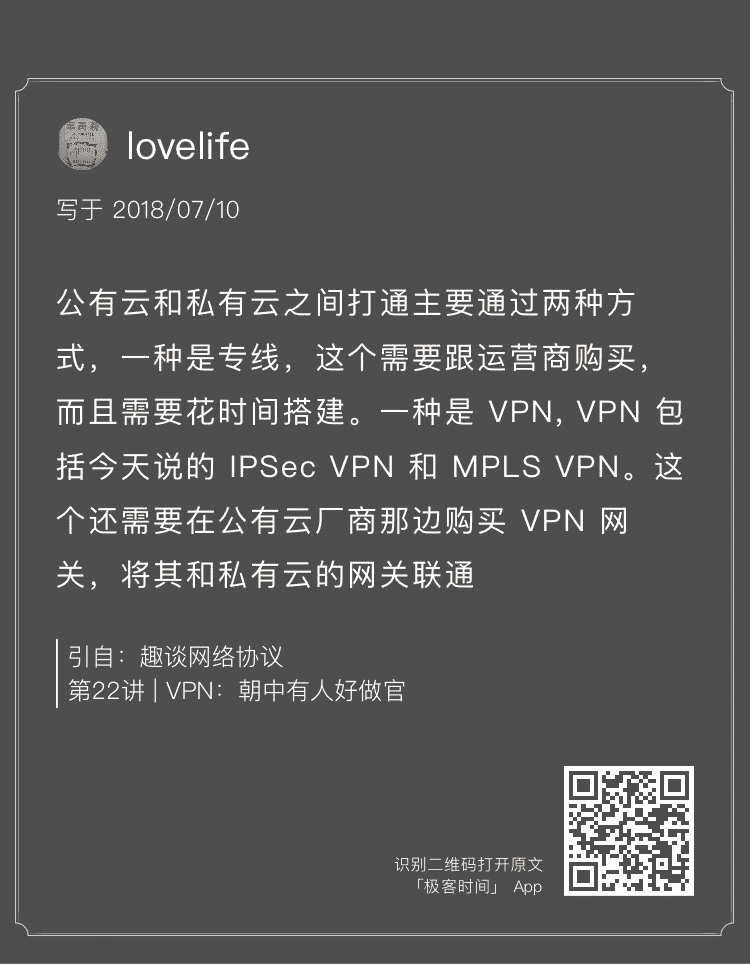

 

### 留言问题

 

DH 算法会因为传输随机数被破解吗？
 

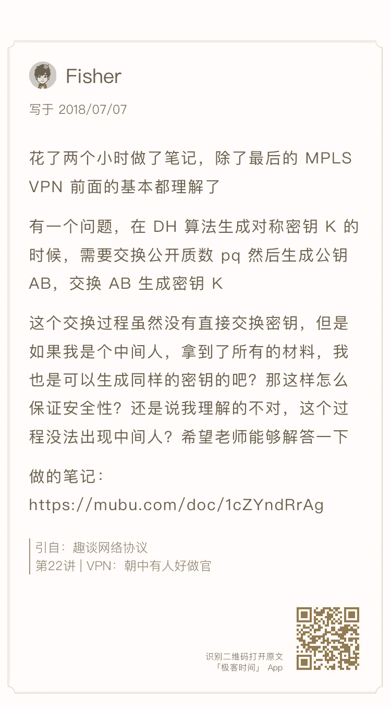

 

这位同学的[笔记](https://mubu.com/doc/1cZYndRrAg)特别认真，让人感动。DH 算法的交换材料要分公钥部分和私钥部分，公钥部分和其他非对称加密一样，都是可以传输的，所以对于安全性是没有影响的，而且传输材料远比传输原始的公钥更加安全。私钥部分是谁都不能给的，因此也是不会截获到的。
 

## [《第 23 讲 | 移动网络：去巴塞罗那，手机也上不了脸书》](https://time.geekbang.org/column/article/10534)

 

### 课后思考题

 

咱们上网都有套餐，有交钱多的，有交钱少的，你知道移动网络是如何控制不同优先级的用户的上网流量的吗？
 

这个其实是 PCRF 协议进行控制的，它可以下发命令给 PGW 来控制上网的行为和特性。
 

## [《第 24 讲 | 云中网络：自己拿地成本高，购买公寓更灵活》](https://time.geekbang.org/column/article/10742)

 

### 课后思考题

 

为了直观，这一节的内容我们以桌面虚拟化系统举例。在数据中心里面，有一款著名的开源软件 OpenStack，这一节讲的网络连通方式对应 OpenStack 中的哪些模型呢？
 

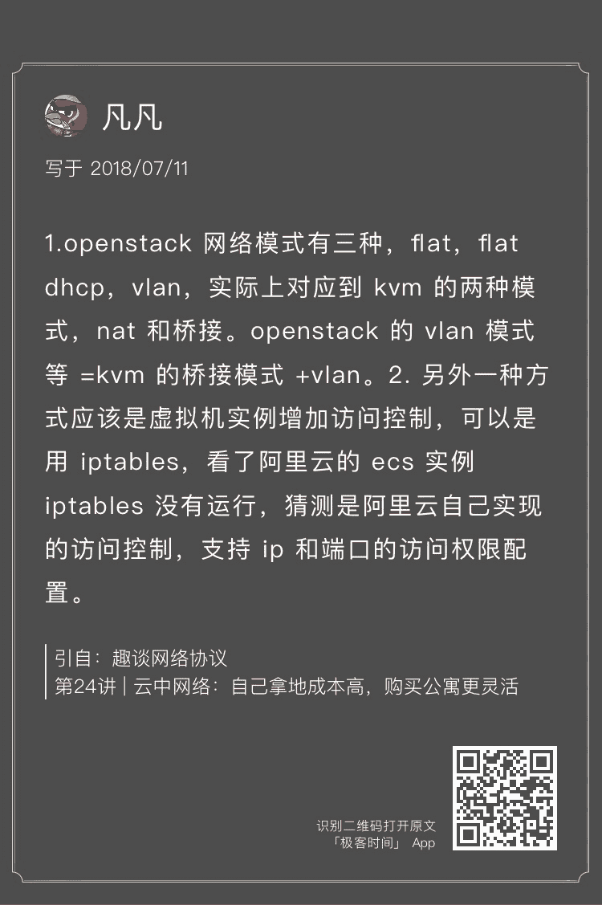

 

OpenStack 的早期网络模式有 Flat、Flat DHCP、VLAN，后来才有了 VPC，用 VXLAN 和 GRE 进行隔离。
 

## [《第 25 讲 | 软件定义网络：共享基础设施的小区物业管理办法》](https://time.geekbang.org/column/article/10755)

 

### 课后思考题

 

在这一节中，提到了通过 VIP 可以通过流表在不同的机器之间实现负载均衡，你知道怎样才能做到吗？
 

可以通过 ovs-ofctl 下发流表规则，创建 group，并把端口加入 group 中，所有发现某个地址的包在两个端口之间进行负载均衡。
 

```
sudo ovs-ofctl -O openflow11 add-group br-lb "group_id=100 type=select selection_method=dp_hash bucket=output:1 bucket=output:2"sudo ovs-ofctl -O openflow11 add-flow br-lb "table=0,ip,nw_dst=192.168.2.0/24,actions=group:100"
```

 

### 留言问题

 

SDN 控制器是什么东西？
 


 

SDN 控制器是一个独立的集群，主要是在管控面，因为要实现一定的高可用性。
 

主流的开源控制器有 OpenContrail、OpenDaylight 等。当然每个网络硬件厂商都有自己的控制器，而且可以实现自己的私有协议，进行更加细粒度的控制，所以江湖一直没有办法统一。
 

流表是在每一台宿主机上保存的，大小限制取决于内存，而集中存放的缺点就是下发会很慢。
 

## [《第 26 讲 | 云中的网络安全：虽然不是土豪，也需要基本安全和保障》](https://time.geekbang.org/column/article/10978)

 

### 课后思考题

 

这一节中重点讲了 iptables 的 filter 和 nat 功能，iptables 还可以通过 QUEUE 实现负载均衡，你知道怎么做吗？
 

我们可以在 iptables 里面添加下面的规则：
 

```
-A PREROUTING -p tcp -m set --match-set minuteman dst,dst -m tcp --tcp-flags FIN,SYN,RST,ACK SYN -j NFQUEUE --queue-balance 50:58-A OUTPUT -p tcp -m set --match-set minuteman dst,dst -m tcp --tcp-flags FIN,SYN,RST,ACK SYN -j NFQUEUE --queue-balance 50:58
```

 

NFQUEUE 的规则表示将把包的处理权交给用户态的一个进程。–queue-balance 表示会将包发给几个 queue。
 

libnetfilter_queue 是一个用户态库，用户态进程会使用 libnetfilter_queue 连接到这些 queue 中，将包读出来，根据包的内容做决策后，再放回内核进行发送。
 

## [《第 27 讲 | 云中的网络 QoS：邻居疯狂下电影，我该怎么办？》](https://time.geekbang.org/column/article/10994)

 

### 课后思考题

 

这一节中提到，入口流量其实没有办法控制，出口流量是可以很好控制的，你能想出一个控制云中的虚拟机的入口流量的方式吗？
 

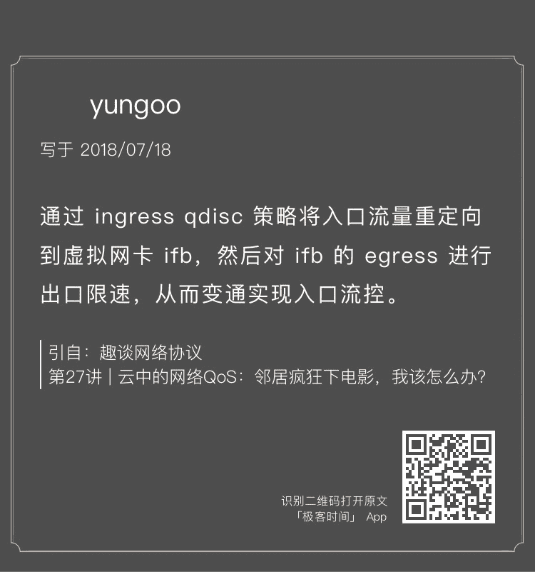

 

 

在云平台中，我们可以限制一个租户的默认带宽，我们仍然可以配置点对点的流量控制。
 

在发送方的 OVS 上，我们可以统计发送方虚拟机的网络统计数据，上报给管理面。在接收方的 OVS 上，我们同样可以收集接收方虚拟机的网络统计数据，上报给管理面。
 

当流量过大的时候，我们虽然不能控制接收方的入口流量，但是我们可以在管理面下发一个策略，控制发送方的出口流量。
 

### 留言问题

 

对于 HTB 借流量的情况，借出去的流量能够抢回来吗？
 


 

首先，借出去的流量，当自己使用的时候，是能够抢回来的。
 

有一篇著名的文章[《HTB Linux queuing discipline manual》](http://luxik.cdi.cz/~devik/qos/htb/manual/userg.htm)里面很详细，你可以看看。
 

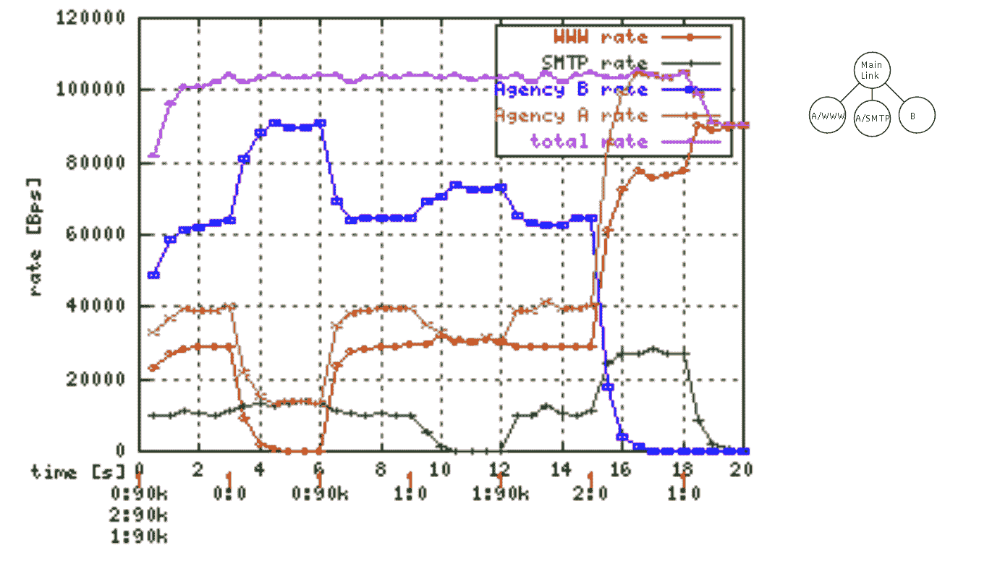

 

很多人看不懂，这是一棵 HTB 树，有三个分支。A 用户使用 www 访问网页，SMTP 协议发送邮件，B 用户不限协议。
 

在时间 0 的时候，0、1、2 都以 90k 的速度发送数据，也即 A 用户在访问网页，同时发送邮件；B 也在上网，干啥都行。
 

在时间 3 的时候，将 0 的发送停止，A 不再访问网页了，红色的线归零，A 的总速率下来了，剩余的流量按照比例分给了蓝色的和绿色的线，也即分给了 A 发邮件和 B 上网。
 

在时间 6 的时候，将 0 的发送重启为 90k，也即 A 重新开始访问网页，则蓝色和绿色的流量返还给红色的流量。
 

在时间 9 的时候，将 1 的发送停止，A 不再发送邮件了，绿色的流量为零，A 的总速率也下来了，剩余的流量按照比例分给了蓝色和红色。
 

在时间 12，将 1 的发送恢复，A 又开始发送邮件了，红色和蓝色返还流量。
 

在时间 15，将 2 的发送停止，B 不再上网了，啥也不干了，蓝色流量为零，剩余的流量按照比例分给红色和绿色。
 

在时间 19，将 1 的发送停止，A 不再发送邮件了，绿色的流量为零，所有的流量都归了红色，所有的带宽都用于 A 来访问网页。
 

## [《第 28 讲 | 云中网络的隔离 GRE、VXLAN：虽然住一个小区，也要保护隐私》](https://time.geekbang.org/column/article/11324)

 

### 课后思考题

 

虽然 VXLAN 可以支持组播，但是如果虚拟机数目比较多，在 Overlay 网络里面，广播风暴问题依然会很严重，你能想到什么办法解决这个问题吗？
 


 

 

很多情况下，物理机可以提前知道对端虚拟机的 MAC 地址，因而当发起 ARP 请求的时候，不用广播全网，只要本地返回就可以了，在 Openstack 里面称为 L2Population。
 

## [《第 29 讲 | 容器网络：来去自由的日子，不买公寓去合租》](https://time.geekbang.org/column/article/11465)

 

### 课后思考题

 

容器内的网络和物理机网络可以使用 NAT 的方式相互访问，如果这种方式用于部署应用，有什么问题呢？
 

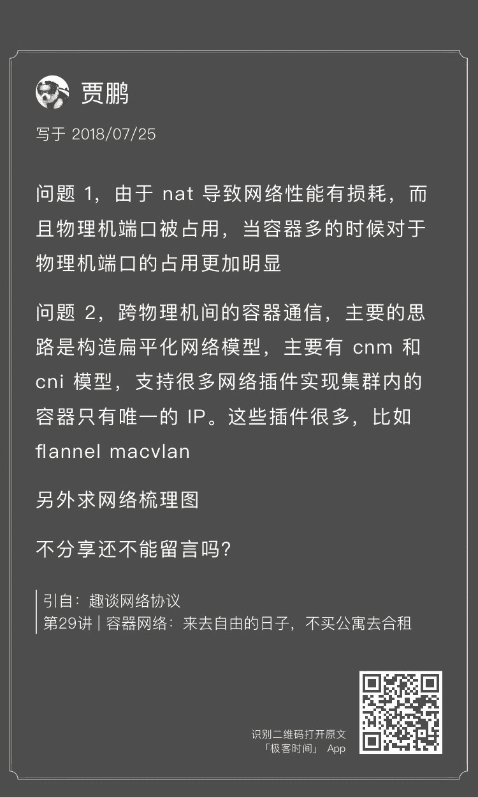

 

 

_CountingStars 对这个问题进行了补充。
 

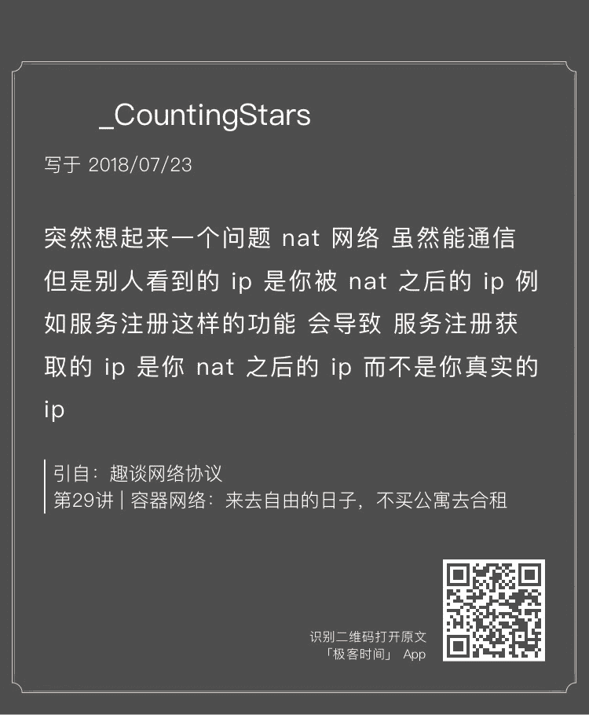

 

其实就是性能损耗，随机端口占用，看不到真实 IP。
 

## [《第 30 讲 | 容器网络之 Flannel：每人一亩三分地》](https://time.geekbang.org/column/article/11643)

 

### 课后思考题

 

通过 Flannel 的网络模型可以实现容器与容器直接跨主机的互相访问，那你知道如果容器内部访问外部的服务应该怎么融合到这个网络模型中吗？
 


 

 

Pod 内到外部网络是通过 docker 引擎在 iptables 的 POSTROUTING 中的 MASQUERADE 规则实现的，将容器的地址伪装为 node IP 出去，回来时再把包 nat 回容器的地址。
 

有的时候，我们想给外部的一个服务使用一个固定的域名，这就需要用到 Kubernetes 里 headless service 的 ExternalName。我们可以将某个外部的地址赋给一个 Service 的名称，当容器内访问这个名字的时候，就会访问一个虚拟的 IP。然后，在容器所在的节点上，由 iptables 规则映射到外部的 IP 地址。
 

## [《第 31 讲 | 容器网络之 Calico：为高效说出善意的谎言》](https://time.geekbang.org/column/article/11940)

 

### 课后思考题

 

将 Calico 部署在公有云上的时候，经常会选择使用 IPIP 模式，你知道这是为什么吗？
 

_CountingStars 的回答是部分正确的。
 

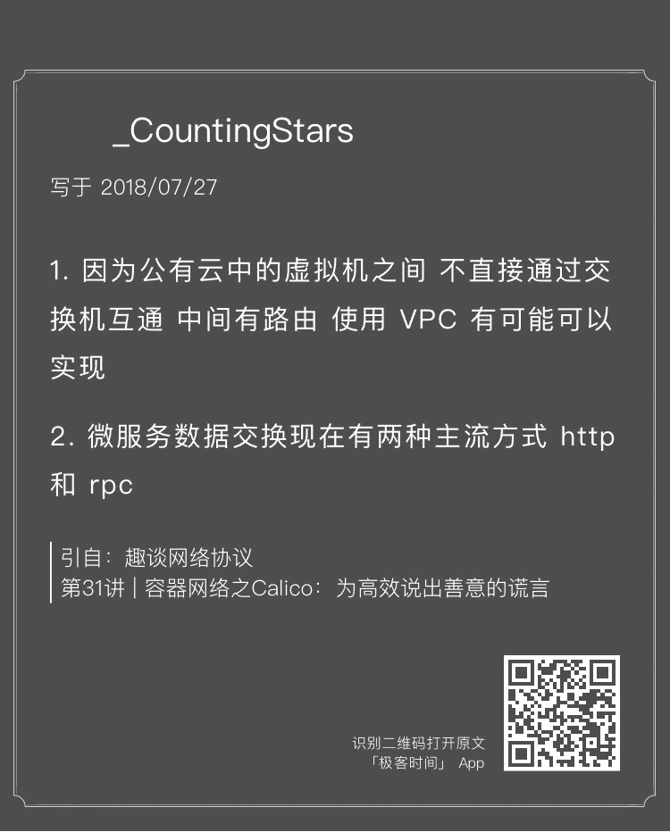

 

 

一个原因是中间有路由，如果 VPC 网络是平的，但是公有云经常会有一个限制，那就是器的 IP 段是用户自己定义的，一旦出虚拟机的时候，云平台发现不是它分配的 IP，很多情况下直接就丢弃了。如果是 IPIP，出虚拟机之后，IP 还是虚拟机的 IP，就没有问题。
 

## [《第 32 讲 | RPC 协议综述：远在天边，近在眼前》](https://time.geekbang.org/column/article/12230)

 

### 课后思考题

 

在这篇文章中，mount 的过程是通过系统调用，最终调用到 RPC 层。一旦 mount 完毕之后，客户端就像写入本地文件一样写入 NFS 了，这个过程是如何触发 RPC 层的呢？
 

_CountingStars 的回答很有深度。
 

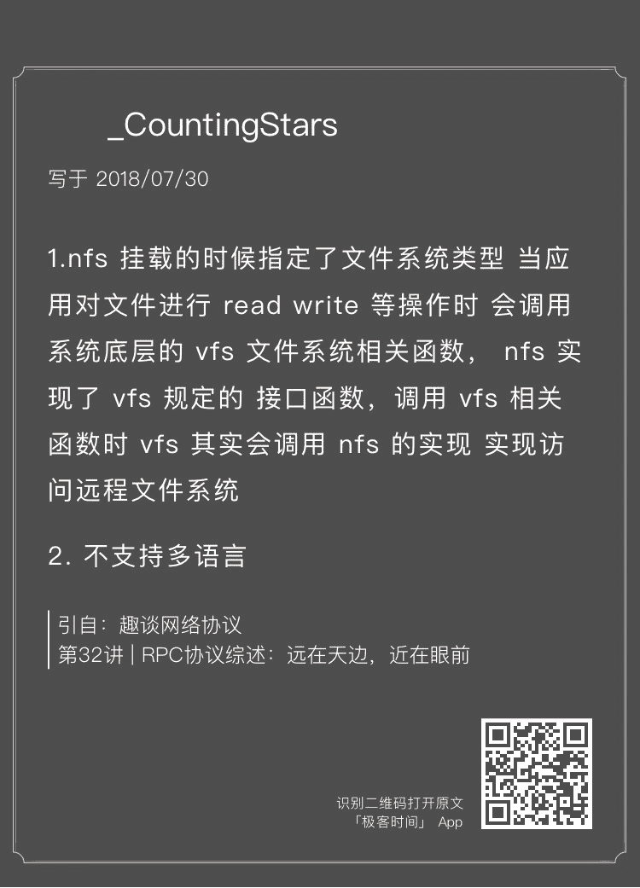

 

是的，是通过 VFS 实现的。
 

在讲[Socket](https://time.geekbang.org/column/article/9141)那一节的时候，我们知道，在 Linux 里面，很多东西都是文件，因而内核中有一个打开的文件列表 File list，每个打开的文件都有一项。
 

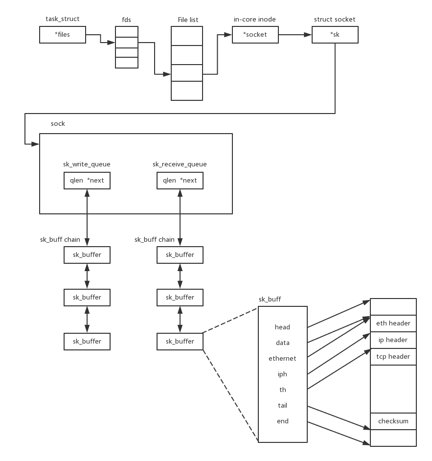

 

对于 Socket 来讲，in-core inode 就是内存中的 inode。对于 nfs 来讲，也有一个 inode，这个 inode 里面有一个成员变量 file_operations，这里面是这个文件系统的操作函数。对于 nfs 来讲，因为有 nfs_file_read、nfs_file_write，所以在一个 mount 的路径中读取某个文件的时候，就会调用这两个函数，触发 RPC，远程调用服务端。
 

## [《第 33 讲 | 基于 XML 的 SOAP 协议：不要说 NBA，请说美国职业篮球联赛》](https://time.geekbang.org/column/article/12388)

 

### 课后思考题

 

对于 HTTP 协议来讲，有多种方法，但是 SOAP 只用了 POST，这样会有什么问题吗？
 

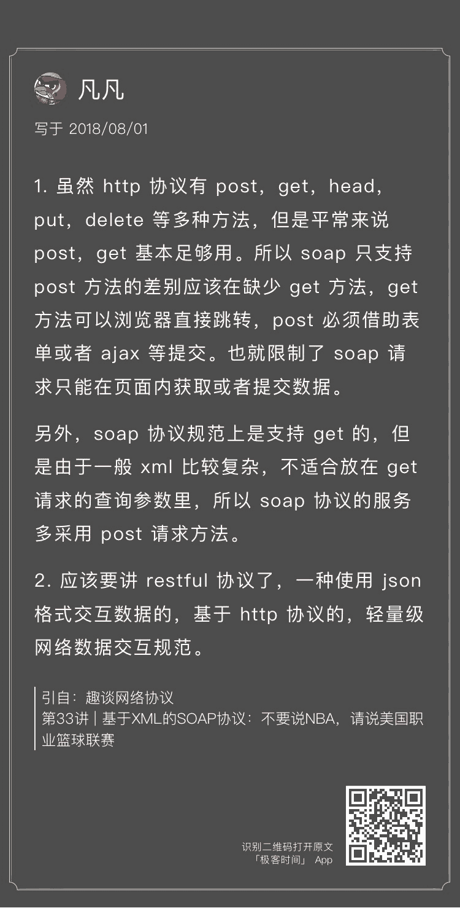

 

## [《第 34 讲 | 基于 JSON 的 RESTful 接口协议：我不关心过程，请给我结果》](https://time.geekbang.org/column/article/12512)

 

### 课后思考题

 

在讨论 RESTful 模型的时候，举了一个库存的例子，但是这种方法有很大问题，那你知道为什么要这样设计吗？
 

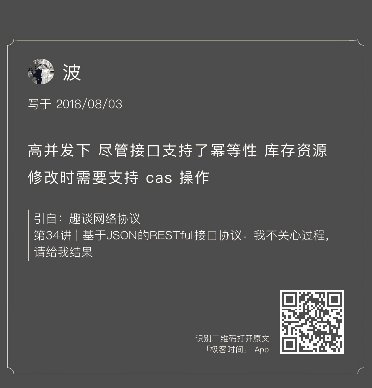

 

 

这个我在双十一包的例子中已经分析过了。
 

## [《第 35 讲 | 二进制类 RPC 协议：还是叫 NBA 吧，总说全称多费劲》](https://time.geekbang.org/column/article/12521)

 

### 课后思考题

 

对于微服务模式下的 RPC 框架的选择，Dubbo 和 SpringCloud 各有优缺点，你能做个详细的对比吗？
 

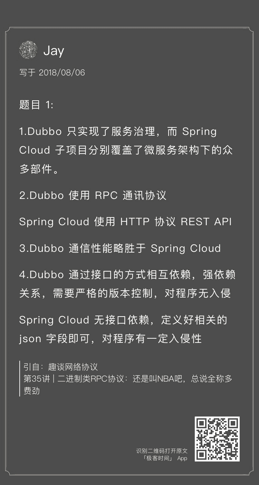

 

 

## [《第 36 讲 | 跨语言类 RPC 协议：交流之前，双方先来个专业术语表》](https://time.geekbang.org/column/article/12819)

 

### 课后思考题

 

在讲述 Service Mesh 的时候，我们说了，希望 Envoy 能够在服务不感知的情况下，将服务之间的调用全部代理了，你知道怎么做到这一点吗？
 


 

 

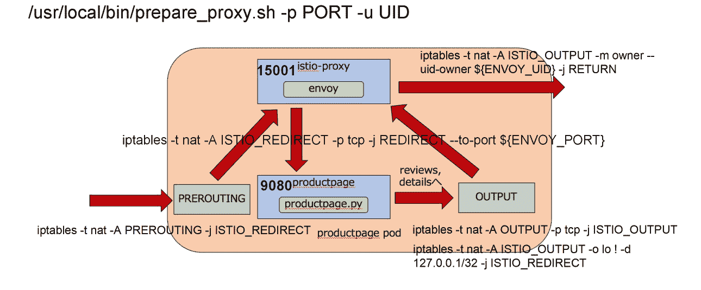

 

 

iptables 规则可以这样来设置：
 

首先，定义的一条规则是 ISTIO_REDIRECT 转发链。这条链不管三七二十一，都将网络包转发给 envoy 的 15000 端口。但是一开始这条链没有被挂到 iptables 默认的几条链中，所以不起作用。
 

接下来，在 PREROUTING 规则中使用这个转发链。从而，进入容器的所有流量都被先转发到 envoy 的 15000 端口。而 envoy 作为一个代理，已经被配置好了，将请求转发给 productpage 程序。
 

当 productpage 往后端进行调用的时候，就碰到了 output 链。这个链会使用转发链，将所有出容器的请求都转发到 envoy 的 15000 端口。
 

这样，无论是入口的流量，还是出口的流量，全部用 envoy 做成了“汉堡包”。envoy 根据服务发现的配置，做最终的对外调用。
 

这个时候，iptables 规则会对从 envoy 出去的流量做一个特殊处理，允许它发出去，不再使用上面的 output 规则。
 

---

 

感谢第 22 讲至第 36 讲中对内容有深度思考和提出问题的同学。我会为你们送上奖励礼券和知识图谱。（稍后运营同学会发送短信通知。）
 


 

咱们的答疑环节暂时告一段落了，如果你在学习过程中有什么问题，欢迎你继续留言给我！
 


