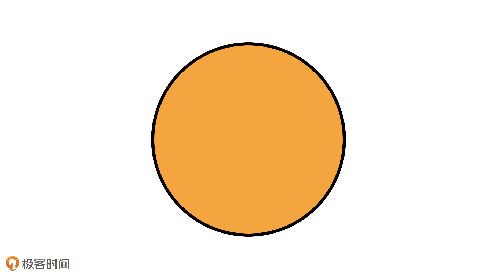
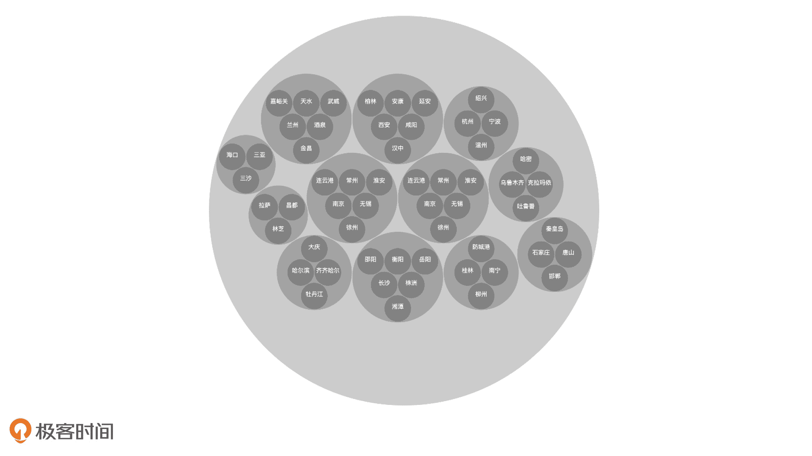
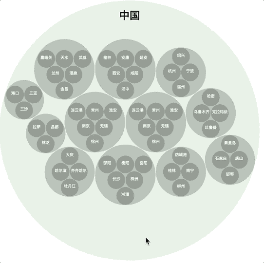

# 03 | 声明式图形系统：如何用SVG图形元素绘制可视化图表？

 

你好，我是月影。今天，我们来讲 SVG。

SVG 的全称是 Scalable Vector Graphics，可缩放矢量图，它是浏览器支持的一种基于 XML 语法的图像格式。

对于前端工程师来说，使用 SVG 的门槛很低。因为描述 SVG 的 XML 语言本身和 HTML 非常接近，都是由标签 + 属性构成的，而且浏览器的 CSS、JavaScript 都能够正常作用于 SVG 元素。这让我们在操作 SVG 时，没什么特别大的难度。甚至，我们可以认为，**SVG 就是 HTML 的增强版**。

对于可视化来说，SVG 是非常重要的图形系统。它既可以用 JavaScript 操作绘制各种几何图形，还可以作为浏览器支持的一种图片格式，来 独立使用 img 标签加载或者通过 Canvas 绘制。即使我们选择使用 HTML 和 CSS、Canvas2D 或者 WebGL 的方式来实现可视化，但我们依然可以且很有可能会使用到 SVG 图像。所以，关于 SVG 我们得好好学。

那这一节课，我们就来聊聊 SVG 是怎么绘制可视化图表的，以及它的局限性是什么。希望通过今天的讲解，你能掌握 SVG 的基本用法和使用场景。

## 利用 SVG 绘制几何图形

在第 1 节课我们讲过，SVG 属于**声明式绘图系统**，它的绘制方式和 Canvas 不同，它不需要用 JavaScript 操作绘图指令，只需要和 HTML 一样，声明一些标签就可以实现绘图了。

那 SVG 究竟是如何绘图的呢？我们先来看一个 SVG 声明的例子。

```
<svg xmlns="http://www.w3.org/2000/svg" version="1.1">  
  <circle cx="100" cy="50" r="40" stroke="black"  
  stroke-width="2" fill="orange" />  
</svg>
```

在上面的代码中，svg 元素是 SVG 的根元素，属性 xmlns 是 xml 的名字空间。那第一行代码就表示，svg 元素的 xmlns 属性值是"http://www.w3.org/2000/svg"，浏览器根据这个属性值就能够识别出这是一段 SVG 的内容了。

svg 元素下的 circle 元素表示这是一个绘制在 SVG 图像中的圆形，属性 cx 和 cy 是坐标，表示圆心的位置在图像的 x=100、y=50 处。属性 r 表示半径，r=40 表示圆的半径为 40。

以上，就是这段代码中的主要属性。如果仔细观察你会发现，我们并没有给 100、50、40 指定单位。这是为什么呢？

因为 SVG 坐标系和 Canvas 坐标系完全一样，都是以图像左上角为原点，x 轴向右，y 轴向下的左手坐标系。而且在默认情况下，SVG 坐标与浏览器像素对应，所以 100、50、40 的单位就是 px，也就是像素，不需要特别设置。

说到这，你还记得吗？在 Canvas 中，为了让绘制出来的图形适配不同的显示设备，我们要设置 Canvas 画布坐标。同理，我们也可以通过给 svg 元素设置 viewBox 属性，来改变 SVG 的坐标系。如果设置了 viewBox 属性，那 SVG 内部的绘制就都是相对于 SVG 坐标系的了。

好，现在我们已经知道上面这段代码的含义了。那接下来，我们把它写入 HTML 文档中，就可以在浏览器中绘制出一个带黑框的橙色圆形了。



黑色外框的圆形

现在，我们已经知道了 SVG 的基本用法了。总的来说，它和 HTML 的用法基本一样，你可以参考 HTML 的用法。那接下来，我还是以上一节课实现的层次关系图为例，来看看使用 SVG 该怎么实现。

## 利用 SVG 绘制层次关系图

我们先来回忆一下，上一节课我们要实现的层次关系图，是在一组给出的层次结构数据中，体现出同属于一个省的城市。数据源和前一节课相同，所以数据的获取部分并没有什么差别。这里我就不列出来了，我们直接来讲绘制的过程。

首先，我们要将获取 Canvas 对象改成获取 SVG 对象，方法是一样的，还是通过选择器来实现。

```
const svgroot = document.querySelector('svg');
```

然后，我们同样实现 draw 方法从 root 开始遍历数据对象。 不过，在 draw 方法里，我们不是像上一讲那样，通过 Canvas 的 2D 上下文调用绘图指令来绘图，而是通过创建 SVG 元素，将元素添加到 DOM 文档里，让图形显示出来。具体代码如下：

```
function draw(parent, node, {fillStyle = 'rgba(0, 0, 0, 0.2)', textColor = 'white'} = {}) {  
    const {x, y, r} = node;  
    const circle = document.createElementNS('http://www.w3.org/2000/svg', 'circle');  
    circle.setAttribute('cx', x);  
    circle.setAttribute('cy', y);  
    circle.setAttribute('r', r);  
    circle.setAttribute('fill', fillStyle);  
    parent.appendChild(circle);  
    ...  
}  
  
draw(svgroot, root);  
  

```

从上面的代码中你可以看到，我们是使用 **document.createElementNS 方法**来创建 SVG 元素的。这里你要注意，与使用 document.createElement 方法创建普通的 HTML 元素不同，SVG 元素要使用 document.createElementNS 方法来创建。

其中，第一个参数是名字空间，对应 SVG 名字空间 http://www.w3.org/2000/svg。第二个参数是要创建的元素标签名，因为要绘制圆型，所以我们还是创建 circle 元素。然后我们将 x、y、r 分别赋给 circle 元素的 cx、cy、r 属性，将 fillStyle 赋给 circle 元素的 fill 属性。最后，我们将 circle 元素添加到它的 parent 元素上去。

接着，我们遍历下一级数据。这次，我们创建一个 SVG 的 g 元素，递归地调用 draw 方法。具体代码如下：

```
if(children) {  
    const group = document.createElementNS('http://www.w3.org/2000/svg', 'g');  
    for(let i = 0; i < children.length; i++) {  
      draw(group, children[i], {fillStyle, textColor});  
    }  
    parent.appendChild(group);  
  }
```

SVG 的 g 元素表示一个分组，我们可以用它来对 SVG 元素建立起层级结构。而且，如果我们给 g 元素设置属性，那么它的子元素会继承这些属性。

最后，如果下一级没有数据了，那我们还是需要给它添加文字。在 SVG 中添加文字，只需要创建 text 元素，然后给这个元素设置属性就可以了。操作非常简单，你看我给出的代码就可以理解了。

```
else {  
    const text = document.createElementNS('http://www.w3.org/2000/svg', 'text');  
    text.setAttribute('fill', textColor);  
    text.setAttribute('font-family', 'Arial');  
    text.setAttribute('font-size', '1.5rem');  
    text.setAttribute('text-anchor', 'middle');  
    text.setAttribute('x', x);  
    text.setAttribute('y', y);  
    const name = node.data.name;  
    text.textContent = name;  
    parent.appendChild(text);  
  }
```

这样，我们就实现了 SVG 版的层次关系图。你看，它是不是看起来和前一节利用 Canvas 绘制的层次关系图没什么差别？纸上得来终觉浅，你可以自己动手实现一下，这样理解得会更深刻。



层次关系图

## SVG 和 Canvas 的不同点

那么问题就来了，既然 SVG 和 Canvas 最终的实现效果没什么差别，那在实际使用的时候，我们该如何选择呢？这就需要我们了解 SVG 和 Canvas 在使用上的不同点。知道了这些不同点，我们就能在合适的场景下选择合适的图形系统了。

SVG 和 Canvas 在使用上的不同主要可以分为两点，分别是**写法上的不同**和**用户交互实现上**的不同。下面，我们一一来看。

### 1. 写法上的不同

第 1 讲我们说过，SVG 是以创建图形元素绘图的“声明式”绘图系统，Canvas 是执行绘图指令绘图的“指令式”绘图系统。那它们在写法上具体有哪些不同呢，我们以层次关系图的绘制过程为例来对比一下。

在绘制层次关系图的过程中，SVG 首先通过创建标签来表示图形元素，circle 表示圆，g 表示分组，text 表示文字。接着，SVG 通过元素的 setAttribute 给图形元素赋属性值，这个和操作 HTML 元素是一样的。

而 Canvas 先是通过上下文执行绘图指令来绘制图形，画圆是调用 context.arc 指令，然后再调用 context.fill 绘制，画文字是调用 context.fillText 指令。另外，Canvas 还通过上下文设置状态属性，context.fillStyle 设置填充颜色，conext.font 设置元素的字体。我们设置的这些状态，在绘图指令执行时才会生效。

从写法上来看，因为 SVG 的声明式类似于 HTML 书写方式，本身对前端工程师会更加友好。但是，SVG 图形需要由浏览器负责渲染和管理，将元素节点维护在 DOM 树中。这样做的缺点是，在一些动态的场景中，也就是需要频繁地增加、删除图形元素的场景中，SVG 与一般的 HTML 元素一样会带来 DOM 操作的开销，所以 SVG 的渲染性能相对比较低。

那除了写法不同以外，SVG 和 Canvas 还有其他区别吗？当然是有的，不过我要先卖一个关子，我们讲完一个例子再来说。

### 2. 用户交互实现上的不同

我们尝试给这个 SVG 版本的层次关系图添加一个功能，也就是当鼠标移动到某个区域时，这个区域会高亮，并且显示出对应的省 - 市信息。

因为 SVG 的一个图形对应一个元素，所以我们可以像处理 DOM 元素一样，很容易地给 SVG 图形元素添加对应的鼠标事件。具体怎么做呢？我们一起来看。

首先，我们要给 SVG 的根元素添加 mousemove 事件，添加代码的操作很简单，你可以直接看代码。

```
 let activeTarget = null;  
  svgroot.addEventListener('mousemove', (evt) => {  
    let target = evt.target;  
    if(target.nodeName === 'text') target = target.parentNode;  
    if(activeTarget !== target) {  
      if(activeTarget) activeTarget.setAttribute('fill', 'rgba(0, 0, 0, 0.2)');  
    }  
    target.setAttribute('fill', 'rgba(0, 128, 0, 0.1)');  
    activeTarget = target;  
  });  

```

就像是我们熟悉的 HTML 用法一样，我们通过事件冒泡可以处理每个圆上的鼠标事件。然后，我们把当前鼠标所在的圆的颜色填充成’rgba(0, 128, 0, 0.1)’，这个颜色是带透明的浅绿色。最终的效果就是当我们的鼠标移动到圆圈范围内的时候，当前鼠标所在的圆圈变为浅绿色。你也可以尝试设置其他的值，看看不同的实现效果。

接着，我们要实现显示对应的省 - 市信息。在这里，我们需要修改一下 draw 方法。具体的修改过程，可以分为两步。

第一步，是把省、市信息通过扩展属性 data-name 设置到 svg 的 circle 元素上，这样我们就可以在移动鼠标的时候，通过读取鼠标所在元素的属性，拿到我们想要展示的省、市信息了。具体代码如下：

```
  function draw(parent, node, {fillStyle = 'rgba(0, 0, 0, 0.2)', textColor = 'white'} = {}) {  
    ...  
    const circle = document.createElementNS('http://www.w3.org/2000/svg', 'circle');  
    ...  
    circle.setAttribute('data-name', node.data.name);  
    ...  
      
    if(children) {  
     const group = document.createElementNS('http://www.w3.org/2000/svg', 'g');  
      ...  
      group.setAttribute('data-name', node.data.name);  
      ...  
    } else {  
      ...  
    }  
  }  

```

第二步，我们要实现一个 getTitle 方法，从当前鼠标事件的 target 往上找 parent 元素，拿到“省 - 市”信息，把它赋给 titleEl 元素。这个 titleEl 元素是我们添加到网页上的一个 h1 元素，用来显示省、市信息。

```
 const titleEl = document.getElementById('title');  
  
  function getTitle(target) {  
    const name = target.getAttribute('data-name');  
    if(target.parentNode && target.parentNode.nodeName === 'g') {  
      const parentName = target.parentNode.getAttribute('data-name');  
      return `${parentName}-${name}`;  
    }  
    return name;  
  }  

```

最后，我们就可以在 mousemove 事件中更新 titleEl 的文本内容了。

```
  
  svgroot.addEventListener('mousemove', (evt) => {  
    ...  
    titleEl.textContent = getTitle(target);  
    ...  
  });
```

这样，我们就实现了给层次关系图增加鼠标控制的功能，最终的效果如下图所示，完整的代码我放在GitHub 仓库了，你可以自己去查看。



其实，我们上面讲的鼠标控制功能就是一个简单的用户交互功能。总结来说，利用 SVG 的一个图形对应一个 svg 元素的机制，我们就可以像操作普通的 HTML 元素那样，给 svg 元素添加事件实现用户交互了。所以，SVG 有一个非常大的优点，那就是**可以让图形的用户交互非常简单**。

和 SVG 相比，利用 Canvas 对图形元素进行用户交互就没有那么容易了。不过，对于圆形的层次关系图来说，在 Canvas 图形上定位鼠标处于哪个圆中并不难，我们只需要计算一下鼠标到每个圆的圆心距离，如果这个距离小于圆的半径，我们就可以确定鼠标在某个圆内部了。这实际上就是上一节课我们留下的思考题，相信现在你应该可以做出来了。

但是试想一下，如果我们要绘制的图形不是圆、矩形这样的规则图形，而是一个复杂得多的多边形，我们又该怎样确定鼠标在哪个图形元素的内部呢？这对于 Canvas 来说，就是一个比较复杂的问题了。不过这也不是不能解决的，在后续的课程中，我们就会讨论如何用数学计算的办法来解决这个问题。

## 绘制大量几何图形时 SVG 的性能问题

虽然使用 SVG 绘图能够很方便地实现用户交互，但是有得必有失，SVG 这个设计给用户交互带来便利性的同时，也带来了局限性。为什么这么说呢？因为它和 DOM 元素一样，以节点的形式呈现在 HTML 文本内容中，依靠浏览器的 DOM 树渲染。如果我们要绘制的图形非常复杂，这些元素节点的数量就会非常多。而节点数量多，就会大大增加 DOM 树渲染和重绘所需要的时间。

就比如说，在绘制如上的层次关系图时，我们只需要绘制数十个节点。但是如果是更复杂的应用，比如我们要绘制数百上千甚至上万个节点，这个时候，DOM 树渲染就会成为性能瓶颈。事实上，在一般情况下，当 SVG 节点超过一千个的时候，你就能很明显感觉到性能问题了。

幸运的是，对于 SVG 的性能问题，我们也是有解决方案的。比如说，我们可以使用虚拟 DOM 方案来尽可能地减少重绘，这样就可以优化 SVG 的渲染。但是这些方案只能解决一部分问题，当节点数太多时，这些方案也无能为力。这个时候，我们还是得依靠 Canvas 和 WebGL 来绘图，才能彻底解决问题。

那在上万个节点的可视化应用场景中，SVG 就真的一无是处了吗？当然不是。SVG 除了嵌入 HTML 文档的用法，还可以直接作为一种图像格式使用。所以，即使是在用 Canvas 和 WebGL 渲染的应用场景中，我们也依然可能会用到 SVG，将它作为一些局部的图形使用，这也会给我们的应用实现带来方便。在后续的课程中，我们会遇到这样的案例。

## 要点总结

这一节课我们学习了 SVG 的基本用法、优点和局限性。

我们知道，SVG 作为一种浏览器支持的图像格式，既可以作为 HTML 内嵌元素使用，也可以作为图像通过 img 元素加载，或者绘制到 Canvas 内。

而用 SVG 绘制可视化图形与用 Canvas 绘制有明显区别，SVG 通过创建标签来表示图形元素，然后将图形元素添加到 DOM 树中，交给 DOM 完成渲染。

使用 DOM 树渲染可以让图形元素的用户交互实现起来非常简单，因为我们可以直接对图形元素注册事件。但是这也带来问题，如果图形复杂，那么 SVG 的图形元素会非常多，这会导致 DOM 树渲染成为性能瓶颈。

## 小试牛刀

1. DOM 操作 SVG 元素和操作普通的 HTML 元素几乎没有差别，所以 CSS 也同样可以作用于 SVG 元素。那你可以尝试使用 CSS，来设置这节课我们实现的层级关系图里，circle 的背景色和文字属性。接着你也可以进一步想一想，这样做有什么好处？
2. 因为 SVG 可以作为一种图像格式使用，所以我们可以将生成的 SVG 作为图像，然后绘制到 Canvas 上。那如果我们先用 SVG 生成层级关系图，再用 Canvas 来完成绘制的话，和我们单独使用它们来绘图有什么不同？为什么？

欢迎在留言区和我讨论，分享你的答案和思考，也欢迎你把这节课分享给你的朋友，我们下节课见！

## 源码

用 SVG 绘制层次关系图和给层次关系图增加鼠标控制的完整代码
