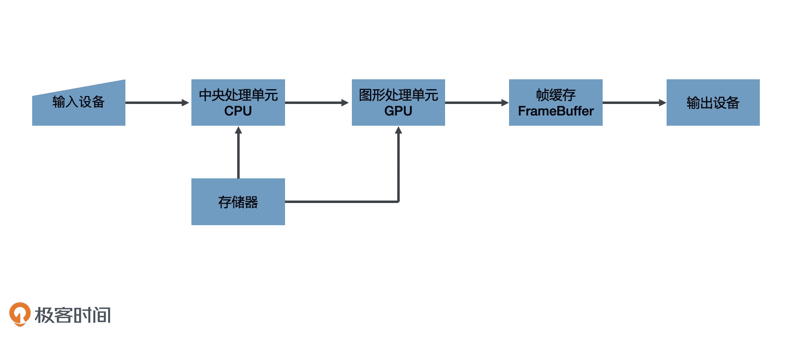
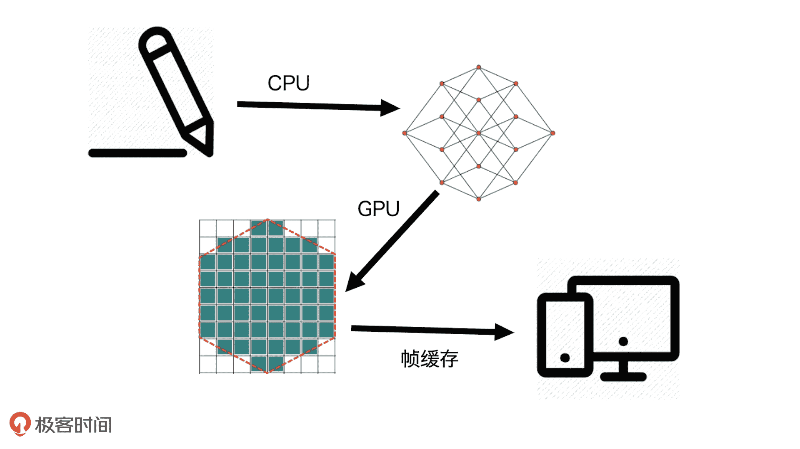
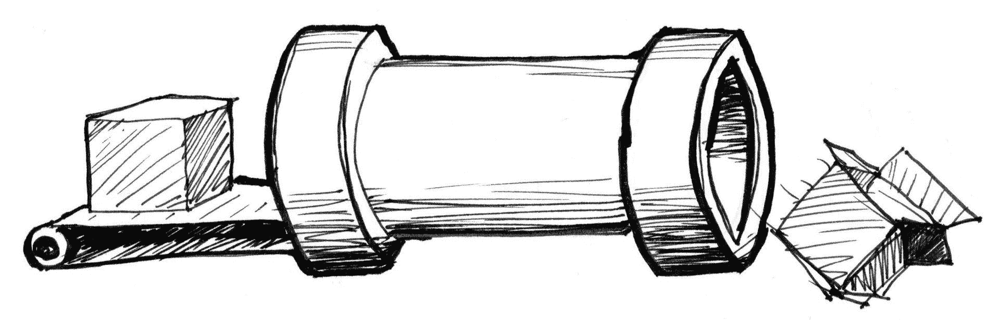
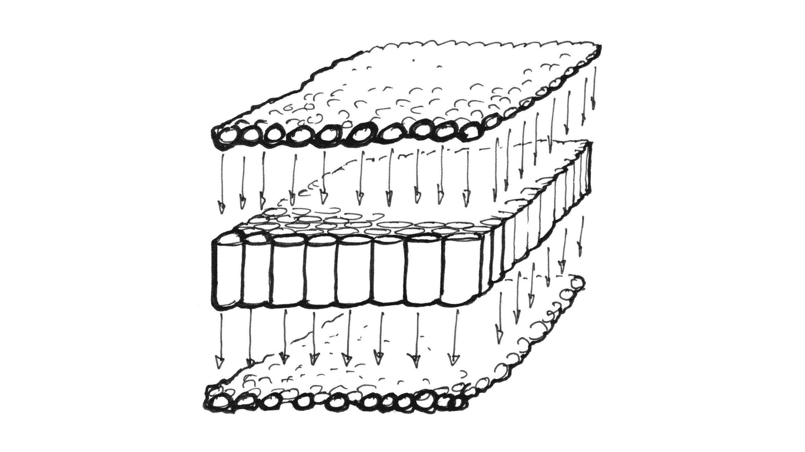
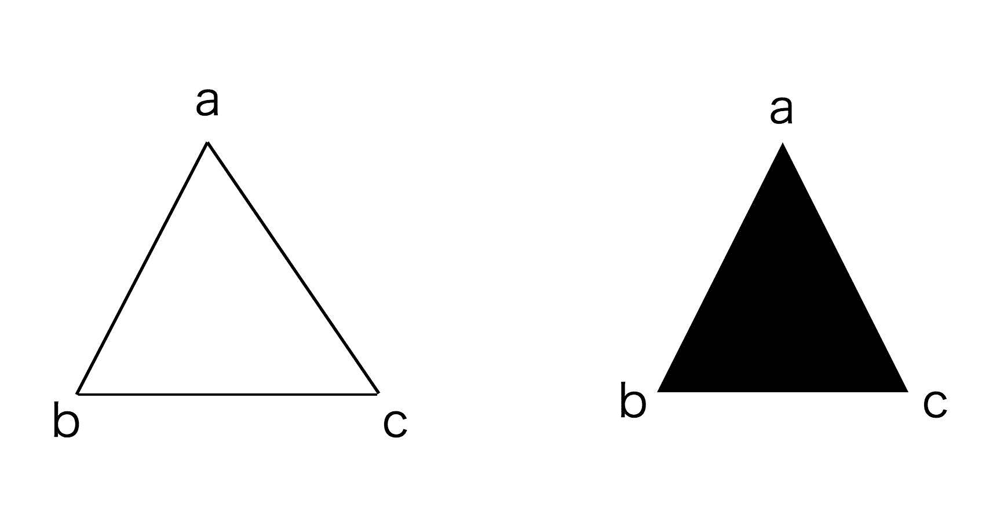

# 04 | GPU与渲染管线：如何用WebGL绘制最简单的几何图形？（上）

 

你好，我是月影。今天，我们要讲 WebGL。今天的内容比较多，也比较重要，所以我们会分上、下两节课来讲。

WebGL 是最后一个和可视化有关的图形系统，也是最难学的一个。为啥说它难学呢？我觉得这主要有两个原因。第一，WebGL 这种技术本身就是用来解决最复杂的视觉呈现的。比如说，大批量绘制复杂图形和 3D 模型，这类比较有难度的问题就适合用 WebGL 来解决。第二，WebGL 相对于其他图形系统来说，是一个更“开放”的系统。

我说的“开放”是针对于底层机制而言的。因为，不管是 HTML/CSS、SVG 还是 Canvas，都主要是使用其 API 来绘制图形的，所以我们不必关心它们具体的底层机制。也就是说，我们只要理解创建 SVG 元素的绘图声明，学会执行 Canvas 对应的绘图指令，能够将图形输出，这就够了。但是，要使用 WebGL 绘图，我们必须要深入细节里。换句话说就是，我们必须要和内存、GPU 打交道，真正控制图形输出的每一个细节。

所以，想要学好 WebGL，我们必须先理解一些基本概念和原理。那今天这一节课，我会从图形系统的绘图原理开始讲起，主要来讲 WebGL 最基础的概念，包括 GPU、渲染管线、着色器。然后，我会带你用 WebGL 绘制一个简单的几何图形。希望通过这个可视化的例子，能够帮助你理解 WebGL 绘制图形的基本原理，打好绘图的基础。

## 图形系统是如何绘图的？

首先，我们来说说计算机图形系统的主要组成部分，以及它们在绘图过程中的作用。知道了这些，我们就能很容易理解计算机图形系统绘图的基本原理了。

一个通用计算机图形系统主要包括 6 个部分，分别是输入设备、中央处理单元、图形处理单元、存储器、帧缓存和输出设备。虽然我下面给出了绘图过程的示意图，不过这些设备在可视化中的作用，我要再跟你多啰嗦几句。

1. **光栅**（Raster）：几乎所有的现代图形系统都是基于光栅来绘制图形的，光栅就是指构成图像的像素阵列。
2. **像素**（Pixel）：一个像素对应图像上的一个点，它通常保存图像上的某个具体位置的颜色等信息。
3. **帧缓存**（Frame Buffer）：在绘图过程中，像素信息被存放于帧缓存中，帧缓存是一块内存地址。
4. **CPU**（Central Processing Unit）：中央处理单元，负责逻辑计算。
5. **GPU**（Graphics Processing Unit）：图形处理单元，负责图形计算。



知道了这些概念，我带你来看一个典型的绘图过程，帮你来明晰一下这些概念的实际用途。

首先，数据经过 CPU 处理，成为具有特定结构的几何信息。然后，这些信息会被送到 GPU 中进行处理。在 GPU 中要经过两个步骤生成光栅信息。这些光栅信息会输出到帧缓存中，最后渲染到屏幕上。



图形数据经过GPU处理最终输出到屏幕上

这个绘图过程是现代计算机中任意一种图形系统处理图形的通用过程。它主要做了两件事，一是对给定的数据结合绘图的场景要素（例如相机、光源、遮挡物体等等）进行计算，最终将图形变为屏幕空间的 2D 坐标。二是为屏幕空间的每个像素点进行着色，把最终完成的图形输出到显示设备上。这整个过程是一步一步进行的，前一步的输出就是后一步的输入，所以我们也把这个过程叫做**渲染管线**（RenderPipelines）。

在这个过程中，CPU 与 GPU 是最核心的两个处理单元，它们参与了计算的过程。CPU 我相信你已经比较熟悉了，但是 GPU 又是什么呢？别着急，听我慢慢和你讲。

## GPU 是什么？

CPU 和 GPU 都属于处理单元，但是结构不同。形象点来说，CPU 就像个大的工业管道，等待处理的任务就像是依次通过这个管道的货物。一条 CPU 流水线串行处理这些任务的速度，取决于 CPU（管道）的处理能力。

实际上，一个计算机系统会有很多条 CPU 流水线，而且任何一个任务都可以随机地通过任意一个流水线，这样计算机就能够并行处理多个任务了。这样的一条流水线就是我们常说的**线程**（Thread）。

[](https://thebookofshaders.com/)
CPU

这样的结构用来处理大型任务是足够的，但是要处理图像应用就不太合适了。这是因为，处理图像应用，实际上就是在处理计算图片上的每一个像素点的颜色和其他信息。每处理一个像素点就相当于完成了一个简单的任务，而一个图片应用又是由成千上万个像素点组成的，所以，我们需要在同一时间处理成千上万个小任务。

要处理这么多的小任务，比起使用若干个强大的 CPU，使用更小、更多的处理单元，是一种更好的处理方式。而 GPU 就是这样的处理单元。

[](https://thebookofshaders.com/)
GPU

GPU 是由大量的小型处理单元构成的，它可能远远没有 CPU 那么强大，但胜在数量众多，可以保证每个单元处理一个简单的任务。即使我们要处理一张 800 * 600 大小的图片，GPU 也可以保证这 48 万个像素点分别对应一个小单元，这样我们就可以**同时**对每个像素点进行计算了。

那 GPU 究竟是怎么完成像素点计算的呢？这就必须要和 WebGL 的绘图过程结合起来说了。

## 如何用 WebGL 绘制三角形？

浏览器提供的 WebGL API 是 OpenGL ES 的 JavaScript 绑定版本，它赋予了开发者操作 GPU 的能力。这一特点也让 WebGL 的绘图方式和其他图形系统的“开箱即用”（直接调用绘图指令或者创建图形元素就可以完成绘图）的绘图方式完全不同，甚至要复杂得多。我们可以总结为以下 5 个步骤：

1. 创建 WebGL 上下文
2. 创建 WebGL 程序（WebGL Program）
3. 将数据存入缓冲区
4. 将缓冲区数据读取到 GPU
5. GPU 执行 WebGL 程序，输出结果

别看这些步骤看起来很简单，但其中会涉及许多你没听过的新概念、方法以及各种参数。不过，这也不用担心，我们今天的重点还是放在理解 WebGL 的基本用法和绘制原理上，对于新的方法具体怎么用，参数如何设置，这些我们都会在后面的课程中详细来讲。

接下来，我们就用一个绘制三角形的例子，来讲一下这些步骤的具体操作过程。

### 步骤一：创建 WebGL 上下文

创建 WebGL 上下文这一步和 Canvas2D 的使用几乎一样，我们只要调用 canvas 元素的 getContext 即可，区别是将参数从’2d’换成’webgl’。

```
const canvas = document.querySelector('canvas');  
const gl = canvas.getContext('webgl');
```

不过，有了 WebGL 上下文对象之后，我们并不能像使用 Canvas2D 的上下文那样，调用几个绘图指令就把图形画出来，还需要做很多工作。别着急，让我们一步一步来。

### 步骤二：创建 WebGL 程序

接下来，我们要创建一个 WebGL 程序。你可能会觉得奇怪，我们不是正在写一个绘制三角形的程序吗？为什么这里又要创建一个 WebGL 程序呢？实际上，这里的 WebGL 程序是一个 WebGLProgram 对象，它是给 GPU 最终运行着色器的程序，而不是我们正在写的三角形的 JavaScript 程序。好了，解决了这个疑问，我们就正式开始创建一个 WebGL 程序吧！

首先，要创建这个 WebGL 程序，我们需要编写两个**着色器**（Shader）。着色器是用 GLSL 这种编程语言编写的代码片段，这里我们先不用过多纠结于 GLSL 语言，在后续的课程中我们会详细讲解。那在这里，我们只需要理解绘制三角形的这两个着色器的作用就可以了。

```
const vertex = `  
  attribute vec2 position;  
  
  void main() {  
    gl_PointSize = 1.0;  
    gl_Position = vec4(position, 1.0, 1.0);  
  }  
`;  
  
  
const fragment = `  
  precision mediump float;  
  
  void main()  
  {  
    gl_FragColor = vec4(1.0, 0.0, 0.0, 1.0);  
  }      
`;
```

那我们为什么要创建两个着色器呢？这就需要我们先来理解**顶点和图元**这两个基本概念了。在绘图的时候，WebGL 是以顶点和图元来描述图形几何信息的。顶点就是几何图形的顶点，比如，三角形有三个顶点，四边形有四个顶点。图元是 WebGL 可直接处理的图形单元，由 WebGL 的绘图模式决定，有点、线、三角形等等。

所以，顶点和图元是绘图过程中必不可少的。因此，WebGL 绘制一个图形的过程，一般需要用到两段着色器，一段叫**顶点着色器**（Vertex Shader）负责处理图形的顶点信息，另一段叫**片元着色器**（Fragment Shader）负责处理图形的像素信息。

更具体点来说，我们可以把**顶点着色器理解为处理顶点的 GPU 程序代码。它可以改变顶点的信息**（如顶点的坐标、法线方向、材质等等），从而改变我们绘制出来的图形的形状或者大小等等。

顶点处理完成之后，WebGL 就会根据顶点和绘图模式指定的图元，计算出需要着色的像素点，然后对它们执行片元着色器程序。简单来说，就是对指定图元中的像素点着色。

WebGL 从顶点着色器和图元提取像素点给片元着色器执行代码的过程，就是我们前面说的生成光栅信息的过程，我们也叫它光栅化过程。所以，**片元着色器的作用，就是处理光栅化后的像素信息。**

这么说可能比较抽象，我 来举个例子。我们可以将图元设为线段，那么片元着色器就会处理顶点之间的线段上的像素点信息，这样画出来的图形就是空心的。而如果我们把图元设为三角形，那么片元着色器就会处理三角形内部的所有像素点，这样画出来的图形就是实心的。



这里你要注意一点，因为图元是 WebGL 可以直接处理的图形单元，所以其他非图元的图形最终必须要转换为图元才可以被 WebGL 处理。举个例子，如果我们要绘制实心的四边形，我们就需要将四边形拆分成两个三角形，再交给 WebGL 分别绘制出来。

好了，那让我们回到片元着色器对像素点着色的过程。你还要注意，这个过程是并行的。也就是说，**无论有多少个像素点，片元着色器都可以同时处理。**这也是片元着色器一大特点。

以上就是片元着色器的作用和使用特点了，关于顶点着色器的作用我们一会儿再说。说了这么多，你可别忘了，创建着色器的目的是为了创建 WebGL 程序，那我们应该如何用顶点着色器和片元着色器代码，来创建 WebGL 程序呢？

这个我们放到下半节课来讲。那上半节课讲完了，你可以先休息一会，再接着来看下半节。
