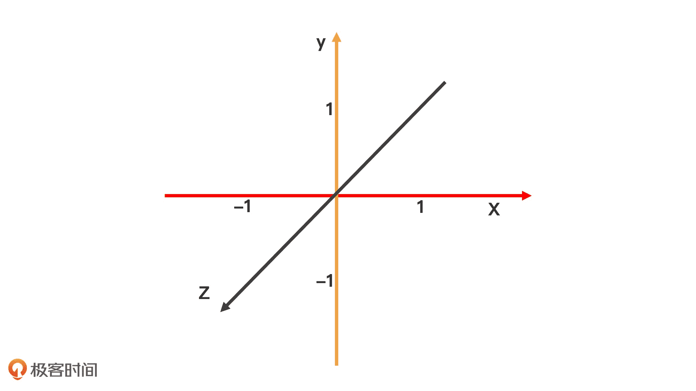
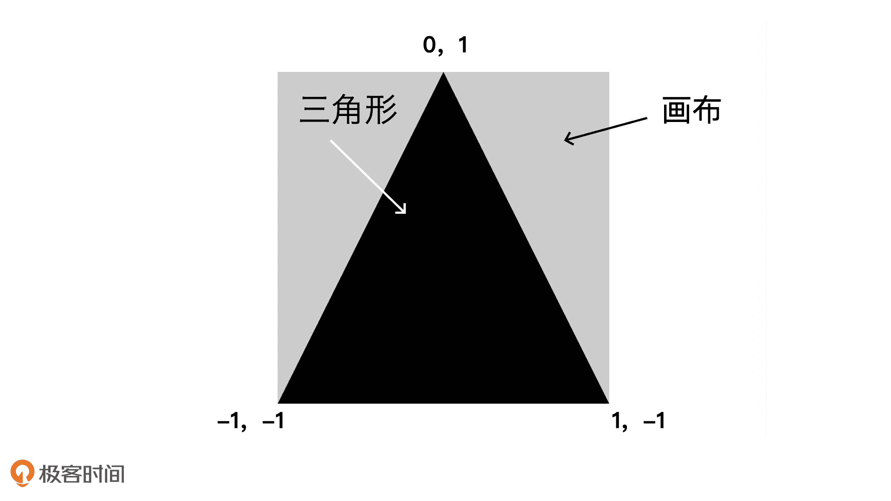
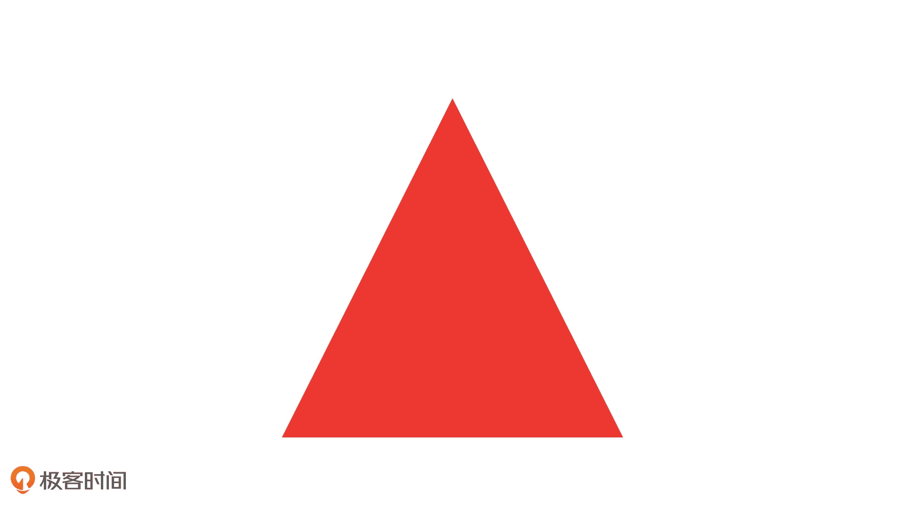
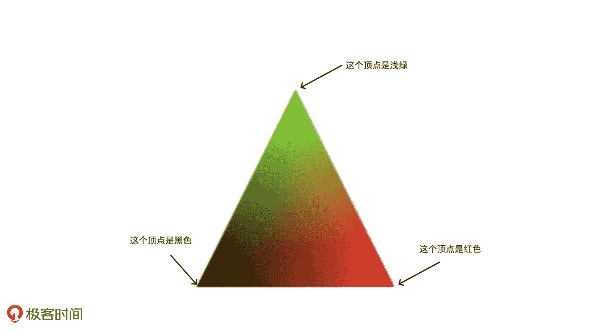
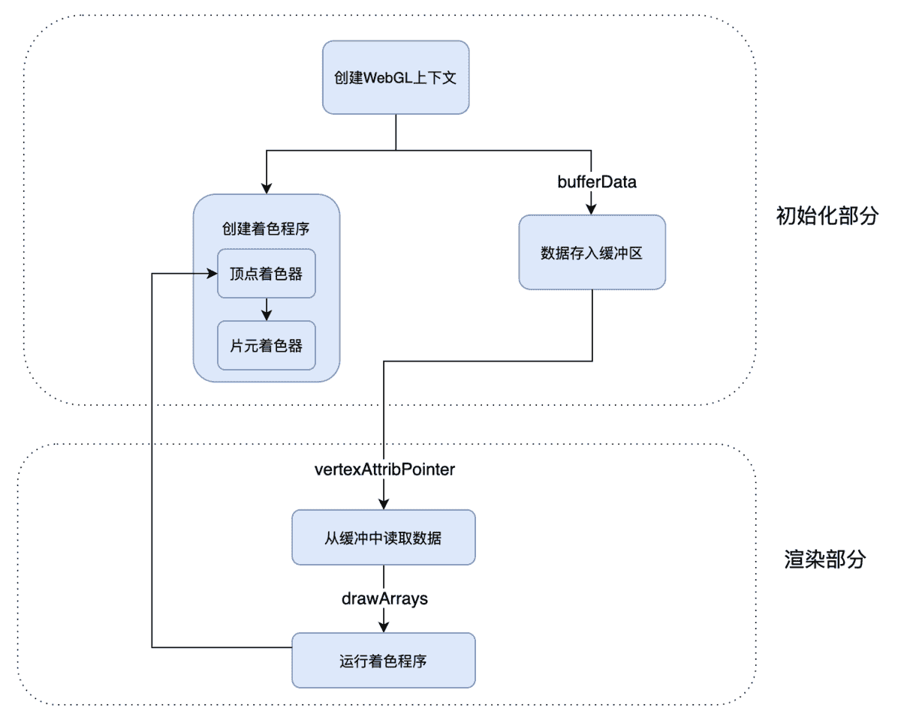

# 04 | GPU与渲染管线：如何用WebGL绘制最简单的几何图形？（下）

 

你好，我是月影。欢迎回来，刚才我们说完了顶点着色器和片元着色器，接着我们要来利用它们实现 WebGL 程序了。

首先，因为在 JavaScript 中，顶点着色器和片元着色器只是一段代码片段，所以我们要将它们分别创建成 shader 对象。代码如下所示：

```
const vertexShader = gl.createShader(gl.VERTEX_SHADER);  
gl.shaderSource(vertexShader, vertex);  
gl.compileShader(vertexShader);  
  
  
const fragmentShader = gl.createShader(gl.FRAGMENT_SHADER);  
gl.shaderSource(fragmentShader, fragment);  
gl.compileShader(fragmentShader);
```

接着，我们创建 WebGLProgram 对象，并将这两个 shader 关联到这个 WebGL 程序上。WebGLProgram 对象的创建过程主要是添加 vertexShader 和 fragmentShader，然后将这个 WebGLProgram 对象链接到 WebGL 上下文对象上。代码如下：

```
const program = gl.createProgram();  
gl.attachShader(program, vertexShader);  
gl.attachShader(program, fragmentShader);  
gl.linkProgram(program);
```

最后，我们要通过 useProgram 选择启用这个 WebGLPrgame 对象。这样，当我们绘制图形时，GPU 就会执行我们通过 WebGLProgram 设定的 两个 shader 程序了。

```
gl.useProgram(program);
```

好了，现在我们已经创建并完成 WebGL 程序的配置。接下来， 我们只要将三角形的数据存入缓冲区，也就能将这些数据送入 GPU 了。那实现这一步之前呢，我们先来认识一下 WebGL 的坐标系。

### 步骤三：将数据存入缓冲区

我们要知道 WebGL 的坐标系是一个三维空间坐标系，坐标原点是（0,0,0）。其中，x 轴朝右，y 轴朝上，z 轴朝外。这是一个右手坐标系。



假设，我们要在这个坐标系上显示一个顶点坐标分别是（-1, -1）、（1, -1）、（0, 1）的三角形，如下图所示。因为这个三角形是二维的，所以我们可以直接忽略 z 轴。下面，我们来一起绘图。



**首先，我们要定义这个三角形的三个顶点**。WebGL 使用的数据需要用类型数组定义，默认格式是 Float32Array。Float32Array 是 JavaScript 的一种类型化数组（TypedArray），JavaScript 通常用类型化数组来处理二进制缓冲区。

因为平时我们在 Web 前端开发中，使用到类型化数组的机会并不多，你可能还不大熟悉，不过没关系，类型化数组的使用并不复杂，定义三角形顶点的过程，你直接看我下面给出的代码就能理解。不过，如果你之前完全没有接触过它，我还是建议你阅读MDN 文档，去详细了解一下类型化数组的使用方法。

```
const points = new Float32Array([  
  -1, -1,  
  0, 1,  
  1, -1,  
]);  

```

**接着，我们要将定义好的数据写入 WebGL 的缓冲区**。这个过程我们可以简单总结为三步，分别是创建一个缓存对象，将它绑定为当前操作对象，再把当前的数据写入缓存对象。这三个步骤主要是利用 createBuffer、bindBuffer、bufferData 方法来实现的，过程很简单你可以看一下我下面给出的实现代码。

```
const bufferId = gl.createBuffer();  
gl.bindBuffer(gl.ARRAY_BUFFER, bufferId);  
gl.bufferData(gl.ARRAY_BUFFER, points, gl.STATIC_DRAW);

### 步骤四：将缓冲区数据读取到 GPU

现在我们已经把数据写入缓存了，但是我们的 shader 现在还不能读取这个数据，还需要把数据绑定给顶点着色器中的 position 变量。
```

还记得我们的顶点着色器是什么样的吗？它是按如下的形式定义的：

```
attribute vec2 position;  
  
void main() {  
  gl_PointSize = 1.0;  
  gl_Position = vec4(position, 1.0, 1.0);  
}
```

在 GLSL 中，attribute 表示声明变量，vec2 是变量的类型，它表示一个二维向量，position 是变量名。接下来我们将 buffer 的数据绑定给顶点着色器的 position 变量。

```
const vPosition = gl.getAttribLocation(program, 'position');获取顶点着色器中的position变量的地址  
gl.vertexAttribPointer(vPosition, 2, gl.FLOAT, false, 0, 0);给变量设置长度和类型  
gl.enableVertexAttribArray(vPosition);激活这个变量
```

经过这样的处理，在顶点着色器中，我们定义的 points 类型数组中对应的值，就能通过变量 position 读到了。

### 步骤五：执行着色器程序完成绘制

现在，我们把数据传入缓冲区以后，GPU 也可以读取绑定的数据到着色器变量了。接下来，我们只需要调用绘图指令，就可以执行着色器程序来完成绘制了。

我们先调用 gl.clear 将当前画布的内容清除，然后调用 gl.drawArrays 传入绘制模式。这里我们选择 gl.TRIANGLES 表示以三角形为图元绘制，再传入绘制的顶点偏移量和顶点数量，WebGL 就会将对应的 buffer 数组传给顶点着色器，并且开始绘制。代码如下：

```
gl.clear(gl.COLOR_BUFFER_BIT);  
gl.drawArrays(gl.TRIANGLES, 0, points.length / 2);
```

这样，我们就在 Canvas 画布上画出了一个红色三角形。



为什么是红色三角形呢？因为我们在片元着色器中定义了像素点的颜色，代码如下：

```
precision mediump float;  
  
void main()  
{  
  gl_FragColor = vec4(1.0, 0.0, 0.0, 1.0);  
}
```

在**片元着色器**里，我们可以通过设置 gl_FragColor 的值来定义和改变图形的颜色。gl_FragColor 是 WebGL 片元着色器的内置变量，表示当前像素点颜色，它是一个用 RGBA 色值表示的四维向量数据。在上面的代码中，因为我们写入 vec4(1.0, 0.0, 0.0, 1.0) 对应的是红色，所以三角形是红色的。如果我们把这个值改成 vec4(0.0, 0.0, 1.0, 1.0)，那三角形就是蓝色。

我为什么会强调颜色这个事儿呢？你会发现，刚才我们只更改了一个值，就把整个图片的所有像素颜色都改变了。所以，我们必须要认识到一点，WebGL 可以并行地对整个三角形的所有像素点同时运行片元着色器。并行处理是 WebGL 程序非常重要的概念，所以我就多强调一下。

我们要记住，不论这个三角形是大还是小，有几十个像素点还是上百万个像素点，GPU 都是**同时处理**每个像素点的。也就是说，图形中有多少个像素点，着色器程序在 GPU 中就会被同时执行多少次。

到这里，WebGL 绘制三角形的过程我们就讲完了。借助这个过程，我们加深了对顶点着色器和片元着色器在使用上的理解。不过，因为后面我们会更多地讲解片元着色器的绘图方法，那今天，我们正好可以借着这个机会，多讲讲顶点着色器的应用，我希望你也能掌握好它。

## 顶点着色器的作用

顶点着色器大体上可以总结为两个作用：一是通过 gl_Position 设置顶点，二是通过定义 varying 变量，向片元着色器传递数据。这么说还是有点抽象，我们还是通过三角形的例子来具体理解一下。

### 1. 通过 gl_Position 设置顶点

假如，我想把三角形的周长缩小为原始大小的一半，有两种处理方式法：一种是修改 points 数组的值，另一种做法是直接对顶点着色器数据进行处理。第一种做法很简单，我就不讲了，如果不懂你可以在留言区提问。我们来详细说说第二种做法。

我们不需要修改 points 数据，只需要在顶点着色器中，将 gl_Position = vec4(position, 1.0, 1.0); 修改为 gl_Position = vec4(position * 0.5, 1.0, 1.0);，代码如下所示。

```
attribute vec2 position;  
  
void main() {  
  gl_PointSize = 1.0;  
  gl_Position = vec4(position * 0.5, 1.0, 1.0);  
}
```

这样，三角形的周长就缩小为原来的一半了。在这个过程中，我们不需要遍历三角形的每一个顶点，只需要是利用 GPU 的并行特性，在顶点着色器中同时计算所有的顶点就可以了。在后续课程中，我们还会遇到更加复杂的例子，但在那之前，你一定要理解并牢记 WebGL 可以**并行计算**这一特点。

### 2. 向片元着色器传递数据

除了计算顶点之外，顶点着色器还可以将数据通过 varying 变量传给片元着色器。然后，这些值会根据片元着色器的像素坐标与顶点像素坐标的相对位置做**线性插值**。这是什么意思呢？其实这很难用文字描述，我们还是来看一段代码：

```
attribute vec2 position;  
varying vec3 color;  
  
void main() {  
  gl_PointSize = 1.0;  
  color = vec3(0.5 + position * 0.5, 0.0);  
  gl_Position = vec4(position * 0.5, 1.0, 1.0);  
}
```

在这段代码中，我们修改了顶点着色器，定义了一个 color 变量，它是一个三维的向量。我们通过数学技巧将顶点的值映射为一个 RGB 颜色值（关于顶点映射 RGB 颜色值的方法，在后续的课程中会有详细介绍），映射公式是 vec3(0.5 + position * 0.5, 0.0)。

这样一来，顶点[-1,-1]被映射为[0,0,0]也就是黑色，顶点[0,1]被映射为[0.5, 1, 0]也就是浅绿色，顶点[1,-1]被映射为[1,0,0]也就是红色。这样一来，三个顶点就会有三个不同的颜色值。

然后我们将 color 通过 varying 变量传给片元着色器。片元着色器中的代码如下：

```
precision mediump float;  
varying vec3 color;  
  
void main()  
{  
  gl_FragColor = vec4(color, 1.0);  
}  
```

我们将 gl_FragColor 的 rgb 值设为变量 color 的值，这样我们就能得到下面这个三角形：



我们可以看到，这个三角形是一个颜色均匀（线性）渐变的三角形，它的三个顶点的色值就是我们通过顶点着色器来设置的。而且你会发现，中间像素点的颜色是均匀过渡的。这就是因为 WebGL 在执行片元着色器程序的时候，顶点着色器传给片元着色器的变量，会根据片元着色器的像素坐标对变量进行线性插值。利用线性插值可以让像素点的颜色均匀渐变这一特点，我们就能绘制出颜色更丰富的图形了。

好了，到这里，我们就在 Canvas 画布上用 WebGL 绘制出了一个三角形。绘制三角形的过程，就像我们初学编程时去写出一个 Hello World 程序一样，按道理来说，应该非常简单才对。但事实上，用 WebGL 完成这个程序，我们一共用了好几十行代码。而如果我们用 Canvas2D 或者 SVG 实现类似的功能，只需要几行代码就可以了。

那我们为什么非要这么做呢？而且我们费了很大的劲，就只绘制出了一个最简单的三角形，这似乎离我们用 WebGL 实现复杂的可视化效果还非常遥远。我想告诉你的是，别失落，想要利用 WebGL 绘制更有趣、更复杂的图形，我们就必须要学会绘制三角形这个图元。还记得我们前面说过的，要在 WebGL 中绘制非图元的其他图形时，我们必须要把它们划分成三角形才行。学习了后面的课程之后，你就会对这一点有更深刻的理解了。

而且，用 WebGL 可以实现的视觉效果，远远超越其他三个图形系统。如果用驾驶技术来比喻的话，使用 SVG 和 Canvas2D 时，就像我们在开一辆自动挡的汽车，那么使用 WebGL 的时候，就像是在开战斗机！所以，千万别着急，随着对 WebGL 的不断深入理解，我们就能用它来实现更多有趣的实例了。

## 要点总结

在这一节课，我们讲了 WebGL 的绘图过程以及顶点着色器和片元着色器的作用。

WebGL 图形系统与用其他图形系统不同，它的 API 非常底层，使用起来比较复杂。想要学好 WebGL，我们必须要从基础概念和原理学起。

一般来说，在 WebGL 中要完成图形的绘制，需要创建 WebGL 程序，然后将图形的几何数据存入数据缓冲区，在绘制过程中让 WebGL 从缓冲区读取数据，并且执行着色器程序。

WebGL 的着色器程序有两个。一个是顶点着色器，负责处理图形的顶点数据。另一个是片元着色器，负责处理光栅化后的像素信息。此外，我们还要牢记，WebGL 程序有一个非常重要的特点就是能够并行处理，无论图形中有多少个像素点，都可以通过着色器程序在 GPU 中被同时执行。

WebGL 完整的绘图过程实在比较复杂，为了帮助你理解，我总结一个流程图，供你参考。

[](https://juejin.im/post/5e7a042e6fb9a07cb96b1627)
WebGL绘图流程

那到这里，可视化的四个图形系统我们就介绍完了。但是，好戏才刚刚开始哦，在后续的文章中我们会围绕着这四个图形系统，尤其是 Canvas2D 和 WebGL 逐渐深入，来实现更多有趣的图形。

## 小试牛刀

1. WebGL 通过顶点和图元来绘制图形，我们在上面的例子中，调用 gl.TRIANGLES 绘制出了实心的三角形。如果要绘制空心三角形，我们又应该怎么做呢？有哪些图元类型可以帮助我们完成这个绘制？
2. 三角形是最简单的几何图形，如果我们要绘制其他的几何图形，我们可以通过用多个三角形拼接来实现。试着用 WebGL 绘制正四边形、正五边形和正六角星吧！

欢迎在留言区和我讨论，分享你的答案和思考，也欢迎你把这一节课分享给你的朋友，我们下节课再见！

## 源码

[1] 示例代码

## 推荐阅读

[1] 类型化数组 MDN 文档

[2] WebGL MDN 文档
